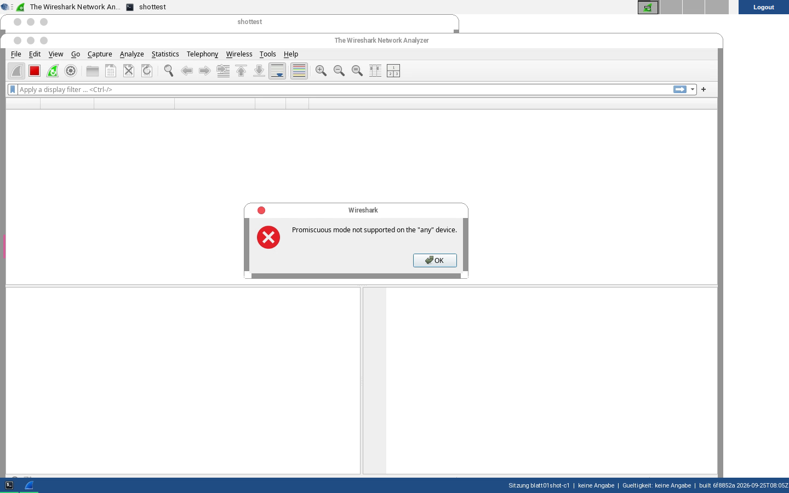
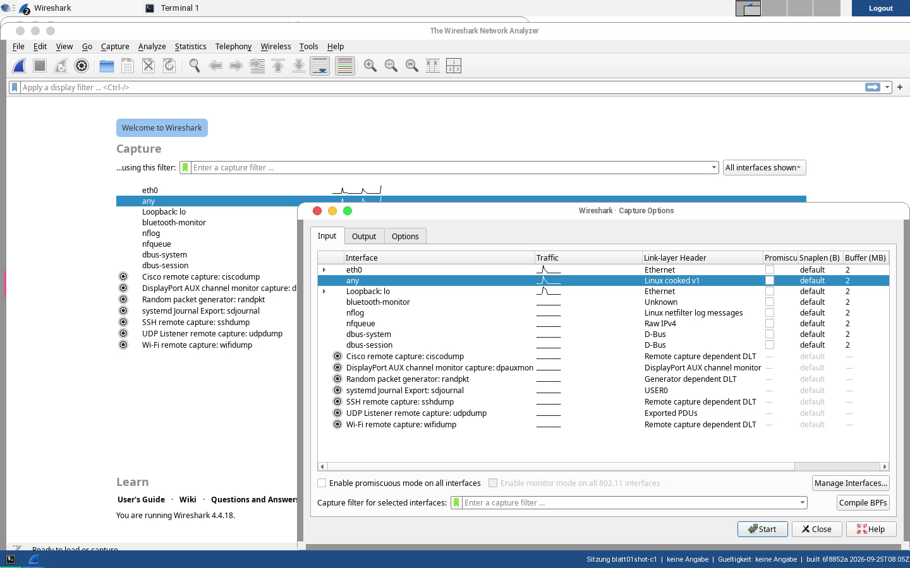
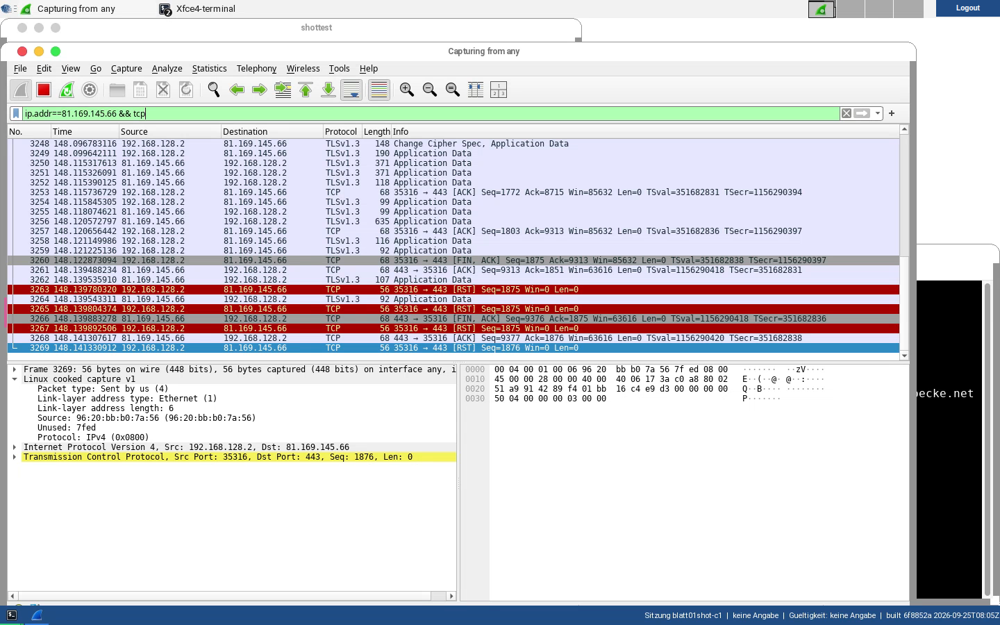
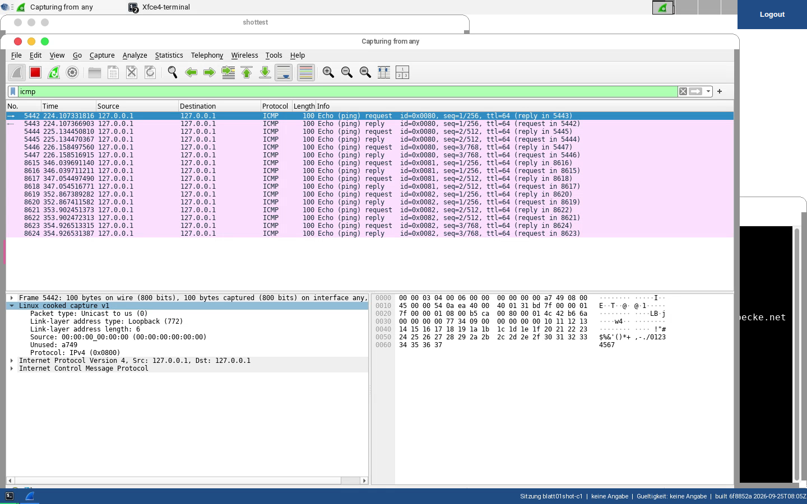
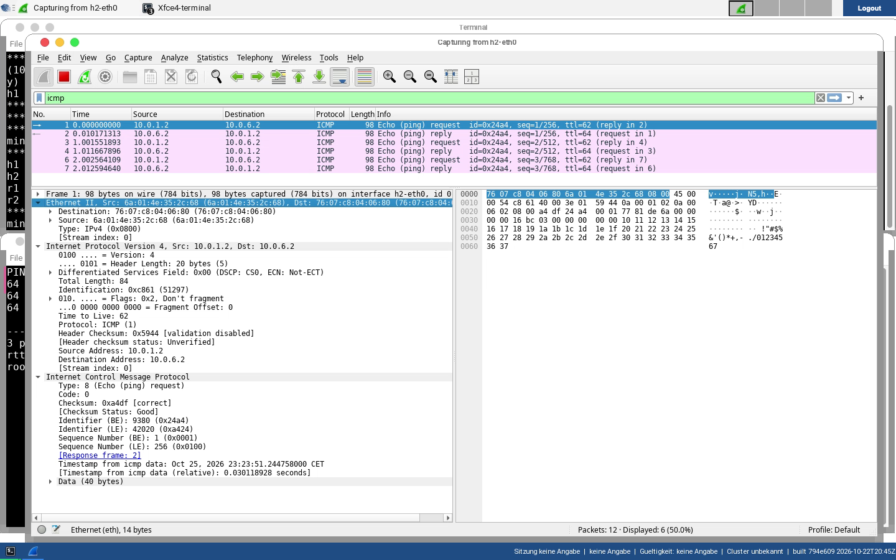

# 01 · Netzwerkgrundlagen & Tools

[:material-file-pdf-box: Als PDF herunterladen](../../pdf/01-netzwerkgrundlagen-tools.pdf){ .md-button }


*Der Desktop nach dem Login. Das Terminal startet ihr über das Symbol "Terminal" am linken Rand, abmelden könnt ihr euch oben rechts.*

## Lernziele

- Das TCP/IP-Schichtenmodell nicht nur benennen, sondern in echtem, mit
  Wireshark aufgezeichnetem Verkehr wiedererkennen (Verbindungs-, Netzwerk-,
  Transport- und Anwendungsschicht).
- Grundlegende Netzwerkwerkzeuge sicher anwenden: `ping`, `netcat`, `dig`,
  `curl`, `whois`, `nmap`, `scp`, `netstat`.
- Den Unterschied zwischen numerischer IP-Adresse und Namensauflösung (DNS)
  sowie zwischen Anwendungsprotokoll (HTTP) und Dienstprotokoll (DNS, DHCP)
  einordnen können.
- Verschlüsselte und unverschlüsselte Kommunikation im Wireshark-Mitschnitt
  unterscheiden (Klartext-Netcat/HTTP vs. SSH/SCP/HTTPS) und die Grenzen von
  Verschlüsselung benennen (Metadaten bleiben sichtbar, auch wenn der Inhalt
  es nicht ist).
- Einen fehlerhaften TLS-Zertifikat-Zustand im Browser erkennen und
  begründen können, statt ihn wegzuklicken.
- Nachvollziehen, warum in einer gerouteten Topologie nicht jeder Rechner
  jeden anderen direkt erreicht (asymmetrisches Routing).
- Namensauflösung nicht nur benutzen, sondern selbst betreiben: einen kleinen,
  lesbaren DNS-Server starten und an `dig`/`nslookup`/`host` sehen, wie eine
  DNS-Antwort aus Header, Flags, Frage- und Antwortabschnitt entsteht.
- Offene Ports und lauschende Dienste mit `ss` (dem Nachfolger von `netstat`)
  ermitteln und den Klartext-Charakter einfacher TCP-Verbindungen im
  Mitschnitt erkennen.

--8<-- "issue-feedback.md"

## Aufgaben

### Teil 1 – Das TCP/IP-Schichtenmodell in echtem Verkehr (außerhalb von Mininet)

!!! abstract "Auf einen Blick"
    **Lernziel:** Ihr zeichnet echten Netzwerkverkehr mit Wireshark auf, findet
    darin eure eigene DNS-Anfrage und eure eigene Web-Anfrage wieder und
    benennt in einem Paket die vier Schichten (Verbindung, Netzwerk,
    Transport, Anwendung).

    **Wozu?** Wenn im Firmennetz „das Internet langsam ist" oder ein Dienst
    nicht antwortet, hilft Raten nicht weiter: Ein Netzwerkadmin schneidet den
    Verkehr mit und sieht nach, in welcher Schicht etwas schiefgeht – ob die
    Namensauflösung klemmt, der Verbindungsaufbau scheitert oder der Server
    eine Fehlerseite liefert. Dieselbe Technik nutzen auch
    Sicherheitsteams, um verdächtige Verbindungen zu untersuchen.

    **Vorwissen:** keines. Ihr könnt ein Terminal öffnen und Befehle abtippen;
    alles Weitere wird hier erklärt.

Dieser erste Teil läuft **nicht** in der Mininet-Emulation, sondern direkt auf
eurem Desktop, um reale Kommunikation ins Internet zu beobachten, bevor wir
uns die kontrollierte, emulierte Topologie von `topo01` ansehen.

#### Das Terminal öffnen

Das Terminal auf diesem Desktop ist `xfce4-terminal`. Ihr startet es über
das Symbol "Terminal" am linken Bildschirmrand.

!!! info "Werkzeug: `xfce4-terminal` und `xterm`"
    `xfce4-terminal` ist ein Terminalemulator mit Tabs, eigenen
    Einstellungen und Kopieren/Einfügen per Maus – Doku:
    [docs.xfce.org/apps/xfce4-terminal/getting-started](https://docs.xfce.org/apps/xfce4-terminal/getting-started).
    Der Mininet-Befehl `mininet> xterm <node>` (z. B. `mininet> xterm h1` in
    Teil 2) öffnet auf diesem Desktop ebenfalls ein `xfce4-terminal`-Fenster.

**Übung:** Öffnet ein Terminal über das Symbol und lasst es für die
folgenden Schritte offen.

--8<-- "issue-feedback.md"

#### Schritt 1: Wireshark starten und aufzeichnen

!!! info "Werkzeug: Wireshark"
    **Was es tut:** Wireshark schneidet den Verkehr auf einer oder mehreren
    Netzwerkschnittstellen mit und zeigt jedes einzelne Paket samt aller
    enthaltenen Protokollschichten an. Es sieht alle Schichten, von der
    Verbindungsschicht bis zur Anwendung.

    **Aufruf und wichtige Stellen:**

    - `wireshark &` – startet das Programm; das `&` am Ende hält das Terminal
      frei für weitere Befehle. Ihr braucht dafür keine Administratorrechte.
    - Schnittstelle `any` – fasst alle Schnittstellen in einer Aufzeichnung
      zusammen.
    - Zeile „Apply a display filter…" – der **Anzeigefilter**, z. B. `dns`
      oder `icmp`: blendet alles andere nur aus (aufgezeichnet wird weiter).
    - Rechtsklick auf ein Paket → „Follow → TCP Stream" – zeigt eine ganze
      Verbindung am Stück.
    - Rotes Quadrat in der Symbolleiste – beendet die Aufzeichnung.

    **Beispiel, Zeile für Zeile gelesen** (Anzeigefilter `dns`, aus Schritt 2):

    ```text
    No. Time      Source          Destination     Protocol Length Info
    1   0.000000  172.17.0.11     141.22.192.100  DNS      71     Standard query 0xb669 A becke.net
    2   0.000283  141.22.192.100  172.17.0.11     DNS      87     Standard query response 0xb669 A becke.net A 81.169.145.66
    ```

    `No.` ist die laufende Paketnummer, `Time` die Sekunden seit dem Start
    der Aufzeichnung, `Source`/`Destination` sind Absender und Empfänger
    (eure Adresse und die des Resolvers), `Protocol` das erkannte
    Anwendungsprotokoll, `Length` die Paketgröße in Bytes. In `Info` steht die
    Frage „A becke.net" (Adresse zu diesem Namen?) und in Zeile 2 die Antwort
    mit der IPv4-Adresse. Die zusammengehörige Antwort trägt dieselbe
    Kennung (`0xb669`).

    **Typische Fehlermeldung:** „Promiscuous mode not supported on the `any`
    device":

    
    *Der Dialog erscheint, wenn beim Start der Haken „Promiscuous mode" noch gesetzt ist.*

    Der Promiscuous-Modus lässt eine einzelne Netzwerkkarte auch Verkehr
    mitschneiden, der nicht an sie adressiert ist. Die Sammel-Schnittstelle
    `any` kann das nicht. Bestätigt mit OK; Wireshark zeichnet dann ohne
    Promiscuous-Modus weiter auf. Offizielle Doku:
    [wireshark.org/docs](https://www.wireshark.org/docs/).

1. Tippt im offenen Terminal:

    ```bash
    wireshark &
    ```

    Es öffnet sich das Wireshark-Hauptfenster mit der Willkommensseite. Im Bereich "Capture"
    seht ihr eine Liste der Schnittstellen, unter anderem `eth0`, `any` und
    `Loopback: lo`.

2. Wählt die Zeile **`any`** aus (sie fasst alle Schnittstellen in einer
    Aufzeichnung zusammen – genau das braucht ihr hier: Schritt 2 und 6
    erzeugen nämlich teils rein lokalen Verkehr, der `eth0` nie erreicht) und
    öffnet über `Capture → Options…` (oder `Strg+K`) die
    Aufzeichnungsoptionen. Wählt dort unten links den Haken
    **"Enable promiscuous mode on all interfaces" ab**, bevor ihr startet:

    
    *Die Einstellung vor dem Start: „any" ausgewählt, Promiscuous-Modus abgewählt.*

3. Klickt "Start". Die Aufzeichnung läuft jetzt auf `any`.

    !!! note "Die Paketliste füllt sich laufend"
        Ihr seht den gesamten Verkehr aller Schnittstellen, auch den des
        Desktop-Streamings, über das ihr diesen Desktop im Browser seht.
        Drei Fensterbereiche sind wichtig:

        - oben die **Paketliste** (eine Zeile pro Paket),
        - in der Mitte der **Detailbaum** (Schicht für Schicht aufklappbar –
          genau den braucht ihr in Schritt 5),
        - unten die **Hex-/ASCII-Rohdaten** des gerade ausgewählten Pakets.

        Gefiltert wird über die Zeile "Apply a display filter…" (Anzeigefilter,
        nicht zu verwechseln mit dem Aufzeichnungsfilter in den
        Capture-Optionen), siehe Schritt 4.

--8<-- "issue-feedback.md"

#### Schritt 2: `nslookup` – die IP-Adresse ermitteln

!!! info "Werkzeug: `nslookup`"
    **Was es tut:** `nslookup` fragt einen DNS-Server nach der IP-Adresse, die
    zu einem Domainnamen gehört (Namensauflösung, Anwendungsschicht) –
    grundsätzlich das, was ein Browser vor jedem Seitenaufruf automatisch im
    Hintergrund erledigt. Hier ermittelt es die IPv4-Adresse von `becke.net`,
    damit ihr den Mitschnitt gezielt auf diese Adresse filtern könnt.

    **Aufruf:**

    - `nslookup <name>` – fragt den Resolver, der in `/etc/resolv.conf` steht.
    - `nslookup <name> <server>` – fragt stattdessen den genannten Server.

    **Beispielausgabe, Zeile für Zeile gelesen:**

    ```text
    $ nslookup becke.net
    Server:		<Adresse eures Resolvers>
    Address:	<Adresse eures Resolvers>#53

    Non-authoritative answer:
    Name:	becke.net
    Address: 81.169.145.66
    ```

    `Server`/`Address` nennen den befragten Resolver samt Port (`#53` ist der
    DNS-Port). „Non-authoritative answer" heißt: Der Resolver hat die Antwort
    von einem anderen Server übernommen und ist selbst nicht für `becke.net`
    zuständig. `Name` und `Address` sind das Ergebnis.

    **Typische Fehlermeldung:** `** server can't find gibtsnicht.invalid:
    NXDOMAIN` bedeutet: Der Name existiert nicht. Kommt stattdessen
    `connection timed out; no servers could be reached`, antwortet der
    Resolver gar nicht.

1. Öffnet ein **zweites** Terminal (Wireshark läuft im ersten weiter) und
    führt aus:

    ```bash
    nslookup becke.net
    ```

    Merkt euch die ausgegebene IPv4-Adresse – ihr braucht sie gleich für den
    Wireshark-Filter. (Bei euch kann die Adresse abweichen.)

    !!! note "Welcher DNS-Server ist das bei euch?"
        Die Adresse hinter `Server:` hängt von der Umgebung ab. Lest nach,
        welche bei euch gilt, statt sie zu raten:

        ```bash
        cat /etc/resolv.conf
        ```

        Die Zeile `nameserver …` nennt den Resolver, den `nslookup` benutzt.
        Notiert die Adresse; im nächsten Schritt seht ihr in Wireshark, dass
        die DNS-Anfrage genau an sie geht.

2. Wechselt zu Wireshark und tippt in die Anzeigefilter-Zeile oben `dns`,
    dann Enter, um die soeben erzeugte DNS-Abfrage wiederzufinden:

    
    *Die DNS-Anfrage (Protokollspalte „DNS") und ihre Antwort, direkt nach `nslookup becke.net`.
    Je zweimal, weil `nslookup` die Adresse (A) und die IPv6-Adresse (AAAA) abfragt.
    Die Adressen in Source und Destination sind die eures Desktops und eures Resolvers.*

    Ihr seht die Anfrage ("Standard query … A becke.net") und die Antwort
    ("Standard query response … A becke.net A …") als eigene Zeilen mit
    Protokoll "DNS".

    !!! note "Warum die Pakete an euren Resolver gehen, nicht an `becke.net`"
        Die DNS-Anfrage geht an den Resolver aus `/etc/resolv.conf`, nicht
        direkt an den für `becke.net` zuständigen Server. Der Resolver
        reicht die Anfrage weiter; diese Weiterleitung seht ihr in eurem
        Mitschnitt nicht. Das ist mit ein Grund, warum in Schritt 1 auf der
        Pseudo-Schnittstelle `any` mitgeschnitten wird: `any` erfasst alle
        Schnittstellen, auch rein lokalen Verkehr.

--8<-- "issue-feedback.md"

#### Schritt 3: `curl` – Verkehr zur ermittelten Adresse erzeugen

!!! info "Werkzeug: `curl`"
    **Was es tut:** `curl` schickt eine Anfrage an einen Server und gibt die
    Antwort aus – wie ein Browser, nur ohne grafische Darstellung
    (Anwendungsschicht: HTTP/HTTPS). Hier erzeugt es gezielt echten Verkehr
    zu der eben ermittelten Adresse.

    **Aufruf:**

    - `curl <url>` – ruft die Adresse ab und gibt den Inhalt aus.
    - `curl -I <url>` – zeigt nur die Kopfzeilen der Antwort.
    - `curl -k <url>` – ignoriert ein ungültiges Zertifikat (nur zum
      Experimentieren, nie im Alltag).

    **Beispielausgabe** von `curl -I https://becke.net`, Zeile für Zeile:

    ```text
    HTTP/2 200
    last-modified: Mon, 12 Feb 2024 11:37:58 GMT
    content-length: 422
    content-type: text/html
    server: Apache/2.4.69 (Unix)
    ```

    `HTTP/2 200` ist die Statuszeile: Protokollversion und Statuscode
    (`200` = alles in Ordnung, `404` = Seite nicht gefunden). Darunter stehen
    Kopfzeilen: wann die Seite zuletzt geändert wurde, wie groß sie ist
    (422 Bytes), welchen Typ sie hat und welche Server-Software antwortet.

    **Typische Fehlermeldung:** `curl: (6) Could not resolve host:
    gibtsnicht.invalid` – der Name ließ sich nicht in eine Adresse auflösen
    (also ein DNS-Problem, kein Webserver-Problem).

```bash
curl https://becke.net
```

Die Ausgabe ist der HTML-Quelltext der Seite; für diesen Schritt zählt nur
der erzeugte Netzwerkverkehr.

--8<-- "issue-feedback.md"

#### Schritt 4: Auf den erzeugten Verkehr filtern

Filtert in Wireshark auf genau diesen Verkehr, damit ihr nicht im restlichen
Hintergrundrauschen des Betriebssystems sucht:

```text
ip.addr == <eure ermittelte IP-Adresse>
```

Macht anschließend einen Rechtsklick auf eines der gefilterten TCP-Pakete und
wählt "Follow → TCP Stream". Wireshark zeigt dann die gesamte Übertragung
dieser einen Verbindung am Stück. Weil Schritt 3 die Seite über HTTPS abruft,
seht ihr nach dem Beginn des TLS-Handshakes nur verschlüsselte, nicht lesbare
Bytes; in Teil 2 folgt ihr auf demselben Weg einem unverschlüsselten Strom.
Wireshark ersetzt dabei den Anzeigefilter durch `tcp.stream eq <Nummer>` –
tragt für Schritt 5 wieder den Filter von oben ein.

--8<-- "issue-feedback.md"

#### Schritt 5: Die vier Schichten im Detailbaum identifizieren

!!! info "Was ist überhaupt eine „Schicht"?"
    Das TCP/IP-Modell teilt Netzwerkkommunikation in mehrere **Schichten**
    auf. Jede Schicht löst dabei ein eigenes, abgegrenztes Teilproblem
    (z. B. "wie kommen Bits über ein Kabel/Funk" oder "wie findet ein Paket
    den richtigen Rechner im Internet") und verpackt dafür die Daten der
    jeweils darüberliegenden Schicht in ihren eigenen Umschlag (Header) –
    von den Anwendungsdaten ganz oben bis zu den elektrischen/optischen
    Bits ganz unten. Diese Unterteilung gibt es, damit jede Schicht
    unabhängig von den anderen ausgetauscht oder verstanden werden kann:
    Ethernet lässt sich durch WLAN ersetzen, ohne dass HTTP davon etwas
    merkt. Im Wireshark-Detailbaum (mittlerer Fensterbereich, siehe
    Schritt 1) seht ihr das ganz konkret: Die eingerückten Zeilen SIND die
    Schichten, von außen/unten nach innen/oben aufgeklappt – die äußerste
    Zeile ist die unterste Schicht (Übertragung), die innerste die oberste
    (Anwendung).

Wählt eines der TCP-Pakete dieser Kommunikation aus (ein Klick in der
Paketliste) und klappt im Detailbaum von außen/unten nach innen/oben die
einzelnen Zeilen auf. Ordnet die Schichten zu:

- **Anwendungsschicht:** HTTP (bzw. TLS-Record bei HTTPS)
- **Transportschicht:** TCP-Segment (Ports, Sequenznummern, Flags)
- **Netzwerkschicht:** IP-Header (IPv4 oder IPv6, Quell-/Zieladresse)
- **Verbindungsschicht:** *siehe Hinweis direkt darunter – hier nicht der
  klassische Ethernet-Header*

!!! info "Verbindungsschicht bei „any": „Linux cooked capture" statt Ethernet-Header"
    Weil ihr auf der Pseudo-Schnittstelle `any` mitschneidet (Schritt 1),
    zeigt die Verbindungsschicht hier **„Linux cooked capture v1"** (kurz
    SLL) statt eines echten Ethernet-Headers – `any` kapselt mehrere,
    unterschiedliche Schnittstellen einheitlich in dieses Pseudo-Format, das
    keinen vollständigen Ethernet-Header (mit Ziel-MAC) kennt, aber
    trotzdem nützliche Link-Layer-Informationen mitbringt:

    
    *„Linux cooked capture v1" für den Verkehr zu becke.net: „Link-layer address type: Ethernet (1)" und die echte MAC-Adresse eurer Schnittstelle als „Source".*

    Achtet auf zwei Felder: **"Link-layer address type"** (hier `Ethernet
    (1)` – das Paket lief tatsächlich über eine echte, Ethernet-artige
    Schnittstelle) und **"Source"** (eine echte Hardware-MAC-Adresse). Beide
    kommen in Schritt 6 wieder vor, mit einem auffälligen Unterschied.

!!! question "Nachgedacht: Welche Schnittstelle war das?"
    Auf welcher tatsächlichen Schnittstelle (nicht `any`) lief dieses Paket
    vermutlich – und woran im Detailbaum könnt ihr das festmachen, obwohl
    `any` selbst kein echter Ethernet-Header ist?

    ??? success "Lösung"
        Vermutlich auf `eth0`, der einzigen echten Netzwerkkarte des
        Desktops (`lo` ist die Loopback-Schnittstelle). Festmachen lässt sich
        das an „Link-layer address type: Ethernet (1)" und der echten
        MAC-Adresse in „Source": Beides gibt es nur bei einer
        Ethernet-artigen Schnittstelle. „Packet type: Sent by us" sagt
        zusätzlich, dass das Paket euer Rechner abgeschickt hat.

Ihr dürft an dieser Stelle gerne alle Fenster schließen und danach wieder ein Terminal öffnen, um euch mehr Übersicht zu ermöglichen.

--8<-- "issue-feedback.md"

#### Vom externen zum lokalen Verkehr: Wechsel zu Schritt 6

Bisher habt ihr Verkehr zu einem echten Server im Internet (`becke.net`)
untersucht. Schritt 6 wechselt bewusst zu rein lokalem Verkehr: Ihr
schickt Pakete an euch selbst (`127.0.0.1`, die Loopback-Adresse), die nie
eine echte Netzwerkkarte durchlaufen. Die neue Frage lautet: Wie sieht
dieselbe Schichten-Analyse aus Schritt 5 aus, wenn gar keine echte Hardware
beteiligt ist? Der Aufbau bleibt dabei gleich – ihr filtert wieder in
derselben laufenden Wireshark-Aufzeichnung auf `any`, diesmal nur mit einem
anderen Anzeigefilter (`icmp` statt der IP-Adresse von eben).

#### Schritt 6: `ping 127.0.0.1` – dasselbe Experiment rein lokal

!!! info "Werkzeug: `ping`"
    **Was es tut:** `ping` schickt kleine Testpakete (ICMP „Echo Request",
    Netzwerkschicht) an eine Zieladresse und misst, ob und wie schnell eine
    Antwort („Echo Reply") zurückkommt – der klassische erste Test, ob ein
    Rechner erreichbar ist. Hier zielt ihr bewusst auf euch selbst
    (`127.0.0.1`).

    **Aufruf:**

    - `ping <ziel>` – schickt Pakete, bis ihr mit `Strg+C` abbrecht.
    - `ping -c 4 <ziel>` – schickt genau vier Pakete.
    - `ping -W 2 <ziel>` – wartet höchstens 2 Sekunden auf jede Antwort.

    **Beispielausgabe, Zeile für Zeile gelesen:**

    ```text
    $ ping -c 3 127.0.0.1
    PING 127.0.0.1 (127.0.0.1) 56(84) bytes of data.
    64 bytes from 127.0.0.1: icmp_seq=1 ttl=64 time=0.072 ms
    64 bytes from 127.0.0.1: icmp_seq=2 ttl=64 time=0.053 ms
    64 bytes from 127.0.0.1: icmp_seq=3 ttl=64 time=0.051 ms

    --- 127.0.0.1 ping statistics ---
    3 packets transmitted, 3 received, 0% packet loss, time 2040ms
    rtt min/avg/max/mdev = 0.051/0.058/0.072/0.009 ms
    ```

    `56(84) bytes` sind Nutzdaten und Gesamtgröße des Pakets. In jeder
    Antwortzeile ist `icmp_seq` die laufende Nummer, `ttl` die verbleibende
    Lebensdauer des Pakets (jeder Router auf dem Weg zählt sie um 1 herunter;
    64 ist der Startwert, hier also kein Router dazwischen) und `time` die
    Umlaufzeit (Round-Trip-Time, RTT) in Millisekunden. Die Statistik fasst
    zusammen: gesendet, empfangen, Verlust, kleinste/mittlere/größte RTT.

    **Typische Fehlermeldungen:**

    - `ping: gibtsnicht.invalid: Name or service not known` – der Name ließ
      sich nicht auflösen.
    - `100% packet loss` ohne weitere Meldung – es kommt keine Antwort (Ziel
      aus, falsche Adresse, oder jemand verwirft die Pakete still).
    - `From 10.0.6.1 icmp_seq=1 Destination Net Unreachable` – ein Router
      meldet ausdrücklich, dass er keinen Weg zum Ziel kennt.

```bash
ping 127.0.0.1
```

(`Strg+C` beendet `ping`, falls es weiterläuft – für den Mitschnitt reichen
wenige Sekunden.)

Filtert in Wireshark auf `icmp` und identifiziert erneut die vier Schichten
in einem der Pakete.

!!! info "Verbindungsschicht bei „any": Loopback statt Ethernet"
    
    *„Linux cooked capture v1" für den Loopback-Verkehr: „Link-layer address type: Loopback (772)" und eine Adresse aus lauter Nullen als „Source".*

    Auch hier zeigt die Verbindungsschicht "Linux cooked capture v1" (wie in
    Schritt 5, ein Merkmal der Pseudo-Schnittstelle `any`). Der Unterschied liegt in denselben zwei Feldern wie eben:
    **"Link-layer address type"** steht auf `Loopback (772)` statt
    `Ethernet (1)`, und **"Source"** ist `00:00:00:00:00:00` – eine
    Adresse aus lauter Nullen, weil hier keine echte Netzwerkkarte beteiligt
    war, die eine eigene MAC-Adresse mitbringen könnte.

!!! question "Nachgedacht: Was sagt eine Null-MAC-Adresse?"
    Vergleicht die beiden Felder "Link-layer address type" und "Source" aus
    Schritt 5 und Schritt 6 direkt gegenüber. Was sagt eine
    Null-MAC-Adresse über den Weg aus, den ein Paket zurückgelegt hat – und
    welche Erwartung leitet ihr daraus für künftige Mitschnitte ab, wenn ihr
    eine Adresse wie `00:00:00:00:00:00` seht?

    ??? success "Lösung"
        Das Paket hat den Rechner nie verlassen: Es lief nur über die
        Loopback-Schnittstelle, ohne echte Netzwerkkarte, und deshalb gibt es
        keine Hardware-Adresse. Sieht man in einem Mitschnitt
        `00:00:00:00:00:00` (Typ „Loopback"), handelt es sich also um
        rein lokalen Verkehr zwischen Programmen desselben Rechners – er
        taucht auf keinem Kabel auf und ist von außen nicht beobachtbar.

!!! tip "Euer eigenes Notizbuch"
    Legt euch unter `~/rn-practice/notizbuch.md` eine eigene Datei an und
    tragt dort Befehle und Wireshark-Filter ein, die ihr euch merken wollt.

Schließt zum Abschluss dieses Teils Wireshark und das Terminal und öffnet für
Teil 2 ein neues Terminal.

### Teil 2 – Werkzeuge in der emulierten Topologie `topo01`

!!! abstract "Auf einen Blick"
    **Lernziel:** Ihr startet ein emuliertes Netz aus zwei Endgeräten und zwei
    Routern, prüft mit `ping`, `traceroute`, `dig`, `nmap` und `ss`/`netstat`,
    wer wen erreicht, und beobachtet mit Wireshark, welche Verbindungen im
    Klartext und welche verschlüsselt laufen.

    **Wozu?** Ein Netz erst aufzubauen und dann kaputtzumachen ist die
    sicherste Art, die Werkzeuge der Netzwerkadmins kennenzulernen. Wer
    nachts gerufen wird, weil eine Filiale nicht erreichbar ist, tippt genau
    diese Befehle: erst `ping` und `traceroute` (wo endet der Weg?), dann
    `dig` (stimmt die Namensauflösung?), dann `nmap` und `ss` (läuft der
    Dienst, ist der Port offen?). Und wer Sicherheit ernst nimmt, muss wissen,
    was ein Angreifer im Mitschnitt sieht.

    **Vorwissen:** Teil 1 (Wireshark, `ping`, Schichten).

Ab hier arbeitet ihr in der Mininet-Emulation. Die Topologie `topo01` besteht
aus zwei Endgeräten `h1` (`10.0.1.2`) und `h2` (`10.0.6.2`) und zwei Routern
`r1`/`r2` dazwischen. Nur `h1` hat zusätzlich über `h1-eth0` (`10.0.5.2`) einen
NAT-Uplink ins Internet; `r1` und `r2` kennen keinen Weg nach draußen.
Aufgaben mit Internet- oder DNS-Zugriff führt ihr deshalb auf `h1` aus.

```text
Internet ── NAT (10.0.5.1) ── h1-eth0  h1  h1-eth1 (10.0.1.2) ── r1 ── 10.0.4.0/24 ── r2 ── (10.0.6.2) h2
```

1. **Netz starten.** Wechselt in das Topologie-Verzeichnis und startet die
    Emulation:

    ```bash
    cd ~/rn-practice/topo01
    ./start-topo01.sh
    ```

    Das Skript richtet den NAT-Uplink und die Namensauflösung ein und startet
    danach `topo01.py`. Auf `h1` läuft ein DNS-Dienst (`dnsmasq`,
    `10.0.1.2`), der die Namen `h1` und `h2` kennt und alle anderen Namen an
    einen DNS-Server weiterreicht, der aus diesem Netz erreichbar ist.
    Startet `topo01.py` nicht direkt, sondern immer über `start-topo01.sh`.

    Nach dem Start öffnen sich zwei Terminalfenster, eines für `h1` und eines
    für `h2`. In diesen Knoten-Terminals seid ihr `root`. Für die Router
    `r1`/`r2` oder ein versehentlich geschlossenes Fenster öffnet ihr auf der
    Mininet-Konsole ein weiteres Terminal:

    ```text
    mininet> xterm <node>
    ```

    z. B. `mininet> xterm r1`.

    Prüft auf der Mininet-Konsole, ob jeder jeden erreicht:

    ```text
    mininet> pingall
    ```

    
    *Oben die Mininet-Konsole nach `pingall`, unten die Knoten-Terminals von `h1` und `h2`.*

    Erwartet wird **`16% dropped (10/12 received)`**. Jede Zeile heißt „dieser
    Knoten hat diese Ziele erreicht"; das `X` markiert ein Ziel, das nicht
    geantwortet hat.

    !!! question "Nachgedacht: Welche zwei Verbindungen fehlen – und warum?"
        Lest das `pingall`-Ergebnis: Zwischen welchen beiden Knoten fehlt die
        Verbindung (je eine Richtung ergibt ein `X`)? Schaut dazu auf `h1` in
        die Routing-Tabelle und vergleicht sie mit dem Netzplan oben:

        ```bash
        h1$ ip route
        ```

        ??? success "Lösung"
            Es fehlen `h1 → r2` und `r2 → h1`. Alle anderen zehn Paare
            antworten (auch `h1` ↔ `h2`). Die Tabelle von `h1` kennt nur drei
            Einträge: das eigene Netz `10.0.1.0/24`, den Uplink `10.0.5.0/24`
            und `10.0.6.0/24` über `r1` – dazu die Standardroute (`default`)
            ins Internet. Das Transitnetz `10.0.4.0/24` zwischen `r1` und `r2`
            fehlt. Ein Ping von `r2` kommt bei `h1` an, aber `h1` findet für
            die Antwort an `10.0.4.2` keine passende Route und schickt sie
            über die Standardroute Richtung Internet – dort geht sie verloren.
            Die Rechenaufgabe zu dieser Topologie steht in
            [Aufgabenblatt 02, Teil 11](02-subnetting-arp.md).

    !!! info "Werkzeug: `ip`"
        **Was es tut:** `ip` zeigt und verändert die Netzwerkeinstellungen
        eines Rechners: Schnittstellen, Adressen (Schicht 2/3) und die
        Routing-Tabelle.

        **Aufruf:**

        - `ip -br a` – kurze Liste aller Schnittstellen mit ihren Adressen.
        - `ip route` – die Routing-Tabelle.

        **Beispielausgabe auf `h1`, Zeile für Zeile gelesen:**

        ```text
        h1$ ip -br a
        lo               UNKNOWN        127.0.0.1/8 ::1/128
        h1-eth1@if2      UP             10.0.1.2/24 fe80::d0c0:31ff:fe75:2dab/64
        h1-eth0@if5      UP             10.0.5.2/24 fe80::f01f:96ff:fee6:64fb/64

        h1$ ip route
        default via 10.0.5.1 dev h1-eth0
        10.0.1.0/24 dev h1-eth1 proto kernel scope link src 10.0.1.2
        10.0.5.0/24 dev h1-eth0 proto kernel scope link src 10.0.5.2
        10.0.6.0/24 via 10.0.1.1 dev h1-eth1
        ```

        Pro Schnittstelle stehen Name, Zustand (`UP` = aktiv) und die
        Adressen mit Präfixlänge (`/24` = die ersten 24 Bit sind das Netz).
        In `ip route` heißt `dev <name>`: direkt über diese Schnittstelle
        erreichbar; `via <adresse>`: über diesen Router; `default`: alles,
        wofür kein genauerer Eintrag passt.

        **Typische Fehlermeldung:** `Device "h9" does not exist.` – es gibt
        keine Schnittstelle dieses Namens (Tippfehler?).

2. **Konnektivität mit Ping prüfen.** Öffnet das Terminal für `h1` und führt
    nacheinander aus (zu `ping` siehe Steckbrief in Teil 1, Schritt 6):

    ```bash
    h1$ ping -c 4 10.0.6.2        # Ping mit numerischer IPv4-Adresse (h2)
    h1$ ping -c 4 h2              # Ping mit Namen statt IP
    h1$ ping -c 4 10.0.5.1        # Ping an ein anderes System im lokalen Segment
    h1$ ping -c 4 1.1.1.1         # Ping ins Internet (numerisch)
    h1$ ping -c 4 one.one.one.one # Ping ins Internet mit Namen (dasselbe Ziel)
    ```

    Zum Vergleich der erste Aufruf, wie er bei uns aussah:

    ```text
    h1$ ping -c 4 10.0.6.2
    PING 10.0.6.2 (10.0.6.2) 56(84) bytes of data.
    64 bytes from 10.0.6.2: icmp_seq=1 ttl=62 time=121 ms
    64 bytes from 10.0.6.2: icmp_seq=2 ttl=62 time=60.5 ms
    64 bytes from 10.0.6.2: icmp_seq=3 ttl=62 time=60.2 ms
    64 bytes from 10.0.6.2: icmp_seq=4 ttl=62 time=60.2 ms
    ```

    Die erste Antwort dauert länger, weil beim ersten Paket noch die
    Hardware-Adressen der Zwischenstationen ermittelt werden müssen.

    Notiert euch die Ausgaben (RTT, TTL) der lokalen Ziele und vergleicht
    sie miteinander: Was fällt euch auf, und wie erklärt ihr die Unterschiede?

    ??? success "Lösung"
        - `10.0.6.2` und `h2` liefern dieselbe Antwort (`ttl=62`, rund 60 ms):
          Der Name wird nur vorher per DNS in die Adresse übersetzt.
        - `ttl=62` heißt: Das Paket wurde von zwei Routern (`r1`, `r2`)
          weitergereicht (64 − 2). Die rund 60 ms sind drei Leitungen
          (`h1`–`r1`, `r1`–`r2`, `r2`–`h2`) mit je 10 ms Verzögerung, hin und
          zurück (3 × 10 ms × 2).
        - `10.0.5.1` (der NAT-Übergang) antwortet mit `ttl=64` und unter
          0,1 ms: kein Router dazwischen, kein künstlicher Verzug.
        - `1.1.1.1` und `one.one.one.one` liefern **100 % Paketverlust**
          (`ping` löst den Namen übrigens auf, die Adresse wird in der
          Kopfzeile genannt).

    !!! question "Nachgedacht: `h1` hat Internet, bekommt aber keine Ping-Antwort"
        `h1` ist der einzige Knoten mit Weg ins Internet. Trotzdem liefern
        `ping 1.1.1.1` und `ping one.one.one.one` auf `h1` 100 %
        Paketverlust. Weist nach, woran das liegt:

        ```bash
        h1$ getent hosts one.one.one.one       # löst der Name auf?
        h1$ nc -z -w 3 1.1.1.1 443             # geht eine TCP-Verbindung durch?
        h1$ echo $?                            # 0 = Verbindung stand
        h1$ traceroute -n -m 6 1.1.1.1         # wo endet der Weg?
        ```

        Beantwortet aus euren eigenen Ausgaben:

        1. Der Name löst auf, und die TCP-Verbindung auf Port 443 kommt
           zustande – welche Schicht des Stapels ist also nicht das Problem?
        2. `ping` nutzt ICMP, `nc` nutzt TCP. Beide laufen über IP. Was genau
           wird demnach gefiltert, und auf welcher Schicht sitzt der Filter?
        3. `traceroute` zeigt euch die letzte antwortende Station vor der
           Stille. Liegt der Filter in eurem Container, im Hostnetz oder
           weiter draußen? Begründet mit der Hop-Nummer.
        4. Warum ist "kein Ping-Echo" ein schlechter Beweis dafür, dass ein
           Rechner nicht erreichbar ist? Nennt zwei Gründe.

        !!! info "Werkzeug: `traceroute`"
            **Was es tut:** `traceroute` zeigt den Weg eines Pakets
            Router für Router (Netzwerkschicht). Es schickt Pakete mit
            immer größerer Lebensdauer (TTL); jeder Router, bei dem sie
            abläuft, meldet sich.

            **Aufruf:** `traceroute -n -m 6 <ziel>` – `-n` zeigt Adressen
            statt Namen, `-m 6` bricht nach 6 Stationen ab.

            **Beispielausgabe, Zeile für Zeile gelesen:**

            ```text
            h1$ traceroute -n -m 6 1.1.1.1
            traceroute to 1.1.1.1 (1.1.1.1), 6 hops max, 60 byte packets
             1  10.0.5.1  2.110 ms  1.951 ms  1.857 ms
             2  172.17.0.1  1.767 ms  1.621 ms  1.516 ms
             3  <Router im Hostnetz>  34.000 ms  33.874 ms  33.751 ms
             4  * * *
             5  * * *
             6  * * *
            ```

            Jede Zeile ist eine Station („Hop") mit drei Messungen. Hop 1 ist
            der NAT-Übergang (`10.0.5.1`), Hop 2 das Gateway des Containers
            (`172.17.0.1`), Hop 3 ein Router im Netz dahinter (hier
            gekürzt). `* * *` heißt: keine Antwort innerhalb der Wartezeit.

            **Typische Fehlermeldung:** Eine Reihe aus `* * *` bis zum Ende
            heißt nicht „kaputt", sondern: Diese Station antwortet nicht auf
            die Testpakete (oft ein Filter).

        ??? success "Lösung"
            1. Die Namensauflösung (DNS, Anwendungsschicht) und der
               TCP-Verbindungsaufbau (Transportschicht) funktionieren; auch
               das Routing bis ins Internet ist nicht das Problem.
            2. Gefiltert wird ICMP, TCP auf Port 443 ist erlaubt: ein Filter
               auf der Netzwerkschicht, der nach dem Protokolltyp
               unterscheidet (ICMP gesperrt, TCP erlaubt).
            3. Hop 1 (`10.0.5.1`) und Hop 2 (`172.17.0.1`) liegen in eurem
               Container bzw. an dessen Gateway, Hop 3 im Hostnetz; ab
               Hop 4 kommt nichts mehr. Der Filter sitzt also **weiter
               draußen**, nicht in eurem Container.
            4. (a) Viele Firewalls sperren ICMP, obwohl der Rechner läuft und
               Webseiten ausliefert (so wie hier). (b) Auch ein Rechner kann
               Echo-Anfragen bewusst ignorieren; umgekehrt beweist ein
               Echo nur, dass ICMP durchkommt, nicht dass ein bestimmter
               Dienst läuft.

        ICMP gesperrt, TCP erlaubt: Diese Asymmetrie ist in Unternehmens- und
        Hochschulnetzen häufig.

    Wechselt danach zum Terminal von `h2` und wiederholt das Experiment aus
    dessen Sicht. Anders als `h1` hat `h2` keinen Weg ins Internet: `r1` und
    `r2` kennen nur die Netze der Topologie.

    ```bash
    h2$ ping -c 4 10.0.1.1
    h2$ ping -c 4 h1
    h2$ ping -c 4 1.1.1.1         # h2 hat keinen Weg ins Internet
    ```

    Vergleicht RTT und TTL der lokalen Ziele zwischen `h1` und `h2`. Warum sind
    sie unterschiedlich? Was sagt euch das über die Anzahl der Zwischenstationen
    (Hops)? Welche Meldung liefert `ping 1.1.1.1` auf `h2`, und welcher Router
    schickt sie? Worin unterscheidet sich dieser Fehler von dem auf `h1`?

    ??? success "Lösung"
        `10.0.1.1` (der Router `r1`) antwortet mit `ttl=63` und rund 40 ms:
        zwei Leitungen, nur ein Router (`r2`) dazwischen. `h1` antwortet mit
        `ttl=62` und rund 60 ms: drei Leitungen, zwei Router. Weniger Hops
        bedeuten höhere TTL und kürzere RTT.

        `ping 1.1.1.1` auf `h2` liefert sofort:

        ```text
        From 10.0.6.1 icmp_seq=1 Destination Net Unreachable
        ```

        Das schickt `r2` (Adresse `10.0.6.1`, die Schnittstelle zu `h2`): Er
        hat keine Route ins Internet und sagt das ausdrücklich. Auf `h1`
        dagegen kam **gar nichts** zurück: Dort wurde das Paket auf dem Weg
        stillschweigend verworfen. „Net Unreachable" ist eine Antwort eines
        Routers, 100 % Verlust ohne Meldung ist Stille.

    !!! info "h1 ↔ h2: erreichbar, aber langsam"
        Ein `ping` zwischen `h1` und `h2` kommt an, die Laufzeit liegt aber
        bei rund 60 ms statt Bruchteilen einer Millisekunde. Jede der drei
        Leitungen `h1`–`r1`–`r2`–`h2` ist in `topo01.py` mit 10 ms
        Verzögerung angelegt; prüft, ob die gemessene RTT dazu passt.

3. **Ping mit Wireshark beobachten.** Öffnet auf `h2` Wireshark im
    Hintergrund und wählt das Interface `h2-eth0` aus:

    ```bash
    h2$ wireshark &
    ```

    Wechselt zum Terminal von `h1` und sendet einen einzelnen Ping:

    ```bash
    h1$ ping -c 1 h2
    ```

    
    *Echter Mitschnitt auf `h2-eth0`, während `h1` per `ping` Verkehr zu `h2`
    erzeugt. Der Detailbereich zeigt genau die in Teil 1 gesuchten Schichten:
    Ethernet II (Verbindungsschicht), Internet Protocol Version 4
    (Netzwerkschicht) und das ICMP-Paket selbst. Die Anfragen tragen
    `ttl=62`, die Antworten `ttl=64`.*

    Welche Protokolle erscheinen in der Spalte "Protocol"? Wiederholt den
    Ping noch zwei weitere Male (`ping -c 1 h2`) – welche Pakettypen
    wiederholen sich, welche nicht? Führt anschließend `ping -c 1 10.0.2.3`
    aus (eine nicht existierende Adresse) und beobachtet den Unterschied.
    Schließt danach das Wireshark-Fenster von `h2`, startet Wireshark
    stattdessen auf `h1` (Interface `h1-eth0`, nicht vergessen: `wireshark &`
    mit `&`, damit das Terminal weiter benutzbar bleibt) und wiederholt
    `ping -c 1 10.0.2.3`. Vergleicht, was auf beiden Seiten sichtbar ist, und
    formuliert eine These, warum sich die Beobachtung unterscheidet.

    ??? success "Lösung"
        Es erscheint nur ICMP: Echo-Request und Echo-Reply im Wechsel; jeder
        weitere Ping wiederholt genau dieses Paar (nur die Sequenznummer
        steigt). Auf `h2-eth0` sieht man bei `ping 10.0.2.3` **nichts**, auf
        `h1-eth0` dagegen Echo-Requests **ohne** Antwort. These: `10.0.2.3`
        liegt in keinem Netz, das `h1` kennt; `h1` schickt das Paket deshalb
        über die Standardroute in den Uplink (`h1-eth0`) statt Richtung `r1`.
        Dort antwortet niemand, und bei `h2` kommt nie etwas an.

4. **Kommunikation mit Netcat herstellen und mit Wireshark beobachten.**

    !!! info "Werkzeug: `netcat` (`nc`)"
        **Was es tut:** `netcat` schickt und empfängt Rohdaten über eine
        TCP- oder UDP-Verbindung – ein „Telefon" für beliebige Dienste
        (Transport-/Anwendungsschicht). Damit lassen sich Server und Clients
        von Hand nachbauen.

        **Aufruf:**

        - `netcat -ul 8080` – lauscht (`-l`) auf UDP-Port (`-u`) 8080 und gibt
          Empfangenes aus.
        - `netcat -u h2 8080` – verbindet sich per UDP mit `h2`, Port 8080;
          was ihr tippt, wird gesendet.
        - `nc -z -w 3 <ziel> <port>` – testet nur, ob der Port offen ist
          (`-z`), wartet höchstens 3 s (`-w 3`).

        **Beispielausgabe** eines Port-Tests auf einen offenen Port:

        ```text
        $ nc -z -v -w 3 1.1.1.1 443
        Connection to 1.1.1.1 443 port [tcp/https] succeeded!
        ```

        `succeeded` heißt: Auf dem Ziel lauscht ein Dienst und die Verbindung
        wurde angenommen.

        **Typische Fehlermeldung:** `nc: connect to 10.0.1.2 port 9999 (tcp)
        failed: Connection refused` – der Rechner ist erreichbar, aber auf dem
        Port lauscht niemand.

    Startet auf `h2` (im Verzeichnis `~/rn-practice/topo01`) den vorbereiteten
    UDP-Netcat-Server:

    ```bash
    h2$ ./startUDPServerNetcat.sh
    ```

    Der Inhalt des Skripts (`cat startUDPServerNetcat.sh`) zeigt euch, dass es
    letztlich nur `netcat -ul 8080` aufruft – ein UDP-Listener auf Port 8080.
    Wechselt zu `h1` und verbindet euch:

    ```bash
    h1$ netcat -u h2 8080
    hallo
    ```

    Auf `h2` erscheint `hallo`. Markiert in Wireshark (auf `h2`, Interface
    `h2-eth0`) das letzte UDP-Paket. Im unteren Fensterbereich ("Packet
    Bytes") seht ihr die Nutzdaten hexadezimal und in ASCII – euer "hallo"
    sollte dort auftauchen. Prüft, wie viele Bytes die Nutzdaten tatsächlich
    belegen und warum (Stichwort ASCII-Kodierung, ein Zeichen = ein Byte).
    Beendet beide Programme mit `Strg+C`.

    ??? success "Lösung"
        Die Nutzdaten sind **6 Bytes** lang: `h a l l o` (fünf Zeichen, je ein
        Byte in ASCII) plus der Zeilenumbruch `0x0a`, den die Eingabetaste
        anhängt. Das UDP-Paket ist entsprechend 8 Bytes Header + 6 Bytes
        Nutzdaten = 14 Bytes groß (Feld „Length" im UDP-Header). Alles liegt im
        Klartext vor.

5. **DNS-Auflösung mit Dig.**

    !!! info "Werkzeug: `dig`"
        **Was es tut:** `dig` ist das ausführlichere Gegenstück zu
        `nslookup`: Es stellt eine DNS-Anfrage und zeigt die Antwort samt
        Kopfdaten (Anwendungsschicht).

        **Aufruf:**

        - `dig <name>` – fragt den Standard-Resolver nach der IPv4-Adresse.
        - `dig @<server> <name>` – fragt einen bestimmten Server.
        - `dig @<server> -p <port> <name>` – ... auf einem anderen Port.
        - `+short` – nur das Ergebnis; `+noall +comments` – nur Kopfdaten.

        **Beispielausgabe (gekürzt), Zeile für Zeile gelesen:**

        ```text
        h1$ dig bundesregierung.de
        ;; ->>HEADER<<- opcode: QUERY, status: NOERROR, id: 33626
        ;; flags: qr rd ra; QUERY: 1, ANSWER: 2, AUTHORITY: 0, ADDITIONAL: 1

        ;; QUESTION SECTION:
        ;bundesregierung.de.		IN	A

        ;; ANSWER SECTION:
        bundesregierung.de.	14400	IN	A	185.173.231.38
        bundesregierung.de.	14400	IN	A	185.173.230.38

        ;; Query time: 138 msec
        ;; SERVER: 10.0.1.2#53(10.0.1.2) (UDP)
        ```

        `status: NOERROR` heißt: Anfrage erfolgreich (`NXDOMAIN` hieße: Name
        existiert nicht). `flags: qr rd ra` – `qr` = das ist eine Antwort,
        `rd` = Rekursion gewünscht, `ra` = Server bietet Rekursion an.
        `QUESTION SECTION` wiederholt die Frage („A" = IPv4-Adresse).
        `ANSWER SECTION` enthält die Antworten: Name, Gültigkeit in Sekunden
        (14400 = 4 Stunden), Klasse `IN`, Typ `A`, Adresse – hier gleich
        zwei Adressen. `SERVER` nennt, wer geantwortet hat.

        **Typische Fehlermeldung:** `;; communications error to
        127.0.0.1#53: connection refused` – auf dem befragten Server lauscht
        kein DNS-Dienst.

    Führt auf `h1` aus:

    ```bash
    h1$ dig bundesregierung.de
    ```

    und sucht in der `ANSWER SECTION` nach der aufgelösten IPv4-Adresse. Die
    Zeile `SERVER` zeigt, welcher DNS-Server geantwortet hat: der DNS-Dienst
    auf `h1` (`10.0.1.2`), der die Anfrage für Internet-Namen weiterreicht.

    !!! question "Nachgedacht: Wer hat geantwortet?"
        Warum steht in `SERVER` die Adresse `10.0.1.2` und nicht die eines
        öffentlichen DNS-Servers? Wie kommt `dig` darauf, ausgerechnet `h1`
        zu fragen?

        ??? success "Lösung"
            `dig` fragt, wie `nslookup`, den Server aus `/etc/resolv.conf`.
            `start-topo01.sh` hat dort `10.0.1.2` an erster Stelle eingetragen;
            `h1` hat die Frage also entgegengenommen und für Internet-Namen
            an den Resolver des Containers weitergegeben. Prüft es mit
            `cat /etc/resolv.conf`.

6. **HTTP/REST mit Curl gegen eine externe API, und der gleiche Dienst im
    Browser.** Fragt auf `h1` mit Curl die Geolocation-API von ip-api.com ab
    (setzt die zuvor per `dig` ermittelte Adresse ein):

    ```bash
    h1$ curl http://ip-api.com/json/<ermittelte-IP-Adresse>
    ```

    Beispiel für `185.173.231.38` (eine der Adressen von `bundesregierung.de`);
    die Ausgabe ist eine einzige JSON-Zeile, hier lesbar umgebrochen:

    ```text
    {"status":"success","country":"Germany","countryCode":"DE",
     "regionName":"North Rhine-Westphalia","city":"Düsseldorf",
     "timezone":"Europe/Berlin","isp":"Babiel GmbH","as":"AS198913 CONET Deutschland GmbH",
     "query":"185.173.231.38"}
    ```

    Das ist **JSON**: Schlüssel-Wert-Paare in geschweiften Klammern, leicht
    von Programmen zu lesen. `status` sagt, ob die Abfrage geklappt hat,
    `query` wiederholt die angefragte Adresse, der Rest beschreibt Standort
    und Betreiber des Netzes.

    Vergleicht das Ergebnis mit dem Aufruf derselben Abfrage im Browser unter
    `https://ip-api.com/#<ermittelte-IP-Adresse>`. Welche Darstellung eignet
    sich für die automatische Weiterverarbeitung durch ein Programm, welche
    für einen Menschen?

    ??? success "Lösung"
        Die JSON-Antwort von `curl` ist maschinenlesbar und eignet sich zur
        automatischen Weiterverarbeitung (z. B. ein Skript, das `city` ausliest).
        Die Browserseite bereitet dieselben Daten für Menschen auf (Karte,
        Beschriftungen).

    !!! info "Wer betreibt ip-api.com?"
        Laut dem offiziellen Impressum/den Nutzungsbedingungen von
        ip-api.com wird der Dienst von **Artia International S.R.L.**
        (Bukarest, Rumänien) betrieben.

7. **WHOIS-Abfrage.**

    !!! info "Werkzeug: `whois`"
        **Was es tut:** `whois` fragt die öffentlichen Registrierungsdaten
        einer Domain oder IP-Adresse ab: wer sie verwaltet, wann sie
        angelegt wurde, wann sie abläuft (Anwendungsschicht, TCP-Port 43).

        **Aufruf:** `whois <domain>`.

        **Beispielausgabe (Auszug):**

        ```text
        h1$ whois mozilla.com
           Domain Name: MOZILLA.COM
           Registrar WHOIS Server: whois.markmonitor.com
           Creation Date: 1994-10-18T04:00:00Z
           Registry Expiry Date: 2027-10-17T04:00:00Z
           Registrar: MarkMonitor Inc.
        ```

        `Registrar` ist die Firma, über die die Domain registriert wurde,
        `Creation Date` und `Registry Expiry Date` nennen Anlage- und
        Ablaufdatum. Weiter unten stehen Kontaktdaten des Inhabers.

        **Typische Fehlermeldung:** `connect: Network is unreachable` heißt: Ihr
        seid auf einem Knoten ohne Internet (z. B. `h2`). Hängt `whois`
        dagegen und liefert dann einen Verbindungsfehler, ist TCP-Port 43 auf
        dem Weg gesperrt; dann hilft RDAP (siehe unten).

    Auf `h1`:

    ```bash
    h1$ whois mozilla.com
    ```

    Achtet auf Felder wie `Registrant Street`/`Registrant City`. `whois`
    muss dafür zunächst den Namen des zuständigen WHOIS-Servers auflösen
    (z. B. `whois.verisign-grs.com`) – funktioniert das nicht, prüft mit
    `dig whois.verisign-grs.com`, ob überhaupt eine Namensauflösung
    stattfindet (siehe Aufgabe 5). Wiederholt die Abfrage mit
    `bundesregierung.de` und vergleicht: Für `.de`-Domains ist die DENIC
    zuständig, und seit der DSGVO sind personenbezogene WHOIS-Daten für
    `.de`-Domains nicht mehr standardmäßig öffentlich einsehbar.

    ??? success "Lösung"
        Bei `mozilla.com` stehen Inhaber, Straße und Stadt im Klartext. Die
        Antwort für `bundesregierung.de` enthält stattdessen nur den Hinweis,
        dass der WHOIS-Dienst der DENIC auf Port 43 keine Angaben zum
        Domaininhaber herausgibt; dafür verweist sie auf eine Webabfrage.

    !!! example "Vertiefung (optional): RDAP statt WHOIS"
        `whois` spricht TCP-Port 43. **RDAP** ist der Nachfolger von WHOIS
        und läuft über normales HTTPS (Port 443). Das ist nützlich, wenn
        Port 43 in einem Netz gesperrt ist:

        ```bash
        h1$ curl -sL https://rdap.org/domain/mozilla.com | head -c 600
        h1$ curl -s https://rdap.denic.de/domain/bundesregierung.de | head -c 600
        h1$ curl -sL https://rdap.org/ip/1.1.1.1 | head -c 600
        ```

        `rdap.org` leitet per Weiterleitung (deshalb `-L`) an den zuständigen
        Registry-Server weiter; für `.de` ist `rdap.denic.de` direkt
        zuständig (`rdap.org` kennt `.de` nicht und antwortet mit 404). Die
        Antwort ist JSON; mit `curl -s … | python3 -m json.tool` wird sie
        lesbar.

8. **Netzwerkscan mit Nmap.**

    !!! info "Werkzeug: `nmap`"
        **Was es tut:** `nmap` untersucht ein Netz: Welche Geräte sind da,
        welche Ports sind offen, welche Software läuft (Transport- und
        Anwendungsschicht). Admins nutzen es zur Bestandsaufnahme, Angreifer
        zur Erkundung – deshalb nur im eigenen Netz einsetzen.

        **Aufruf:**

        - `nmap -sn <netz>` – nur „wer antwortet?" (Ping-Scan, keine Ports).
        - `nmap -O <ziel>` – rät das Betriebssystem und zeigt offene Ports
          (braucht Administratorrechte; in den Knoten-Terminals seid ihr `root`).

        **Beispielausgabe von `nmap -sn 10.0.4.0/24`, Zeile für Zeile:**

        ```text
        h2$ nmap -sn 10.0.4.0/24
        Starting Nmap 7.95 ( https://nmap.org ) at 2026-10-26 05:44 CET
        Nmap scan report for 10.0.4.1
        Host is up (0.040s latency).
        Nmap scan report for 10.0.4.2
        Host is up (0.020s latency).
        Nmap done: 256 IP addresses (2 hosts up) scanned in 21.38 seconds
        ```

        `/24` umfasst 256 Adressen; zwei davon antworten (`Host is up`),
        mit der gemessenen Antwortzeit. Der Scan dauert rund 20 Sekunden,
        weil 254 Adressen nicht antworten und nmap jeweils wartet.

        **Typische Meldung:** `Note: Host seems down` heißt: Das Ziel
        antwortet nicht auf die Erkundungs-Pakete (aus, oder gefiltert).

    Auf `h2`:

    ```bash
    h2$ nmap -sn 10.0.4.0/24
    ```

    Prüft, welche Hosts erkannt werden. Versucht anschließend, das
    Betriebssystem eines gefundenen Hosts zu identifizieren:

    ```bash
    h2$ nmap -O <gefundene-IP>
    ```

    Findet heraus, auf welchem Host der Dienst OpenSSH erreichbar ist, und
    prüft mit `searchsploit`, ob es bekannte Schwachstellen gibt:

    ```bash
    h2$ searchsploit OpenSSH
    ```

    `searchsploit` durchsucht eine lokale Datenbank bekannter Schwachstellen
    (Exploit-DB). Die Tabelle zeigt links den Titel, rechts den Dateipfad:

    ```text
     Exploit Title                                |  Path
    ----------------------------------------------+---------------------------
    Debian OpenSSH - (Authenticated) Remote SELin | linux/remote/6094.txt
    Dropbear / OpenSSH Server - 'MAX_UNAUTH_CLIEN | multiple/dos/1572.pl
    FreeBSD OpenSSH 3.5p1 - Remote Command Execut | freebsd/remote/17462.txt
    ```

    Port-Scans dienen hier ausschließlich der eigenen, isolierten
    Mininet-Umgebung. Gegen fremde Systeme ohne Zustimmung sind sie in
    Deutschland rechtlich heikel und teils strafbar.

    ??? success "Lösung"
        Der Ping-Scan findet zwei Hosts: `10.0.4.1` (`r1`) und `10.0.4.2`
        (`r2`) – die beiden Router im Transitnetz. `nmap -O 10.0.4.2` zeigt:

        ```text
        PORT   STATE SERVICE
        22/tcp open  ssh
        Network Distance: 1 hop
        ```

        OpenSSH läuft also auf `r2`. `nmap -O 10.0.4.1` dagegen findet
        keinen offenen Port. Zur Betriebssystem-Zeile (`Linux 4.X|5.X, ...`):
        nmap rät aus dem Verhalten des Netzwerkstapels und nennt mehrere
        Kandidaten; „Too many fingerprints match this host" heißt, dass es
        sich nicht festlegen kann. `searchsploit` listet viele alte Einträge
        – ein Treffer in der Liste heißt nicht, dass die hier installierte
        Version betroffen ist; dazu müsst ihr die Versionsnummer vergleichen.

9. **Sichere Übertragung mit SCP, und was trotz Verschlüsselung sichtbar
    bleibt.**

    !!! info "Werkzeug: `ssh`, `sshd` und `scp`"
        **Was es tut:** SSH ist die verschlüsselte Fernanmeldung
        (Anwendungsschicht, TCP-Port 22). `sshd` ist der **Server**, der auf
        Anmeldungen wartet; `ssh` der Client; `scp` kopiert damit Dateien.
        Statt eines Passworts nutzt ihr hier ein **Schlüsselpaar**: Der
        öffentliche Teil kommt in die Datei `authorized_keys` des Servers, der
        private bleibt bei euch.

        **Aufruf:**

        - `/usr/sbin/sshd -D -e -f sshd.conf` – startet den Server im
          Vordergrund (`-D`), schreibt Meldungen ins Terminal (`-e`) und liest
          die Einstellungen aus `sshd.conf`.
        - `ssh-keygen -t ed25519 -N "" -f <datei> -q` – erzeugt ein
          Schlüsselpaar ohne Passwortschutz (`-N ""`), `-q` unterdrückt Ausgaben.
        - `scp -i <schlüssel> <nutzer>@<host>:<pfad> ./` – kopiert eine
          Datei in das aktuelle Verzeichnis (`./`); `-i` wählt den Schlüssel.

        **Beispielausgabe:** auf `h2` der erste Verbindungsaufbau, auf `h1`
        die Meldungen des Servers (siehe Bild unten):

        ```text
        h2$ scp -i ~/.ssh/rn-practice-key cads@10.0.1.2:rn-practice/test30M.txt ./
        The authenticity of host '10.0.1.2 (10.0.1.2)' can't be established.
        ED25519 key fingerprint is SHA256:U152+5KFVB8AWmYYTdqVlO/Yr8PSjSql+blega5/lr0.
        Are you sure you want to continue connecting (yes/no/[fingerprint])? yes
        test30M.txt                                  100%  196     1.6KB/s   00:00

        h1$ (Server-Terminal)
        Server listening on 10.0.1.2 port 22.
        Accepted publickey for cads from 10.0.6.2 port 32962 ssh2: ED25519 SHA256:...
        Starting session: subsystem 'sftp' for cads from 10.0.6.2 port 32962
        ```

        Beim ersten Verbinden zeigt der Client den **Fingerabdruck** des
        Servers und fragt, ob ihr ihm vertraut (`yes` merkt ihn sich).
        `100% 196` sind die übertragenen Bytes. Im Server-Terminal steht
        `Accepted publickey for cads from 10.0.6.2`: Der Schlüssel wurde
        akzeptiert.

        **Typische Fehlermeldungen:**
        `Permission denied (publickey)` – der Server lehnt den Schlüssel ab
        (kein oder falscher Schlüssel, `-i` vergessen).
        `ssh: connect to host 10.0.1.2 port 22: Connection refused` – der
        Server läuft nicht (noch nicht gestartet oder mit `Strg+C` beendet).

    Startet auf `h2` Wireshark (Interface `h2-eth0`):

    ```bash
    h2$ wireshark &
    ```

    Startet auf `h1` den SSH-Server. Das Knoten-Terminal von `h1` öffnet sich
    bereits im Verzeichnis `~/rn-practice/topo01`, in dem `sshd.conf` liegt:

    ```bash
    h1$ /usr/sbin/sshd -D -e -f sshd.conf
    ```

    Das Terminal von `h1` bleibt dabei belegt, das ist gewollt: `-D` hält
    `sshd` im Vordergrund, `-e` schreibt seine Meldungen hierher. Hier seht
    ihr später jeden Anmeldeversuch.

    Ihr meldet euch als Nutzer `cads` an, dessen Passwort ihr nicht kennt.
    Erzeugt deshalb auf `h2` ein eigenes Schlüsselpaar und tragt den
    öffentlichen Teil als vertrauenswürdig ein:

    ```bash
    h2$ mkdir -p ~/.ssh
    h2$ ssh-keygen -t ed25519 -N "" -f ~/.ssh/rn-practice-key -q
    h2$ cat ~/.ssh/rn-practice-key.pub >> ~/.ssh/authorized_keys
    ```

    !!! note "Warum ein auf `h2` erzeugter Schlüssel auch für den Login auf `h1` gilt"
        `h1` und `h2` sind zwei Netzwerk-Namespaces desselben Containers mit
        einem gemeinsamen Dateisystem: `~/.ssh` ist auf beiden Knoten
        dasselbe Verzeichnis. Der Schlüssel wird nicht übers Netz übertragen,
        nur die SSH-Verbindung danach, und die seht ihr im Mitschnitt.

    Kopiert anschließend von `h2` aus eine Datei von `h1`. Beim ersten
    Verbinden fragt `scp` nach dem Fingerabdruck von `h1`: antwortet mit `yes`.

    ```bash
    h2$ scp -i ~/.ssh/rn-practice-key cads@10.0.1.2:rn-practice/test30M.txt ./
    ```

    Der Pfad ist relativ zum Home-Verzeichnis von `cads`: Die Datei liegt
    unter `~/rn-practice/`, nicht unter `~/rn-practice/topo01/`. `scp` meldet
    `test30M.txt 100% 196`, und im `h1`-Terminal steht
    `Accepted publickey for cads from 10.0.6.2`.

    
    *Links der SSH-Server auf `h1`, rechts die Schlüsselerzeugung und der `scp`-Aufruf auf `h2`.*

    Beendet nun den SSH-Server im Terminal von `h1` mit `Strg+C`: `sshd -D`
    belegt das Terminal, und ihr braucht es gleich wieder.

    Beobachtet in Wireshark den TCP-Drei-Wege-Handshake, die
    SSH-Verhandlungsphase und danach durchgehend verschlüsselten Verkehr –
    der Dateiinhalt selbst ist nicht einsehbar.

    
    *Mitschnitt der SSH-Verbindung: Sichtbar bleiben Adressen, Ports, Paketgrößen und die Verhandlung; der Inhalt steht nur als „Encrypted packet".*

    !!! warning "`test30M.txt` ist ein Shell-Skript"
        Trotz des Namens ist `test30M.txt` keine 30-MB-Testdatei, sondern ein
        kurzes Skript, das eine Netcat-Shell auf Port 1234 öffnet und sich
        danach selbst löscht. Die Übung zeigt: Verschlüsselung (SCP/SSH)
        schützt den Transportweg, nicht die Entscheidung, ob ihr dem Inhalt
        am Endpunkt vertraut.

    Schaut euch die kopierte Datei lokal an:

    ```bash
    h2$ cat test30M.txt
    ```

    Darin findet sich ein netcat-Aufruf. Führt ihn probeweise aus, um eine
    (in dieser isolierten Übung harmlose) Reverse-Shell zu demonstrieren:

    ```bash
    h2$ sh ./test30M.txt
    ```

    Nach der Ausführung ist die Datei gelöscht und scheinbar nichts
    Wesentliches geschehen. Tatsächlich hat sich aber eine Reverse-Shell
    geöffnet. Verbindet euch von `h1` aus auf die geöffnete Shell und prüft,
    auf welchem Host ihr tatsächlich Befehle ausführt:

    ```bash
    h1$ netcat 10.0.6.2 1234
    ifconfig
    ```

    !!! tip "Woran ihr eine erfolgreiche Reverse-Shell erkennt"
        Nach dem `netcat`-Aufruf erscheint kein Prompt wie `root@…:~#`,
        sondern ein einfaches `#` – das ist die Shell, die `test30M.txt` auf
        `h2` geöffnet hat, nicht eine neue Shell auf `h1`. Erst danach tippt
        ihr `ifconfig`.

    Erscheint ein Interface `h2-eth0`, habt ihr Zugriff auf `h2` – obwohl ihr
    den Befehl von `h1` aus abgesetzt habt. Aktiviert die Wireshark-Aufnahme
    auf `h2-eth0` erneut und schaut euch über die Reverse-Shell eine weitere
    Datei an:

    ```bash
    cat key.pem
    ```

    Über "Follow → TCP Stream" lässt sich die komplette, unverschlüsselte
    Kommunikation in Wireshark rekonstruieren – anders als bei SCP/SSH war
    dieser Kanal zu keinem Zeitpunkt verschlüsselt.

    
    *Der Strom der Reverse-Shell im Klartext: Befehle und Antworten sind lesbar.*

    Beendet die Reverse-Shell mit `exit` (endet `netcat` auf `h1` nicht von
    selbst, hilft `Strg+C`). Danach lauscht auf `h2` nichts mehr auf Port 1234.
    Prüft es auf `h2`:

    ```bash
    h2$ ss -tlnp
    ```

    !!! info "Werkzeug: `netstat` und `ss`"
        **Was es tut:** Beide zeigen, welche Programme auf welchen Ports
        lauschen oder verbunden sind (Transportschicht). `netstat` ist das
        ältere Werkzeug, `ss` der Nachfolger; beide siehe Teil 4.

        **Aufruf:** `netstat -tulnp` – `t` TCP, `u` UDP, `l` nur
        Lauschende, `n` Zahlen statt Namen, `p` zugehöriges Programm.

        **Beispielausgabe auf `h2` mit offener Reverse-Shell:**

        ```text
        h2$ netstat -tulnp
        Active Internet connections (only servers)
        Proto Recv-Q Send-Q Local Address   Foreign Address  State   PID/Program name
        tcp        0      0 0.0.0.0:1234    0.0.0.0:*        LISTEN  55593/nc
        ```

        Ein Programm namens `nc` (Prozess 55593) lauscht auf allen Adressen
        (`0.0.0.0`) auf Port 1234 – genau die Reverse-Shell. Ist nichts offen,
        erscheint nur die Kopfzeile.

    Prüft abschließend auf `h2`, welche Prozesse Netzwerkports geöffnet
    halten, und beendet nicht erkannte Prozesse:

    ```bash
    h2$ netstat -tulnp
    h2$ kill -9 <PID>
    ```

    !!! question "Nachgedacht: Verschlüsselt oder nicht – wer sieht was?"
        Vergleicht den SSH-Mitschnitt mit dem Klartext-Strom der
        Reverse-Shell. Was bleibt bei SSH trotz Verschlüsselung sichtbar? Wie
        bewertet ihr die Möglichkeit, verschlüsselte Kanäle aufzubauen, aus
        Sicht von Nutzer:in, Administrator:in und Sicherheitsbehörden?

        ??? success "Lösung"
            Bei SSH bleiben **Metadaten** sichtbar: Absender- und
            Empfängeradresse, Ports, Zeitpunkte, Paketgrößen, die
            Verhandlungsphase und damit die verwendeten Verfahren; nur der
            Inhalt ist unleserlich. Die Reverse-Shell lief im Klartext:
            Befehle, Ausgaben und sogar der Dateiinhalt von `key.pem` sind
            lesbar. Nutzer:innen schützt Verschlüsselung vor Mitlesen,
            Administrator:innen erschwert sie die Fehlersuche und die
            Erkennung von Missbrauch im eigenen Netz, und Sicherheitsbehörden
            können Inhalte nicht mitlesen – sie sind auf Metadaten oder
            Zugriff an den Endpunkten angewiesen. Außerdem gilt: Ein
            verschlüsselter Kanal schützt nicht davor, dass ihr schädlichen
            Inhalt (wie `test30M.txt`) am Ende selbst ausführt.

10. **Verschlüsselter Web-Verkehr und ein absichtlich kaputtes
    Zertifikat.** Startet auf `h1` einen einfachen HTTP-Server:

    ```bash
    h1$ python3 startHTTPServer.py &
    ```

    Prüft mit `netstat`, dass Port 80 nun belegt ist:

    ```bash
    h1$ netstat -tulnp | grep :80
    ```

    Startet auf `h2` Wireshark (Interface `h2-eth0`) und setzt den Anzeigefilter:

    ```text
    ip.addr == 10.0.1.2 && tcp
    ```

    Startet den Browser auf `h2`:

    ```bash
    h2$ ./runSimpleBrowser.sh
    ```

    und ruft `http://h1` auf. Vergleicht in Wireshark ("Follow → TCP
    Stream") den HTTP/HTML-Inhalt mit der im Browser sichtbaren Seite bzw.
    mit "View Page Source".

    Beendet den HTTP-Server auf `h1` (er läuft im Hintergrund, `Strg+C`
    erreicht ihn nicht) mit:

    ```bash
    h1$ kill %1
    ```

    und startet stattdessen den HTTPS-Server:

    ```bash
    h1$ python3 startHTTPsServer.py
    ```

    !!! info "Passphrase für `key.pem`"
        Der Start fragt interaktiv nach einer PEM-Passphrase, bevor der
        Server auf Port 443 lauscht. Die Passphrase ist **`mininet`**; beim
        Tippen erscheinen keine Zeichen. Danach steht im Terminal
        `Serving TLS`.

    Ruft auf `h2` `https://h1` auf und beobachtet erneut in Wireshark, dass
    der Inhalt diesmal nicht mehr im Klartext sichtbar ist.

    Der Browser zeigt eine Zertifikatswarnung:

    
    *Die Warnung beim Aufruf von `https://h1`. Der Fehlercode lautet `MOZILLA_PKIX_ERROR_SELF_SIGNED_CERT`.*

    !!! question "Nachgedacht: Was stimmt an diesem Zertifikat nicht?"
        `cert.pem`/`key.pem` in `topo01` sind ein absichtlich unsinniges,
        selbstsigniertes Test-Zertifikat (Common Name `noway`, Organisation
        „Not your buisness", Abteilung „bad company"). Das eigentliche
        Lernziel ist, als Nutzer:in *ohne* IT-Hintergrund zu erkennen und zu
        benennen, was daran nicht stimmt. Klickt dazu auf „View the site's
        certificate" und beschreibt, warum der Browser nicht vertraut.

        ??? success "Lösung"
            (1) Es ist **selbstsigniert**: Aussteller und Inhaber sind
            dieselbe Stelle, keine anerkannte Zertifizierungsstelle hat die
            Identität geprüft (Fehlercode `SELF_SIGNED_CERT`). (2) Der Common
            Name `noway` hat keinen Bezug zum aufgerufenen Namen `h1`: Das
            Zertifikat wurde nicht für diese Adresse ausgestellt. (3) Die
            Angaben (Organisation, Abteilung) sind erkennbar Unsinn. Wer die
            Warnung wegklickt, verschlüsselt zwar die Übertragung, weiß aber
            nicht, mit wem er spricht – ein Angreifer in der Mitte könnte sich
            mit einem genauso selbst gebauten Zertifikat ausgeben.

    Beendet den HTTPS-Server auf `h1` mit `Strg+C`.

11. **Netz beenden.** Auf der Mininet-Konsole:

    ```text
    mininet> quit
    ```

!!! example "Vertiefung (optional): TLS-ClientHello von curl und Firefox vergleichen"
    Schritt 10 hat gezeigt, dass der Browser bei einem fehlerhaften
    Zertifikat warnt. Geht einen Schritt tiefer und vergleicht, *wie*
    unterschiedliche Clients überhaupt eine TLS-Verbindung anbahnen:
    Startet auf `h1` erneut `python3 startHTTPsServer.py` (Passphrase
    `mininet`, siehe oben) und auf `h2`
    eine Wireshark-Aufzeichnung auf `h2-eth0`. Ruft `https://h1` einmal
    mit `curl -k https://h1` und einmal über `./runSimpleBrowser.sh` auf.
    Filtert in Wireshark auf `tls.handshake.type == 1` (Client Hello) und
    vergleicht bei beiden Mitschnitten die angebotene Liste der
    Cipher-Suiten sowie die TLS-Erweiterungen. Diese Unterschiede sind kein
    Zufall, sondern der Fingerabdruck der jeweiligen TLS-Bibliothek – genau
    das Prinzip, auf dem Verfahren wie JA3-Fingerprinting beruhen (siehe
    [Aufgabenblatt 06, Teil 5](06-advanced-covert-channels.md)).

!!! note "Subnetz-Rechenaufgabe zu dieser Topologie"
    Die Rechenaufgabe zu dieser Topologie (warum `pingall` Verluste meldet)
    steht in [Aufgabenblatt 02, Teil 11](02-subnetting-arp.md). Bearbeitet
    sie, nachdem IP-Adressierung und Subnetting in der Vorlesung eingeführt
    wurden.

--8<-- "issue-feedback.md"

### Teil 3 – Namensauflösung selbst betreiben: ein lesbarer DNS-Server (`topo01`)

!!! abstract "Auf einen Blick"
    **Lernziel:** Ihr startet einen eigenen kleinen DNS-Server, fragt ihn mit
    `dig`, `nslookup` und `host` ab und erklärt anhand der Antwort Flags
    (`qr aa`) und Statuscode (`NXDOMAIN`).

    **Wozu?** DNS ist das Telefonbuch des Internets – und ein beliebtes
    Angriffsziel: Wer falsche Antworten einschleust, leitet Nutzer auf
    gefälschte Seiten um. Admins, die in einem Störfall „der Name geht
    nicht" hören, müssen eine DNS-Antwort lesen können, um zu sehen, ob der
    Server nicht antwortet, den Namen nicht kennt oder eine falsche Adresse
    liefert. Wer selbst einen Server gebaut hat, versteht diese Ausgaben.

    **Vorwissen:** Teil 2, Aufgabe 5 (`dig`) und die Topologie `topo01`.

In Teil 2 habt ihr `dig` benutzt, um Namen aufzulösen. In diesem Teil betreibt
ihr selbst einen kleinen, lesbaren DNS-Server (`dns-server.py`, nur
Standardbibliothek: `socketserver` und `struct`) und seht, wie eine
DNS-Antwort aufgebaut ist.

Startet `topo01`, öffnet ein Terminal für `h1` und werft zuerst einen Blick in
das Skript:

```bash
h1$ cd ~/rn-practice/topo01
h1$ cat dns-server.py
```

Achtet auf die Funktion `encode_name` (ein Label = ein Längen-Byte plus die
Zeichen, abgeschlossen mit einem Null-Byte) und auf den Header mit seinen
Flags (`QR`, `AA`). Port 53 auf `h1` ist bereits vom DNS-Dienst der Topologie
belegt; startet den eigenen Server deshalb auf Port 5353:

```bash
h1$ python3 dns-server.py 5353
```

Der Server meldet sich:

```text
Autoritativer Mini-DNS-Server laeuft auf UDP-Port 5353.
Zone: becke.net, example.com, h1, h2
```

Fragt den Server von `h2` aus mit allen drei Standard-Werkzeugen ab (`dig`
kennt ihr aus Teil 2; `nslookup` aus Teil 1; `host` ist die Kurzform für
dasselbe):

```bash
h2$ dig @10.0.1.2 -p 5353 h2
h2$ nslookup -port=5353 h1 10.0.1.2
h2$ host -p 5353 becke.net 10.0.1.2
```

So sieht die Antwort auf die erste Frage aus; zum Vergleich mit Aufgabe 5
steht diesmal `flags: qr aa` ohne `rd`/`ra`:

```text
;; ->>HEADER<<- opcode: QUERY, status: NOERROR, id: 8028
;; flags: qr aa; QUERY: 1, ANSWER: 1, AUTHORITY: 0, ADDITIONAL: 0

;; ANSWER SECTION:
h2.			60	IN	A	10.0.6.2

;; SERVER: 10.0.1.2#5353(10.0.1.2) (UDP)
```

`nslookup` meldet `Name: h1`, `Address: 10.0.1.2`; `host` meldet
`becke.net has address 185.199.108.153`.

Vergleicht die Adresse, die euer Server für `becke.net` liefert
(`185.199.108.153`), mit der Antwort von `dig becke.net` (ohne `@`, also über
den DNS-Dienst der Topologie). Was folgt daraus für das Vertrauen in
DNS-Antworten?

??? success "Lösung"
    `dig becke.net` liefert über den DNS-Dienst der Topologie eine andere
    Adresse (bei uns `81.169.145.66`). Euer Server hat **eine selbst
    erfundene Antwort** gegeben, und `dig`/`nslookup`/`host` haben sie
    anstandslos angezeigt: DNS prüft in der Grundform nicht, ob eine Antwort
    echt ist. Wer euren Resolver (oder die Verbindung dorthin) kontrolliert,
    kann euch falsche Adressen unterschieben. Schutz bieten erst
    Erweiterungen wie DNSSEC.

Fragt zuletzt einen Namen ab, den der Server nicht kennt, und schaut euch
den Statuscode an:

```bash
h2$ dig @10.0.1.2 -p 5353 gibtsnicht.invalid +noall +comments
```

```text
;; ->>HEADER<<- opcode: QUERY, status: NXDOMAIN, id: 1353
;; flags: qr aa; QUERY: 1, ANSWER: 0, AUTHORITY: 0, ADDITIONAL: 0
```

!!! question "Aufgabe: Flags und Statuscode"
    In der `dig`-Ausgabe stehen die Flags `qr aa`. Was bedeuten sie
    (Antwort? autoritativ?), und wo im Skript werden sie gesetzt? Welchen
    `status`-Wert liefert die letzte, unbekannte Abfrage (`NOERROR` oder
    `NXDOMAIN`?), und welche Zeile im Skript (`rcode = ...`) entscheidet darüber?

    ??? success "Lösung"
        `qr` (Query/Response) = „das ist eine Antwort, keine Frage"; `aa`
        (Authoritative Answer) = „ich bin für diese Zone zuständig und
        antworte aus eigenen Daten". Beide werden im Skript in der Zeile
        `flags = 0x8400 | rcode` gesetzt (`0x8000` ist `QR`, `0x0400` ist
        `AA`). Der unbekannte Name liefert **`NXDOMAIN`** (Name existiert
        nicht); darüber entscheidet die Zeile
        `rcode = 0 if (ip or qtype != 1) else 3`: Findet der Server keine
        Adresse zum Namen, ist der Statuscode 3 (`NXDOMAIN`), sonst 0
        (`NOERROR`). Findet beides mit `grep -n -E "flags|rcode" dns-server.py`.

Beendet den DNS-Server auf `h1` mit `Strg+C`.

!!! quote "Hintergrund: DNS ist kaum jünger als das Internet-Protokoll selbst"
    Paul Mockapetris entwarf das DNS 1983 am Information Sciences Institute der
    USC, weil die zentrale Datei `HOSTS.TXT` nicht mehr skalierte. Die
    Erstfassung steht in RFC 882 und RFC 883 (November 1983); 1987 ersetzten
    RFC 1034 und RFC 1035 sie (Kopf: „Obsoletes: RFCs 882, 883, 973").

    - RFC 1035 (rfc-editor): <https://www.rfc-editor.org/rfc/rfc1035.html>
    - Internet Hall of Fame, Paul Mockapetris: <https://www.internethalloffame.org/inductee/paul-mockapetris/>

### Teil 4 – Offene Ports finden: `ss` statt `netstat` (`topo01`)

!!! abstract "Auf einen Blick"
    **Lernziel:** Ihr öffnet selbst einen Dienst, findet ihn mit `ss` als
    lauschenden Port wieder und lest Zustand, Adresse, Port und Prozess aus
    der Ausgabe.

    **Wozu?** „Läuft der Dienst überhaupt, und auf welchem Port?" ist die
    erste Frage bei fast jeder Serverstörung. Ebenso wichtig für die
    Sicherheit: Jeder offene Port ist eine Tür; wer Server betreibt, prüft
    regelmäßig mit `ss`, ob nur die Dienste lauschen, die dort hingehören
    (und nicht ein vergessener Testdienst oder Schlimmeres).

    **Vorwissen:** Teil 2, Aufgabe 9 (`netstat`).

In Teil 2 (Aufgabe 9) habt ihr `netstat -tulnp` benutzt. `netstat` gilt als
veraltet und ist auf vielen Distributionen nicht mehr vorinstalliert; sein
Nachfolger aus dem `iproute2`-Paket ist `ss`. In diesem Teil öffnet ihr
selbst einen Dienst und findet ihn wieder.

!!! info "Werkzeug: `ss` und `socat`"
    **Was sie tun:** `ss` listet Netzwerkverbindungen und lauschende Ports
    (Transportschicht). `socat` (*SOcket CAT*) ist ein vielseitigeres
    Werkzeug als `netcat`: Es verbindet zwei beliebige Datenströme, hier ein
    TCP-Port mit dem Programm `cat`, das alles Empfangene zurückschickt – ein
    einfacher Echo-Dienst.

    **Aufruf:**

    - `ss -tlnp` – `t` TCP, `l` nur Lauschende, `n` Zahlen statt Namen,
      `p` zugehöriges Programm.
    - `ss -tlnp 'sport = :8080'` – nur Einträge mit lokalem Port 8080.
    - `socat TCP-LISTEN:8080,reuseaddr,fork EXEC:/bin/cat &` – Echo-Dienst auf
      Port 8080; `fork` bedient mehrere Verbindungen, `&` schickt ihn in den
      Hintergrund.

    **Beispielausgabe auf `h1`, Zeile für Zeile gelesen:**

    ```text
    h1$ ss -tlnp
    State  Recv-Q Send-Q Local Address:Port Peer Address:Port Process
    LISTEN 0      32          10.0.1.2:53        0.0.0.0:*    users:(("dnsmasq",pid=51907,fd=5))
    LISTEN 0      5            0.0.0.0:8080      0.0.0.0:*    users:(("socat",pid=56649,fd=7))
    ```

    `State` ist der Zustand (`LISTEN` = wartet auf Verbindungen). `Local
    Address:Port` ist die lauschende Adresse: `0.0.0.0` heißt „auf allen
    Adressen dieses Rechners", `10.0.1.2` nur auf dieser. `Peer` bleibt leer
    (`0.0.0.0:*`), weil noch niemand verbunden ist. `Process` nennt Programm
    und Prozessnummer. Die erste Zeile ist der DNS-Dienst der Topologie, die
    zweite euer `socat`.

    **Typische Fehlermeldung:** `socat: E bind(…, {AF=2 0.0.0.0:8080}):
    Address already in use` – der Port ist schon belegt (oft von einem
    vorherigen, noch laufenden Start).

Öffnet auf `h1` einen einfachen TCP-Echo-Dienst auf Port 8080:

```bash
h1$ socat TCP-LISTEN:8080,reuseaddr,fork EXEC:/bin/cat &
```

Findet den lauschenden Port einmal mit `ss` und einmal mit `netstat` und
vergleicht die Ausgaben:

```bash
h1$ ss -tlnp
h1$ ss -tlnp 'sport = :8080'
h1$ netstat -tlnp 2>/dev/null | grep 8080 || echo "netstat nicht verfuegbar"
```

!!! question "Aufgabe: Spalten lesen"
    Welche Spalten zeigt `ss` (Zustand, lokale Adresse:Port, Prozess)? Was
    bedeutet `LISTEN`? Beendet den Dienst danach wieder (`kill %1` oder
    `pkill socat`) und prüft mit `ss -tlnp`, dass der Port verschwunden ist.

    ??? success "Lösung"
        `ss` zeigt `State`, `Recv-Q`/`Send-Q` (Warteschlangen), `Local
        Address:Port`, `Peer Address:Port` und `Process`. `LISTEN` bedeutet:
        Ein Programm wartet auf eingehende Verbindungen. Nach `kill %1` fehlt
        die `8080`-Zeile; es bleibt nur der DNS-Dienst auf Port 53. `netstat
        -tlnp` zeigt dieselbe Information in anderen Spalten
        (`0.0.0.0:8080 … LISTEN 56649/socat`).

### Teil 5 – Eine Verbindung von Hand aufbauen und ihren Klartext sehen (`topo01`)

!!! abstract "Auf einen Blick"
    **Lernziel:** Ihr baut eine TCP-Verbindung von Hand auf, schneidet sie mit
    `tcpdump` mit und findet euren Text im Klartext im Mitschnitt wieder.

    **Wozu?** So sieht ein Angreifer (oder ein neugieriger Betreiber eines
    WLANs) Passwörter und Formulareingaben mit, wenn eine Anwendung keine
    Transportverschlüsselung nutzt. Wer verstanden hat, wie leicht das
    geht, bestellt künftig HTTP nur noch mit „s" und versteht, warum
    Telnet und FTP aus dem Betrieb verschwunden sind.

    **Vorwissen:** Teil 2, Aufgaben 4 (`netcat`) und 9 (SSH/SCP), Teil 4
    (`socat`, `ss`).

!!! quote "Hintergrund: das „TCP/IP swiss army knife""
    `netcat` wurde 1995 von einem Autor unter dem Pseudonym „Hobbit"
    veröffentlicht, die letzte Originalfassung („v1.10") stammt vom
    20. März 1996. Hobbit nannte das Werkzeug „my tcp/ip swiss army knife".
    `socat` greift dieselbe Idee auf und erweitert sie.

    - Original-README von „Hobbit" (nc110): <https://nc110.sourceforge.io/>
    - SecTools.org (Nmap-Projekt), Eintrag Netcat: <https://sectools.org/tool/netcat/>

In Teil 2 (Aufgabe 4) habt ihr mit `netcat` einen UDP-Listener angesprochen.
Hier baut ihr eine TCP-Verbindung zwischen den beiden Hosts auf und weist
nach, dass ihr Inhalt im Klartext übertragen wird, im Gegensatz zur
SSH-Verbindung aus Aufgabe 9.

!!! info "Werkzeug: `tcpdump`"
    **Was es tut:** `tcpdump` ist das Kommandozeilen-Gegenstück zu Wireshark:
    Es schneidet Pakete auf einer Schnittstelle mit und schreibt sie auf den
    Bildschirm oder in eine Datei. Es braucht Administratorrechte – in den
    Knoten-Terminals seid ihr `root`.

    **Aufruf:**

    - `-i h1-eth1` – auf dieser Schnittstelle mitschneiden.
    - `-w <datei>` – in eine Datei schreiben (später lesbar mit `-r`).
    - `-A` – Paketinhalt als lesbaren Text (ASCII) anzeigen.
    - `tcp port 8080` – nur TCP-Pakete mit Port 8080 (der **Aufzeichnungsfilter**).
    - `-r <datei>` – eine gespeicherte Datei anzeigen.

    **Beispielausgabe** nach dem Beenden eines Mitschnitts:

    ```text
    tcpdump: listening on h1-eth1, link-type EN10MB (Ethernet), snapshot length 262144 bytes
    10 packets captured
    10 packets received by filter
    0 packets dropped by kernel
    ```

    `listening on …` bestätigt den Start (`EN10MB` = Ethernet). Danach: Wie
    viele Pakete der Filter erfasst hat (`captured`), wie viele den Filter
    erreicht haben (`received by filter`) und wie viele der Kernel
    verworfen hat (`dropped`, idealerweise 0).

    **Typische Fehlermeldungen:** `tcpdump: h2-eth9: No such device exists` –
    die Schnittstelle gibt es nicht (Tippfehler; `ip -br a` listet die
    vorhandenen). `You don't have permission to perform this capture on that
    device` – ihr seid nicht `root` (z. B. in einem normalen Terminal statt
    im Knoten-Terminal).

Der Echo-Dienst aus Teil 4 läuft noch auf `h1` (sonst neu starten). Startet auf
`h1` einen Mitschnitt auf der Schnittstelle Richtung `r1` (`h1-eth1`; über
`h1-eth0` läuft nur der Internet-Uplink) und schickt von `h2` eine Zeile durch:

```bash
h1$ mkdir -p ~/rn-practice/pcaps
h1$ tcpdump -i h1-eth1 -A -w ~/rn-practice/pcaps/01-klartext.pcap tcp port 8080 &
h2$ printf 'GEHEIM: passwort123\n' | socat -T2 - TCP:10.0.1.2:8080
```

Der Echo-Dienst schickt dieselbe Zeile zurück. Beendet den Mitschnitt auf
`h1` (`pkill tcpdump`) und sucht euren Text darin:

```bash
h1$ tcpdump -r ~/rn-practice/pcaps/01-klartext.pcap -A | grep GEHEIM
```

Die Ausgabe enthält die Zeile (zweimal: Hin- und Rückweg), vor den Zeichen
stehen ein paar unlesbare Bytes aus den Paketköpfen:

```text
.,.t	Uc.GEHEIM: passwort123
	Uc..,.tGEHEIM: passwort123
```

Der Mitschnitt liegt in eurem Home-Verzeichnis und bleibt über das Ende der
Sitzung hinaus erhalten. Löscht ihn, sobald ihr die Aufgabe beantwortet habt –
er enthält das „Passwort" im Klartext:

```bash
h1$ rm ~/rn-practice/pcaps/01-klartext.pcap
```

Beendet auch den Echo-Dienst (`pkill socat`).

!!! question "Aufgabe: Klartext oder nicht?"
    Der Text `GEHEIM: passwort123` steht unverschlüsselt im
    Mitschnitt. Vergleicht das mit dem SCP/SSH-Verkehr aus Aufgabe 9 (Teil 2):
    Warum ist dort der Inhalt **nicht** lesbar, hier aber schon? Was bedeutet das
    für Anwendungsprotokolle, die – wie klassisches HTTP, Telnet oder FTP – ohne
    Transportverschlüsselung arbeiten?

    ??? success "Lösung"
        `socat` und der Echo-Dienst schicken die Bytes unverändert über TCP;
        auf dem Weg sind sie lesbar, und jeder, der an einer Leitung oder
        einem Switch mitschneidet, sieht sie. SSH dagegen verschlüsselt den
        Inhalt, bevor er auf die Leitung kommt; im Mitschnitt stehen nur
        „Encrypted packet" und Metadaten. Klassisches HTTP, Telnet und FTP
        übertragen Zugangsdaten und Inhalte im Klartext und gelten daher
        als unsicher; ihre verschlüsselten Nachfolger sind HTTPS, SSH und
        SFTP/FTPS.

--8<-- "issue-feedback.md"
