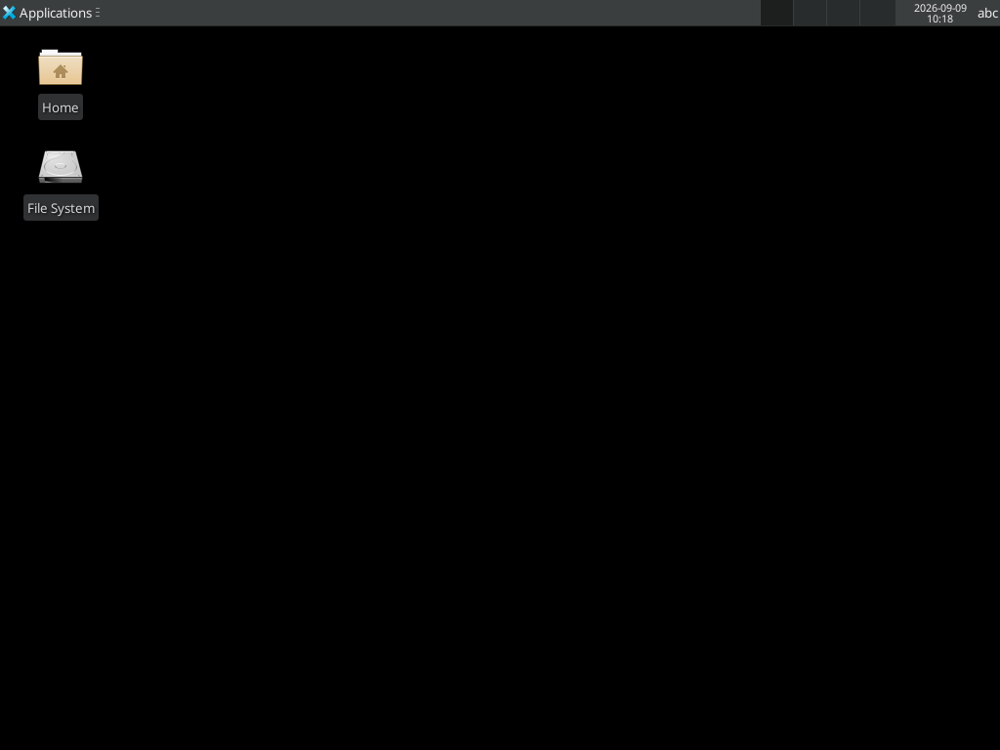

# 01 · Netzwerkgrundlagen & Tools

[:material-file-pdf-box: Als PDF herunterladen](../../pdf/01-netzwerkgrundlagen-tools.pdf){ .md-button }

*Der Desktop nach dem Login. Das Terminal startet ihr per Doppelklick auf das Symbol "Terminal" am linken Rand, abmelden könnt ihr euch oben rechts.*

## Lernziele

- Das TCP/IP-Schichtenmodell nicht nur benennen, sondern in echtem, mit
  Wireshark aufgezeichnetem Verkehr wiedererkennen (Verbindungs-, Netzwerk-,
  Transport- und Anwendungsschicht).
- Grundlegende Netzwerkwerkzeuge sicher anwenden: `ping`, `traceroute`,
  `nslookup`, `netcat`, `dig`, `curl`, `whois`, `nmap`, `scp`, `tcpdump`,
  `netstat`, `ss` und `socat`.
- Den Unterschied zwischen numerischer IP-Adresse und Namensauflösung (DNS)
  erklären und DNS (ein Hilfsdienst, der Namen in Adressen übersetzt) von
  Anwendungsprotokollen wie HTTP unterscheiden, die Nutzdaten transportieren.
- Verschlüsselte und unverschlüsselte Kommunikation im Wireshark-Mitschnitt
  unterscheiden (Klartext-Netcat/HTTP vs. SSH/SCP/HTTPS) und die Grenzen von
  Verschlüsselung benennen (Metadaten bleiben sichtbar, auch wenn der Inhalt
  es nicht ist).
- Einen fehlerhaften TLS-Zertifikat-Zustand im Browser erkennen und
  begründen können, statt ihn wegzuklicken.
- Nachvollziehen, warum in einer gerouteten Topologie nicht jeder Rechner
  jeden anderen direkt erreicht (asymmetrisches Routing).
- Namensauflösung nicht nur benutzen, sondern selbst betreiben: einen kleinen,
  lesbaren DNS-Server starten und an `dig`/`nslookup`/`host` sehen, wie eine
  DNS-Antwort aus Header, Flags, Frage- und Antwortabschnitt entsteht.
- Offene Ports und lauschende Dienste mit `ss` (dem Nachfolger von `netstat`)
  ermitteln und den Klartext-Charakter einfacher TCP-Verbindungen im
  Mitschnitt erkennen.

--8<-- "issue-feedback.md"

## Aufgaben

Das Blatt ist in 3 Meilensteine geteilt. Jeder Meilenstein ist eine eigene Seite und endet mit einer kurzen Zusammenfassung: was ihr gelernt habt und was der nächste Meilenstein bringt. Bearbeitet sie der Reihe nach. Die Teile laufen über die Meilensteine hindurch weiter: Meilenstein 1 enthält Teil 1, Meilenstein 2 Teil 2, Meilenstein 3 die Teile 3 bis 5. Verweise wie „Teil 4" oder „Aufgabe 9" (eine nummerierte Aufgabe in Teil 2) beziehen sich auf diese Zählung.

1. [Meilenstein 1: Schichten im echten Verkehr](m1-schichten-im-echten-verkehr.md){ .meilenstein }  
   Auf dieser Seite zeichnet ihr echten Netzwerkverkehr mit Wireshark auf und ordnet ihn dem TCP/IP-Schichtenmodell zu.
2. [Meilenstein 2: Werkzeuge in der emulierten Topologie](m2-werkzeuge-in-topo01.md){ .meilenstein }  
   Hier startet ihr die emulierte Topologie topo01 und untersucht sie mit den gängigen Netzwerkwerkzeugen.
3. [Meilenstein 3: Dienste selbst betreiben und belauschen](m3-dienste-selbst-betreiben.md){ .meilenstein }  
   Diese Seite dreht die Perspektive um: Ihr betreibt Dienste selbst und seht im Mitschnitt, was auf der Leitung passiert.
