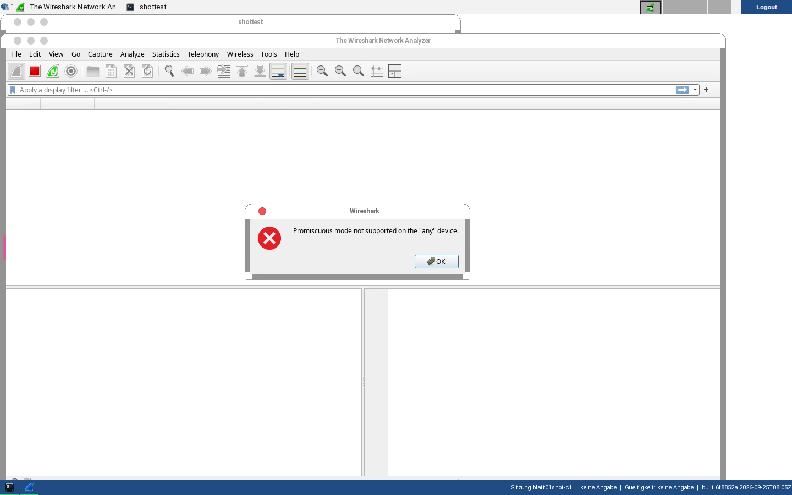
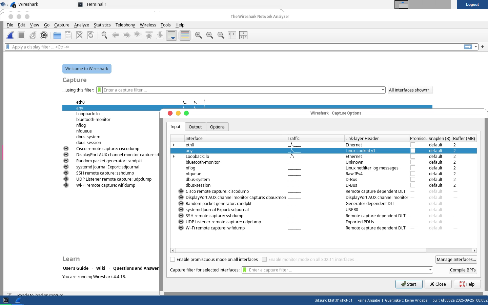
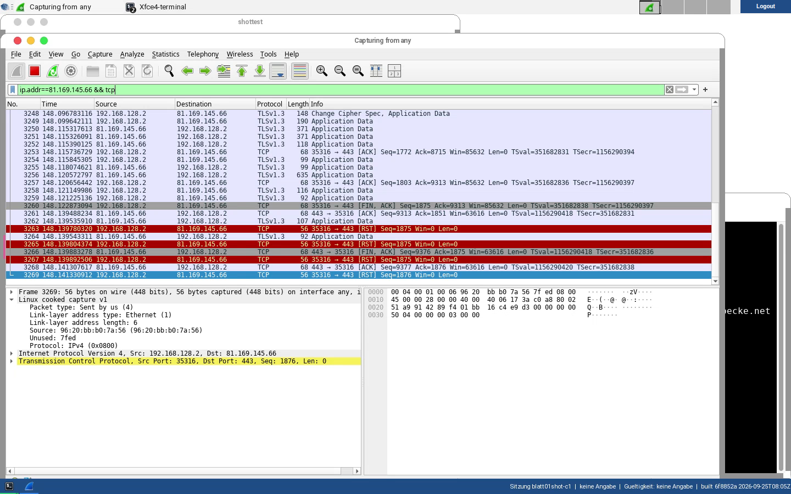
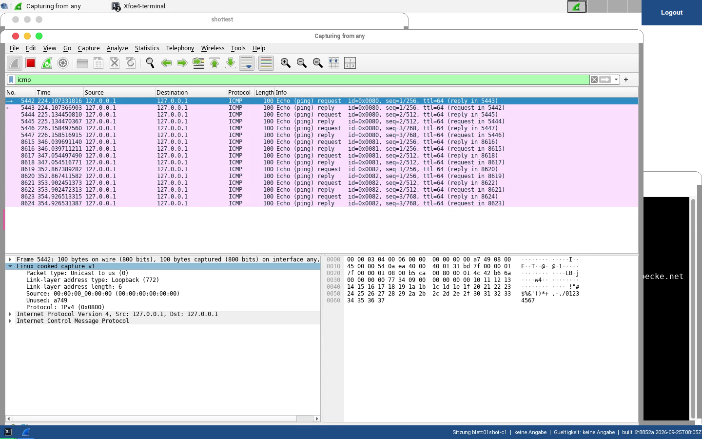

# Meilenstein 1 von 3 · Schichten im echten Verkehr

*01 · Netzwerkgrundlagen & Tools* · [Übersicht des Blatts](index.md)

Auf dieser Seite zeichnet ihr echten Netzwerkverkehr mit Wireshark auf und ordnet ihn dem TCP/IP-Schichtenmodell zu.

<div class="schichtenbild" style="max-width:20rem;margin:0 0 1.2em 0;font-size:.72rem;line-height:1.5">
<div style="margin-bottom:.3em;color:#757575">In diesen Schichten des TCP/IP-Modells bewegt ihr euch hier:</div>
<div style="display:grid;gap:3px">
<div style="padding:.2em .7em;border-radius:3px;background:#3f51b5;color:#fff;font-weight:600;border:1px solid #3f51b5">Anwendungsschicht · Schwerpunkt</div>
<div style="padding:.2em .7em;border-radius:3px;background:#3f51b5;color:#fff;font-weight:600;border:1px solid #3f51b5">Transportschicht · Schwerpunkt</div>
<div style="padding:.2em .7em;border-radius:3px;background:#3f51b5;color:#fff;font-weight:600;border:1px solid #3f51b5">Netzwerkschicht · Schwerpunkt</div>
<div style="padding:.2em .7em;border-radius:3px;background:#3f51b5;color:#fff;font-weight:600;border:1px solid #3f51b5">Netzzugriffsschicht · Schwerpunkt</div>
</div>
</div>

### Teil 1 – Das TCP/IP-Schichtenmodell in echtem Verkehr (außerhalb von Mininet)

!!! abstract "Auf einen Blick"
    **Lernziel:** Ihr zeichnet echten Netzwerkverkehr mit Wireshark auf, findet
    darin eure eigene DNS-Anfrage und eure eigene Web-Anfrage wieder und
    benennt in einem Paket die vier Schichten (Netzzugriff, Netzwerk,
    Transport, Anwendung).

    **Wozu?** Wenn im Firmennetz „das Internet langsam ist" oder ein Dienst
    nicht antwortet, hilft Raten nicht weiter: Ein Netzwerkadmin schneidet den
    Verkehr mit und sieht nach, in welcher Schicht etwas schiefgeht – ob die
    Namensauflösung klemmt, der Verbindungsaufbau scheitert oder der Server
    eine Fehlerseite liefert. Dieselbe Technik nutzen auch
    Sicherheitsteams, um verdächtige Verbindungen zu untersuchen.

    **Vorwissen:** keines. Ihr könnt ein Terminal öffnen und Befehle abtippen;
    alles Weitere wird hier erklärt.

Dieser erste Teil läuft **nicht** in der Mininet-Emulation, sondern direkt auf
eurem Desktop, um reale Kommunikation ins Internet zu beobachten, bevor wir
uns die kontrollierte, emulierte Topologie von `topo01` ansehen.

#### Das Terminal öffnen

Das Terminal auf diesem Desktop ist `xfce4-terminal`. Ihr startet es per
**Doppelklick** auf das Symbol "Terminal" am linken Bildschirmrand (ein Fenster
mit schwarzem Hintergrund). Es öffnet sich im Ordner `~/rn-practice`; `~` heißt
euer Home-Verzeichnis. Tippt hier Befehle ein und bestätigt jede Zeile mit
Enter.

!!! info "Werkzeug: `xfce4-terminal` und `xterm`"
    `xfce4-terminal` ist ein Terminalemulator mit Tabs, eigenen
    Einstellungen und Kopieren/Einfügen per Maus – Doku:
    [docs.xfce.org/apps/xfce4-terminal/getting-started](https://docs.xfce.org/apps/xfce4-terminal/getting-started).
    Der Mininet-Befehl `mininet> xterm <node>` (z. B. `mininet> xterm h1` in
    [Teil 2](m2-werkzeuge-in-topo01.md#teil-2-werkzeuge-in-der-emulierten-topologie-topo01)) öffnet auf diesem Desktop ebenfalls ein `xfce4-terminal`-Fenster.

**Übung:** Öffnet ein Terminal über das Symbol und lasst es für die
folgenden Schritte offen.

!!! info "Wie die Befehle in diesem Blatt gekennzeichnet sind"
    Auf diesem Desktop gibt es zwei Arten von Terminalfenstern. Ihr müsst sie
    auseinanderhalten:

    - **Normales Terminal** (Symbol „Terminal"): Die Eingabeaufforderung
      beginnt mit `cads@…`. Befehle ohne Präfix, wie `wireshark &` in Teil 1,
      tippt ihr hier.
    - **Knotenfenster** der emulierten Topologie (ab [Teil 2](m2-werkzeuge-in-topo01.md#teil-2-werkzeuge-in-der-emulierten-topologie-topo01)): Der Fenstertitel
      lautet „Node: h1" bzw. „Node: h2", die Eingabeaufforderung
      `root@…:~/rn-practice/topo01#`. Sie sieht in **allen** Knotenfenstern
      gleich aus – achtet auf den **Fenstertitel**.

    `h1$ ping -c 4 10.0.6.2` heißt: Tippt nur `ping -c 4 10.0.6.2` (ohne das
    `h1$`) in das Fenster „Node: h1". Entsprechend steht `h2$` für „Node: h2".
    `mininet> pingall` heißt: Tippt `pingall` in das Terminal, in dem ihr
    `./start-topo01.sh` gestartet habt; dort bleibt der Prompt `mininet>`
    stehen, solange das Netz läuft.

--8<-- "issue-feedback.md"

#### Schritt 1: Wireshark starten und aufzeichnen

!!! info "Werkzeug: Wireshark"
    **Was es tut:** Wireshark schneidet den Verkehr auf einer oder mehreren
    Netzwerkschnittstellen mit und zeigt jedes einzelne Paket samt aller
    enthaltenen Protokollschichten an. Es sieht alle Schichten, von der
    Netzzugriffsschicht bis zur Anwendung.

    **Aufruf und wichtige Stellen:**

    - `wireshark &` – startet das Programm; das `&` am Ende hält das Terminal
      frei für weitere Befehle. Ihr braucht dafür keine Administratorrechte.
    - Schnittstelle `any` – fasst alle Schnittstellen in einer Aufzeichnung
      zusammen.
    - Zeile „Apply a display filter…" – der **Anzeigefilter**, z. B. `dns`
      oder `icmp`: blendet alles andere nur aus (aufgezeichnet wird weiter).
    - Rechtsklick auf ein Paket → „Follow → TCP Stream" – zeigt eine ganze
      Verbindung am Stück.
    - Rotes Quadrat in der Symbolleiste – beendet die Aufzeichnung.

    **Beispiel, Zeile für Zeile gelesen** (Anzeigefilter `dns`, aus Schritt 2):

    ```text
    No. Time      Source          Destination     Protocol Length Info
    1   0.000000  172.17.0.11     141.22.192.100  DNS      71     Standard query 0xb669 A becke.net
    2   0.000283  141.22.192.100  172.17.0.11     DNS      87     Standard query response 0xb669 A becke.net A 81.169.145.66
    ```

    `No.` ist die laufende Paketnummer, `Time` die Sekunden seit dem Start
    der Aufzeichnung, `Source`/`Destination` sind Absender und Empfänger
    (eure Adresse und die des Resolvers), `Protocol` das erkannte
    Anwendungsprotokoll, `Length` die Paketgröße in Bytes. In `Info` steht die
    Frage „A becke.net" (Adresse zu diesem Namen?) und in Zeile 2 die Antwort
    mit der IPv4-Adresse. Die zusammengehörige Antwort trägt dieselbe
    Kennung (`0xb669`).

    **Typische Fehlermeldung:** „Promiscuous mode not supported on the `any`
    device":

    
    *Der Dialog erscheint, wenn beim Start der Haken „Promiscuous mode" gesetzt ist. Im Desktop-Image ist er schon abgewählt; ihr seht den Dialog dann normalerweise nicht.*

    Der Promiscuous-Modus lässt eine einzelne Netzwerkkarte auch Verkehr
    mitschneiden, der nicht an sie adressiert ist. Die Sammel-Schnittstelle
    `any` kann das nicht. Bestätigt mit OK; Wireshark zeichnet dann ohne
    Promiscuous-Modus weiter auf. Offizielle Doku:
    [wireshark.org/docs](https://www.wireshark.org/docs/).

1. Tippt im offenen Terminal:

    ```bash
    wireshark &
    ```

    Es öffnet sich das Wireshark-Hauptfenster mit der Willkommensseite. Im Bereich "Capture"
    seht ihr eine Liste der Schnittstellen, unter anderem `eth0`, `any` und
    `Loopback: lo`.

2. Wählt die Zeile **`any`** aus (sie fasst alle Schnittstellen in einer
    Aufzeichnung zusammen – genau das braucht ihr hier: Schritt 2 und 6
    erzeugen nämlich teils rein lokalen Verkehr, der `eth0` nie erreicht) und
    öffnet über `Capture → Options…` (oder `Strg+K`) die
    Aufzeichnungsoptionen. Prüft dort unten links, dass der Haken
    **"Enable promiscuous mode on all interfaces" abgewählt** ist, bevor ihr
    startet (im Image ist er es bereits – setzt ihn nicht):

    
    *Die Einstellung vor dem Start: „any" ausgewählt, Promiscuous-Modus abgewählt.*

3. Klickt "Start". Die Aufzeichnung läuft jetzt auf `any`. (Ohne die
    Optionen geht es auch schneller: Ein **Doppelklick** auf die
    Schnittstellenzeile im Startfenster beginnt sofort mit dem Mitschnitt.)

    !!! note "Die Paketliste füllt sich laufend"
        Ihr seht den gesamten Verkehr aller Schnittstellen, auch den des
        Desktop-Streamings, über das ihr diesen Desktop im Browser seht.
        Drei Fensterbereiche sind wichtig:

        - oben die **Paketliste** (eine Zeile pro Paket),
        - in der Mitte der **Detailbaum** (Schicht für Schicht aufklappbar –
          genau den braucht ihr in Schritt 5),
        - unten die **Hex-/ASCII-Rohdaten** des gerade ausgewählten Pakets.

        Gefiltert wird über die Zeile "Apply a display filter…" (Anzeigefilter,
        nicht zu verwechseln mit dem Aufzeichnungsfilter in den
        Capture-Optionen), siehe Schritt 4.

--8<-- "issue-feedback.md"

#### Schritt 2: `nslookup` – die IP-Adresse ermitteln

!!! info "Werkzeug: `nslookup`"
    **Was es tut:** `nslookup` fragt einen DNS-Server nach der IP-Adresse, die
    zu einem Domainnamen gehört (Namensauflösung, Anwendungsschicht) –
    grundsätzlich das, was ein Browser vor jedem Seitenaufruf automatisch im
    Hintergrund erledigt. Hier ermittelt es die IPv4-Adresse von `becke.net`,
    damit ihr den Mitschnitt gezielt auf diese Adresse filtern könnt.

    **Aufruf:**

    - `nslookup <name>` – fragt den Resolver, der in `/etc/resolv.conf` steht.
    - `nslookup <name> <server>` – fragt stattdessen den genannten Server.

    **Beispielausgabe, Zeile für Zeile gelesen:**

    ```text
    $ nslookup becke.net
    Server:		<Adresse eures Resolvers>
    Address:	<Adresse eures Resolvers>#53

    Non-authoritative answer:
    Name:	becke.net
    Address: 81.169.145.66
    ```

    `Server`/`Address` nennen den befragten Resolver samt Port (`#53` ist der
    DNS-Port). „Non-authoritative answer" heißt: Der Resolver hat die Antwort
    von einem anderen Server übernommen und ist selbst nicht für `becke.net`
    zuständig. `Name` und `Address` sind das Ergebnis.

    **Typische Fehlermeldung:** `** server can't find gibtsnicht.invalid:
    NXDOMAIN` bedeutet: Der Name existiert nicht. Kommt stattdessen
    `connection timed out; no servers could be reached`, antwortet der
    Resolver gar nicht.

1. Öffnet ein **zweites** Terminal (Wireshark läuft im ersten weiter), am
    einfachsten mit `Strg+Umschalt+N` im Terminalfenster, und führt dort aus.
    Das neue Fenster erscheint manchmal erst nach einigen Sekunden und kann
    hinter Wireshark liegen; holt es dann über die Fensterliste oben links
    nach vorn (siehe
    [Fenster wiederfinden und tippen](../../reference/umgebung.md#fenster-wiederfinden-und-tippen)):

    ```bash
    nslookup becke.net
    ```

    Merkt euch die ausgegebene IPv4-Adresse – ihr braucht sie gleich für den
    Wireshark-Filter. (Bei euch kann die Adresse abweichen.)

    !!! note "Welcher DNS-Server ist das bei euch?"
        Die Adresse hinter `Server:` hängt von der Umgebung ab. Lest nach,
        welche bei euch gilt, statt sie zu raten:

        ```bash
        cat /etc/resolv.conf
        ```

        Die Zeile `nameserver …` nennt den Resolver, den `nslookup` benutzt.
        Notiert die Adresse; gleich in Punkt 2 seht ihr in Wireshark, dass
        die DNS-Anfrage genau an sie geht.

2. Wechselt zu Wireshark und tippt in die Anzeigefilter-Zeile oben `dns`,
    dann Enter, um die soeben erzeugte DNS-Abfrage wiederzufinden:

    !!! note "Eure Anzeige kann abweichen"
        Je nach Standort stehen bei `Source`/`Destination` andere Adressen
        (z. B. der Docker-Resolver `127.0.0.11` oder der Cluster-DNS
        `10.43.0.10`) statt der im Bild. Manchmal seht ihr auch deutlich
        mehr DNS-Pakete, weil zusätzlich Suchdomänen abgefragt werden, und
        `nslookup` meldet vorab Zeilen wie `Got recursion not available`.
        Die Zusatzanfragen kommen von `search` und `options ndots:` in
        `/etc/resolv.conf`; Antworten wie „No such name" darauf sind normal.
        Sucht dann die Zeile mit `A becke.net` oder filtert mit
        `dns.qry.name == "becke.net"`. Ruft ihr in Schritt 3 `curl` auf,
        kommen für denselben Namen noch einmal DNS-Zeilen hinzu.

    
    *Die DNS-Anfrage (Protokollspalte „DNS") und ihre Antwort, direkt nach `nslookup becke.net`.
    Je zweimal, weil `nslookup` die Adresse (A) und die IPv6-Adresse (AAAA) abfragt.
    Die Adressen in Source und Destination sind die eures Desktops und eures Resolvers.*

    Ihr seht die Anfrage ("Standard query … A becke.net") und die Antwort
    ("Standard query response … A becke.net A …") als eigene Zeilen mit
    Protokoll "DNS".

    !!! note "Warum die Pakete an euren Resolver gehen, nicht an `becke.net`"
        Die DNS-Anfrage geht an den Resolver aus `/etc/resolv.conf`, nicht
        direkt an den für `becke.net` zuständigen Server. Der Resolver
        reicht die Anfrage weiter; diese Weiterleitung seht ihr in eurem
        Mitschnitt nicht. Das ist mit ein Grund, warum in Schritt 1 auf der
        Pseudo-Schnittstelle `any` mitgeschnitten wird: `any` erfasst alle
        Schnittstellen, auch rein lokalen Verkehr.

--8<-- "issue-feedback.md"

#### Schritt 3: `curl` – Verkehr zur ermittelten Adresse erzeugen

!!! info "Werkzeug: `curl`"
    **Was es tut:** `curl` schickt eine Anfrage an einen Server und gibt die
    Antwort aus – wie ein Browser, nur ohne grafische Darstellung
    (Anwendungsschicht: HTTP/HTTPS). Hier erzeugt es gezielt echten Verkehr
    zu der eben ermittelten Adresse.

    **Aufruf:**

    - `curl <url>` – ruft die Adresse ab und gibt den Inhalt aus.
    - `curl -I <url>` – zeigt nur die Kopfzeilen der Antwort.
    - `curl -k <url>` – ignoriert ein ungültiges Zertifikat (nur zum
      Experimentieren, nie im Alltag).

    **Beispielausgabe** von `curl -I https://becke.net`, Zeile für Zeile:

    ```text
    HTTP/2 200
    last-modified: Mon, 12 Feb 2024 11:37:58 GMT
    content-length: 422
    content-type: text/html
    server: Apache/2.4.69 (Unix)
    ```

    `HTTP/2 200` ist die Statuszeile: Protokollversion und Statuscode
    (`200` = alles in Ordnung, `404` = Seite nicht gefunden). Darunter stehen
    Kopfzeilen: wann die Seite zuletzt geändert wurde, wie groß sie ist
    (422 Bytes), welchen Typ sie hat und welche Server-Software antwortet.
    Eure Werte weichen ab (Serverversion, Zeiten). Die 422 Bytes sind bei
    `becke.net` derzeit eine kleine Weiterleitungsseite, keine Startseite.

    **Typische Fehlermeldung:** `curl: (6) Could not resolve host:
    gibtsnicht.invalid` – der Name ließ sich nicht in eine Adresse auflösen
    (also ein DNS-Problem, kein Webserver-Problem).

Tippt im zweiten Terminal:

```bash
curl https://becke.net
```

Die Ausgabe ist der HTML-Quelltext der Seite. Bei `becke.net` ist das eine
kurze Weiterleitungsseite: Ihr seht unter anderem `<title>Weiterleitung</title>`,
einen `meta`-Eintrag mit `http-equiv="refresh"`, der auf eine andere Adresse
verweist, und den Satz „Sie werden automatisch in
0 Sekunden weitergeleitet." `curl` folgt dieser Weiterleitung nicht; für diesen
Schritt zählt nur der erzeugte Netzwerkverkehr.

--8<-- "issue-feedback.md"

#### Schritt 4: Auf den erzeugten Verkehr filtern

Filtert in Wireshark auf genau diesen Verkehr, damit ihr nicht im restlichen
Hintergrundrauschen des Betriebssystems sucht:

```text
ip.addr == <eure ermittelte IP-Adresse>
```

Macht anschließend einen Rechtsklick auf eines der gefilterten TCP-Pakete und
wählt "Follow → TCP Stream" (im Untermenü „Follow" steht daneben auch „TLS
Stream"; nehmt „TCP Stream"). Wireshark zeigt dann die gesamte Übertragung
dieser einen Verbindung am Stück. Weil Schritt 3 die Seite über HTTPS abruft,
seht ihr nach dem Beginn des TLS-Handshakes nur verschlüsselte, nicht lesbare
Bytes; in [Teil 2](m2-werkzeuge-in-topo01.md#teil-2-werkzeuge-in-der-emulierten-topologie-topo01) folgt ihr auf demselben Weg einem unverschlüsselten Strom.
Dabei öffnet sich ein zusätzliches Fenster „Follow TCP Stream". Schließt es
mit **Close** (oder **Back**). Im Hauptfenster steht jetzt der Filter
`tcp.stream eq <Nummer>` anstelle eures Anzeigefilters – tragt für Schritt 5
wieder den Filter von oben ein. Klickt dazu ins Filterfeld und löscht den alten
Text vollständig (Text markieren und Entf, oder der X-Knopf rechts im Feld),
bevor ihr tippt: Sonst hängt sich der neue Text an den alten an, und das Feld
wird rot.

--8<-- "issue-feedback.md"

#### Schritt 5: Die vier Schichten im Detailbaum identifizieren

!!! info "Was ist überhaupt eine „Schicht"?"
    Das TCP/IP-Modell teilt Netzwerkkommunikation in mehrere **Schichten**
    auf. Jede Schicht löst dabei ein eigenes, abgegrenztes Teilproblem
    (z. B. "wie kommen Bits über ein Kabel/Funk" oder "wie findet ein Paket
    den richtigen Rechner im Internet") und verpackt dafür die Daten der
    jeweils darüberliegenden Schicht in ihren eigenen Umschlag (Header) –
    von den Anwendungsdaten ganz oben bis zu den elektrischen/optischen
    Bits ganz unten. Diese Unterteilung gibt es, damit jede Schicht
    unabhängig von den anderen ausgetauscht oder verstanden werden kann:
    Ethernet lässt sich durch WLAN ersetzen, ohne dass HTTP davon etwas
    merkt. Im Wireshark-Detailbaum (mittlerer Fensterbereich, siehe
    Schritt 1) seht ihr das ganz konkret: Die eingerückten Zeilen SIND die
    Schichten, von außen/unten nach innen/oben aufgeklappt – die äußerste
    Zeile ist die unterste Schicht (Übertragung), die innerste die oberste
    (Anwendung).

Wählt eines der TCP-Pakete dieser Kommunikation aus, das euer Desktop
**gesendet** hat (ein Klick in der Paketliste; als `Source` steht eure eigene
Adresse, z. B. beim „Client Hello"), und klappt im Detailbaum von außen/unten nach innen/oben die
einzelnen Zeilen auf. Ordnet die Schichten zu:

- **Anwendungsschicht:** HTTP (bzw. TLS-Record bei HTTPS)
- **Transportschicht:** TCP-Segment (Ports, Sequenznummern, Flags)
- **Netzwerkschicht:** IP-Header (IPv4 oder IPv6, Quell-/Zieladresse)
- **Netzzugriffsschicht:** *siehe Hinweis direkt darunter – hier nicht der
  klassische Ethernet-Header*

!!! info "Netzzugriffsschicht bei „any": „Linux cooked capture" statt Ethernet-Header"
    Weil ihr auf der Pseudo-Schnittstelle `any` mitschneidet (Schritt 1),
    zeigt die Netzzugriffsschicht hier **„Linux cooked capture v1"** (kurz
    SLL) statt eines echten Ethernet-Headers – `any` kapselt mehrere,
    unterschiedliche Schnittstellen einheitlich in dieses Pseudo-Format, das
    keinen vollständigen Ethernet-Header (mit Ziel-MAC) kennt, aber
    trotzdem nützliche Link-Layer-Informationen mitbringt:

    
    *„Linux cooked capture v1" für den Verkehr zu becke.net: „Link-layer address type: Ethernet (1)" und die echte MAC-Adresse eurer Schnittstelle als „Source".*

    Achtet auf zwei Felder: **"Link-layer address type"** (hier `Ethernet
    (1)` – das Paket lief tatsächlich über eine echte, Ethernet-artige
    Schnittstelle) und **"Source"** (eine echte Hardware-MAC-Adresse). Beide
    kommen in Schritt 6 wieder vor, mit einem auffälligen Unterschied.
    Wählt ihr stattdessen ein **empfangenes** Paket (Source ist der Server),
    steht dort „Unicast to us (0)" und als „Source" die MAC-Adresse des
    Gateways, über das die Antwort hereinkam – nicht die eurer Schnittstelle.

!!! question "Nachgedacht: Welche Schnittstelle war das?"
    Auf welcher tatsächlichen Schnittstelle (nicht `any`) lief dieses Paket
    vermutlich – und woran im Detailbaum könnt ihr das festmachen, obwohl
    `any` selbst kein echter Ethernet-Header ist?

    ??? success "Lösung"
        Vermutlich auf `eth0`, der einzigen echten Netzwerkkarte des
        Desktops (`lo` ist die Loopback-Schnittstelle). Festmachen lässt sich
        das an „Link-layer address type: Ethernet (1)" und der echten
        MAC-Adresse in „Source": Beides gibt es nur bei einer
        Ethernet-artigen Schnittstelle. „Packet type: Sent by us" sagt
        zusätzlich, dass das Paket euer Rechner abgeschickt hat.

Wenn der Bildschirm zu voll wird, könnt ihr das Terminalfenster mit
`nslookup`/`curl` schließen. **Wireshark lasst ihr laufen**, ihr braucht es in
Schritt 6.

--8<-- "issue-feedback.md"

#### Vom externen zum lokalen Verkehr: Wechsel zu Schritt 6

Bisher habt ihr Verkehr zu einem echten Server im Internet (`becke.net`)
untersucht. Schritt 6 wechselt bewusst zu rein lokalem Verkehr: Ihr
schickt Pakete an euch selbst (`127.0.0.1`, die Loopback-Adresse), die nie
eine echte Netzwerkkarte durchlaufen. Die neue Frage lautet: Wie sieht
dieselbe Schichten-Analyse aus Schritt 5 aus, wenn gar keine echte Hardware
beteiligt ist? Der Aufbau bleibt dabei gleich – ihr filtert wieder in
derselben laufenden Wireshark-Aufzeichnung auf `any`, diesmal nur mit einem
anderen Anzeigefilter (`icmp` statt der IP-Adresse von eben).

#### Schritt 6: `ping 127.0.0.1` – dasselbe Experiment rein lokal

!!! info "Werkzeug: `ping`"
    **Was es tut:** `ping` schickt kleine Testpakete (ICMP „Echo Request",
    Netzwerkschicht) an eine Zieladresse und misst, ob und wie schnell eine
    Antwort („Echo Reply") zurückkommt – der klassische erste Test, ob ein
    Rechner erreichbar ist. Hier zielt ihr bewusst auf euch selbst
    (`127.0.0.1`).

    **Aufruf:**

    - `ping <ziel>` – schickt Pakete, bis ihr mit `Strg+C` abbrecht.
    - `ping -c 4 <ziel>` – schickt genau vier Pakete.
    - `ping -W 2 <ziel>` – wartet höchstens 2 Sekunden auf jede Antwort.

    **Beispielausgabe, Zeile für Zeile gelesen:**

    ```text
    $ ping -c 3 127.0.0.1
    PING 127.0.0.1 (127.0.0.1) 56(84) bytes of data.
    64 bytes from 127.0.0.1: icmp_seq=1 ttl=64 time=0.072 ms
    64 bytes from 127.0.0.1: icmp_seq=2 ttl=64 time=0.053 ms
    64 bytes from 127.0.0.1: icmp_seq=3 ttl=64 time=0.051 ms

    --- 127.0.0.1 ping statistics ---
    3 packets transmitted, 3 received, 0% packet loss, time 2040ms
    rtt min/avg/max/mdev = 0.051/0.058/0.072/0.009 ms
    ```

    `56(84) bytes`: 56 Byte Nutzdaten, 84 Byte als IP-Paket (20 Byte
    IP-Kopf + 8 Byte ICMP-Kopf + 56 Byte Daten). Wireshark zeigt hier
    100 Byte, weil bei der Schnittstelle `any` der 16 Byte lange „Linux
    cooked"-Kopf mitgezählt wird (auf einer echten Ethernet-Schnittstelle
    wären es 98). In jeder
    Antwortzeile ist `icmp_seq` die laufende Nummer, `ttl` die verbleibende
    Lebensdauer des Pakets (jeder Router auf dem Weg zählt sie um 1 herunter;
    64 ist der Startwert, hier also kein Router dazwischen) und `time` die
    Umlaufzeit (Round-Trip-Time, RTT) in Millisekunden. Die Statistik fasst
    zusammen: gesendet, empfangen, Verlust, kleinste/mittlere/größte RTT.

    **Typische Fehlermeldungen:**

    - `ping: gibtsnicht.invalid: Name or service not known` – der Name ließ
      sich nicht auflösen.
    - `100% packet loss` ohne weitere Meldung – es kommt keine Antwort (Ziel
      aus, falsche Adresse, oder jemand verwirft die Pakete still).
    - `From 10.0.6.1 icmp_seq=1 Destination Net Unreachable` – ein Router
      meldet ausdrücklich, dass er keinen Weg zum Ziel kennt.

```bash
ping 127.0.0.1
```

(`Strg+C` beendet `ping`, falls es weiterläuft – für den Mitschnitt reichen
wenige Sekunden.)

Filtert in Wireshark auf `icmp` und seht euch den Detailbaum eines der Pakete
an. Hier findet ihr nur **zwei** der vier Schichten: die Netzzugriffsschicht
(„Linux cooked capture") und die Netzwerkschicht (IPv4 samt ICMP – ICMP gehört
zur Netzwerkschicht). Eine Transport- und eine Anwendungsschicht gibt es
nicht, weil `ping` weder TCP/UDP noch Anwendungsdaten verwendet.

!!! info "Netzzugriffsschicht bei „any": Loopback statt Ethernet"
    
    *„Linux cooked capture v1" für den Loopback-Verkehr: „Link-layer address type: Loopback (772)" und eine Adresse aus lauter Nullen als „Source".*

    Auch hier zeigt die Netzzugriffsschicht "Linux cooked capture v1" (wie in
    Schritt 5, ein Merkmal der Pseudo-Schnittstelle `any`). Der Unterschied liegt in denselben zwei Feldern wie eben:
    **"Link-layer address type"** steht auf `Loopback (772)` statt
    `Ethernet (1)`, und **"Source"** ist `00:00:00:00:00:00` – eine
    Adresse aus lauter Nullen, weil hier keine echte Netzwerkkarte beteiligt
    war, die eine eigene MAC-Adresse mitbringen könnte.

!!! question "Nachgedacht: Was sagt eine Null-MAC-Adresse?"
    Vergleicht die beiden Felder "Link-layer address type" und "Source" aus
    Schritt 5 und Schritt 6 direkt gegenüber. Was sagt eine
    Null-MAC-Adresse über den Weg aus, den ein Paket zurückgelegt hat – und
    welche Erwartung leitet ihr daraus für künftige Mitschnitte ab, wenn ihr
    eine Adresse wie `00:00:00:00:00:00` seht?

    ??? success "Lösung"
        Das Paket hat den Rechner nie verlassen: Es lief nur über die
        Loopback-Schnittstelle, ohne echte Netzwerkkarte, und deshalb gibt es
        keine Hardware-Adresse. Sieht man in einem Mitschnitt
        `00:00:00:00:00:00` (Typ „Loopback"), handelt es sich also um
        rein lokalen Verkehr zwischen Programmen desselben Rechners – er
        taucht auf keinem Kabel auf und ist von außen nicht beobachtbar.

!!! tip "Euer eigenes Notizbuch"
    Legt euch unter `~/rn-practice/notizbuch.md` eine eigene Datei an und
    tragt dort Befehle und Wireshark-Filter ein, die ihr euch merken wollt.
    Im Image ist dafür der Editor `mousepad` vorhanden:
    `mousepad ~/rn-practice/notizbuch.md &` im normalen Terminal.

Schließt zum Abschluss dieses Teils Wireshark und das Terminal und öffnet für
[Teil 2](m2-werkzeuge-in-topo01.md#teil-2-werkzeuge-in-der-emulierten-topologie-topo01) ein neues Terminal. Beim Schließen (`Strg+Q`) fragt Wireshark, ob der Mitschnitt
gespeichert werden soll: Wählt bei laufender Aufzeichnung **„Stop and Quit
without Saving"** (steht die Aufzeichnung, heißt der Knopf „Quit without
Saving" bzw. „Continue without Saving"); den Mitschnitt braucht ihr nicht.

!!! success "Meilenstein 1 geschafft"
    **Das habt ihr gelernt:**

    - Eigene DNS- und Web-Anfragen in einem Wireshark-Mitschnitt finden.
    - In einem einzelnen Paket die vier Schichten (Netzzugriff, Netzwerk, Transport, Anwendung) benennen.
    - DNS als Hilfsdienst zur Namensauflösung von Anwendungsprotokollen wie HTTP unterscheiden, die Nutzdaten transportieren.

    **Was Meilenstein 2 verspricht:** Als Nächstes startet ihr ein kleines emuliertes Netz mit zwei Endgeräten und zwei Routern und untersucht es mit ping, traceroute, dig, whois, nmap und Wireshark. Das Schichtenwissen hilft euch, die Ausgaben einzuordnen.

    [Weiter zu Meilenstein 2: Werkzeuge in der emulierten Topologie](m2-werkzeuge-in-topo01.md){ .md-button }
