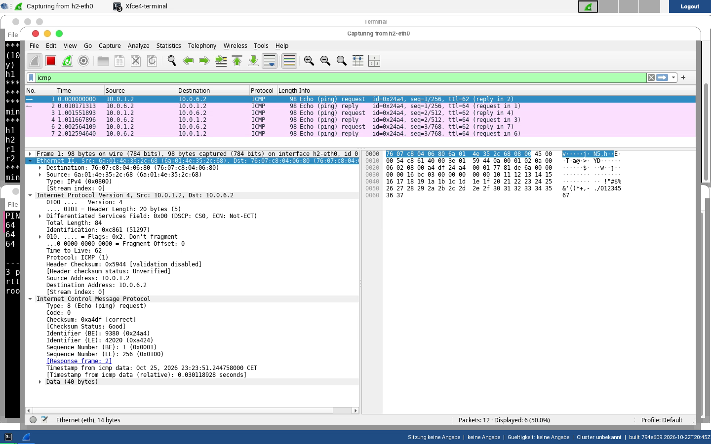

# Meilenstein 2 von 3 · Werkzeuge in der emulierten Topologie

*01 · Netzwerkgrundlagen & Tools* · [Übersicht des Blatts](index.md)

Hier startet ihr die emulierte Topologie topo01 und untersucht sie mit den gängigen Netzwerkwerkzeugen.

<div class="schichtenbild" style="max-width:20rem;margin:0 0 1.2em 0;font-size:.72rem;line-height:1.5">
<div style="margin-bottom:.3em;color:#757575">In diesen Schichten des TCP/IP-Modells bewegt ihr euch hier:</div>
<div style="display:grid;gap:3px">
<div style="padding:.2em .7em;border-radius:3px;background:#3f51b5;color:#fff;font-weight:600;border:1px solid #3f51b5">Anwendungsschicht · Schwerpunkt</div>
<div style="padding:.2em .7em;border-radius:3px;background:#3f51b5;color:#fff;font-weight:600;border:1px solid #3f51b5">Transportschicht · Schwerpunkt</div>
<div style="padding:.2em .7em;border-radius:3px;background:#3f51b5;color:#fff;font-weight:600;border:1px solid #3f51b5">Netzwerkschicht · Schwerpunkt</div>
<div style="padding:.2em .7em;border-radius:3px;color:#9e9e9e;border:1px dashed #9e9e9e">Netzzugriffsschicht</div>
</div>
</div>

### Teil 2 – Werkzeuge in der emulierten Topologie `topo01`

!!! abstract "Auf einen Blick"
    **Lernziel:** Ihr startet ein emuliertes Netz aus zwei Endgeräten und zwei
    Routern, prüft mit `ping`, `traceroute`, `dig`, `nmap` und `netstat` (`ss` folgt in Meilenstein 3),
    wer wen erreicht, und beobachtet mit Wireshark, welche Verbindungen im
    Klartext und welche verschlüsselt laufen.

    **Wozu?** Ein Netz erst aufzubauen und dann kaputtzumachen ist die
    sicherste Art, die Werkzeuge der Netzwerkadmins kennenzulernen. Wer
    nachts gerufen wird, weil eine Filiale nicht erreichbar ist, tippt genau
    diese Befehle: erst `ping` und `traceroute` (wo endet der Weg?), dann
    `dig` (stimmt die Namensauflösung?), dann `nmap` und `ss` (läuft der
    Dienst, ist der Port offen?). Und wer Sicherheit ernst nimmt, muss wissen,
    was ein Angreifer im Mitschnitt sieht.

    **Vorwissen:** [Teil 1](m1-schichten-im-echten-verkehr.md#teil-1-das-tcpip-schichtenmodell-in-echtem-verkehr-auerhalb-von-mininet) (Wireshark, `ping`, Schichten).

Ab hier arbeitet ihr in der Mininet-Emulation. Die Topologie `topo01` besteht
aus zwei Endgeräten `h1` (`10.0.1.2`) und `h2` (`10.0.6.2`) und zwei Routern
`r1`/`r2` dazwischen. Nur `h1` hat zusätzlich über `h1-eth0` (`10.0.5.2`) einen
NAT-Uplink ins Internet; `r1` und `r2` kennen keinen Weg nach draußen.
Aufgaben mit Internet- oder DNS-Zugriff führt ihr deshalb auf `h1` aus.
Die Aufgaben dieser Seite sind von 1 bis 11 durchnummeriert; Verweise wie
„Aufgabe 9" (auch auf der nächsten Seite) meinen genau diese Zählung.

```text
Internet ── NAT (10.0.5.1) ── h1-eth0  h1  h1-eth1 (10.0.1.2) ── r1 ── 10.0.4.0/24 ── r2 ── (10.0.6.2) h2
```

1. **Netz starten.** Läuft noch eine andere Topologie, beendet sie vorher
    mit `exit` bzw. `quit` auf ihrer Mininet-Konsole. Wechselt dann in das
    Topologie-Verzeichnis und startet die Emulation:

    ```bash
    cd ~/rn-practice/topo01
    ./start-topo01.sh
    ```

    Das Skript richtet den NAT-Uplink und die Namensauflösung ein und startet
    danach `topo01.py`. Auf `h1` läuft ein DNS-Dienst (`dnsmasq`,
    `10.0.1.2`), der die Namen `h1` und `h2` kennt und alle anderen Namen an
    einen DNS-Server weiterreicht, der aus diesem Netz erreichbar ist.
    Startet `topo01.py` nicht direkt, sondern immer über `start-topo01.sh`.

    Das Terminal, in dem ihr das Skript gestartet habt, ist jetzt die
    Mininet-Konsole (`mininet>`). Erscheint stattdessen eine Fehlermeldung und
    kein `mininet>`, startet das Skript noch einmal; hilft das nicht, meldet
    euch beim Betreuer.

    Nach dem Start öffnen sich zwei Terminalfenster, eines für `h1` und eines
    für `h2` (Titel „Node: h1" und „Node: h2"). In diesen Knoten-Terminals
    seid ihr `root`; die Eingabeaufforderung sieht in beiden gleich aus. Die
    Fenster können übereinander liegen oder komplett hinter der
    Mininet-Konsole verschwinden. Gleichartige Fenster fasst die Leiste oben links
    zu einem Eintrag „Xfce4-terminal" zusammen; ein Klick darauf klappt eine
    Liste aller Fenster auf, aus der ihr das gewünschte per Klick auf den
    Namen nach vorn holt (das ✕ daneben schließt es). Alternativ zieht ihr
    die Fenster am Titelbalken auseinander; der Fenstertitel („Node: h1", „Node: h2",
    „Terminal") verrät, wo ihr tippt. Mehr dazu in
    der [Umgebungsreferenz](../../reference/umgebung.md#fenster-wiederfinden-und-tippen). Für die Router
    `r1`/`r2` oder ein versehentlich geschlossenes Fenster öffnet ihr auf der
    Mininet-Konsole ein weiteres Terminal:

    ```text
    mininet> xterm <node>
    ```

    z. B. `mininet> xterm r1`.

    Prüft auf der Mininet-Konsole, ob jeder jeden erreicht:

    ```text
    mininet> pingall
    ```

    (Fehlt nach einem Fensterwechsel der erste Buchstabe, z. B. `ingall`,
    klickt zuerst ins Fenster, wartet kurz und tippt erneut – siehe
    [Umgebungsreferenz](../../reference/umgebung.md#fenster-wiederfinden-und-tippen).)

    
    *Oben die Mininet-Konsole nach `pingall`, unten die Knoten-Terminals von `h1` und `h2`.*

    `pingall` braucht etwa eine Minute, weil die fehlgeschlagenen Pings auf
    ihre Zeitüberschreitung warten. Nutzt die Zeit: Seht euch den Netzplan
    oben an und vermutet, welche Verbindungen fehlen werden. Erwartet wird
    **`16% dropped (10/12 received)`**. Jede Zeile heißt „dieser
    Knoten hat diese Ziele erreicht"; das `X` markiert ein Ziel, das nicht
    geantwortet hat.

    !!! question "Nachgedacht: Welche zwei Verbindungen fehlen – und warum?"
        Lest das `pingall`-Ergebnis: Zwischen welchen beiden Knoten fehlt die
        Verbindung (je eine Richtung ergibt ein `X`)? Schaut dazu auf `h1` in
        die Routing-Tabelle und vergleicht sie mit dem Netzplan oben:

        ```bash
        h1$ ip route
        ```

        ??? success "Lösung"
            Es fehlen `h1 → r2` und `r2 → h1`. Alle anderen zehn Paare
            antworten (auch `h1` ↔ `h2`). Die Tabelle von `h1` hat vier
            Zeilen: das eigene Netz `10.0.1.0/24`, den Uplink `10.0.5.0/24`
            und `10.0.6.0/24` über `r1` – dazu als vierte die Standardroute
            (`default`) ins Internet. Das Transitnetz `10.0.4.0/24` zwischen `r1` und `r2`
            fehlt. Ein Ping von `r2` kommt bei `h1` an, aber `h1` findet für
            die Antwort an `10.0.4.2` keine passende Route und schickt sie
            über die Standardroute Richtung Internet – dort geht sie verloren.
            Die Rechenaufgabe zu dieser Topologie steht in
            [Aufgabenblatt 02, Teil 11](../02-subnetting-arp/index.md).

    !!! info "Werkzeug: `ip`"
        **Was es tut:** `ip` zeigt und verändert die Netzwerkeinstellungen
        eines Rechners: Schnittstellen, Adressen (Schicht 2/3) und die
        Routing-Tabelle.

        **Aufruf:**

        - `ip -br a` – kurze Liste aller Schnittstellen mit ihren Adressen.
        - `ip route` – die Routing-Tabelle.

        **Beispielausgabe auf `h1`, Zeile für Zeile gelesen:**

        ```text
        h1$ ip -br a
        lo               UNKNOWN        127.0.0.1/8 ::1/128
        h1-eth1@if2      UP             10.0.1.2/24 fe80::d0c0:31ff:fe75:2dab/64
        h1-eth0@if5      UP             10.0.5.2/24 fe80::f01f:96ff:fee6:64fb/64

        h1$ ip route
        default via 10.0.5.1 dev h1-eth0
        10.0.1.0/24 dev h1-eth1 proto kernel scope link src 10.0.1.2
        10.0.5.0/24 dev h1-eth0 proto kernel scope link src 10.0.5.2
        10.0.6.0/24 via 10.0.1.1 dev h1-eth1
        ```

        Pro Schnittstelle stehen Name, Zustand (`UP` = aktiv) und die
        Adressen mit Präfixlänge (`/24` = die ersten 24 Bit sind das Netz).
        In `ip route` heißt `dev <name>`: direkt über diese Schnittstelle
        erreichbar; `via <adresse>`: über diesen Router; `default`: alles,
        wofür kein genauerer Eintrag passt.

        **Typische Fehlermeldung:** `Device "h9" does not exist.` – es gibt
        keine Schnittstelle dieses Namens (Tippfehler?).

2. **Konnektivität mit Ping prüfen.** Wechselt in das Fenster „Node: h1"
    und führt dort nacheinander aus – ohne das Präfix `h1$`, siehe die Box
    „Wie die Befehle in diesem Blatt gekennzeichnet sind" in [Teil 1](m1-schichten-im-echten-verkehr.md#teil-1-das-tcpip-schichtenmodell-in-echtem-verkehr-auerhalb-von-mininet) (zu `ping`
    siehe Box „Werkzeug: `ping`" in [Teil 1](m1-schichten-im-echten-verkehr.md#teil-1-das-tcpip-schichtenmodell-in-echtem-verkehr-auerhalb-von-mininet), Schritt 6):

    ```bash
    h1$ ping -c 4 10.0.6.2        # Ping mit numerischer IPv4-Adresse (h2)
    h1$ ping -c 4 h2              # Ping mit Namen statt IP
    h1$ ping -c 4 10.0.5.1        # Ping an ein anderes System im lokalen Segment
    h1$ ping -c 4 1.1.1.1         # Ping ins Internet (numerisch)
    h1$ ping -c 4 one.one.one.one # Ping ins Internet mit Namen (derselbe Dienst, aber evtl. andere Adresse)
    ```

    Zum Vergleich der erste Aufruf, wie er bei uns aussah (vor dem `pingall`):

    ```text
    h1$ ping -c 4 10.0.6.2
    PING 10.0.6.2 (10.0.6.2) 56(84) bytes of data.
    64 bytes from 10.0.6.2: icmp_seq=1 ttl=62 time=121 ms
    64 bytes from 10.0.6.2: icmp_seq=2 ttl=62 time=60.5 ms
    64 bytes from 10.0.6.2: icmp_seq=3 ttl=62 time=60.2 ms
    64 bytes from 10.0.6.2: icmp_seq=4 ttl=62 time=60.2 ms
    ```

    Die erste Antwort dauert länger, weil beim ersten Paket noch die
    Hardware-Adressen der Zwischenstationen per ARP ermittelt werden müssen.
    Habt ihr vorher `pingall` ausgeführt, seht ihr diesen Effekt meist nicht
    mehr, denn die Adresseinträge stehen dann schon im Zwischenspeicher
    (ARP-Cache). Eure erste Antwort kann also schon rund 60 ms dauern; das ist
    kein Fehler.

    Notiert euch die Ausgaben (RTT, TTL) der lokalen Ziele und vergleicht
    sie miteinander: Was fällt euch auf, und wie erklärt ihr die Unterschiede?

    ??? success "Lösung"
        - `10.0.6.2` und `h2` liefern dieselbe Antwort (`ttl=62`, rund 60 ms):
          Der Name wird nur vorher per DNS in die Adresse übersetzt.
        - `ttl=62` heißt: Das Paket wurde von zwei Routern (`r1`, `r2`)
          weitergereicht (64 − 2). Die rund 60 ms sind drei Leitungen
          (`h1`–`r1`, `r1`–`r2`, `r2`–`h2`) mit je 10 ms Verzögerung, hin und
          zurück (3 × 10 ms × 2).
        - `10.0.5.1` (der NAT-Übergang) antwortet mit `ttl=64` und unter
          0,1 ms: kein Router dazwischen, kein künstlicher Verzug.
        - `1.1.1.1` und `one.one.one.one` liefern an manchen Standorten
          **100 % Paketverlust**, an anderen kommen Antworten durch (z. B.
          `ttl=53`, rund 10 ms) – das hängt vom Standort eures Desktops ab.
          Beide Namen gehören zum selben Dienst, müssen aber nicht dieselbe
          Adresse haben: `one.one.one.one` löst bei `ping` je nach
          Standort z. B. auf `1.0.0.1` oder `1.1.1.1` auf (die Adresse steht
          in der Kopfzeile).

    !!! question "Nachgedacht: `h1` hat Internet, bekommt aber keine Ping-Antwort"
        `h1` ist der einzige Knoten mit Weg ins Internet. Ob ICMP-Pakete
        ins Internet durchkommen, hängt vom Standort eures Desktops ab: Bei
        vielen Desktops liefern `ping 1.1.1.1` und `ping one.one.one.one` auf
        `h1` **100 % Paketverlust**, bei anderen kommen Antworten zurück.
        Seht zuerst nach, welcher Fall bei euch vorliegt. Gibt es bei euch
        keinen Verlust, ist ICMP an eurem Standort nicht gefiltert; die
        folgenden Fragen sind dann ein Gedankenexperiment, und die Beobachtung
        zeigt, dass solche Filter standortabhängig sind. (Auch dann kann
        `traceroute` schon nach wenigen Stationen in `* * *` enden, obwohl
        `ping` antwortet; auf dem ICC-Cluster z. B. nach Hop 2, `10.42.0.1`.)
        Weist (bei 100 % Verlust) nach, woran das liegt:

        ```bash
        h1$ getent hosts one.one.one.one       # löst der Name auf? (evtl. nur IPv6-Adressen)
        h1$ nc -z -w 3 1.1.1.1 443             # geht eine TCP-Verbindung durch?
        h1$ echo $?                            # 0 = Verbindung stand
        h1$ traceroute -n -m 6 1.1.1.1         # wo endet der Weg?
        ```

        Beantwortet aus euren eigenen Ausgaben:

        1. Der Name löst auf, und die TCP-Verbindung auf Port 443 kommt
           zustande – welche Schicht des Stapels ist also nicht das Problem?
        2. `ping` nutzt ICMP, `nc` nutzt TCP. Beide laufen über IP. Was genau
           wird demnach gefiltert, und auf welcher Schicht sitzt der Filter?
        3. `traceroute` zeigt euch die letzte antwortende Station vor der
           Stille. Liegt der Filter in eurem Container, im Hostnetz oder
           weiter draußen? Begründet mit der Hop-Nummer.
        4. Warum ist "kein Ping-Echo" ein schlechter Beweis dafür, dass ein
           Rechner nicht erreichbar ist? Nennt zwei Gründe.
        5. (Nur falls bei euch `ping` durchkommt, `traceroute` aber früh in
           `* * *` endet:) Welche ICMP-Meldung der Router fehlt dann, auf die
           `traceroute` angewiesen ist?

        !!! info "Werkzeug: `traceroute`"
            **Was es tut:** `traceroute` zeigt den Weg eines Pakets
            Router für Router (Netzwerkschicht). Es schickt Pakete mit
            immer größerer Lebensdauer (TTL); jeder Router, bei dem sie
            abläuft, meldet sich.

            **Aufruf:** `traceroute -n -m 6 <ziel>` – `-n` zeigt Adressen
            statt Namen, `-m 6` bricht nach 6 Stationen ab.

            **Beispielausgabe, Zeile für Zeile gelesen** (die Adressen ab
            Hop 2 sind ein **Beispiel** und hängen vom Standort ab):

            ```text
            h1$ traceroute -n -m 6 1.1.1.1
            traceroute to 1.1.1.1 (1.1.1.1), 6 hops max, 60 byte packets
             1  10.0.5.1  2.110 ms  1.951 ms  1.857 ms
             2  172.17.0.1  1.767 ms  1.621 ms  1.516 ms
             3  <Router im Hostnetz>  34.000 ms  33.874 ms  33.751 ms
             4  * * *
             5  * * *
             6  * * *
            ```

            Jede Zeile ist eine Station („Hop") mit drei Messungen. Hop 1 ist
            der NAT-Übergang (`10.0.5.1`), Hop 2 das Gateway eures
            Containers (im Beispiel `172.17.0.1`; auf anderen Desktops z. B.
            `192.168.80.1` oder `10.42.0.1`), Hop 3 ein Router im Netz dahinter
            (hier gekürzt). `* * *` heißt: keine Antwort innerhalb der
            Wartezeit.

            **Typische Fehlermeldung:** Eine Reihe aus `* * *` bis zum Ende
            heißt nicht „kaputt", sondern: Diese Station antwortet nicht auf
            die Testpakete (oft ein Filter).

        ??? success "Lösung"
            1. Die Namensauflösung (DNS, Anwendungsschicht) und der
               TCP-Verbindungsaufbau (Transportschicht) funktionieren; auch
               das Routing bis ins Internet ist nicht das Problem.
            2. Gefiltert wird ICMP, TCP auf Port 443 ist erlaubt: ein Filter
               auf der Netzwerkschicht, der nach dem Protokolltyp
               unterscheidet (ICMP gesperrt, TCP erlaubt).
            3. Hop 1 (`10.0.5.1`) und Hop 2 (das Gateway eures Containers, die
               Adresse sieht bei euch evtl. anders aus) liegen in eurem
               Container bzw. an dessen Gateway; Hop 3 liegt im Hostnetz.
               Danach kommt nichts mehr (je nach Standort endet die Liste
               schon bei Hop 3). Der Filter sitzt also **weiter draußen**,
               nicht in eurem Container.
            4. (a) Viele Firewalls sperren ICMP, obwohl der Rechner läuft und
               Webseiten ausliefert (so wie hier). (b) Auch ein Rechner kann
               Echo-Anfragen bewusst ignorieren; umgekehrt beweist ein
               Echo nur, dass ICMP durchkommt, nicht dass ein bestimmter
               Dienst läuft.
            5. „Time Exceeded": `traceroute` wartet auf diese Meldung, mit der
               ein Router eine abgelaufene TTL meldet. Kommt sie ab einer
               Station nicht mehr zurück, bleibt die Zeile `* * *`, obwohl
               `ping` das Ziel erreicht.

        ICMP gesperrt, TCP erlaubt: Diese Asymmetrie ist in Unternehmens- und
        Hochschulnetzen häufig. Darum heißt „ping geht nicht" im
        Homeoffice-VPN nicht „Server tot" – dafür habt ihr jetzt den Beweis
        selbst erzeugt.

    Wechselt danach zum Terminal von `h2` und wiederholt das Experiment aus
    dessen Sicht. Anders als `h1` hat `h2` keinen Weg ins Internet: `r1` und
    `r2` kennen nur die Netze der Topologie.

    ```bash
    h2$ ping -c 4 10.0.1.1
    h2$ ping -c 4 h1
    h2$ ping -c 4 1.1.1.1         # h2 hat keinen Weg ins Internet
    ```

    Vergleicht RTT und TTL der lokalen Ziele zwischen `h1` und `h2`. Warum sind
    sie unterschiedlich? Was sagt euch das über die Anzahl der Zwischenstationen
    (Hops)? Welche Meldung liefert `ping 1.1.1.1` auf `h2`, und welcher Router
    schickt sie? Worin unterscheidet sich dieser Fehler von dem auf `h1`?

    ??? success "Lösung"
        `10.0.1.1` (der Router `r1`) antwortet mit `ttl=63` und rund 40 ms:
        zwei Leitungen, nur ein Router (`r2`) dazwischen. `h1` antwortet mit
        `ttl=62` und rund 60 ms: drei Leitungen, zwei Router. Weniger Hops
        bedeuten höhere TTL und kürzere RTT.

        `ping 1.1.1.1` auf `h2` liefert sofort:

        ```text
        From 10.0.6.1 icmp_seq=1 Destination Net Unreachable
        ```

        Das schickt `r2` (Adresse `10.0.6.1`, die Schnittstelle zu `h2`): Er
        hat keine Route ins Internet und sagt das ausdrücklich. Auf `h1`
        dagegen kam **gar nichts** zurück: Dort wurde das Paket auf dem Weg
        stillschweigend verworfen. „Net Unreachable" ist eine Antwort eines
        Routers, 100 % Verlust ohne Meldung ist Stille.

    !!! info "h1 ↔ h2: erreichbar, aber langsam"
        Ein `ping` zwischen `h1` und `h2` kommt an, die Laufzeit liegt aber
        bei rund 60 ms statt Bruchteilen einer Millisekunde. Jede der drei
        Leitungen `h1`–`r1`–`r2`–`h2` ist in `topo01.py` mit 10 ms
        Verzögerung angelegt; prüft, ob die gemessene RTT dazu passt.

3. **Ping mit Wireshark beobachten.** Startet auf `h2` (Fenster „Node: h2")
    Wireshark im Hintergrund:

    ```bash
    h2$ wireshark &
    ```

    Im Startfenster **doppelklickt ihr auf die Zeile `h2-eth0`**; damit
    beginnt der Mitschnitt (alternativ: Zeile markieren und in der Symbolleiste
    auf die Haifischflosse klicken). Wireshark öffnet als eigenes, eher
    kleines Fenster und verdeckt dabei Teile der Terminalfenster. Vergrößert
    es per Doppelklick auf die Titelleiste, wenn euch Detailbaum und Rohdaten
    zu klein sind; wie ihr die Terminals wiederfindet, steht unter
    [Fenster wiederfinden und tippen](../../reference/umgebung.md#fenster-wiederfinden-und-tippen).
    Die Warnzeilen, die Wireshark beim Schließen ins Terminal schreibt
    (`QThreadStorage …`), sind wie in Teil 1 harmlos.

    Wechselt zum Terminal von `h1` und sendet einen einzelnen Ping:

    ```bash
    h1$ ping -c 1 h2
    ```

    
    *Echter Mitschnitt auf `h2-eth0`, während `h1` per `ping` Verkehr zu `h2`
    erzeugt. Der Detailbereich zeigt genau die in [Teil 1](m1-schichten-im-echten-verkehr.md#teil-1-das-tcpip-schichtenmodell-in-echtem-verkehr-auerhalb-von-mininet) gesuchten Schichten:
    Ethernet II (Netzzugriffsschicht), Internet Protocol Version 4
    (Netzwerkschicht) und das ICMP-Paket selbst. Die Anfragen tragen
    `ttl=62`, die Antworten `ttl=64`.*

    Welche Protokolle erscheinen in der Spalte "Protocol"? (Setzt dazu
    zunächst keinen Filter.) Tippt danach in die Zeile „Apply a display
    filter" `icmp` und Enter. Wiederholt den Ping noch zwei weitere Male
    (`ping -c 1 h2`) – welche Pakettypen wiederholen sich, welche nicht?
    Führt anschließend `ping -c 1 10.0.2.3` aus (eine nicht existierende
    Adresse; `ping` wartet etwa 10 Sekunden und endet dann ohne Antwort –
    das ist kein Hänger) und beobachtet den Unterschied. Schließt danach das
    Wireshark-Fenster von `h2` (bei der Frage nach dem Speichern: „Stop and
    Quit without Saving"; steht die Aufzeichnung, „Quit without Saving" bzw.
    „Continue without Saving"), startet Wireshark stattdessen
    auf `h1` (`h1$ wireshark &` – mit `&`, damit das Terminal weiter benutzbar
    bleibt –, Doppelklick auf `h1-eth0`) und wiederholt `ping -c 1 10.0.2.3`.
    Vergleicht, was auf beiden Seiten sichtbar ist, und formuliert eine These,
    warum sich die Beobachtung unterscheidet. Schließt danach auch dieses
    Wireshark-Fenster.

    ??? success "Lösung"
        Ohne Filter erscheinen ICMP (Echo-Request und Echo-Reply im Wechsel;
        jeder weitere Ping wiederholt genau dieses Paar, nur die
        Sequenznummer steigt) und gelegentlich **ARP** („Wer
        hat 10.0.6.2?" und die Antwort), meist beim ersten Ping oder wenn ein
        Cache-Eintrag neu ermittelt werden muss. ARP wiederholt sich nicht,
        solange der Eintrag im Cache steht. Mit dem Filter `icmp` seht ihr nur die
        ICMP-Pakete (im Bild 6 von 12). Auf `h2-eth0` sieht man bei `ping 10.0.2.3` **nichts**, auf
        `h1-eth0` dagegen Echo-Requests **ohne** Antwort. These: `10.0.2.3`
        liegt in keinem Netz, das `h1` kennt; `h1` schickt das Paket deshalb
        über die Standardroute in den Uplink (`h1-eth0`) statt Richtung `r1`.
        Dort antwortet niemand, und bei `h2` kommt nie etwas an.

4. **Kommunikation mit Netcat herstellen und mit Wireshark beobachten.**

    !!! info "Werkzeug: `netcat` (`nc`)"
        **Was es tut:** `netcat` schickt und empfängt Rohdaten über eine
        TCP- oder UDP-Verbindung – ein „Telefon" für beliebige Dienste
        (Transport-/Anwendungsschicht). Damit lassen sich Server und Clients
        von Hand nachbauen.

        **Aufruf:**

        - `netcat -ul 8080` – lauscht (`-l`) auf UDP-Port (`-u`) 8080 und gibt
          Empfangenes aus.
        - `netcat -u h2 8080` – verbindet sich per UDP mit `h2`, Port 8080;
          was ihr tippt, wird gesendet.
        - `nc -z -w 3 <ziel> <port>` – testet nur, ob der Port offen ist
          (`-z`), wartet höchstens 3 s (`-w 3`).

        **Beispielausgabe** eines Port-Tests auf einen offenen Port:

        ```text
        $ nc -z -v -w 3 1.1.1.1 443
        Connection to 1.1.1.1 443 port [tcp/https] succeeded!
        ```

        `succeeded` heißt: Auf dem Ziel lauscht ein Dienst und die Verbindung
        wurde angenommen.

        **Typische Fehlermeldung:** `nc: connect to 10.0.1.2 port 9999 (tcp)
        failed: Connection refused` – der Rechner ist erreichbar, aber auf dem
        Port lauscht niemand.

    Startet zuerst auf `h2` Wireshark (`h2$ wireshark &`, Doppelklick auf
    `h2-eth0`, Anzeigefilter `udp`) und *danach* den Server und den Client.
    Startet auf `h2` (im Verzeichnis `~/rn-practice/topo01`) den
    vorbereiteten UDP-Netcat-Server:

    ```bash
    h2$ ./startUDPServerNetcat.sh
    ```

    Der Inhalt des Skripts (`cat startUDPServerNetcat.sh`) zeigt euch, dass es
    letztlich nur `netcat -ul 8080` aufruft – ein UDP-Listener auf Port 8080.
    Wechselt zu `h1` und verbindet euch:

    ```bash
    h1$ netcat -u h2 8080
    hallo
    ```

    Auf `h2` erscheint `hallo`. Markiert in Wireshark (auf `h2`, Interface
    `h2-eth0`) das letzte UDP-Paket. Im unteren Fensterbereich ("Packet
    Bytes") seht ihr die Nutzdaten hexadezimal und in ASCII – euer "hallo"
    sollte dort auftauchen. Prüft, wie viele Bytes die Nutzdaten tatsächlich
    belegen und warum (Stichwort ASCII-Kodierung, ein Zeichen = ein Byte).
    Beendet beide Programme mit `Strg+C`. Wiederholt ihr den Versuch, startet
    den Server vorher neu: Ein UDP-`netcat` bleibt an den ersten Absender
    gebunden, ein zweiter Client wird sonst nicht mehr bedient.

    !!! danger "Nie `pkill` oder `killall` benutzen"
        Die Mininet-Knoten teilen sich die Prozessliste mit eurem Desktop.
        `pkill nc` beendet euren ganzen Desktop und meldet euch ab. Beendet
        Prozesse mit `Strg+C` oder `kill <PID>` (die PID steht in der Ausgabe
        von `jobs -l` bzw. `ps`).

        Wundert euch deshalb nicht, dass das Skript `test30M.txt` in
        Aufgabe 9 selbst `pkill -f "nc -l 1234"` enthält: Es beendet gezielt
        nur den einen `nc`-Prozess mit genau dieser Kommandozeile (Port 1234).
        Wer `pkill` frei tippt, riskiert dagegen, mehr als gewollt zu
        beenden; tippt es darum nie selbst.

    ??? success "Lösung"
        Die Nutzdaten sind **6 Bytes** lang: `h a l l o` (fünf Zeichen, je ein
        Byte in ASCII) plus der Zeilenumbruch `0x0a`, den die Eingabetaste
        anhängt. Das UDP-Paket ist entsprechend 8 Bytes Header + 6 Bytes
        Nutzdaten = 14 Bytes groß (Feld „Length" im UDP-Header). Alles liegt im
        Klartext vor.

5. **DNS-Auflösung mit Dig.**

    !!! info "Werkzeug: `dig`"
        **Was es tut:** `dig` ist das ausführlichere Gegenstück zu
        `nslookup`: Es stellt eine DNS-Anfrage und zeigt die Antwort samt
        Kopfdaten (Anwendungsschicht).

        **Aufruf:**

        - `dig <name>` – fragt den Standard-Resolver nach der IPv4-Adresse.
        - `dig @<server> <name>` – fragt einen bestimmten Server.
        - `dig @<server> -p <port> <name>` – ... auf einem anderen Port.
        - `+short` – nur das Ergebnis; `+noall +comments` – nur Kopfdaten.

        **Beispielausgabe (gekürzt), Zeile für Zeile gelesen:**

        ```text
        h1$ dig bundesregierung.de
        ;; ->>HEADER<<- opcode: QUERY, status: NOERROR, id: 33626
        ;; flags: qr rd ra; QUERY: 1, ANSWER: 2, AUTHORITY: 0, ADDITIONAL: 1

        ;; QUESTION SECTION:
        ;bundesregierung.de.		IN	A

        ;; ANSWER SECTION:
        bundesregierung.de.	14400	IN	A	185.173.231.38
        bundesregierung.de.	14400	IN	A	185.173.230.38

        ;; Query time: 138 msec
        ;; SERVER: 10.0.1.2#53(10.0.1.2) (UDP)
        ```

        `status: NOERROR` heißt: Anfrage erfolgreich (`NXDOMAIN` hieße: Name
        existiert nicht). `flags: qr rd ra` – `qr` = das ist eine Antwort,
        `rd` = Rekursion gewünscht, `ra` = Server bietet Rekursion an.
        `QUESTION SECTION` wiederholt die Frage („A" = IPv4-Adresse).
        `ANSWER SECTION` enthält die Antworten: Name, Gültigkeit in Sekunden
        (14400 = 4 Stunden; der Wert hängt vom Resolver ab, bei euch kann
        z. B. 30 stehen), Klasse `IN`, Typ `A`, Adresse – hier gleich
        zwei Adressen. `SERVER` nennt, wer geantwortet hat.

        **Typische Fehlermeldung:** `;; communications error to
        127.0.0.1#53: connection refused` – auf dem befragten Server lauscht
        kein DNS-Dienst.

    Führt auf `h1` aus:

    ```bash
    h1$ dig bundesregierung.de
    ```

    und sucht in der `ANSWER SECTION` nach der aufgelösten IPv4-Adresse. Die
    Zeile `SERVER` zeigt, welcher DNS-Server geantwortet hat: der DNS-Dienst
    auf `h1` (`10.0.1.2`), der die Anfrage für Internet-Namen weiterreicht.

    !!! question "Nachgedacht: Wer hat geantwortet?"
        Warum steht in `SERVER` die Adresse `10.0.1.2` und nicht die eines
        öffentlichen DNS-Servers? Wie kommt `dig` darauf, ausgerechnet `h1`
        zu fragen?

        ??? success "Lösung"
            `dig` fragt, wie `nslookup`, den Server aus `/etc/resolv.conf`.
            `start-topo01.sh` hat dort `10.0.1.2` an erster Stelle eingetragen;
            `h1` hat die Frage also entgegengenommen und für Internet-Namen
            an den Resolver des Containers weitergegeben. Prüft es mit
            `cat /etc/resolv.conf`.

6. **HTTP/REST mit Curl gegen eine externe API, und der gleiche Dienst im
    Browser.** Fragt auf `h1` mit Curl die Geolocation-API von ip-api.com ab
    (setzt die zuvor per `dig` ermittelte Adresse ein):

    ```bash
    h1$ curl http://ip-api.com/json/<ermittelte-IP-Adresse>
    ```

    Beispiel für `185.173.231.38` (eine der Adressen von `bundesregierung.de`);
    die Ausgabe ist eine einzige JSON-Zeile, hier lesbar umgebrochen:

    ```text
    {"status":"success","country":"Germany","countryCode":"DE",
     "regionName":"North Rhine-Westphalia","city":"Düsseldorf",
     "timezone":"Europe/Berlin","isp":"Babiel GmbH","as":"AS198913 CONET Deutschland GmbH",
     "query":"185.173.231.38"}
    ```

    Das ist **JSON**: Schlüssel-Wert-Paare in geschweiften Klammern, leicht
    von Programmen zu lesen. `status` sagt, ob die Abfrage geklappt hat,
    `query` wiederholt die angefragte Adresse, der Rest beschreibt Standort
    und Betreiber des Netzes.

    Vergleicht das Ergebnis mit dem Aufruf derselben Abfrage im Browser
    **auf dem normalen Desktop** (Firefox ESR über das Anwendungsmenü unter „Internet" – direkt darunter steht „Log Out", das beendet eure Sitzung –, nicht
    `runSimpleBrowser.sh`; der Eintrag „Web Browser" startet Chromium, das für
    diese Aufgabe ebenso geht; `h2` hat kein Internet) unter
    `https://ip-api.com/#<ermittelte-IP-Adresse>`. Welche Darstellung eignet
    sich für die automatische Weiterverarbeitung durch ein Programm, welche
    für einen Menschen?

    ??? success "Lösung"
        Die JSON-Antwort von `curl` ist maschinenlesbar und eignet sich zur
        automatischen Weiterverarbeitung (z. B. ein Skript, das `city` ausliest).
        Die Browserseite bereitet dieselben Daten für Menschen auf (Karte,
        Beschriftungen).

    !!! info "Wer betreibt ip-api.com?"
        Laut dem offiziellen Impressum/den Nutzungsbedingungen von
        ip-api.com wird der Dienst von **Artia International S.R.L.**
        (Bukarest, Rumänien) betrieben.

7. **WHOIS-Abfrage.**

    !!! info "Werkzeug: `whois`"
        **Was es tut:** `whois` fragt die öffentlichen Registrierungsdaten
        einer Domain oder IP-Adresse ab: wer sie verwaltet, wann sie
        angelegt wurde, wann sie abläuft (Anwendungsschicht, TCP-Port 43).

        **Aufruf:** `whois <domain>`.

        **Beispielausgabe (Auszug):**

        ```text
        h1$ whois mozilla.com
           Domain Name: MOZILLA.COM
           Registrar WHOIS Server: whois.markmonitor.com
           Creation Date: 1994-10-18T04:00:00Z
           Registry Expiry Date: 2027-10-17T04:00:00Z
           Registrar: MarkMonitor Inc.
        ```

        `Registrar` ist die Firma, über die die Domain registriert wurde,
        `Creation Date` und `Registry Expiry Date` nennen Anlage- und
        Ablaufdatum. Weiter unten stehen Kontaktdaten des Inhabers.

        **Typische Fehlermeldung:** `connect: Network is unreachable` heißt
        auf `h2`: Der Knoten hat kein Internet. Auf `h1` gilt beides als
        erwartbar: Je nach Standort (z. B. auf dem ICC-Cluster) kommt sofort
        `connect: Network is unreachable`, oder `whois` hängt etwa eine Minute
        und liefert dann einen Verbindungsfehler (z. B. auch
        `Network is unreachable` beim IPv6-Versuch) oder nur `Timeout.`
        (so oft bei `bundesregierung.de`). Auf anderen Desktops funktioniert
        `whois` ohne Fehler. In den Fehlerfällen ist
        TCP-Port 43 an eurem Standort nicht erreichbar bzw. gesperrt; das ist
        auf manchen Desktops der Fall. Dann
        hilft RDAP (siehe Vertiefung unten).

    Auf `h1` (die Abfrage kann einige Sekunden bis etwa eine Minute dauern):

    ```bash
    h1$ whois mozilla.com
    ```

    Achtet auf Felder wie `Registrant Street`/`Registrant City`. `whois`
    muss dafür zunächst den Namen des zuständigen WHOIS-Servers auflösen
    (z. B. `whois.verisign-grs.com`) – funktioniert das nicht, prüft mit
    `dig whois.verisign-grs.com`, ob überhaupt eine Namensauflösung
    stattfindet (siehe Aufgabe 5). Wiederholt die Abfrage mit
    `bundesregierung.de` und vergleicht: Für `.de`-Domains ist die DENIC
    zuständig, und seit der DSGVO sind personenbezogene WHOIS-Daten für
    `.de`-Domains nicht mehr standardmäßig öffentlich einsehbar.

    ??? success "Lösung"
        Bei `mozilla.com` stehen Inhaber, Straße und Stadt im Klartext. Die
        Antwort für `bundesregierung.de` enthält stattdessen nur den Hinweis,
        dass der WHOIS-Dienst der DENIC auf Port 43 keine Angaben zum
        Domaininhaber herausgibt; dafür verweist sie auf eine Webabfrage.
        Ist Port 43 bei euch gesperrt (Timeout), zeigt die RDAP-Abfrage von
        `rdap.denic.de` in der Vertiefung unten dasselbe Ergebnis.

    !!! example "Vertiefung (optional): RDAP statt WHOIS"
        `whois` spricht TCP-Port 43. **RDAP** ist der Nachfolger von WHOIS
        und läuft über normales HTTPS (Port 443). Das ist nützlich, wenn
        Port 43 in einem Netz gesperrt ist, wie es in Firmennetzen oft der
        Fall ist. Jeder der drei Aufrufe braucht 10 bis 20 Sekunden ohne
        Ausgabe; wartet kurz. Bleibt die Ausgabe leer, wiederholt den Aufruf:

        ```bash
        h1$ curl -sL https://rdap.org/domain/mozilla.com | head -c 600
        h1$ curl -s https://rdap.denic.de/domain/bundesregierung.de | head -c 600
        h1$ curl -sL https://rdap.org/ip/1.1.1.1 | head -c 600
        ```

        `rdap.org` leitet per Weiterleitung (deshalb `-L`) an den zuständigen
        Registry-Server weiter; für `.de` ist `rdap.denic.de` direkt
        zuständig (`rdap.org` kennt `.de` nicht und antwortet mit 404). Die
        Antwort ist JSON; mit `curl -s … | python3 -m json.tool` wird sie
        lesbar.

8. **Netzwerkscan mit Nmap.**

    !!! info "Werkzeug: `nmap`"
        **Was es tut:** `nmap` untersucht ein Netz: Welche Geräte sind da,
        welche Ports sind offen, welche Software läuft (Transport- und
        Anwendungsschicht). Admins nutzen es zur Bestandsaufnahme, Angreifer
        zur Erkundung – deshalb nur im eigenen Netz einsetzen.

        **Aufruf:**

        - `nmap -sn <netz>` – nur „wer antwortet?" (Ping-Scan, keine Ports).
        - `nmap -O <ziel>` – rät zusätzlich zur Portliste das Betriebssystem
          (braucht Administratorrechte; in den Knoten-Terminals seid ihr `root`).
        - `nmap -sV -p 22 <ziel>` – ermittelt die Version des Dienstes auf
          Port 22 (Spalte `VERSION`).

        **Beispielausgabe von `nmap -sn 10.0.4.0/24`, Zeile für Zeile:**

        ```text
        h2$ nmap -sn 10.0.4.0/24
        Starting Nmap 7.95 ( https://nmap.org ) at 2026-10-26 05:44 CET
        Nmap scan report for 10.0.4.1
        Host is up (0.040s latency).
        Nmap scan report for 10.0.4.2
        Host is up (0.020s latency).
        Nmap done: 256 IP addresses (2 hosts up) scanned in 21.38 seconds
        ```

        `/24` umfasst 256 Adressen; zwei davon antworten (`Host is up`),
        mit der gemessenen Antwortzeit. Der Scan dauert zehn bis zwanzig
        Sekunden, weil 254 Adressen nicht antworten und nmap jeweils wartet
        (Dauer und Uhrzeit weichen bei euch ab).

        **Typische Meldung:** `Note: Host seems down` heißt: Das Ziel
        antwortet nicht auf die Erkundungs-Pakete (aus, oder gefiltert).

    Auf `h2`:

    ```bash
    h2$ nmap -sn 10.0.4.0/24
    ```

    Prüft, welche Hosts erkannt werden. Versucht anschließend, das
    Betriebssystem eines gefundenen Hosts zu identifizieren:

    ```bash
    h2$ nmap -O <gefundene-IP>
    ```

    Findet heraus, auf welchem Host der Dienst OpenSSH erreichbar ist, und
    ermittelt mit `h2$ nmap -sV -p 22 <IP-des-Hosts>`, welche Version dort
    läuft (Spalte `VERSION`). Prüft dann mit `searchsploit`, ob es bekannte
    Schwachstellen gibt:

    ```bash
    h2$ searchsploit OpenSSH
    ```

    `searchsploit` durchsucht eine lokale Datenbank bekannter Schwachstellen
    (Exploit-DB). Die Tabelle zeigt links den Titel, rechts den Dateipfad:

    ```text
     Exploit Title                                |  Path
    ----------------------------------------------+---------------------------
    Debian OpenSSH - (Authenticated) Remote SELin | linux/remote/6094.txt
    Dropbear / OpenSSH Server - 'MAX_UNAUTH_CLIEN | multiple/dos/1572.pl
    FreeBSD OpenSSH 3.5p1 - Remote Command Execut | freebsd/remote/17462.txt
    ```

    Genau so inventarisieren Admins ein Netz: Ihr findet Geräte, die ihr
    nicht kennt, und seht, ob dort ein Dienst wie SSH auf Port 22 offen ist.

    Port-Scans dienen hier ausschließlich der eigenen, isolierten
    Mininet-Umgebung. Gegen fremde Systeme ohne Zustimmung sind sie in
    Deutschland rechtlich heikel und teils strafbar.

    ??? success "Lösung"
        Der Ping-Scan findet zwei Hosts: `10.0.4.1` (`r1`) und `10.0.4.2`
        (`r2`) – die beiden Router im Transitnetz. `nmap -O 10.0.4.2` zeigt:

        ```text
        PORT   STATE SERVICE
        22/tcp open  ssh
        Network Distance: 1 hop
        ```

        OpenSSH läuft also auf `r2`. `nmap -O 10.0.4.1` dagegen findet
        keinen offenen Port (alle 1000 Ports `closed`) und meldet
        `Network Distance: 2 hops`: Von `h2` aus liegt `r1` hinter `r2`.
        Zur Betriebssystem-Zeile: nmap rät aus dem Verhalten des
        Netzwerkstapels und nennt je nach Standort mehrere Kandidaten
        (`Linux 4.X|5.X, ...`) oder meldet `No exact OS matches for host`
        mit einem langen „TCP/IP fingerprint"-Block; dieser Block ist normal
        und muss nicht abgetippt werden. „Too many fingerprints match this
        host" heißt, dass sich nmap nicht festlegen kann. `searchsploit` listet viele alte Einträge
        – ein Treffer in der Liste heißt nicht, dass die hier installierte
        Version betroffen ist; dazu müsst ihr die Versionsnummer vergleichen.
        `nmap -sV -p 22 10.0.4.2` zeigt sie in der Spalte `VERSION`, z. B.
        `OpenSSH 10.0p2 Debian …`.

9. **Sichere Übertragung mit SCP, und was trotz Verschlüsselung sichtbar
    bleibt.**

    !!! info "Werkzeug: `ssh`, `sshd` und `scp`"
        **Was es tut:** SSH ist die verschlüsselte Fernanmeldung
        (Anwendungsschicht, TCP-Port 22). `sshd` ist der **Server**, der auf
        Anmeldungen wartet; `ssh` der Client; `scp` kopiert damit Dateien.
        Statt eines Passworts nutzt ihr hier ein **Schlüsselpaar**: Der
        öffentliche Teil kommt in die Datei `authorized_keys` des Servers, der
        private bleibt bei euch.

        **Aufruf:**

        - `/usr/sbin/sshd -D -e -f sshd.conf` – startet den Server im
          Vordergrund (`-D`), schreibt Meldungen ins Terminal (`-e`) und liest
          die Einstellungen aus `sshd.conf`.
        - `ssh-keygen -t ed25519 -N "" -f <datei> -q` – erzeugt ein
          Schlüsselpaar ohne Passwortschutz (`-N ""`), `-q` unterdrückt Ausgaben.
        - `scp -i <schlüssel> <nutzer>@<host>:<pfad> ./` – kopiert eine
          Datei in das aktuelle Verzeichnis (`./`); `-i` wählt den Schlüssel.

        **Beispielausgabe:** auf `h2` der erste Verbindungsaufbau, auf `h1`
        die Meldungen des Servers (siehe Bild unten):

        ```text
        h2$ scp -i ~/.ssh/rn-practice-key cads@10.0.1.2:rn-practice/test30M.txt ./
        The authenticity of host '10.0.1.2 (10.0.1.2)' can't be established.
        ED25519 key fingerprint is SHA256:U152+5KFVB8AWmYYTdqVlO/Yr8PSjSql+blega5/lr0.
        This key is not known by any other names.
        Are you sure you want to continue connecting (yes/no/[fingerprint])? yes
        Warning: Permanently added '10.0.1.2' (ED25519) to the list of known hosts.
        test30M.txt                                  100%  196     1.6KB/s   00:00

        h1$ (Server-Terminal)
        Server listening on 10.0.1.2 port 22.
        Accepted publickey for cads from 10.0.6.2 port 32962 ssh2: ED25519 SHA256:...
        Starting session: subsystem 'sftp' for cads from 10.0.6.2 port 32962
        ```

        Beim ersten Verbinden zeigt der Client den **Fingerabdruck** des
        Servers und fragt, ob ihr ihm vertraut (`yes` merkt ihn sich).
        `100% 196` sind die übertragenen Bytes. Im Server-Terminal steht
        `Accepted publickey for cads from 10.0.6.2`: Der Schlüssel wurde
        akzeptiert.

        **Typische Fehlermeldungen:**
        `Permission denied (publickey)` – der Server lehnt den Schlüssel ab
        (kein oder falscher Schlüssel, `-i` vergessen).
        `ssh: connect to host 10.0.1.2 port 22: Connection refused` – der
        Server läuft nicht (noch nicht gestartet oder mit `Strg+C` beendet).

    Startet auf `h2` Wireshark (Doppelklick auf `h2-eth0`; für die
    Auswertung später hilft der Anzeigefilter `ssh`):

    ```bash
    h2$ wireshark &
    ```

    Startet auf `h1` den SSH-Server. Das Knoten-Terminal von `h1` öffnet sich
    bereits im Verzeichnis `~/rn-practice/topo01`, in dem `sshd.conf` liegt:

    ```bash
    h1$ /usr/sbin/sshd -D -e -f sshd.conf
    ```

    Das Terminal von `h1` bleibt dabei belegt, das ist gewollt: `-D` hält
    `sshd` im Vordergrund, `-e` schreibt seine Meldungen hierher. Hier seht
    ihr später jeden Anmeldeversuch.

    Ihr meldet euch als Nutzer `cads` an, dessen Passwort ihr nicht kennt.
    (`cads` ist der Benutzer, unter dem euer Desktop läuft; `whoami` in einem
    normalen Terminal zeigt ihn.) Erzeugt deshalb auf `h2` ein eigenes
    Schlüsselpaar und tragt den
    öffentlichen Teil als vertrauenswürdig ein:

    ```bash
    h2$ rm -f ~/.ssh/rn-practice-key*
    h2$ mkdir -p ~/.ssh
    h2$ ssh-keygen -t ed25519 -N "" -f ~/.ssh/rn-practice-key -q
    h2$ cat ~/.ssh/rn-practice-key.pub >> ~/.ssh/authorized_keys
    ```

    !!! note "Warum ein auf `h2` erzeugter Schlüssel auch für den Login auf `h1` gilt"
        `h1` und `h2` sind zwei Netzwerk-Namespaces desselben Containers mit
        einem gemeinsamen Dateisystem: `~/.ssh` ist auf beiden Knoten
        dasselbe Verzeichnis. Der Schlüssel wird nicht übers Netz übertragen,
        nur die SSH-Verbindung danach, und die seht ihr im Mitschnitt.
        Das Home-Verzeichnis von `cads` (`/config`) ist auch das
        Home-Verzeichnis von `root` in den Knoten-Terminals; deshalb liest
        der Server `~/.ssh/authorized_keys` aus demselben Ordner, in den ihr
        den Schlüssel schreibt. Das `rm -f` am Anfang löscht einen alten Schlüssel
        aus einem früheren Versuch (euer Home-Verzeichnis bleibt erhalten);
        ohne diesen Schritt fragt `ssh-keygen` „Overwrite (y/n)?" und
        verschluckt den nächsten Befehl. Der Fingerabdruck im Beispiel
        oben ist nur ein Beispiel; euer Wert weicht ab.

    Kopiert anschließend von `h2` aus eine Datei von `h1`. Beim ersten
    Verbinden fragt `scp` nach dem Fingerabdruck von `h1`: antwortet mit `yes`.

    !!! warning "Kommt die Frage nicht, tippt nichts"
        Habt ihr `h1` schon einmal bestätigt (zum Beispiel bei einem früheren
        Versuch), fragt `scp` bzw. `ssh` nicht mehr, und die Datei wird
        sofort kopiert. Tippt dann **kein** `yes`: Die Shell führt es als
        Befehl aus und flutet das Fenster mit `y` (Abbruch mit Strg+C).

    ```bash
    h2$ scp -i ~/.ssh/rn-practice-key cads@10.0.1.2:rn-practice/test30M.txt ./
    ```

    Der Pfad ist relativ zum Home-Verzeichnis von `cads`: Die Datei liegt
    unter `~/rn-practice/`, nicht unter `~/rn-practice/topo01/`. `scp` meldet
    `test30M.txt 100% 196`, und im `h1`-Terminal steht
    `Accepted publickey for cads from 10.0.6.2`.

    
    *Links der SSH-Server auf `h1`, rechts die Schlüsselerzeugung und der `scp`-Aufruf auf `h2`.*

    Beendet nun den SSH-Server im Terminal von `h1` mit `Strg+C`: `sshd -D`
    belegt das Terminal, und ihr braucht es gleich wieder.

    Geschafft: Ihr habt gerade eine Datei so übertragen, wie Admins Server
    warten – und ein Mithörer sieht trotzdem nur „Encrypted packet". Im
    nächsten Schritt seht ihr die Kehrseite.

    Beobachtet in Wireshark den TCP-Drei-Wege-Handshake, die
    SSH-Verhandlungsphase und danach durchgehend verschlüsselten Verkehr –
    der Dateiinhalt selbst ist nicht einsehbar.

    
    *Mitschnitt der SSH-Verbindung: Sichtbar bleiben Adressen, Ports, Paketgrößen und die Verhandlung; der Inhalt steht nur als „Encrypted packet".*

    !!! warning "`test30M.txt` ist ein Shell-Skript"
        Trotz des Namens ist `test30M.txt` keine 30-MB-Testdatei, sondern ein
        kurzes Skript, das eine Netcat-Shell auf Port 1234 öffnet und sich
        danach selbst löscht. Die Übung zeigt: Verschlüsselung (SCP/SSH)
        schützt den Transportweg, nicht die Entscheidung, ob ihr dem Inhalt
        am Endpunkt vertraut.

    Schaut euch die kopierte Datei lokal an:

    ```bash
    h2$ cat test30M.txt
    ```

    Darin findet sich ein netcat-Aufruf. Führt ihn probeweise aus. Er öffnet
    auf `h2` eine **Bind-Shell** (in dieser isolierten Übung harmlos): Ein
    Programm wartet auf Port 1234 und gibt jedem, der sich verbindet, eine
    Shell. Bei einer *Reverse*-Shell wäre es umgekehrt: Das Opfer baut selbst
    die Verbindung nach draußen zum Angreifer auf, was Firewalls oft eher
    durchlassen.

    ```bash
    h2$ sh ./test30M.txt
    ```

    Nach der Ausführung ist die Datei gelöscht und scheinbar nichts
    Wesentliches geschehen. Tatsächlich hat sich aber eine Bind-Shell
    geöffnet. Prüft zuerst, dass der Wireshark-Mitschnitt auf `h2-eth0` noch
    läuft (rotes Quadrat aktiv); falls nicht, startet ihn neu (Doppelklick auf
    `h2-eth0`), *bevor* ihr euch verbindet. Verbindet euch dann von `h1` aus auf
    die geöffnete Shell und prüft, auf welchem Host ihr tatsächlich Befehle
    ausführt:

    ```bash
    h1$ netcat 10.0.6.2 1234
    ifconfig
    ```

    !!! tip "Woran ihr eine erfolgreiche Bind-Shell erkennt"
        Nach dem `netcat`-Aufruf erscheint kein Prompt wie `root@…:~#`,
        sondern ein einfaches `#` – das ist die Shell, die `test30M.txt` auf
        `h2` geöffnet hat, nicht eine neue Shell auf `h1`. Davor kann die
        Zeile `/bin/sh: 0: can't access tty; job control turned off`
        erscheinen; sie ist harmlos. Erst danach tippt ihr `ifconfig`.

    Erscheint ein Interface `h2-eth0`, habt ihr Zugriff auf `h2` – obwohl ihr
    den Befehl von `h1` aus abgesetzt habt. Schaut euch über die Bind-Shell
    eine weitere Datei an:

    ```bash
    cat key.pem
    ```

    Über "Follow → TCP Stream" lässt sich die komplette, unverschlüsselte
    Kommunikation in Wireshark rekonstruieren – anders als bei SCP/SSH war
    dieser Kanal zu keinem Zeitpunkt verschlüsselt.

    
    *Der Strom der Bind-Shell im Klartext: Befehle und Antworten sind lesbar.*

    Beendet die Bind-Shell mit `exit` (endet `netcat` auf `h1` nicht von
    selbst, hilft `Strg+C`). Danach lauscht auf `h2` nichts mehr auf Port 1234.
    Prüft es auf `h2` (das Werkzeug erklärt die Box darunter):

    ```bash
    h2$ netstat -tulnp
    ```

    !!! info "Werkzeug: `netstat` und `ss`"
        **Was es tut:** Beide zeigen, welche Programme auf welchen Ports
        lauschen oder verbunden sind (Transportschicht). `netstat` ist das
        ältere Werkzeug, `ss` der Nachfolger; beide siehe [Teil 4](m3-dienste-selbst-betreiben.md#teil-4-offene-ports-finden-ss-statt-netstat-topo01).

        **Aufruf:** `netstat -tulnp` – `t` TCP, `u` UDP, `l` nur
        Lauschende, `n` Zahlen statt Namen, `p` zugehöriges Programm.

        **Beispielausgabe auf `h2`, solange die Shell noch offen ist:**

        ```text
        h2$ netstat -tulnp
        Active Internet connections (only servers)
        Proto Recv-Q Send-Q Local Address   Foreign Address  State   PID/Program name
        tcp        0      0 0.0.0.0:1234    0.0.0.0:*        LISTEN  55593/nc
        ```

        In einem schmalen Fenster bricht die Zeile um, dann steht die PID
        (`…/nc`) in der Folgezeile. Ein Programm namens `nc` (Prozess 55593) lauscht auf allen Adressen
        (`0.0.0.0`) auf Port 1234 – genau die Bind-Shell. Nach `exit` fehlt
        diese Zeile; ist nichts offen, erscheint nur die Kopfzeile.

    Steht dort trotz `exit` noch ein `nc` (Netcat) mit Port 1234, beendet ihn
    mit `kill <PID>` (die PID ist die Zahl vor `/nc`):

    ```bash
    h2$ kill <PID>
    ```

    Programme, die ihr nicht selbst gestartet habt (z. B. `dnsmasq` oder
    `sshd`), lasst ihr in Ruhe. Zeigt `netstat` nach dem `exit` gar keine
    Zeile mehr, gibt es nichts zu beenden.

    !!! question "Nachgedacht: Verschlüsselt oder nicht – wer sieht was?"
        Vergleicht den SSH-Mitschnitt mit dem Klartext-Strom der
        Bind-Shell. Was bleibt bei SSH trotz Verschlüsselung sichtbar? Wie
        bewertet ihr die Möglichkeit, verschlüsselte Kanäle aufzubauen, aus
        Sicht von Nutzer:in, Administrator:in und Sicherheitsbehörden?

        ??? success "Lösung"
            Bei SSH bleiben **Metadaten** sichtbar: Absender- und
            Empfängeradresse, Ports, Zeitpunkte, Paketgrößen, die
            Verhandlungsphase und damit die verwendeten Verfahren; nur der
            Inhalt ist unleserlich. Die Bind-Shell lief im Klartext:
            Befehle, Ausgaben und sogar der Dateiinhalt von `key.pem` sind
            lesbar. Nutzer:innen schützt Verschlüsselung vor Mitlesen,
            Administrator:innen erschwert sie die Fehlersuche und die
            Erkennung von Missbrauch im eigenen Netz, und Sicherheitsbehörden
            können Inhalte nicht mitlesen – sie sind auf Metadaten oder
            Zugriff an den Endpunkten angewiesen. Außerdem gilt: Ein
            verschlüsselter Kanal schützt nicht davor, dass ihr schädlichen
            Inhalt (wie `test30M.txt`) am Ende selbst ausführt.

10. **Verschlüsselter Web-Verkehr und ein absichtlich kaputtes
    Zertifikat.** Startet auf `h1` einen einfachen HTTP-Server:

    ```bash
    h1$ python3 startHTTPServer.py &
    ```

    Prüft mit `netstat`, dass Port 80 nun belegt ist:

    ```bash
    h1$ netstat -tulnp | grep :80
    ```

    Startet auf `h2` Wireshark (`h2$ wireshark &`, Doppelklick auf `h2-eth0`)
    und setzt den Anzeigefilter:

    ```text
    ip.addr == 10.0.1.2 && tcp
    ```

    Startet den Browser auf `h2`:

    ```bash
    h2$ ./runSimpleBrowser.sh &
    ```

    Das `&` am Ende lässt Firefox im Hintergrund laufen. Ohne `&` blockiert
    Firefox das Terminal von `h2`: Alles, was ihr dort tippt, geht verloren,
    bis ihr Strg+C drückt (das beendet auch Firefox). Habt ihr ohne `&`
    gestartet, nutzt für weitere Befehle ein neues `h2`-Fenster
    (`mininet> xterm h2`).

    (Firefox öffnet beim ersten Start evtl. eine Willkommensseite und einen
    Tab von mozilla.org, der nie lädt, weil `h2` kein Internet hat; beides
    könnt ihr ignorieren.) Ruft `http://h1` auf. Vergleicht in Wireshark ("Follow → TCP
    Stream": setzt zuerst den Filter `http` und klickt auf die Zeile
    `GET / HTTP/1.1`, nicht auf `GET /favicon.ico`; die Streamnummer ist bei
    euch eine andere) den HTTP/HTML-Inhalt mit der im Browser sichtbaren Seite bzw.
    mit "View Page Source".

    Beendet den HTTP-Server auf `h1` (er läuft im Hintergrund, `Strg+C`
    erreicht ihn nicht): `jobs -l` zeigt seine Prozessnummer, `kill <PID>`
    beendet ihn. (Nicht `kill %1` verwenden: Die Jobnummer `%1` kann
    inzwischen zu einem anderen Hintergrundprogramm, z. B. Wireshark,
    gehören.)

    ```bash
    h1$ jobs -l
    h1$ kill <PID>
    ```

    und startet stattdessen den HTTPS-Server:

    ```bash
    h1$ python3 startHTTPsServer.py
    ```

    !!! info "Passphrase für `key.pem`"
        Der Start fragt interaktiv nach einer PEM-Passphrase, bevor der
        Server auf Port 443 lauscht. Die Passphrase ist **`mininet`**; beim
        Tippen erscheinen keine Zeichen, schließt sie mit Enter ab. Danach steht im Terminal
        `Serving TLS`.

    Ruft auf `h2` im Browser `https://h1` auf. Statt der Seite zeigt der
    Browser zuerst eine Zertifikatswarnung – das ist hier **gewollt** und kein
    Fehler eurer Umgebung:

    
    *Die Warnung beim Aufruf von `https://h1`. Der Fehlercode lautet `MOZILLA_PKIX_ERROR_SELF_SIGNED_CERT`.*

    !!! question "Nachgedacht: Was stimmt an diesem Zertifikat nicht?"
        `cert.pem`/`key.pem` in `topo01` sind ein absichtlich unsinniges,
        selbstsigniertes Test-Zertifikat (Common Name `noway`, Organisation
        „Not your buisness" [sic, so steht es im Zertifikat], Abteilung „bad
        company"). Das eigentliche
        Lernziel ist, als Nutzer:in *ohne* IT-Hintergrund zu erkennen und zu
        benennen, was daran nicht stimmt. Klickt dazu auf „View the site's
        certificate" (das öffnet einen neuen Tab; die Warnseite bleibt im
        vorigen Tab) und beschreibt, warum der Browser nicht vertraut.

        ??? success "Lösung"
            (1) Es ist **selbstsigniert**: Aussteller und Inhaber sind
            dieselbe Stelle, keine anerkannte Zertifizierungsstelle hat die
            Identität geprüft (Fehlercode `SELF_SIGNED_CERT`). (2) Der Common
            Name `noway` hat keinen Bezug zum aufgerufenen Namen `h1`: Das
            Zertifikat wurde nicht für diese Adresse ausgestellt. (3) Die
            Angaben (Organisation, Abteilung) sind erkennbar Unsinn. Wer die
            Warnung wegklickt, verschlüsselt zwar die Übertragung, weiß aber
            nicht, mit wem er spricht – ein Angreifer in der Mitte könnte sich
            mit einem genauso selbst gebauten Zertifikat ausgeben.

    !!! warning "Warnung hier bewusst akzeptieren"
        Damit die Seite trotzdem lädt, müsst ihr das Zertifikat **in dieser
        Übung ausdrücklich akzeptieren**: Klickt auf der Warnseite auf
        **„Advanced…“** und dann auf den Knopf **„Proceed to h1 (Risky)“**
        (in anderen Firefox-Versionen heißt er **„Accept the Risk and
        Continue“**). Er steht unten im aufgeklappten Bereich; scrollt ggf.
        nach unten. Erst danach erscheint die Seite von `h1`. Das ist nur hier in
        Ordnung, weil ihr wisst, dass `h1` euer eigener Testserver mit einem
        absichtlich selbst gebauten Zertifikat ist – bei einer echten Webseite
        würdet ihr an dieser Stelle abbrechen.

    Beobachtet nun erneut in Wireshark, dass der Inhalt diesmal nicht mehr
    im Klartext sichtbar ist. Filtert dazu zuerst auf `ip.addr == 10.0.1.2`:
    Sonst landet ihr leicht bei einer Hintergrundverbindung von Firefox, deren
    Strom leer ist („0 bytes").

    Beendet den HTTPS-Server auf `h1` mit `Strg+C`. Es erscheint ein
    Python-Traceback mit `KeyboardInterrupt`; das ist normal und kein Fehler.

!!! example "Vertiefung (optional): TLS-ClientHello von curl und Firefox vergleichen"
    Diese Vertiefung macht ihr **vor** Aufgabe 11, solange das Netz noch
    läuft. Aufgabe 10 hat gezeigt, dass der Browser bei einem fehlerhaften
    Zertifikat warnt. Geht einen Schritt tiefer und vergleicht, *wie*
    unterschiedliche Clients überhaupt eine TLS-Verbindung anbahnen:
    Startet auf `h1` erneut `python3 startHTTPsServer.py` (Passphrase
    `mininet`, siehe oben) und auf `h2`
    eine Wireshark-Aufzeichnung auf `h2-eth0` (Doppelklick). Ruft `https://h1` einmal
    mit `curl -k https://h1` und einmal über `./runSimpleBrowser.sh` auf.
    Filtert in Wireshark auf `tls.handshake.type == 1` (Client Hello) und
    vergleicht bei beiden Mitschnitten die angebotene Liste der
    Cipher-Suiten sowie die TLS-Erweiterungen. Diese Unterschiede sind kein
    Zufall, sondern der Fingerabdruck der jeweiligen TLS-Bibliothek – genau
    das Prinzip, auf dem Verfahren wie JA3-Fingerprinting beruhen (siehe
    [Aufgabenblatt 06, Teil 5](../06-advanced-covert-channels/index.md)).
    Beendet danach den HTTPS-Server mit `Strg+C` und schließt die
    Wireshark-Fenster.

11. **Netz beenden.** Auf der Mininet-Konsole:

    ```text
    mininet> quit
    ```

!!! note "Subnetz-Rechenaufgabe zu dieser Topologie"
    Die Rechenaufgabe zu dieser Topologie (warum `pingall` Verluste meldet)
    steht in [Aufgabenblatt 02, Teil 11](../02-subnetting-arp/index.md). Bearbeitet
    sie, nachdem IP-Adressierung und Subnetting in der Vorlesung eingeführt
    wurden.

--8<-- "issue-feedback.md"

!!! success "Meilenstein 2 geschafft"
    **Das habt ihr gelernt:**

    - Mit ping und traceroute prüfen, wer wen erreicht, und erklären, warum in einer gerouteten Topologie nicht jeder jeden direkt erreicht.
    - Namensauflösung mit dig (nslookup kennt ihr aus Meilenstein 1), Registrierungsdaten mit whois und Netzscans mit nmap einsetzen.
    - Im Mitschnitt unverschlüsselte Verbindungen von verschlüsselten (SSH, SCP, HTTPS) unterscheiden und benennen, was trotz Verschlüsselung sichtbar bleibt.
    - Einen fehlerhaften TLS-Zustand im Browser erkennen und begründen.

    **Was Meilenstein 3 verspricht:** Als Nächstes betreibt ihr selbst einen kleinen DNS-Server, sucht offene Ports mit ss und baut eine TCP-Verbindung von Hand auf. So seht ihr von der anderen Seite, was die Werkzeuge bisher nur abgefragt haben.

    [Weiter zu Meilenstein 3: Dienste selbst betreiben und belauschen](m3-dienste-selbst-betreiben.md){ .md-button }
