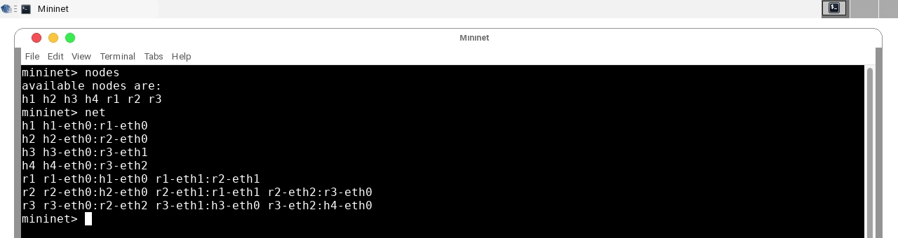
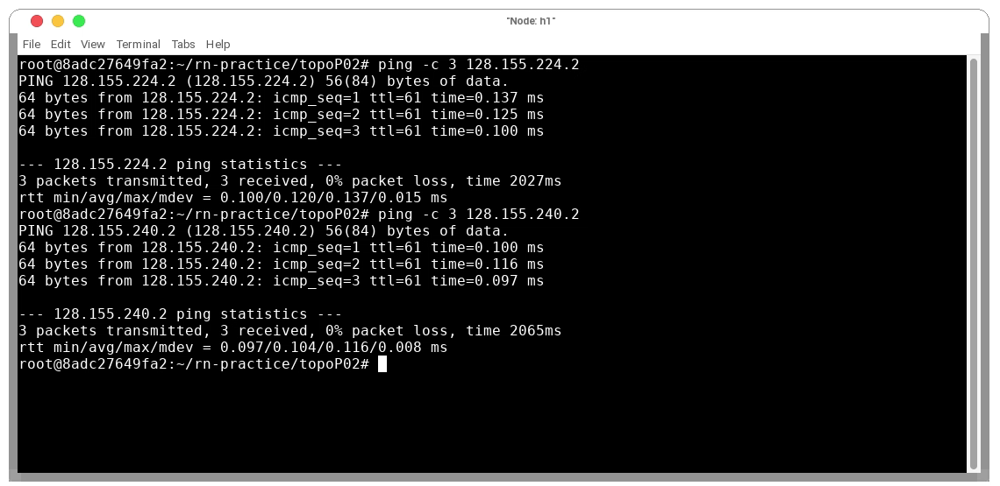
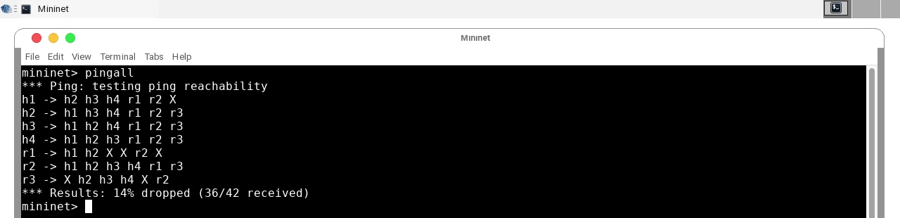
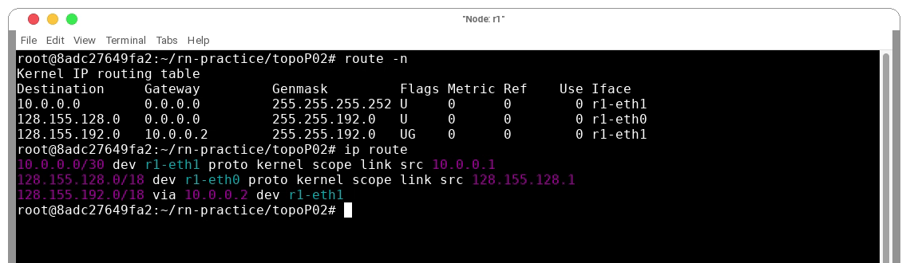
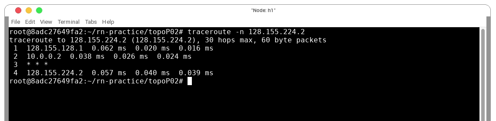
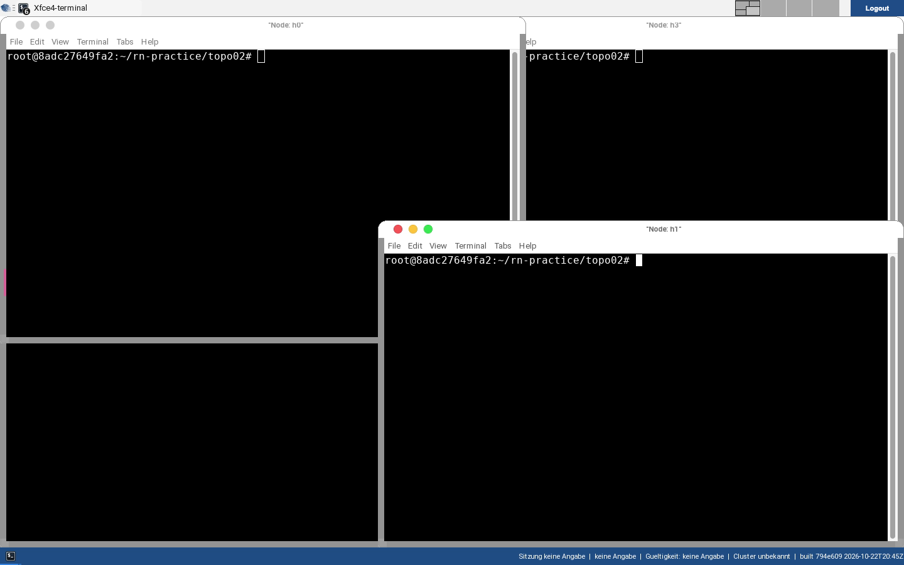
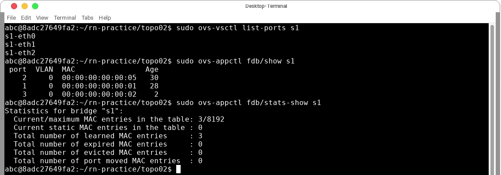
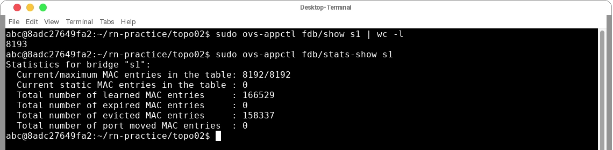
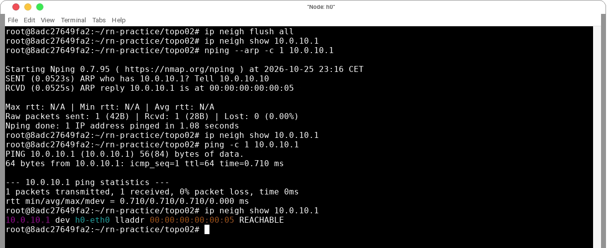
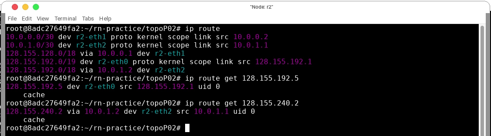

# 02 · IPv4-Subnetting & ARP

[:material-file-pdf-box: Als PDF herunterladen](../../pdf/02-subnetting-arp.pdf){ .md-button }

## Worum es geht

Stellt euch ein Unternehmen mit vier Abteilungen vor. Jede Abteilung bekommt
ein eigenes Netz, die Netze hängen an drei Routern, und irgendjemand muss
entscheiden, **welche Adressen wohin gehören** und **wie ein Paket seinen Weg
findet**. Genau das machen Netzwerkadministratorinnen und -administratoren
jeden Tag: Adressen planen, Routen setzen, und wenn etwas nicht ankommt,
herausfinden, an welcher Stelle der Kette es hakt.

Dieses Blatt führt euch dabei Schritt für Schritt. Es beginnt mit einer
**Werkzeugeinführung** (Mininet, `ip`, `ping`, `traceroute`, `tcpdump`,
`ip neigh`), die ihr einmal durcharbeitet und später als Nachschlagewerk
benutzt. Danach folgen die Teile 1 bis 11. Jeder Teil ist gleich aufgebaut:

1. **Auf einen Blick** – Lernziel, Motivation, Vorwissen.
2. **Vorgemacht** – ein Beispiel, das euch vorgerechnet oder vorgeführt wird,
   samt erwarteter Ausgabe und der Anleitung, sie zu lesen.
3. **Gemeinsam** – eine angeleitete Übung mit kleinen Schritten.
4. **Selbst** – eine Aufgabe, die ihr allein löst.
5. **Lösungen** stehen eingeklappt direkt unter der jeweiligen Aufgabe
   (`Lösung`). Versucht es zuerst allein; ein Aufklappen nach einem ehrlichen
   Versuch ist aber ausdrücklich erlaubt, denn Lernen funktioniert über das
   Vergleichen.

## Lernziele

Nach diesem Blatt könnt ihr

- aus Hostzahlen **Subnetze mit passender Präfixlänge ableiten** (VLSM) und
  Netz-, Broadcast- und Hostadressen **berechnen**;
- die Routingtabelle eines Routers **lesen** und für ein Paket **begründen**,
  welche Route gewinnt (längstes Präfix);
- die Konfiguration von Adressen, Routen und Gateways unter Linux
  **selbst durchführen** und als wiederholbares Skript **aufschreiben**;
- **erklären**, warum für jeden Hop eine eigene ARP-Auflösung nötig ist, und
  sie im Mitschnitt **nachweisen**;
- das Lernverhalten eines Switches (Lernen, Fluten, Altern, Überlaufen)
  **messen** und die Folgen für die Sicherheit **einordnen**;
- (Vertiefung, optional) die Auswirkungen einer kleinen MTU auf
  IPv4-Fragmentierung und Paketverlust **beobachten**.

--8<-- "issue-feedback.md"

!!! info "Schreibweise der Befehle (Prompts)"
    `h1$` bedeutet: Befehl im Terminal des Knotens `h1` eingeben (in Mininet
    über `mininet> xterm h1` geöffnet); entsprechend `r1$`, `h0$` usw. Ohne
    Knotenpräfix (`$`) läuft der Befehl in einem normalen Terminal des
    Desktops, `mininet>` steht für die Mininet-Kommandozeile. Der echte Prompt
    sieht anders aus, z. B. `root@desktop-…:~/rn-practice/topoXX#` im
    Knotenterminal; gemeint ist trotzdem derselbe Eingabeort.

## Werkzeugeinführung: Mininet und die Netzwerkwerkzeuge

Bevor wir rechnen, lernt ihr die Werkzeuge kennen, die in allen Teilen wieder
auftauchen. Nehmt euch dafür ruhig 20 bis 30 Minuten Zeit: Wer die Werkzeuge
sicher bedient, verliert später keine Zeit mit Tippfehlern und kann sich auf
das Netz selbst konzentrieren. Jedes Werkzeug hat einen eigenen Steckbrief
(Kasten „Werkzeug: …“) mit echter Ausgabe aus dem Praktikumsabbild; in den
späteren Teilen verweisen wir nur noch darauf.

!!! abstract "Auf einen Blick"
    **Lernziel:** Ihr könnt die Mininet-Topologie `topoP02` starten, mit einem
    Terminal pro Knoten arbeiten und mit fünf Werkzeugen die Frage
    beantworten „Was ist hier eingestellt, und kommt etwas an?“.

    **Wozu?** Meldet morgens jemand „Die Abteilung Einkauf kommt nicht ins
    Netz“, öffnet ein Netzwerkadmin kein Dashboard, sondern tippt genau diese
    Befehle: `ip addr` (hat der Rechner eine Adresse?), `ip route` (wohin
    schickt er seine Pakete?), `ping` und `traceroute` (kommt etwas an, und wo
    bleibt es hängen?), `tcpdump` (was geht wirklich über die Leitung?). Sie
    laufen auf jedem Linux-Server, Router und Container – ihr nutzt sie später
    genauso in Cloud- und Kubernetes-Umgebungen, wenn ein Dienst „nicht
    erreichbar“ ist.

    **Vorwissen:** Ein Terminal öffnen und Befehle eintippen. Mehr nicht.

### Mininet: ein ganzes Netz auf einem Rechner

!!! info "Werkzeug: Mininet"
    **Was es tut:** Mininet baut aus Linux-Bordmitteln ein virtuelles Netz auf
    einem einzigen Rechner. Jeder „Rechner“ (`h1`, `h2`, …) und jeder „Router“
    (`r1`, `r2`, …) ist ein eigener **Netzwerk-Namespace**: ein abgeschottetes
    Stück Linux mit eigenen Netzwerkschnittstellen, eigener Routingtabelle und
    eigenem ARP-Cache. Die Knoten sind durch virtuelle Kabel verbunden. Was
    ihr in einem Knoten tippt, wirkt nur dort – so verhalten sich getrennte
    Geräte. Mininet selbst arbeitet auf keiner bestimmten Schicht; es stellt
    die Geräte und Leitungen bereit, auf denen die Schichten 2 und 3 laufen.

    **Aufruf-Muster:**

    | Eingabe | Wirkung |
    |---|---|
    | `./start-topoP02.sh` | im Desktop-Terminal: baut die Topologie auf und zeigt den Prompt `mininet>` |
    | `mininet> nodes` | listet alle Knoten |
    | `mininet> net` | zeigt, welche Schnittstelle mit welcher verbunden ist |
    | `mininet> h1 <befehl>` | führt einen einzelnen Befehl im Knoten `h1` aus |
    | `mininet> xterm h1` | öffnet ein eigenes Terminalfenster `Node: h1` |
    | `mininet> pingall` | pingt jeden Knoten von jedem aus an |
    | `mininet> quit` | beendet die Topologie und schließt die Knotenfenster |

    **Echte Ausgabe** (`nodes` und `net` in `topoP02`):

    ```text
    mininet> nodes
    available nodes are:
    h1 h2 h3 h4 r1 r2 r3
    mininet> net
    h1 h1-eth0:r1-eth0
    h2 h2-eth0:r2-eth0
    h3 h3-eth0:r3-eth1
    h4 h4-eth0:r3-eth2
    r1 r1-eth0:h1-eth0 r1-eth1:r2-eth1
    r2 r2-eth0:h2-eth0 r2-eth1:r1-eth1 r2-eth2:r3-eth0
    r3 r3-eth0:r2-eth2 r3-eth1:h3-eth0 r3-eth2:h4-eth0
    ```

    **So lest ihr das:** `nodes` nennt die sieben Knoten. Jede Zeile von `net`
    beginnt mit einem Knoten; danach folgen seine Schnittstellen in der Form
    `<eigene Schnittstelle>:<Schnittstelle der Gegenseite>`. `h1 h1-eth0:r1-eth0`
    heißt: Die Schnittstelle `h1-eth0` von `h1` ist per Kabel mit `r1-eth0` von
    `r1` verbunden. Die Namen sind systematisch: `<knoten>-eth<nummer>`.
    Ein Router wie `r2` hat mehrere Schnittstellen, ein Host nur eine.

    **Typische Meldungen:** `*** Unknown command: h9 ls` heißt: Den Knoten `h9`
    gibt es nicht (Tippfehler im Knotennamen – `nodes` zeigt die gültigen).
    `bash: foo: command not found` heißt dagegen: Der Knoten existiert, nur der
    Befehl dahinter nicht.

Startet die Referenztopologie dieses Blatts in einem Desktop-Terminal
(Symbol `Terminal` auf dem Desktop) und probiert `nodes` und `net` aus:

```bash
$ cd ~/rn-practice/topoP02
$ ./start-topoP02.sh
```

Nach einigen Sekunden erscheint der Prompt `mininet>`.


*Die Mininet-Kommandozeile von `topoP02` nach dem Start: `nodes` und `net`.*

Ein einzelner Befehl lässt sich direkt auf einem Knoten ausführen, indem man
den Knotennamen voranstellt:

```bash
mininet> h1 ip addr show h1-eth0
```

Für längere Arbeit öffnet ihr ein eigenes Terminal je Knoten:

```bash
mininet> xterm h1
```

Es erscheint ein Fenster mit dem Titel `Node: h1`. Alles, was ihr dort
eintippt, läuft im Namensraum von `h1` – als wäre das ein eigener Rechner.
Beendet wird die Topologie mit `mininet> quit`; dabei räumt das Startskript
auch die Knotenterminals auf.

!!! tip "Faustregel für das Arbeiten mit mehreren Fenstern"
    Gebt jedem Fenster eine feste Aufgabe: eines pro Knoten, den ihr
    beobachtet, und ein Terminal für die Mininet-Kommandozeile. Lest vor jedem
    Befehl die Titelzeile des Fensters (`Node: h1`) – die häufigste
    Fehlerquelle in diesem Praktikum ist ein Befehl im falschen Fenster.

### `ip addr`: Welche Adressen hat dieser Knoten?

!!! info "Werkzeug: `ip addr`"
    **Was es tut:** Zeigt, welche Netzwerkschnittstellen ein Knoten hat und
    welche Adresse jede trägt. Es liest die Einstellungen von Schicht 2
    (MAC-Adresse) und Schicht 3 (IP-Adresse, Präfixlänge) aus dem Kernel.

    **Aufruf-Muster:**

    | Eingabe | Wirkung |
    |---|---|
    | `ip addr show h1-eth0` | alle Angaben zu einer Schnittstelle |
    | `ip -br addr` | Kurzform: eine Zeile je Schnittstelle |
    | `ip -o addr` | eine Zeile je Adresse, gut zum Durchsuchen mit `grep` |

    **Echte Ausgabe** (`h1$ ip addr show h1-eth0`; MAC-Adresse und die Zahl
    hinter `@if` unterscheiden sich bei euch, darunter steht noch eine
    `inet6`-Zeile):

    ```text
    2: h1-eth0@if2: <BROADCAST,MULTICAST,UP,LOWER_UP> mtu 1500 qdisc noqueue state UP group default qlen 1000
        link/ether fe:a2:b8:50:06:11 brd ff:ff:ff:ff:ff:ff link-netnsid 0
        inet 128.155.128.2/18 brd 128.155.191.255 scope global h1-eth0
    ```

    **So lest ihr das:**

    | Teil der Ausgabe | Bedeutung |
    |---|---|
    | `h1-eth0` | Name der Schnittstelle: `h1` ist der Knoten, `eth0` die erste Schnittstelle. |
    | `mtu 1500` | größte Paketnutzlast, die diese Schnittstelle in einem Rahmen sendet (mehr dazu in Teil 3). |
    | `state UP` / `UP,LOWER_UP` | Die Schnittstelle ist eingeschaltet und das „Kabel“ ist verbunden. |
    | `link/ether fe:a2:…` | die **MAC-Adresse** (Hardware-Adresse, Schicht 2). |
    | `inet 128.155.128.2/18` | die **IPv4-Adresse** (Schicht 3) und die **Präfixlänge**: Die ersten 18 Bit bezeichnen das Netz. |
    | `brd 128.155.191.255` | die **Broadcast-Adresse** des Netzes: „alle Rechner in diesem Subnetz“. |

    Die Kurzform `ip -br addr` auf `h4` zeigt in einer Zeile Name, Zustand und
    Adressen:

    ```text
    h4-eth0@if4      UP             128.155.240.2/23 fe80::5496:fff:fed3:a928/64
    ```

    **Typische Fehlermeldung:** `Device "h1-eth9" does not exist.` – Die
    Schnittstelle gibt es nicht (Tippfehler oder falsches Fenster: `h1` hat nur
    `h1-eth0`). Fehlt in der Ausgabe die `inet`-Zeile, hat die Schnittstelle
    keine IPv4-Adresse – so sieht `topoP02-self` in Teil 2 am Anfang aus.

**Probiert es:** Lest auf `h4` die Adresse und die Präfixlänge ab
(`mininet> h4 ip -br addr`). Welche Präfixlänge sollte `h4` haben – und wo in
Teil 1 findet ihr den Beleg dafür?

### `ip route`: Wohin schickt dieser Knoten ein Paket?

!!! info "Werkzeug: `ip route`"
    **Was es tut:** Zeigt die **Routingtabelle** des Knotens. Sie beantwortet
    für jede Zieladresse: „Direkt zustellen oder an einen Router (Gateway)
    schicken – und über welche Schnittstelle?“ Das ist die Entscheidung von
    Schicht 3.

    **Aufruf-Muster:**

    | Eingabe | Wirkung |
    |---|---|
    | `ip route` | die ganze Tabelle |
    | `ip route get 128.155.224.2` | fragt den Kernel: Welche Route würdest du für dieses Ziel nehmen? Es wird **kein** Paket verschickt. |
    | `route -n` | dieselbe Tabelle im klassischen Spaltenformat (Destination, Gateway, Genmask, Iface) |
    | `ip route add <netz> via <gateway>` | trägt eine Route ein (Teil 2) |

    **Echte Ausgabe** (`r1$ ip route`):

    ```text
    10.0.0.0/30 dev r1-eth1 proto kernel scope link src 10.0.0.1
    128.155.128.0/18 dev r1-eth0 proto kernel scope link src 128.155.128.1
    128.155.192.0/18 via 10.0.0.2 dev r1-eth1
    ```

    **So lest ihr das:** Jede Zeile ist eine Regel „Pakete an *Netz* gehen so
    raus“.

    - `… dev r1-eth0 proto kernel scope link` – ein **direkt angeschlossenes**
      Netz. Der Kernel hat die Zeile selbst angelegt, sobald die Schnittstelle
      eine Adresse bekam. Es gibt kein `via`: Das Ziel liegt am selben Kabel.
      `src 128.155.128.1` ist die Absenderadresse, die der Router dort benutzt.
    - `… via 10.0.0.2 dev r1-eth1` – ein **entferntes** Netz. Der Router
      `10.0.0.2` (das **Gateway** oder der **Nexthop**) kennt den weiteren Weg.
    - Eine Zeile `default via …` wäre die **Standardroute** (Netz `0.0.0.0/0`):
      „Für alles, was sonst nirgends passt“. Hosts haben meist genau diese eine.

    `ip route get` ist die Kontrolle, die kein Paket verschickt. Auf `h1`:

    ```text
    h1$ ip route get 128.155.224.2
    128.155.224.2 via 128.155.128.1 dev h1-eth0 src 128.155.128.2 uid 0
        cache
    ```

    Gelesen: Für `128.155.224.2` schickt `h1` das Paket über `h1-eth0` an das
    Gateway `128.155.128.1` und trägt als Absender `128.155.128.2` ein. Fehlt
    `via`, liegt das Ziel im selben Netz.

    **Typische Meldung:** Steht in `ip route` kein passender Eintrag und es
    gibt keine Standardroute, antwortet der Kernel beim Senden mit
    `Network is unreachable` – das Paket verlässt den Knoten gar nicht erst
    (in Teil 2 erlebt ihr das auf einem unkonfigurierten `h1`).

### `ping`: Ist das Ziel erreichbar?

!!! info "Werkzeug: `ping`"
    **Was es tut:** Schickt ICMP-Echo-Anfragen (Schicht 3) an ein Ziel und
    misst, ob und wie schnell Antworten zurückkommen. Es ist der erste Test
    für „geht es überhaupt?“.

    **Aufruf-Muster:**

    | Eingabe | Wirkung |
    |---|---|
    | `ping -c 4 128.155.224.2` | vier Anfragen, dann aufhören (ohne `-c` läuft `ping` endlos – abbrechen mit `Strg+C`) |
    | `ping -c 3 -i 0.3 <ziel>` | Abstand 0,3 Sekunden statt einer Sekunde |
    | `ping -s 1000 <ziel>` | Nutzlast 1000 Byte statt 56 (Teil 3) |
    | `ping -M do -s 1000 <ziel>` | zusätzlich „nicht fragmentieren“ (Teil 3) |
    | `ping -W 1 <ziel>` | höchstens 1 Sekunde auf eine Antwort warten |

    **Echte Ausgabe** (`h1$ ping -c 4 128.155.224.2`):

    ```text
    PING 128.155.224.2 (128.155.224.2) 56(84) bytes of data.
    64 bytes from 128.155.224.2: icmp_seq=1 ttl=61 time=0.214 ms
    64 bytes from 128.155.224.2: icmp_seq=2 ttl=61 time=0.099 ms
    64 bytes from 128.155.224.2: icmp_seq=3 ttl=61 time=0.097 ms
    64 bytes from 128.155.224.2: icmp_seq=4 ttl=61 time=0.090 ms

    --- 128.155.224.2 ping statistics ---
    4 packets transmitted, 4 received, 0% packet loss, time 3067ms
    rtt min/avg/max/mdev = 0.090/0.125/0.214/0.051 ms
    ```

    **So lest ihr das:**

    - `56(84) bytes` – 56 Byte Nutzlast, mit IP- und ICMP-Kopf 84 Byte.
    - `icmp_seq` zählt die Anfragen; fehlt eine Nummer, ging ein Paket verloren.
    - `time` ist die Umlaufzeit (RTT) in Millisekunden.
    - `ttl=61`: Der **Time-To-Live**-Wert startet bei 64 und wird von jedem
      Router um 1 verringert. 64 − 61 = **3 Router** lagen auf dem Weg
      (`r1`, `r2`, `r3`). Das ist eine Messung der Weglänge, ohne dass ihr die
      Topologie kennen müsstet.
    - `4 packets transmitted, 4 received, 0% packet loss` ist, was ihr sehen
      wollt. Die letzte Zeile fasst die Laufzeiten zusammen (kleinste,
      mittlere, größte, Schwankung).

    **Typische Fehlermeldungen:**

    | Meldung | Bedeutung |
    |---|---|
    | `ping: connect: Network is unreachable` | Der sendende Knoten hat gar keine passende Route. |
    | `From 128.155.128.1 icmp_seq=1 Destination Net Unreachable` | Ein Router (hier `r1`) meldet: „Ich habe keine Route zu diesem Ziel.“ |
    | `From 10.0.10.10 icmp_seq=1 Destination Host Unreachable` | Der Absender selbst (hier `h0` in Teil 5) meldet: Das Ziel liegt im eigenen Netz, antwortet aber auf ARP nicht. |
    | `ping: sendmsg: Message too long` | Das Paket ist größer als die MTU und darf nicht fragmentiert werden (Teil 3). |
    | `100% packet loss` ohne jede Meldung | Das Paket kam an, aber die Antwort findet keinen Rückweg – oder jemand verwirft sie. |

### `traceroute`: Welchen Weg nimmt das Paket?

!!! info "Werkzeug: `traceroute`"
    **Was es tut:** Zeigt alle Router auf dem Weg zu einem Ziel (Schicht 3).
    `traceroute` schickt Pakete mit TTL 1, 2, 3, … Jeder Router, der die TTL
    auf 0 herunterzählt, meldet sich per ICMP – so erfährt der Absender, wer
    an Position 1, 2, 3 steht.

    **Aufruf-Muster:**

    | Eingabe | Wirkung |
    |---|---|
    | `traceroute -n 128.155.224.2` | Weg zum Ziel, Adressen ohne Namensauflösung (hier gibt es keine Namen, die Anfrage würde nur warten) |
    | `traceroute -n -w 1 <ziel>` | pro Hop höchstens 1 Sekunde auf Antwort warten |

    **Echte Ausgabe** (`h1$ traceroute -n 128.155.224.2` in `topoP02`):

    ```text
    traceroute to 128.155.224.2 (128.155.224.2), 30 hops max, 60 byte packets
     1  128.155.128.1  0.049 ms  0.019 ms  0.017 ms
     2  10.0.0.2  0.037 ms  0.025 ms  0.024 ms
     3  * * *
     4  128.155.224.2  0.046 ms  0.039 ms  0.038 ms
    ```

    **So lest ihr das:** Jede Zeile ist ein Hop (Router oder Ziel). Danach
    stehen die Adresse des Antwortenden und drei Laufzeiten – `traceroute`
    schickt je Hop drei Pakete. `* * *` heißt: Von diesem Hop kam keine
    Antwort. Das ist nicht automatisch ein Fehler; hier wird Hop 3 (`r3`) in
    Teil 1 zur Denkaufgabe. Hop 4 ist das Ziel selbst.

    **Typische Meldungen:** Ein angehängtes `!N` (etwa
    `128.155.128.1  0.030 ms !N`) heißt „Network unreachable“: Der Router hat
    keine Route zum Ziel. Startet ihr `traceroute` unmittelbar ein zweites
    Mal, kann ein Hop kurz stumm bleiben, weil Linux die Rate der
    ICMP-Antworten begrenzt: Wartet eine Sekunde und wiederholt.

### `tcpdump`: Was geht tatsächlich über das Kabel?

!!! info "Werkzeug: `tcpdump`"
    **Was es tut:** Schneidet Pakete an einer Schnittstelle mit und zeigt sie
    als Text – das „Mikroskop“ der Netzwerkdiagnose. Es sieht Schicht 2 bis 4.
    Wireshark (aus Blatt 01) tut dasselbe mit Oberfläche; `tcpdump` läuft
    direkt im Knotenterminal.

    **Aufruf-Muster:**

    | Eingabe | Wirkung |
    |---|---|
    | `tcpdump -n -i r1-eth0 arp` | an dieser Schnittstelle mitschneiden, nur ARP zeigen |
    | `-i any` | an allen Schnittstellen mitschneiden |
    | `-n` | Adressen nicht in Namen auflösen (schneller, eindeutiger) |
    | Filter `arp`, `icmp`, `host 10.0.0.2`, `tcp port 80` | nur passende Pakete; kombinierbar mit `and`/`or` |
    | `-c 4` | nach vier Paketen selbst aufhören |
    | `-v` | ausführlichere Kopfzeilen (Teil 3 braucht sie für Offsets) |
    | `-w datei.pcap` | Mitschnitt speichern, später in Wireshark öffnen |

    `tcpdump` läuft, bis ihr `Strg+C` drückt. Deshalb braucht es ein **eigenes
    Fenster**: In einem Fenster mitschneiden, im anderen den Verkehr erzeugen
    (z. B. mit `ping`).

    **Echte Ausgabe** (`r1$ tcpdump -n -i any arp`, während `h1` zum ersten
    Mal `h3` anpingt):

    ```text
    tcpdump: WARNING: any: That device doesn't support promiscuous mode
    (Promiscuous mode not supported on the "any" device)
    tcpdump: verbose output suppressed, use -v[v]... for full protocol decode
    listening on any, link-type LINUX_SLL2 (Linux cooked v2), snapshot length 262144 bytes
    23:08:55.492254 r1-eth0 B   ARP, Request who-has 128.155.128.1 tell 128.155.128.2, length 28
    23:08:55.492294 r1-eth0 Out ARP, Reply 128.155.128.1 is-at 22:48:82:30:b9:94, length 28
    23:08:55.492339 r1-eth1 Out ARP, Request who-has 10.0.0.2 tell 10.0.0.1, length 28
    23:08:55.492348 r1-eth1 In  ARP, Reply 10.0.0.2 is-at 86:6a:b0:07:10:3c, length 28
    ^C
    4 packets captured
    4 packets received by filter
    0 packets dropped by kernel
    ```

    **So lest ihr das:** Die ersten vier Zeilen sind Meldungen von `tcpdump`
    selbst (bei `-i any` normal: Auf dem Sammelgerät `any` gibt es keinen
    Promiscuous-Modus). Jede Paketzeile besteht aus: Uhrzeit, Schnittstelle,
    Richtung (`B` Broadcast, `Out` von diesem Knoten gesendet, `In` bei ihm
    angekommen), Protokoll, Inhalt, Länge. Bei ARP lautet der Inhalt
    `Request who-has <IP> tell <IP>` („Wer hat diese Adresse? Antwort bitte
    an …“) bzw. `Reply <IP> is-at <MAC>`. Die letzten drei Zeilen nach
    `Strg+C` sind die Bilanz.

    **Typische Fehlermeldung:** `tcpdump: h1-eth9: No such device exists` –
    die Schnittstelle gibt es nicht (Tippfehler oder falsches Fenster).

### `ip neigh` und `arp -a`: Wen kennt dieser Knoten auf der Leitung?

!!! info "Werkzeug: `ip neigh` und `arp -a`"
    **Was es tut:** Zeigt den **ARP-/Nachbarschafts-Cache** (Schicht 2/3): die
    Zuordnung „IP-Adresse → MAC-Adresse“ für Geräte am selben Segment, samt
    Zustand des Eintrags.

    **Aufruf-Muster:**

    | Eingabe | Wirkung |
    |---|---|
    | `ip neigh` | alle Einträge |
    | `ip neigh show 10.0.10.1` | nur der Eintrag für diese Adresse |
    | `ip neigh flush all` | Cache leeren – nützlich, wenn ihr eine ARP-Auflösung noch einmal von vorn beobachten wollt |
    | `arp -a` | die ältere Darstellung derselben Information |

    **Echte Ausgabe** (`h1$ ip neigh` und `arp -a`, nachdem `h1` sein Gateway
    angepingt hat):

    ```text
    128.155.128.1 dev h1-eth0 lladdr 1e:8d:e9:7f:fb:3e REACHABLE
    ? (128.155.128.1) at 1e:8d:e9:7f:fb:3e [ether] on h1-eth0
    ```

    **So lest ihr das:** `128.155.128.1` ist die IP des Nachbarn, `dev
    h1-eth0` die Schnittstelle, über die er erreichbar ist, `lladdr` seine
    MAC-Adresse. Der letzte Begriff ist der **Zustand**: `REACHABLE`
    (kürzlich bestätigt), `STALE` (älter, aber weiter nutzbar), `DELAY` und
    `PROBE` (wird gerade neu geprüft). In `arp -a` heißt ein Gerät ohne Namen
    `?`.

    **Typische Meldung:** Pingt ihr eine Adresse im eigenen Netz, die niemandem
    gehört, steht kurz `128.155.128.99 dev h1-eth0 INCOMPLETE` (Anfrage
    gestellt, keine Antwort) und danach `… FAILED` im Cache; `ping` meldet
    `Destination Host Unreachable`. `FAILED` heißt: Auf Schicht 2 antwortet
    niemand – das Problem liegt nicht im Routing.

!!! success "Geschafft: euer Werkzeugkasten"
    Merkt euch die Zuordnung: **`ip addr`** = „Was bin ich?“, **`ip route`** =
    „Wohin schicke ich?“, **`ping`/`traceroute`** = „Komme ich an, und auf
    welchem Weg?“, **`tcpdump`** = „Was geht wirklich über das Kabel?“,
    **`ip neigh`** = „Wen kenne ich nebenan?“. Mit diesen fünf Fragen lässt
    sich fast jedes Netzproblem eingrenzen.

## Aufgaben

### Teil 1 – VLSM-Subnetting nachvollziehen (`topoP02`)

!!! abstract "Auf einen Blick"
    **Lernziel:** Ihr könnt aus der Zahl benötigter Hosts die passende
    Präfixlänge bestimmen, die Routingtabelle von `r1` lesen und mit
    `traceroute` und `tcpdump` nachweisen, dass jeder Hop eine eigene
    ARP-Auflösung braucht.

    **Wozu?** Zieht ein Unternehmen in ein neues Bürogebäude oder legt eine
    Firma ein Cloud-Netz (VPC) an, bekommt sie einen Adressblock und muss
    entscheiden, wie viele Adressen jede Abteilung erhält: zu wenige, und
    Rechner finden keinen Platz; zu viele, und Adressen, die Anbieter
    vermieten, liegen brach. Die Routingtabelle eines Routers zu lesen ist
    außerdem der schnellste Weg zu erklären, warum eine Abteilung nicht
    erreichbar ist: fehlende Route, falsches Gateway oder falsche Maske sind
    dort sofort zu sehen. Und wer ARP im Mitschnitt deuten kann, versteht, was
    auf jedem Hop wirklich passiert.

    **Vorwissen:** Dualsystem (2ⁿ), Aufbau einer IPv4-Adresse aus vier Oktetten.
    Wenn die Begriffe unten neu sind, lest zuerst den Kasten „Fachbegriff:
    Subnetz".

!!! info "Fachbegriff: Subnetz"
    Ein **Subnetz** ist ein zusammenhängender Ausschnitt eines
    IP-Adressraums, der als eigenes Netzsegment behandelt wird – festgelegt
    durch eine **Netzadresse** und eine **Präfixlänge** (z. B. `/18`), die
    angibt, wie viele der führenden Adressbits das Netz identifizieren; der
    Rest steht für einzelne Hosts zur Verfügung. Ein großer Adressraum wird
    in mehrere Subnetze aufgeteilt, damit Abteilungen, Standorte oder
    Funktionsbereiche getrennt adressiert und geroutet werden können.
    **VLSM** (Variable Length Subnet Masking) bedeutet: Die Subnetze eines
    Adressraums müssen nicht gleich groß sein – jedes bekommt so viele
    Adressen, wie sein Hostbedarf verlangt.

#### Das Szenario

Ein Unternehmen mit vier Abteilungen soll aus dem Adressraum
`128.155.128.0/17` versorgt werden. Der Hostbedarf pro Abteilung:

| Abteilung   | benötigte Hosts |
|-------------|-----------------|
| Entwicklung | 10.000          |
| Verkauf     | 7.500           |
| Einkauf     | 2.100           |
| Lager       | 400             |

#### Vorgemacht: Vom Hostbedarf zur Präfixlänge

Die Rechenregel: Ein Subnetz mit `n` Host-Bits bietet `2ⁿ − 2` nutzbare
Hostadressen. Die zwei fehlenden Adressen sind die **Netzadresse** (alle
Host-Bits 0) und die **Broadcast-Adresse** (alle Host-Bits 1). Die
Präfixlänge ist `32 − n`.

Beispiel **Entwicklung** (10.000 Hosts):

1. Gesucht: kleinstes `n` mit `2ⁿ − 2 ≥ 10.000`.
2. `2¹³ − 2 = 8.190` – zu wenig. `2¹⁴ − 2 = 16.382` – reicht. Also `n = 14`.
3. Präfixlänge: `32 − 14 = 18`, das Subnetz ist ein `/18`.

Ergebnis: Entwicklung bekommt ein `/18` mit 16.382 nutzbaren Adressen; 6.382
bleiben ungenutzt – das ist der Preis der Zweierpotenzen.

#### Selbst: Die übrigen drei Abteilungen

Bestimmt auf dieselbe Weise Host-Bits und Präfixlänge für **Verkauf**,
**Einkauf** und **Lager**. Notiert jeweils `n`, die nutzbaren Hosts und das
Präfix, bevor ihr weiterlest.

??? success "Lösung"
    | Abteilung | benötigt | `n` | nutzbar (`2ⁿ − 2`) | Präfix |
    |---|---|---|---|---|
    | Entwicklung | 10.000 | 14 | 16.382 | `/18` |
    | Verkauf | 7.500 | 13 | 8.190 | `/19` |
    | Einkauf | 2.100 | 12 | 4.094 | `/20` |
    | Lager | 400 | 9 | 510 | `/23` |

    Kontrolle der „Knappheitsgrenze": Für Einkauf würde `n = 11` nur 2.046
    nutzbare Hosts liefern – knapp zu wenig für 2.100. Für Lager liefert
    `n = 8` nur 254, `n = 9` dagegen 510.

#### Die Topologie lesen

Die Abteilungen hängen so an den Routern: `r3` hat zwei Host-Anschlüsse (`h3`
und `h4`); zusammen mit `h1` an `r1` und `h2` an `r2` ergibt das ein Subnetz
je Abteilung.

| Router-Interface | Subnetz | Nutzbare Hosts | Abteilung |
|---|---|---|---|
| `r1-eth0` (→ `h1`) | `128.155.128.0/18` | 16.382 | Entwicklung (10.000) |
| `r2-eth0` (→ `h2`) | `128.155.192.0/19` | 8.190 | Verkauf (7.500) |
| `r3-eth1` (→ `h3`) | `128.155.224.0/20` | 4.094 | Einkauf (2.100) |
| `r3-eth2` (→ `h4`) | `128.155.240.0/23` | 510 | Lager (400) |

Zusätzlich zu den vier Abteilungsnetzen gibt es zwei private
**Transitnetze** zwischen den Routern (`10.0.0.0/30` zwischen `r1` und `r2`,
`10.0.1.0/30` zwischen `r2` und `r3`) – ein in der Praxis übliches Muster,
um Backbone-Verbindungen von den Netzen der Endgeräte zu trennen. Ein `/30`
bietet genau zwei Hostadressen – für die beiden Router an den Enden der
Verbindung reicht das.

Ein Überblick über die Topologie:

```text
 h1 --- r1 --- r2 --- r3 --- h3
        (10.0.0.0/30)(10.0.1.0/30)  \
        h2 an r2                      --- h4
```

(`h2` hängt an `r2`, `h3` und `h4` an `r3`.) Prüft die Zuordnung am laufenden
Netz mit `mininet> net`.

#### Gemeinsam: Erreichbarkeit prüfen

Startet in Mininet (falls noch nicht geschehen: `./start-topoP02.sh`) auf `h1`
einen Ping zu `h3` und `h4`. Öffnet dafür mit `mininet> xterm h1` ein
Terminal:

```bash
h1$ ping -c 4 128.155.224.2   # h3
h1$ ping -c 4 128.155.240.2   # h4
```


*Ping von `h1` über drei Router (`r1`→`r2`→`r3`) zu `h3` und `h4`. Die
TTL von 61 (Startwert 64) zeigt die drei Router-Hops.*

Beide Pings müssen ohne Verlust ankommen. Prüft jetzt, ob **alle** Rechner in
**allen** Netzen erreichbar sind. Es gibt vier Hosts, also sind sechs
Paarungen zu testen (`h1`↔`h2`, `h1`↔`h3`, `h1`↔`h4`, `h2`↔`h3`, `h2`↔`h4`,
`h3`↔`h4`). Legt euch dafür eine kleine Tabelle an und tragt „ok" oder
„Fehler" ein; die Adressen stehen in der Tabelle oben (die Hosts tragen jeweils
`.2` im Netz).

??? success "Lösung"
    Alle sechs Paarungen antworten. Beispiele:

    ```bash
    h2$ ping -c 2 128.155.128.2   # h1
    h3$ ping -c 2 128.155.192.2   # h2
    h4$ ping -c 2 128.155.224.2   # h3
    ```

    Dass auch `h3` und `h4` das Verkaufsnetz erreichen, liegt an der Route
    `128.155.192.0/19 via 10.0.1.1` auf `r3`: Sie sorgt dafür, dass `r3` für
    das Netz von `h2` einen Weg kennt (der Rückweg der Antwort würde sonst
    enden).

Zum Abschluss lasst Mininet alle Paare auf einmal prüfen. Gebt in der
Mininet-Kommandozeile ein:

```bash
mininet> pingall
```


*`pingall` in `topoP02`: 36 von 42 Pings kommen an. Jedes `X` steht für ein
Paar, das nicht antwortet.*

Die Ausgabe lautet `14% dropped (36/42 received)`. Alle vier Hosts erreichen
sich gegenseitig; die `X` stehen bei Paaren, an denen ein Router beteiligt
ist. Notiert, welche Paare es sind, und überlegt, was sie gemeinsam haben.

??? success "Lösung"
    Es fehlen sechs Paare: `h1 -> r3`, `r1 -> h3`, `r1 -> h4`, `r1 -> r3`,
    `r3 -> h1`, `r3 -> r1` – 42 Paare minus 6 ergibt 36. Gemeinsam ist allen
    eine **Transitadresse** (`10.0.0.1` von `r1`, `10.0.1.2` von `r3`) auf
    einer Seite: `r1` kennt das Transitnetz `10.0.1.0/30` nicht und `r3` kennt
    `10.0.0.0/30` nicht, die Antwort findet also keinen Rückweg. Genau diese
    Lücke erklärt auch die Frage „Hop 3 bleibt stumm“ weiter unten.

#### Die Routingtabelle lesen

!!! info "Fachbegriff: Routingtabelle"
    Die **Routingtabelle** eines Rechners oder Routers listet, über welchen
    Weg (welche **Ausgangsschnittstelle**, ggf. über welchen **Gateway**/
    **Nexthop**) ein Paket zu einem bestimmten Zielnetz gelangt. Direkt
    angeschlossene Netze trägt der Kernel automatisch ein; jedes andere Ziel
    braucht entweder eine manuell gesetzte Route (wie in Teil 2) oder eine
    von einem Routing-Protokoll gelernte Route (siehe
    [Lab 03](03-routing-rip-bgp.md)). Zwei gebräuchliche Werkzeuge zum
    Anzeigen sind `route -n` (klassisch) und `ip route` (Teil der
    `iproute2`-Sammlung) – beide zeigen dieselbe Tabelle in unterschiedlicher
    Formatierung.

Öffnet ein Terminal auf `r1` und lest die Tabelle:

```bash
mininet> xterm r1
r1$ route -n
r1$ ip route
```


*`route -n`/`ip route` auf `r1`. Die Zeile `128.155.192.0/18 via 10.0.0.2`
fasst die Netze von Verkauf (`/19`), Einkauf (`/20`) und Lager (`/23`) zu
einer einzigen Route über `r2` zusammen.*

**So lest ihr die drei Zeilen von `r1`:**

1. `10.0.0.0/30 dev r1-eth1` – das Transitnetz zu `r2`, direkt angeschlossen.
2. `128.155.128.0/18 dev r1-eth0` – das Netz von `h1`, direkt angeschlossen.
3. `128.155.192.0/18 via 10.0.0.2` – **alles** von `128.155.192.0` bis
   `128.155.255.255` geht über `r2`. Das nennt man **Routenzusammenfassung**
   (Aggregation): `r1` muss die drei Abteilungsnetze dahinter nicht einzeln
   kennen.

**Selbst:** Lest auf `r2` und `r3` die Tabellen ab (`ip route`). Notiert für
jede Zeile, ob sie ein direkt angeschlossenes oder ein entferntes Netz
beschreibt und welches Zielnetz sie zusammenfasst.

??? success "Lösung"
    `r2`: direkt angeschlossen sind `10.0.0.0/30` (`r2-eth1`),
    `10.0.1.0/30` (`r2-eth2`) und `128.155.192.0/19` (`r2-eth0`, Verkauf).
    Entfernt sind `128.155.128.0/18 via 10.0.0.1` (das Netz von `h1`, über
    `r1`) und `128.155.192.0/18 via 10.0.1.2` (alles hinter `r3`).

    `r3`: direkt angeschlossen sind `10.0.1.0/30` (`r3-eth0`),
    `128.155.224.0/20` (`r3-eth1`, Einkauf) und `128.155.240.0/23`
    (`r3-eth2`, Lager). Entfernt sind `128.155.128.0/18 via 10.0.1.1` (Netz von
    `h1`) und `128.155.192.0/19 via 10.0.1.1` (Netz von `h2`).

#### Traceroute und ARP

Ihr habt geprüft, *dass* die Pakete ankommen. Jetzt geht es darum, *wie*
sie unterwegs adressiert werden – dafür kommt mit ARP ein zweites Protokoll
ins Spiel, das IP-Adressen auf Hardware-Adressen abbildet.

!!! info "Fachbegriff: ARP (Address Resolution Protocol)"
    Eine IP-Adresse allein reicht nicht, um ein Paket auf einem Ethernet-
    Segment zuzustellen – dafür wird die **MAC-Adresse** der Netzwerkkarte
    gebraucht. **ARP** (Address Resolution Protocol, RFC 826) ist das
    Protokoll, mit dem ein Rechner diese Zuordnung klärt: Er fragt per
    Broadcast „wer hat diese IP-Adresse?" und die passende Netzwerkkarte
    antwortet mit ihrer MAC-Adresse. Jeder Rechner merkt sich das Ergebnis
    eine Zeit lang in seinem **ARP-/Nachbarschafts-Cache**. ARP wird immer
    nur **innerhalb eines Segments** verwendet, für den jeweils **nächsten**
    Hop – nie für das Endziel, wenn dieses in einem anderen Netz liegt.

**Vorgemacht – der Weg von `h1` zu `h3`:**

```bash
h1$ traceroute -n 128.155.224.2
```

Ihr bekommt eine Zeile je Router: `r1` (`128.155.128.1`) als Hop 1, `r2`
(`10.0.0.2`) als Hop 2, dann Hop 3 und zuletzt `h3` selbst als Hop 4.
Auffällig: Hop 3 (`r3`) erscheint nur als `* * *`. Das untersuchen wir
gleich.


*`traceroute` von `h1` zu `h3`: Hop 3 antwortet nicht.*

**Gemeinsam – ARP sichtbar machen.** Schon vorhandene ARP-Einträge
verhindern, dass ihr eine Auflösung beobachtet, denn jede Auflösung wird ja
zwischengespeichert. Löscht deshalb zuerst die Caches, dann schneidet ihr mit:

1. Öffnet Terminals auf `h1`, `r1`, `r2` und `r3`
   (`mininet> xterm h1`, `xterm r1`, …).
2. Leert in jedem der vier Fenster den Cache: `ip neigh flush all`.
3. Startet in den Fenstern von `r1`, `r2` und `r3` je
   `tcpdump -n -i any arp`.
4. Löst von `h1` aus genau eine Übertragung aus: `ping -c 1 128.155.224.2`.

Zu Beginn meldet `tcpdump` vier Zeilen über sich selbst (siehe Steckbrief
oben: `WARNING: any: …` und `listening on any …`); danach folgen die
ARP-Pakete.

**Erwartete Ausgabe** (Zeitstempel und MAC-Adressen weichen ab). Auf `r1`:

```text
23:08:55.492254 r1-eth0 B   ARP, Request who-has 128.155.128.1 tell 128.155.128.2, length 28
23:08:55.492294 r1-eth0 Out ARP, Reply 128.155.128.1 is-at 22:48:82:30:b9:94, length 28
23:08:55.492339 r1-eth1 Out ARP, Request who-has 10.0.0.2 tell 10.0.0.1, length 28
23:08:55.492348 r1-eth1 In  ARP, Reply 10.0.0.2 is-at 86:6a:b0:07:10:3c, length 28
```


*Oben der Mitschnitt auf `r1`, unten der auslösende Ping von `h1`. Die erste
Anfrage kommt von `h1` (Broadcast, `B`), die zweite stellt `r1` selbst an
`r2`.*

Gelesen: `B` steht für Broadcast, `Out` für „von diesem Router gesendet", `In`
für „bei diesem Router angekommen". Je Router seht ihr zwei Anfragen mit
je einer Antwort:

- auf `r1`: `who-has 128.155.128.1 tell 128.155.128.2` (`h1` sucht seinen
  Router) und `who-has 10.0.0.2 tell 10.0.0.1` (`r1` sucht `r2`);
- auf `r2`: `who-has 10.0.0.2 tell 10.0.0.1` (die Anfrage von `r1`, bei `r2`
  angekommen) und `who-has 10.0.1.2 tell 10.0.1.1` (`r2` sucht `r3`);
- auf `r3`: `who-has 10.0.1.2 tell 10.0.1.1` (die Anfrage von `r2`) und
  `who-has 128.155.224.2 tell 128.155.224.1` (`r3` sucht `h3`).

Dieselbe Anfrage taucht also auf zwei Routern auf: einmal beim Absender, einmal
beim Empfänger. Beendet die drei `tcpdump` mit `Strg+C`.

**So lest ihr das:** Die IP-Zieladresse des Pakets (`128.155.224.2`) blieb auf
dem gesamten Weg gleich. Gefragt wurde auf jedem Segment aber nach jeweils
**einem anderen Gerät** – dem nächsten Hop. Das Ziel `h3` wird erst auf dem
letzten Segment per ARP gesucht.

Schaut danach die Caches an (`ip neigh` auf `h1`, `r1`, `r2`, `r3`). `h1`
kennt nur seinen Router `128.155.128.1`, nicht `h3`:

```bash
h1$ ip neigh
```

```text
128.155.128.1 dev h1-eth0 lladdr 22:48:82:30:b9:94 REACHABLE
```

Auf den Routern stehen daneben auch Einträge im Zustand `DELAY` (der Nachbar,
der die Anfrage gestellt hat): Das ist ein Zwischenzustand, nach wenigen
Sekunden wird daraus `REACHABLE` oder `STALE`.

**Kernbeobachtung:** Obwohl die IP-Zieladresse (`128.155.224.2`) über den
gesamten Pfad unverändert bleibt, wird auf jedem der vier Segmente
(`h1`–`r1`, `r1`–`r2`, `r2`–`r3`, `r3`–`h3`) eine eigene ARP-Auflösung für
den jeweils nächsten Hop durchgeführt.

!!! question "Nachgedacht: Hop 3 bleibt stumm"
    `r3` schickt seine ICMP-Meldung mit der Absenderadresse `10.0.1.2`.
    Schaut in die Routing-Tabelle von `r1`: Kennt `r1` einen Weg zu
    `10.0.1.0/30`? Was macht ein Router, der Pakete von einer Quelle erhält,
    zu der er selbst keine Route hat (Stichwort *Reverse Path Filter*,
    `sysctl net.ipv4.conf.all.rp_filter`)?

??? success "Lösung"
    `r1` kennt nur `10.0.0.0/30`, `128.155.128.0/18` und `128.155.192.0/18`.
    Für `10.0.1.0/30` gibt es keine Route – auch keine Standardroute. Die
    Antwort von `r3` trägt als Absender `10.0.1.2` und läuft über `r2` zu
    `r1`. Der **Reverse Path Filter** (`rp_filter`) lässt ein Paket nur durch,
    wenn der Router zur Absenderadresse selbst eine Route hätte. Im Modus 1
    („streng") muss diese Route über genau die Schnittstelle führen, auf der
    das Paket ankam; im Modus 2 („locker") genügt irgendeine Route. In `topoP02`
    steht der Wert auf 2 (`r1$ sysctl net.ipv4.conf.all.rp_filter` zeigt
    `net.ipv4.conf.all.rp_filter = 2`). Auch der lockere Modus verwirft das
    Paket, denn `r1` hat zu `10.0.1.2` gar keine Route: `h1` bekommt für Hop 3
    nichts zu sehen. Hop 2 (`10.0.0.2`) und Hop 4 (`128.155.224.2`) sind über
    vorhandene Routen erreichbar und antworten normal.

    Ihr könnt das selbst belegen: Ergänzt auf `r1` die fehlende Route und
    wiederholt `traceroute`:

    ```bash
    r1$ ip route add 10.0.1.0/30 via 10.0.0.2
    h1$ traceroute -n 128.155.224.2
    ```

    Hop 3 erscheint dann mit `10.0.1.2`:

    ```text
     1  128.155.128.1  0.047 ms  0.019 ms  0.018 ms
     2  10.0.0.2  0.035 ms  0.024 ms  0.024 ms
     3  10.0.1.2  0.039 ms  0.031 ms  0.030 ms
     4  128.155.224.2  0.048 ms  0.048 ms  0.037 ms
    ```

    Die Route ist flüchtig: Nach einem Neustart der Topologie ist sie wieder
    weg.

!!! question "Nachgedacht: Warum fragt h1 nicht nach h3?"
    Wenn ARP nur innerhalb eines Segments gilt: Woher weiß `h1` dann
    überhaupt, dass es sein Paket an `r1` schicken soll, statt selbst nach
    der MAC-Adresse von `h3` zu fragen? (Hinweis: Schaut auf die
    Routing-Tabelle von `h1` – die Antwort liegt nicht bei ARP, sondern
    einen Schritt davor.)

??? success "Lösung"
    `h1` schaut zuerst in seine Routingtabelle (`h1$ ip route`).
    `128.155.224.2` liegt nicht im direkt angeschlossenen Netz
    `128.155.128.0/18`, deshalb greift die Standardroute
    `default via 128.155.128.1`. Das **Gateway** `128.155.128.1` *liegt* im
    eigenen Segment, also kann `h1` per ARP nach genau dessen MAC-Adresse
    fragen und das Paket dorthin schicken. Die Entscheidung „an wen"
    (Routing, Schicht 3) fällt vor der Frage „unter welcher MAC" (ARP,
    Schicht 2).

!!! example "Vertiefung (optional): Routing-Schnappschüsse über mehrere Anläufe vergleichen"
    Euer `~/rn-practice`-Verzeichnis bleibt über Container-Neustarts hinweg
    erhalten. Sichert die Ausgaben von `route -n`, `ip route` und `arp -a`
    auf allen Routern und Hosts in eine eigene Datei, z. B.
    `~/rn-practice/snapshots/02-lauf1.txt`. Beendet die Topologie
    (`mininet> quit`), startet sie erneut und wiederholt den Mitschnitt in
    einer zweiten Datei. Ein `diff` zwischen beiden Läufen zeigt, welche
    Einträge bei jedem Start identisch bleiben (die vom Skript
    vorkonfigurierten Routen) und welche verschwunden sind, falls ihr
    zwischendurch manuell etwas verändert hattet – also was an einer
    laufenden Konfiguration flüchtig ist.

### Teil 2 – Eigene Konfiguration üben (`topoP02-self.py`)

!!! abstract "Auf einen Blick"
    **Lernziel:** Ihr konfiguriert Adressen, Routen und Gateways selbst und
    schreibt die Befehle anschließend als wiederholbares Skript auf.

    **Wozu?** In Teil 1 hat euch jemand die Arbeit abgenommen. In der Praxis
    sitzt ihr beim Aufbau eines neuen Standorts, beim Einrichten eines
    Servers oder beim Test einer Cloud-Vorlage vor einem leeren System und
    müsst Adresse, Route und Gateway selbst eintragen – und feststellen, an
    welchem der drei Schritte es hakt. Dasselbe gilt für das Skript am Ende
    dieses Teils: Was nur von Hand getippt wurde, ist nach dem nächsten
    Neustart weg und lässt sich nicht an Kolleginnen weitergeben.
    Konfigurationen als wiederholbares Skript aufzuschreiben ist der erste
    Schritt zu Werkzeugen wie Ansible.

    **Vorwissen:** Teil 1 (Subnetze, Routingtabelle lesen).

Dieselbe Topologie steht auch unkonfiguriert zur Verfügung, damit ihr die
Adressierung und das Routing selbst nachbaut. Für diese Variante gibt es
kein Startskript; ruft die Python-Datei direkt auf (beendet zuvor die
laufende Topologie mit `mininet> quit`):

```bash
cd ~/rn-practice/topoP02
sudo python3 topoP02-self.py
```

Zuerst überzeugt euch, dass wirklich nichts konfiguriert ist: `mininet> h1 ip
addr show h1-eth0` zeigt keine `inet`-Zeile (nur eine `inet6 fe80::…`-Zeile,
die ist normal), und `mininet> h1 ping -c 1 128.155.128.1` scheitert mit
`ping: connect: Network is unreachable`.

#### Die drei Befehlsarten

!!! info "Werkzeug: `ifconfig`, `ip route add` und `route add default gw`"
    **Was sie tun:** Sie **ändern** die Einstellungen des Kernels (bisher habt
    ihr nur gelesen): eine Adresse auf eine Schnittstelle legen (Schicht 3),
    eine Route eintragen, das Standard-Gateway festlegen.

    **Aufruf-Muster:**

    ```bash
    # IP-Adresse für ein Router- oder Host-Interface konfigurieren
    ifconfig <interface> <ip_address>/<subnet_mask>

    # Route auf einem Router hinzufügen
    ip route add <ziel_netz> via <gateway_ip>

    # Standard-Gateway für einen Host festlegen
    route add default gw <gateway_ip>
    ```

    **Echte Ausgabe:** Alle drei Befehle sind bei Erfolg **stumm**. Ob sie
    gewirkt haben, zeigt erst eine Kontrolle. Nach
    `h1$ ifconfig h1-eth0 128.155.128.2/18` liefert `ifconfig h1-eth0` die
    Zeile

    ```text
    inet 128.155.128.2  netmask 255.255.192.0  broadcast 128.155.191.255
    ```

    gelesen: `ifconfig` schreibt die Präfixlänge `/18` als Netzmaske
    `255.255.192.0` (18 Einsen, dann Nullen) und berechnet die Broadcast-Adresse
    selbst. Nach `route add default gw 128.155.128.1` zeigt `route -n` auf `h1`:

    ```text
    Destination     Gateway         Genmask         Flags Metric Ref    Use Iface
    0.0.0.0         128.155.128.1   0.0.0.0         UG    0      0        0 h1-eth0
    128.155.128.0   0.0.0.0         255.255.192.0   U     0      0        0 h1-eth0
    ```

    Die erste Zeile ist die Standardroute (`0.0.0.0/0`), `G` in `Flags` steht für
    „über ein Gateway“; die zweite ist das direkt angeschlossene Netz, das der
    Kernel beim Setzen der Adresse selbst angelegt hat.

    **Typische Fehlermeldungen:**

    | Meldung | Bedeutung |
    |---|---|
    | `SIOCADDRT: Network is unreachable` | Das Gateway liegt in keinem Netz, das der Knoten direkt erreicht – meist fehlt noch die Adresse auf der Schnittstelle (Reihenfolge!). |
    | `Error: Nexthop has invalid gateway.` | Dasselbe bei `ip route add`: Das `via`-Gateway ist über keine konfigurierte Schnittstelle direkt erreichbar. |
    | `RTNETLINK answers: File exists` / `SIOCADDRT: File exists` | Die Route gibt es schon (z. B. weil ihr den Befehl ein zweites Mal ausführt). |

Die IP-Weiterleitung ist auf allen Routern durch die `Router`-Klasse in
`topoP02-self.py` bereits aktiviert; ihr müsst sie nicht selbst setzen. Der
Befehl dafür lautet:

```bash
sysctl net.ipv4.ip_forward=1
```

#### Vorgemacht: Das Netz von `h1`

Wir konfigurieren die Strecke `h1`–`r1` gemeinsam. Ein Router mit zwei
Schnittstellen braucht auf jeder Seite eine Adresse aus dem jeweiligen Netz:

```bash
mininet> r1 ifconfig r1-eth0 128.155.128.1/18
mininet> h1 ifconfig h1-eth0 128.155.128.2/18
mininet> h1 route add default gw 128.155.128.1
mininet> h1 ping -c 2 128.155.128.1
```

Der Ping muss antworten (`2 packets transmitted, 2 received, 0% packet loss`,
`ttl=64`): `h1` und `r1` liegen jetzt im selben Subnetz. Beachtet
die **Reihenfolge**: Erst bekommt das Interface eine Adresse, dann lässt sich
ein Gateway eintragen, das über dieses Interface direkt erreichbar ist. Sonst
meldet `route add default gw` `SIOCADDRT: Network is unreachable`.


*Die ersten Schritte in `topoP02-self`: vorher ein Ping ins Leere (`Network is
unreachable`), nach der Konfiguration von `r1` und `h1` antwortet `r1`. Der
Ping zu `h2` meldet weiter `Destination Net Unreachable`, und `pingall` zählt
die noch fehlenden Adressen auf.*

#### Gemeinsam: Die Strecke `r1`–`r2`

Konfiguriert jetzt die Verbindung `r1-eth1` – `r2-eth1` (Transitnetz
`10.0.0.0/30`) und das Netz von `h2`. Orientiert euch an Teil 1: Dort stehen
alle Adressen. Die Adressen der Transitnetze: `r1-eth1` = `10.0.0.1/30`,
`r2-eth1` = `10.0.0.2/30`.

Das Netz von `h2` gehört dazu: `r2-eth0` = `128.155.192.1/19`, `h2-eth0` =
`128.155.192.2/19` und für `h2` das Standard-Gateway `128.155.192.1`.

Prüft jetzt **vor** den Routen, was fehlt:

```bash
mininet> h1 ping -c 2 128.155.192.2    # h2: noch nicht erreichbar? Was fehlt?
```

Erwartet: `From 128.155.128.1 icmp_seq=1 Destination Net Unreachable`. Die
Meldung kommt von `r1` und sagt: „Ich habe keine Route zu diesem Ziel".

Ergänzt dann die **Routen**: `r1` muss wissen, wohin Pakete für
`128.155.192.0/18` gehen sollen, `r2` für `128.155.128.0/18`. Setzt zuerst
nur die Route auf `r1` und pingt erneut: Jetzt kommt **gar keine** Meldung
mehr, der Ping bleibt stumm (`100% packet loss`). Der Hinweis auf den Fehler
ist verschwunden, weil das Paket zwar bei `h2` ankommt, `r2` aber die Antwort
nicht zurückschicken kann. Erst mit der Route auf `r2` klappt es.

Wenn ein Ping nicht ankommt, geht ihr systematisch vor: Zuerst `ip route get
<ziel>` auf dem Router, an dem es hakt – dann `ip addr` auf der Gegenseite.

??? success "Lösung"
    ```text
    mininet> r1 ifconfig r1-eth1 10.0.0.1/30
    mininet> r2 ifconfig r2-eth1 10.0.0.2/30
    mininet> r2 ifconfig r2-eth0 128.155.192.1/19
    mininet> h2 ifconfig h2-eth0 128.155.192.2/19
    mininet> h2 route add default gw 128.155.192.1
    mininet> r1 ip route add 128.155.192.0/18 via 10.0.0.2
    mininet> r2 ip route add 128.155.128.0/18 via 10.0.0.1
    mininet> h1 ping -c 2 128.155.192.2
    ```

    Der letzte Ping antwortet mit `ttl=62` (zwei Router auf dem Weg).

#### Selbst: Das ganze Netz

Konfiguriert nun alle Router und Hosts so, dass sich alle vier Hosts
gegenseitig erreichen. Prüft mit Pings und mit `traceroute` von `h1` zu `h4`.
Zum Schluss könnt ihr `mininet> pingall` eingeben: Es meldet wie in Teil 1
`14% dropped (36/42 received)`. Solange noch Schnittstellen ohne Adresse
sind, listet `pingall` stattdessen auf, welche noch fehlen (`pingall braucht
auf allen Schnittstellen eine Adresse. Es fehlen noch: …`) – eure Checkliste
für die nächsten Befehle.

??? success "Lösung"
    Adressen:

    ```text
    r1 ifconfig r1-eth0 128.155.128.1/18
    r1 ifconfig r1-eth1 10.0.0.1/30
    r2 ifconfig r2-eth0 128.155.192.1/19
    r2 ifconfig r2-eth1 10.0.0.2/30
    r2 ifconfig r2-eth2 10.0.1.1/30
    r3 ifconfig r3-eth0 10.0.1.2/30
    r3 ifconfig r3-eth1 128.155.224.1/20
    r3 ifconfig r3-eth2 128.155.240.1/23
    h1 ifconfig h1-eth0 128.155.128.2/18
    h2 ifconfig h2-eth0 128.155.192.2/19
    h3 ifconfig h3-eth0 128.155.224.2/20
    h4 ifconfig h4-eth0 128.155.240.2/23
    ```

    Standard-Gateways der Hosts:

    ```text
    h1 route add default gw 128.155.128.1
    h2 route add default gw 128.155.192.1
    h3 route add default gw 128.155.224.1
    h4 route add default gw 128.155.240.1
    ```

    Routen auf den Routern:

    ```text
    r1 ip route add 128.155.192.0/18 via 10.0.0.2
    r2 ip route add 128.155.192.0/18 via 10.0.1.2
    r2 ip route add 128.155.128.0/18 via 10.0.0.1
    r3 ip route add 128.155.128.0/18 via 10.0.1.1
    r3 ip route add 128.155.192.0/19 via 10.0.1.1
    ```

    Wichtig: Alle Hosts einer Verbindung verwenden **dieselbe** Präfixlänge
    wie die Router-Schnittstelle am anderen Ende (z. B. `h4` und `r3-eth2`
    beide `/23`).

!!! example "Vertiefung (optional): Eure Konfiguration als wiederholbares Skript"
    **Wozu?** Alles, was ihr von Hand eingetippt habt, ist mit `mininet>
    quit` verschwunden. Wer ein Netz aufbaut, will es nicht jedes Mal neu
    eintippen – und wer es einem Kollegen übergibt, will es nicht beschreiben,
    sondern **abspielen**. Ein Skript ist die Aufschrift „so wurde es gebaut".

    **Das Gerüst.** Die Mininet-Kommandozeile kann eine Datei einlesen
    (`source`); jede Zeile ist ein Befehl **mit dem Knoten vorweg**. Die
    Datei bleibt bewusst ohne Kommentarzeilen, weil Mininet jede Zeile als
    Befehl liest; die Erklärung steht deshalb darunter. Legt die Datei
    `~/rn-practice/topoP02/meine-config.sh` mit genau diesem Inhalt an:

    ```text
    r1 ifconfig r1-eth0 128.155.128.1/18
    r1 ifconfig r1-eth1 10.0.0.1/30
    h1 ifconfig h1-eth0 128.155.128.2/18
    h1 route add default gw 128.155.128.1
    ```

    **Zeile für Zeile:**

    | Zeile | Was sie tut | Warum an dieser Stelle |
    |---|---|---|
    | `r1 ifconfig r1-eth0 128.155.128.1/18` | Router-Seite des Hostnetzes bekommt ihre Adresse. | Muss vor dem Gateway kommen, das auf diese Adresse zeigt. |
    | `r1 ifconfig r1-eth1 10.0.0.1/30` | Router-Seite des Transitnetzes. | Das Transitnetz wird später für die Routen gebraucht. |
    | `h1 ifconfig h1-eth0 128.155.128.2/18` | Der Host bekommt seine Adresse im selben Subnetz. | Ohne Adresse gibt es kein „direkt erreichbares Gateway". |
    | `h1 route add default gw 128.155.128.1` | Alles Unbekannte geht an `r1`. | Das Gateway ist jetzt über `h1-eth0` direkt erreichbar. |

    **Die Reihenfolge zählt:** erst die Adressen setzen, dann die Routen.
    Eine Route über ein Gateway lässt der Kernel nur zu, wenn das Gateway
    über ein bereits konfiguriertes Interface direkt erreichbar ist.

    **Ausprobieren:** Beendet die Topologie, startet `topoP02-self.py` neu und
    spielt die Datei ein:

    ```bash
    mininet> source meine-config.sh
    mininet> h1 ping -c 2 128.155.128.1
    ```

    **Schrittweise erweitern.** Nehmt dieselbe Datei und ergänzt Stufe für
    Stufe, nach jeder Stufe wird mit einem Ping geprüft:

    1. *Stufe 1* (steht oben): `h1` erreicht `r1`.
    2. *Stufe 2*: Transitnetz `r1`–`r2` und das Netz von `h2` ergänzen, dazu die
       Routen auf `r1` und `r2`. Prüfen: `h1` pingt `h2`.
    3. *Stufe 3*: den Rest (`r2`–`r3`, `h3`, `h4`) ergänzen. Prüfen: `h1` pingt
       `h4`. Eure Datei entspricht jetzt der Lösung oben.

    Prüft den Endzustand mit `ip -o addr` und einem Ping, ob er derselbe ist
    wie in Teil 1.

    **Zweiter Durchlauf – warum ein Skript wiederholbar sein sollte.** Spielt
    die Datei danach ein **zweites** Mal auf derselben laufenden Topologie
    ein. `ip route add` meldet dann `RTNETLINK answers: File exists`,
    `route add default gw` meldet `SIOCADDRT: File exists`, und
    `ip addr add` würde ebenfalls mit einer Fehlermeldung scheitern. Ein
    Befehl, der beim zweiten Aufruf scheitert, taugt nicht für
    automatisierte Konfiguration. (Die `ifconfig`-Zeilen melden beim zweiten
    Durchlauf nichts; `ip addr add` dagegen meldet
    `Error: ipv4: Address already assigned.`)

    Sucht die Varianten, die sich wiederholen lassen (Stichwort
    `ip route replace`, `ip addr replace`), und überlegt, warum diese
    Eigenschaft bei Konfigurationswerkzeugen einen eigenen Namen hat.

    ??? success "Lösung"
        Wiederholbare Fassungen: `ip addr replace 128.155.128.1/18 dev
        r1-eth0`, `ip route replace 128.155.192.0/18 via 10.0.0.2` und
        `ip route replace default via 128.155.128.1` (auf `h1`). `replace`
        legt den Eintrag an, falls er fehlt, und überschreibt ihn, falls er
        schon da ist – ein zweiter Durchlauf endet im selben Zustand und ohne
        Fehler. Diese Eigenschaft heißt **Idempotenz**: Eine Operation
        mehrfach auszuführen hat dieselbe Wirkung wie einmal. Werkzeuge wie
        Ansible bauen ihre Module darauf auf.

### Teil 3 (Vertiefung, optional) – MTU und Fragmentierung (`topoP04`)

!!! abstract "Auf einen Blick"
    **Lernziel:** Ihr beobachtet, wie ein zu großes Paket in Fragmente zerlegt
    wird, und schätzt ab, was ein Paketverlust für fragmentierte Datagramme
    bedeutet.

    **Wozu?** Ein Homeoffice-Mitarbeiter meldet: „Chat und Ping gehen, aber
    der Dateiupload hängt.“ Häufige Ursache: Ein VPN-Tunnel, eine
    Mobilfunkstrecke oder ein falsch eingestellter Router erlaubt nur
    Pakete, die kleiner sind als 1500 Byte. Kleine Pakete passen durch, große
    werden zerlegt oder verworfen. Admins grenzen das mit `ping -s …` und
    `tcpdump` ein; ihr seht hier den Mechanismus dahinter und rechnet nach,
    warum selbst 10 % Verlust je Leitung Fragmente so teuer machen.

    **Vorwissen:** Teil 1 (Pings lesen); `ping` und `tcpdump` aus der
    Werkzeugeinführung.

Bisher ging es um Adressierung und Routing – die Frage, *wohin* ein Paket
geschickt wird. In diesem optionalen Teil geht es darum, *wie groß* ein
Paket sein darf, bevor es unterwegs zerlegt werden muss. Dafür wechselt ihr
zu `topoP04` (beendet vorher die laufende Topologie mit `mininet> quit`), einer
Zwei-Host-Topologie (`h1` = `10.0.0.1`, `h2` =
`10.0.0.2`) mit kleiner MTU (536 Byte statt der üblichen 1500) und 10 %
künstlichem Paketverlust auf jedem Link:

```python
self.addLink(h1, s1, cls=TCLink, bw=10, mtu=536, loss=10)
self.addLink(h2, s1, cls=TCLink, bw=10, mtu=536, loss=10)
```

Im Verzeichnis liegen außerdem zwei Textdateien zum Verschicken:
`MehrAls500ByteText.txt` (632 Byte) und `MehrAls1500ByteText.txt`
(1638 Byte).

**Vorgemacht:** Die **MTU** (Maximum Transmission Unit) ist die größte
Nutzlast, die ein Link in einem Paket transportiert. Ist ein IP-Paket größer,
muss es **fragmentiert** werden: Der Absender teilt es in Stücke, die jeweils
in die MTU passen; erst der Empfänger setzt sie wieder zusammen. Die Stücke
tragen Offset und das Flag `MF` („More Fragments"). Bei MTU 536 passen pro
Fragment 516 Byte IP-Nutzlast hinein, aufgerundet auf ein Vielfaches von 8:
512 Byte.

**Gemeinsam:** Startet die Topologie und beobachtet mit `ping`, ab welcher
Paketgröße Fragmentierung nötig wird:

```bash
cd ~/rn-practice/topoP04
./start-topoP04.sh
h1$ ping -c 4 -M do -s 1000 10.0.0.2   # "do" = Don't Fragment
h1$ ping -c 4 -s 1000 10.0.0.2         # ohne DF-Bit
```

**Erwartung:** Mit gesetztem DF-Bit verweigert schon `h1` das Senden
(`ping: sendmsg: Message too long`). Ohne DF-Bit wird jedes Echo in zwei
Fragmente zerlegt; durch die Verlustrate gehen einzelne Pings verloren
(gemessen: `4 packets transmitted, 2 received, 50% packet loss`; das erste
Echo braucht wegen des ARP-Vorlaufs oft über eine Sekunde, bei jedem Lauf
fallen andere Pings aus). Der Mitschnitt zeigt je Echo zwei Zeilen:

```text
23:19:38.193008 IP (tos 0x0, ttl 64, id 11425, offset 0, flags [+], proto ICMP (1), length 532)
    10.0.0.1 > 10.0.0.2: ICMP echo request, id 10797, seq 1, length 512
23:19:38.193030 IP (tos 0x0, ttl 64, id 11425, offset 512, flags [none], proto ICMP (1), length 516)
    10.0.0.1 > 10.0.0.2: ip-proto-1
```

`flags [+]` heißt „es folgen weitere Fragmente“; `id 11425` ist die
gemeinsame Kennung beider Fragmente. `length 532` ist das erste Fragment mit
20 Byte IP-Kopf und 512 Byte Nutzlast. Das zweite beginnt bei `offset 512`,
trägt die restlichen 496 Byte (1008 − 512; Länge 516 mit Kopf) und zeigt
`ip-proto-1` statt der ICMP-Zeile, weil nur das erste Fragment den ICMP-Kopf
enthält.

Beobachtet mit `tcpdump -n -v -i h1-eth0` den Unterschied zwischen beiden
Aufrufen (Felder `offset` und `flags [+]`). Öffnet dafür mit
`mininet> xterm h1` ein Terminalfenster, startet dort den Mitschnitt und
schickt den Ping aus der Mininet-Kommandozeile:

```bash
h1$ tcpdump -n -v -c 4 -i h1-eth0 icmp
mininet> h1 ping -c 1 -s 1000 10.0.0.2
```

![Zwei Terminalfenster: oben "Node: h1" mit tcpdump-Mitschnitt von vier Paketen, zwei Fragmente pro Echo-Anfrage und Echo-Antwort (offset 0 mit flags [+], offset 512 mit flags [none]); unten "Mininet" mit dem erfolgreichen Ping über 1008 Byte](../assets/screenshots/02-subnetting-arp/teil3-fragmente-tcpdump.png)
*Ein Ping mit 1000 Byte Nutzlast über die Leitung mit MTU 536: Anfrage und
Antwort bestehen je aus zwei Fragmenten.*

Schickt anschließend die Textdateien per UDP über die Leitung:

!!! info "Werkzeug: `nc` (netcat)"
    **Was es tut:** Schickt oder empfängt rohe Daten über TCP oder UDP
    (Schicht 4) – ein „Telefon“ für Text, ganz ohne Anwendungsprotokoll.

    **Aufruf-Muster:**

    | Eingabe | Wirkung |
    |---|---|
    | `nc -u -l 5000` | lauscht auf UDP-Port 5000 und schreibt Empfangenes ins Terminal |
    | `nc -u -w1 10.0.0.2 5000 < datei` | schickt den Inhalt der Datei als UDP-Datagramm an `10.0.0.2:5000`; `-w1` beendet nach 1 Sekunde Ruhe |
    | `-u` | UDP statt TCP |

    **Echte Ausgabe:** Der Sender schweigt. Im Fenster des Empfängers erscheint
    der Dateitext, wenn das Datagramm vollständig ankommt. In der
    Mininet-Zeile prüft `h2 sh -c 'wc -c /tmp/nc.out'` die Menge: `1638` Byte
    (die ganze Datei) oder `0`. Dazwischen gibt es nichts, weil UDP ein
    Datagramm nur vollständig oder gar nicht zustellt (Nachgedacht unten).

    **Typische Fehlermeldung:** Läuft schon ein Listener auf dem Port, meldet
    der zweite `nc` `Address already in use`. Bei `Connection refused` fehlt
    der Listener oder ihr habt Port oder Adresse vertippt.

```bash
h2$ nc -u -l 5000
h1$ nc -u -w1 10.0.0.2 5000 < MehrAls1500ByteText.txt
```

Bei der 1638-Byte-Datei zeigt der Mitschnitt auf `h2` vier Fragmente der
UDP-Nachricht (`offset 0`, `512`, `1024` mit `flags [+]`, zuletzt `offset
1536` mit `flags [none]`, Länge 130). Kam alles an, erscheint der Text im
Fenster von `h2`. Wiederholt den Versuch mehrmals: Mal kommen alle 1638 Byte
an, mal nichts – so viel zur Rechnung in der folgenden Denkaufgabe.

!!! question "Nachgedacht: Ein Fragment geht verloren"
    Zählt die Fragmente im Mitschnitt und überlegt, was mit dem ganzen
    Datagramm passiert, wenn durch die 10 % Verlustrate nur eines seiner
    Fragmente verloren geht. Wie wahrscheinlich ist es, dass das gesamte
    Datagramm der 1638-Byte-Datei ankommt?

??? success "Lösung"
    Das UDP-Datagramm hat 1638 + 8 (UDP-Header) = 1646 Byte IP-Nutzlast. Bei
    512 Byte je Fragment sind das **4 Fragmente** (3 × 512 + 110). Der
    Empfänger kann nur dann zusammensetzen, wenn **alle** Fragmente ankommen;
    geht eines verloren, wird das ganze Datagramm verworfen (UDP wiederholt
    nichts). Auf dem Weg `h1` → Switch → `h2` liegen zwei Links mit je 10 %
    Verlust, ein Fragment kommt also mit 0,9 · 0,9 = 0,81 durch. Für alle vier
    gilt rechnerisch 0,81⁴ ≈ **0,43**: Nur gut zwei von fünf Datagrammen
    kommen an – obwohl jede einzelne Leitung „nur" 10 % verliert. Fragmentierung
    vervielfacht den Effekt von Verlust; deshalb vermeiden moderne Protokolle
    sie und passen ihre Paketgröße an die kleinste MTU des Wegs an.

### Teil 4 – Broadcast-Adressen selbst berechnen, bevor ihr sie prüft (`topoP02`)

!!! abstract "Auf einen Blick"
    **Lernziel:** Ihr berechnet aus Netzadresse und Präfixlänge die
    Broadcast-Adresse eines Subnetzes und kontrolliert sie am laufenden
    System.

    **Wozu?** Bei jedem Firewall-Eintrag, jeder Cloud-Subnetz-Planung und
    jeder Fehlersuche muss man wissen, wo ein Subnetz beginnt und endet. Ein
    Tippfehler in der Maske (`/23` statt `/22`) legt im Betrieb einen halben
    Standort lahm oder lässt zwei Netze sich überlappen; wer die Grenzen im
    Kopf nachrechnet, bemerkt ihn vorher – auch wenn gerade kein Werkzeug zur
    Hand ist. Es ist außerdem der Stoff, der in Zertifizierungen (z. B. CCNA)
    immer wieder drankommt.

    **Vorwissen:** Präfixlänge ↔ Netzmaske (Teil 1).

Die VLSM-Tabelle aus Teil 1 gibt euch für jedes der vier Subnetze
Netzadresse und Anzahl nutzbarer Hosts vor.

#### Vorgemacht: Das Netz von `h3` (Einkauf)

Netz `128.155.224.0`, Präfix `/20`.

1. Netzmaske: 20 Bit auf 1 → `255.255.240.0` (das dritte Oktett hat 4 Bit auf
   1: `11110000` = 240).
2. Invertiert (Host-Anteil): `0.0.15.255`.
3. Netzadresse + invertierte Maske, komponentenweise addiert:
   `128.155.(224+15).(0+255)` = **`128.155.239.255`**.

Das ist die Broadcast-Adresse: die letzte Adresse des Subnetzes, für Hosts
nicht nutzbar. Die erste nutzbare Adresse ist `128.155.224.1`, die letzte
`128.155.239.254`.

#### Selbst: `h1` und `h2`

Berechnet nach demselben Muster – **ohne vorher `ip addr` auf dem jeweiligen
Interface auszuführen** – die **Broadcast-Adresse** für die Subnetze von `h1`
(Entwicklung) und `h2` (Verkauf):

| Abteilung | Netz | Präfixlänge | Eure berechnete Broadcast-Adresse |
|---|---|---|---|
| Entwicklung (`h1`) | `128.155.128.0` | `/18` | ? |
| Verkauf (`h2`) | `128.155.192.0` | `/19` | ? |

**Vorgehen:** Bestimmt zunächst die Netzmaske in Dotted-Decimal-Schreibweise
(`/18` → `255.255.192.0`, `/19` → `255.255.224.0`), invertiert sie bitweise
(Host-Anteil), und setzt diesen invertierten Anteil auf die Netzadresse auf
– das Ergebnis ist die Broadcast-Adresse.

Startet anschließend `topoP02` (falls nicht mehr aktiv) und prüft eure
Rechnung gegen die vom Kernel vergebene Broadcast-Adresse:

```bash
cd ~/rn-practice/topoP02
./start-topoP02.sh
h1$ ip addr show h1-eth0
h2$ ip addr show h2-eth0
```

Das Feld `brd` in der Ausgabe von `ip addr show` zeigt die vom Kernel aus
Adresse und Präfixlänge berechnete Broadcast-Adresse – sie muss mit eurem
von Hand berechneten Wert übereinstimmen.

??? success "Lösung"
    `ip addr show h1-eth0` liefert `inet 128.155.128.2/18 brd
    128.155.191.255`, `ip addr show h2-eth0` liefert `inet
    128.155.192.2/19 brd 128.155.223.255`.

    Rechnung `h1`: `/18` → `255.255.192.0`, invertiert `0.0.63.255`, also
    `128.155.(128+63).255` = `128.155.191.255`. Rechnung `h2`: `/19` →
    `255.255.224.0`, invertiert `0.0.31.255`, also `128.155.(192+31).255` =
    `128.155.223.255`.

#### Zusatzaufgabe: Wie viele `/19` passen in das `/17`?

Berechnet zusätzlich, wie viele Subnetze der Größe `/19` (Verkauf)
rechnerisch insgesamt in das übergeordnete `/17`-Netz aus der
Aufgabenstellung passen würden, wenn das gesamte Netz ausschließlich in
gleich große `/19`-Subnetze aufgeteilt würde – und vergleicht das Ergebnis
mit der Anzahl der tatsächlich benötigten, unterschiedlich großen VLSM-Netze
aus der Tabelle in Teil 1. Was verliert man an nutzbaren Adressen, wenn man
statt VLSM eine starre, gleich große Aufteilung verwendet?

??? success "Lösung"
    Ein `/17` hat 2¹⁵ = 32.768 Adressen, ein `/19` 2¹³ = 8.192. Es passen
    32.768 / 8.192 = 2^(19−17) = **4** Subnetze der Größe `/19` hinein. Die
    Anzahl (4) stimmt mit den vier Abteilungen überein, aber jedes `/19` hat
    nur 8.190 nutzbare Hosts: Für Entwicklung (10.000) reicht das nicht. Die
    starre Aufteilung scheitert also nicht an der Anzahl der Netze, sondern
    an der Größe der größten Abteilung. Mehr dazu rechnet ihr in Teil 10.

### Teil 5 – Die Lerntabelle des Switches füllen (`topo02`)

!!! abstract "Auf einen Blick"
    **Lernziel:** Ihr messt, wie ein Switch lernt, flutet, vergisst und
    überläuft, und könnt daraus eine Schwachstelle ableiten.

    **Wozu?** Ein Switch gilt als „sicherer als ein Hub“, weil er Rahmen nur
    an den Port des Empfängers schickt. Dafür merkt er sich in einer Tabelle,
    welche MAC-Adresse an welchem Port hängt. Admins lesen diese Tabelle
    (`show mac address-table` bei Cisco-Geräten), wenn sie ein Gerät im
    Netz suchen („An welchem Port steckt der Drucker?“) oder wenn
    unerklärlich viel Verkehr an einem Port ankommt. Wer versteht, *wie* die
    Tabelle entsteht, altert und volllaufen kann, versteht auch, warum ein
    Angreifer im selben Segment mitlesen kann – und was die Gegenmaßnahme
    leistet.

    **Vorwissen:** MAC-Adressen und ARP (Teil 1); `tcpdump` aus der
    Werkzeugeinführung.

ARP war in Teil 1 die Frage „welche MAC-Adresse gehört zu dieser IP-Adresse?"
– gestellt von einem **Host**. Jetzt wechselt die Perspektive auf das Gerät in
der Mitte. Ein Switch stellt diese Frage nie. Er beantwortet eine andere,
ohne je gefragt zu haben: „über welchen Port erreiche ich diese MAC-Adresse?"

Er **lernt** dazu aus jedem Rahmen, der bei ihm ankommt, und zwar aus der
*Absender*-Adresse. Aus dieser einen Regel folgt alles Weitere – dass er ein
unbekanntes Ziel an alle Ports schicken muss, dass er wieder vergisst, und
dass seine Tabelle volllaufen kann.

!!! info "Werkzeug: `ovs-appctl` und `ovs-vsctl`"
    **Was sie tun:** Die Switches dieser Topologie sind Open-vSwitch-Instanzen
    (Schicht 2). `ovs-appctl` fragt den laufenden Switch („Was weißt du
    gerade?“), `ovs-vsctl` liest und ändert seine Einstellungen. `fdb` steht
    für *forwarding database* – der Name dessen, was in Vorlesungen meist
    „MAC-Tabelle“ oder „Lerntabelle“ heißt.

    **Aufruf-Muster** (immer mit `sudo`, in einem **normalen Desktop-Terminal**,
    nicht in der Mininet-Konsole oder einem Knotenfenster):

    | Eingabe | Wirkung |
    |---|---|
    | `sudo ovs-vsctl list-ports s1` | listet die Ports des Switches `s1` |
    | `sudo ovs-appctl fdb/show s1` | zeigt die Lerntabelle |
    | `sudo ovs-appctl fdb/stats-show s1` | Belegung, Obergrenze, Zähler für gelernt, abgelaufen, verdrängt |
    | `sudo ovs-appctl fdb/flush s1` | leert die Lerntabelle |
    | `sudo ovs-vsctl set bridge s1 other-config:mac-aging-time=15` | stellt die Alterungszeit auf 15 s |

    **Echte Ausgabe** (`fdb/show` kurz nach dem Start, `fdb/stats-show` darunter):

    ```text
    $ sudo ovs-appctl fdb/show s1
     port  VLAN  MAC                Age
        2     0  00:00:00:00:00:05   30
        1     0  00:00:00:00:00:01   28
        3     0  00:00:00:00:00:02    2

    $ sudo ovs-appctl fdb/stats-show s1
    Statistics for bridge "s1":
      Current/maximum MAC entries in the table: 3/8192
      Current static MAC entries in the table : 0
      Total number of learned MAC entries     : 3
      Total number of expired MAC entries     : 0
      Total number of evicted MAC entries     : 0
      Total number of port moved MAC entries  : 0
    ```

    **So lest ihr das:** `fdb/show` hat je gelernter Adresse eine Zeile: `port`
    ist die OVS-**Portnummer** (nicht der Name), `VLAN` ist 0 (ungenutzt), `MAC`
    die gelernte Adresse und `Age` ihr Alter in Sekunden. Bei `stats-show` ist
    `3/8192` die Belegung gegen die Obergrenze; `learned` zählt alle jemals
    gelernten Einträge, `expired` die wegen Alterung gelöschten, `evicted` die
    verdrängten, weil die Tabelle voll war (Schritt 5).

    **Typische Fehlermeldungen:** `database connection failed (Permission
    denied)` heißt: `sudo` vergessen. `no such bridge` mit
    `ovs-appctl: ovs-vswitchd: server returned an error` heißt: Der
    Switchname ist falsch (`s1`, nicht `S1` oder `br0`).

Startet die Topologie. `topo02` hat einen Switch mit **drei** angeschlossenen
Geräten – das braucht ihr, um Fluten beobachten zu können: Es muss jemanden
geben, der einen Rahmen empfängt, der nicht für ihn ist.

```bash
$ cd ~/rn-practice/topo02
$ ./start-topo02.sh
```

Beim Start öffnet `topo02` von selbst Terminalfenster für `r1`, `h0`, `h1`,
`h2` und `h3` (Titel `Node: <name>`). Sie liegen zunächst übereinander; zieht
sie mit der Maus an eine Stelle, an der ihr sie nebeneinander seht. Das Fenster
mit der Mininet-Kommandozeile (`mininet>`) liegt dahinter. Ein weiteres
Desktop-Terminal öffnet ihr mit dem Symbol `Terminal` auf dem Desktop.


*Der Bildschirm direkt nach dem Start von `topo02`: Die Knotenfenster öffnen
sich übereinander.*

An `s1` hängen `h0` (`10.0.10.10`), `h1` (`10.0.10.11`) und `r1`
(`10.0.10.1`). Verschafft euch zuerst Klarheit über Ports und Adressen:

```bash
$ sudo ovs-vsctl list-ports s1
$ sudo ovs-appctl fdb/show s1
```

`list-ports` nennt drei Ports: `s1-eth0` (zu `r1`), `s1-eth1` (zu `h0`) und
`s1-eth2` (zu `h1`). Die Lerntabelle `fdb/show` enthält schon kurz nach dem
Start meist drei Einträge, denn die Geräte haben beim Hochfahren von selbst
etwas gesendet:

```text
 port  VLAN  MAC                Age
    2     0  00:00:00:00:00:05   30
    1     0  00:00:00:00:00:01   28
    3     0  00:00:00:00:00:02    2
```


*Ports, Lerntabelle und Statistik des Switches `s1` kurz nach dem Start.*

Das Format ist `port VLAN MAC Age` – der Port erscheint dort als
OVS-Portnummer, nicht als Name (hier `1` = `h0`, `2` = `r1`, `3` = `h1`); die
MAC-Adressen `…:01`, `…:05`, `…:02` gehören zu `h0`, `r1`, `h1`; `Age` ist
das Alter des Eintrags in Sekunden. Die Zahlen bei euch weichen ab.

#### Schritt 1 – Erst vorhersagen

Beantwortet diese vier Fragen schriftlich, **bevor** ihr ein Kommando absetzt:

| Frage | Eure Vorhersage |
|---|---|
| `h0` schickt einen Rahmen an eine MAC-Adresse, die dem Switch unbekannt ist. Wie viele der drei Ports sehen ihn? | ? |
| Danach schickt `h0` an eine MAC-Adresse, die der Switch kennt. Wie viele Ports sehen ihn jetzt? | ? |
| Ihr setzt die Alterungszeit auf 15 Sekunden. Nach wie vielen Sekunden Stille ist ein Eintrag verschwunden? | ? s |
| Die Tabelle fasst höchstens `n` Einträge. Was passiert beim `n+1`-ten? | ? |

??? success "Lösung"
    Ein unbekanntes Ziel wird an alle Ports **außer dem Eingangsport**
    geflutet: von den drei Ports sehen es **zwei** (`h1` und `r1`; der Sender
    `h0` bekommt seinen eigenen Rahmen nicht zurück). Ein bekanntes Ziel geht
    nur an **einen** Port, den des Ziels. Ein Eintrag verschwindet nach
    höchstens etwa der Alterungszeit (hier 15 s, gemessen in Schritt 4 mit
    Streuung). Beim `n+1`-ten Eintrag muss ein vorhandener weichen
    (*evicted*); die Tabelle bleibt bei `n`.

#### Schritt 2 – Fluten an ein unbekanntes Ziel messen

Ein unbekanntes Ziel stellt ihr am einfachsten mit einer MAC-Adresse her, die
**niemandem** gehört. Dann kann der Switch sie nie lernen, und jeder Rahmen
dorthin wird geflutet. Tragt sie auf `h0` von Hand ein, damit kein ARP
dazwischenkommt. Ihr braucht dafür **zwei** Knotenterminals, `h0` und `h1`;
beide sind seit dem Start offen (`Node: h0`, `Node: h1`):

```bash
h0$ ip neigh replace 10.0.10.99 lladdr 02:00:00:00:00:99 dev h0-eth0 nud permanent
```

Lasst `h1` mithören – `h1` ist weder Absender noch Empfänger dieser Rahmen.
Startet zuerst das Mithören, dann den Ping (`tcpdump` läuft, bis ihr
`Strg+C` drückt):

```bash
h1$ tcpdump -i h1-eth0 -n icmp
h0$ ping -c 3 10.0.10.99
```

**Messwert:** Wie viele der drei gesendeten Rahmen kommen bei `h1` an?
(`ping` meldet `100% packet loss`: Die Adresse existiert nicht, das ist
gewollt. Gezählt werden die Zeilen `ICMP echo request` im Fenster von `h1`.)

#### Schritt 3 – Die Gegenprobe

Ein Befund „`h1` sieht die Rahmen" belegt für sich genommen noch nichts – er
könnte auch bedeuten, dass dieser Switch *grundsätzlich* alles an alle
schickt, also gar nicht lernt. Leert deshalb die Tabelle und wiederholt den
Versuch mit einem Ziel, das existiert:

```bash
$ sudo ovs-appctl fdb/flush s1
h1$ tcpdump -i h1-eth0 -n icmp
h0$ ping -c 5 10.0.20.10
```

**Messwert:** Wie viele der fünf Echo-Anfragen sieht `h1` jetzt? Das Ergebnis
schwankt von Lauf zu Lauf: Gemessen wurden 0, 1 und 2 Zeilen insgesamt (die
erste Anfrage und/oder die erste Antwort), aber nie mehr. Das liegt daran, dass
`h0` und `r1` kurz nach dem Leeren schon wieder etwas senden und der Switch
sie sofort neu lernt. Entscheidend ist der Unterschied zu Schritt 2: dort
alle drei Rahmen, hier höchstens zwei von zehn.

Schaut euch anschließend an, was der Switch dabei gelernt hat:

```bash
$ sudo ovs-appctl fdb/show s1
```

Die Spalte `Age` ist das Alter des Eintrags in Sekunden. Lasst die Ausgabe
zweimal im Abstand einiger Sekunden laufen und achtet darauf, wann `Age` von
selbst wieder auf einen kleinen Wert springt – und was das über den Verkehr
aussagt, der in der Zwischenzeit geflossen ist.

#### Schritt 4 – Die Alterungszeit messen

Ein Switch, der nie vergisst, wäre unbrauchbar: Ein an einen anderen Port
umgesteckter Rechner bliebe für immer unerreichbar. Setzt die Alterungszeit
herunter, erzeugt einmal Verkehr und beobachtet dann, **ohne weiteren
Verkehr**, wie lange der Eintrag überlebt:

```bash
$ sudo ovs-vsctl set bridge s1 other-config:mac-aging-time=15
$ sudo ovs-vsctl get bridge s1 other-config
h0$ ping -c 2 10.0.20.10
$ sudo watch -n 1 ovs-appctl fdb/show s1
```

`get` bestätigt die Einstellung, in der Ausgabe steht `mac-aging-time="15"`.

**Messwert:** Nach wie vielen Sekunden ist der Eintrag für `h0`s MAC-Adresse
(`00:00:00:00:00:01`) verschwunden? Lest dafür die Spalte `Age`: Der letzte
Wert, den ihr vor dem Verschwinden seht, ist die Lebensdauer. Wiederholt die
Messung zwei- bis dreimal, vergleicht mit den eingestellten 15 Sekunden und
erklärt die Abweichung. Gemessen wurde: Der Eintrag war nie früher weg (`Age`
erreichte 14), verschwand aber erst etwa 15 bis 20 Sekunden nach dem letzten
Paket. Hat `h0` zwischendurch weiter gesendet (z. B. ein ARP-Refresh), beginnt
das Alter von vorn und die Zeit wird länger.

!!! question "Nachgedacht: Zusage oder Untergrenze?"
    Ein Switch hält keinen Wecker für jeden einzelnen Eintrag – er räumt
    in Durchläufen auf. Ist eine Alterungszeit damit eine Zusage oder eine
    Untergrenze?

??? success "Lösung"
    Eher eine **Untergrenze**: Gemessen war der Eintrag nie vor Ablauf der
    eingestellten Zeit weg, verschwand aber oft einige Sekunden später. Der
    Grund: Der Switch prüft die Tabelle in periodischen Durchläufen und führt
    nicht je Eintrag einen eigenen Timer. Rechnet deshalb nicht mit einer
    exakten Frist; für die Praxis genügt: „mindestens die eingestellte Zeit,
    meist etwas mehr".

#### Schritt 5 – Die Tabelle zum Überlaufen bringen

Die Lerntabelle ist endlich. Fragt zuerst nach, wie groß sie ist:

```bash
$ sudo ovs-appctl fdb/stats-show s1
```

Das Werkzeug, mit dem man eine solche Tabelle füllt, heißt `macof` (aus dem
Paket `dsniff`). Es erzeugt Rahmen mit **zufälligen** Absenderadressen – und
weil der Switch aus genau diesem Feld lernt, legt er für jeden einzelnen einen
Eintrag an.

!!! info "Werkzeug: `macof`"
    **Was es tut:** Schickt in hoher Rate Ethernet-Rahmen (Schicht 2) mit
    zufälligen Absender-MAC-Adressen. Es ist ein Prüfwerkzeug für Switches –
    setzt es nur in diesem Praktikumsnetz ein.

    **Aufruf-Muster:**

    | Eingabe | Wirkung |
    |---|---|
    | `macof -i h0-eth0` | Rahmen auf dieser Schnittstelle senden, bis ihr `Strg+C` drückt |
    | `timeout 5 macof -i h0-eth0` | nach 5 Sekunden automatisch beenden |
    | `macof -i h0-eth0 -n 1000` | genau 1000 Rahmen senden |

    **Echte Ausgabe** (die ersten Zeilen von `macof -i h0-eth0`):

    ```text
    6e:ee:f2:0:81:e5 ca:c7:61:4f:fd:b5 0.0.0.0.1509 > 0.0.0.0.50899: S 365803438:365803438(0) win 512
    95:8d:d2:73:d3:1 c1:b2:47:73:89:8b 0.0.0.0.11547 > 0.0.0.0.13515: S 1118972713:1118972713(0) win 512
    33:1e:e1:28:71:3f 45:3d:3f:27:fb:1c 0.0.0.0.58866 > 0.0.0.0.39633: S 1815607821:1815607821(0) win 512
    ```

    **So lest ihr das:** Pro Zeile ein gesendeter Rahmen: erst die zufällige
    **Absender-MAC** (die der Switch lernt), dann die ebenso zufällige
    Ziel-MAC, danach ein TCP-SYN-Paket mit Zufallsadressen und -ports als
    Füllung. Die Zeilen scrollen in Sekunden zu Tausenden vorbei – das ist
    normal. Interessant ist nicht die Ausgabe, sondern die Tabelle des
    Switches (`fdb/stats-show`).

    **Typische Fehlermeldung:** `macof: libnet_check_iface() ioctl: No such
    device` heißt: Die Schnittstelle gibt es nicht – Name vertippt oder Befehl
    im falschen Fenster (`macof` läuft im Fenster von `h0`, Schnittstelle
    `h0-eth0`).

```bash
h0$ timeout 5 macof -i h0-eth0
$ sudo ovs-appctl fdb/show s1 | wc -l
$ sudo ovs-appctl fdb/stats-show s1
```

`macof` schreibt fünf Sekunden lang sehr viele Zeilen mit zufälligen
Adressen in das Fenster von `h0`; das ist normal. (`wc -l` zählt die
Kopfzeile von `fdb/show` mit; gemessen wurden `8193` Zeilen und
`Current/maximum MAC entries in the table: 8192/8192`.)


*Nach fünf Sekunden `macof`: Die Lerntabelle ist mit 8192 von 8192 Einträgen
voll, über 150.000 Einträge wurden verdrängt.*
 Verkleinert die Tabelle
danach absichtlich und wiederholt den Versuch:

```bash
$ sudo ovs-vsctl set bridge s1 other-config:mac-table-size=64
h0$ timeout 5 macof -i h0-eth0
$ sudo ovs-appctl fdb/stats-show s1
```

**Messwerte:** Wie viele Einträge stehen danach in der Tabelle, und um wie
viel ist die Zeile `evicted` (verdrängt) gestiegen? Die Zähler in
`fdb/stats-show` laufen seit dem Start des Switches mit; vergleicht deshalb
die Werte vor und nach `macof`. Setzt die Einstellungen danach wieder zurück:

```bash
$ sudo ovs-vsctl remove bridge s1 other-config mac-table-size
$ sudo ovs-vsctl remove bridge s1 other-config mac-aging-time
```

!!! question "Nachgedacht: Der Bogen zur Sicherheit – und die Grenze dieser Übung"
    Ihr habt dafür gesorgt, dass ein Switch keinen Platz mehr hat, um echte
    Adressen zu lernen. Überlegt, was das für einen Angreifer am selben
    Segment bedeutet: Welche Rahmen sieht er danach, die er vorher nicht sah?
    Der Angriff hat einen Namen (*MAC flooding*), und die Gegenmaßnahme in
    verwalteten Switches auch (*port security*).

    Gemessen habt ihr hier aber nur die **Verdrängung von Einträgen**
    (`evicted`). Dass der Switch daraufhin fremden Verkehr an euren Port
    flutet, ist damit **nicht** gezeigt – das wäre eine eigene Messung mit
    `tcpdump` auf `h1`, während `macof` läuft. Formuliert, wie ihr sie
    anlegen würdet; in Teil 9 führt ihr sie durch. Wie ein Lauschangriff auf
    einem geteilten Segment praktisch aussieht, steht in
    [Lab 05 – ARP-Spoofing & Denial-of-Service](05-arp-spoofing-dos.md).

??? success "Lösung"
    Ein Switch, dessen Tabelle voll ist, kann neue Adressen nur noch lernen,
    indem er andere vergisst. Rahmen an eine **vergessene** (unbekannte)
    Adresse flutet er an alle Ports – also auch an den des Angreifers. Der
    Angreifer sieht danach Unicast-Verkehr, der nicht für ihn bestimmt ist.
    **Port Security** begrenzt auf verwalteten Switches die Zahl der pro Port
    lernbaren MAC-Adressen (oft nur eine oder wenige) und sperrt den Port
    oder verwirft Rahmen, wenn die Grenze überschritten wird – `macof`
    scheitert dann nach den ersten Rahmen.

    Eine saubere Messung dazu startet `tcpdump` auf `h1`, lässt `h0` und
    `r1` miteinander kommunizieren, und vergleicht die Rahmenzahl bei `h1`
    **vor** und **während** `macof`. Genau das ist Teil 9.

??? success "Lösung: typische Messwerte (erst nach der eigenen Messung öffnen)"
    | Messung | Typisches Ergebnis |
    |---|---|
    | Ports von `s1` | `s1-eth1` (`h0`), `s1-eth0` (`r1`), `s1-eth2` (`h1`) |
    | Fluten an ein unbekanntes Ziel (Schritt 2) | `h1` sieht **3 von 3** Rahmen |
    | Gegenprobe mit bekanntem Ziel (Schritt 3) | `h1` sieht 0 bis 2 Zeilen (erste Anfrage und/oder erste Antwort direkt nach dem Leeren), danach nichts mehr |
    | Alterung bei `mac-aging-time=15` | Eintrag verschwindet frühestens nach 15 s, gemessen etwa 15 bis 20 s nach dem letzten Paket (`Age` höchstens 14 zu sehen); der Wert streut, weil der Switch nicht pro Eintrag einen Wecker hält |
    | Obergrenze der Tabelle (Standard) | **8192** Einträge |
    | `macof` 5 s gegen die Standardtabelle | Tabelle voll: `8192/8192`, `evicted` sechsstellig (im Beispiel 158.337) |
    | `macof` 5 s bei `mac-table-size=64` | genau **64** Einträge (`64/64`, 65 Zeilen mit Kopfzeile), `evicted` steigt um mehrere 100.000 |

    Der Kontrast „alle Rahmen" gegen „nur der erste" ist der eigentliche
    Befund dieses Teils: derselbe Switch, dieselbe Quelle, derselbe
    Beobachter – nur einmal mit und einmal ohne Eintrag in der Lerntabelle.
    Die Zahlen für `evicted` hängen davon ab, wie schnell `macof` Rahmen
    erzeugt.

--8<-- "issue-feedback.md"

### Teil 6 – ARP von Hand auslösen und die Zustände lesen (`topo02`)

!!! abstract "Auf einen Blick"
    **Lernziel:** Ihr löst **eine einzelne** ARP-Auflösung aus, lest Frage und
    Antwort und deutet die Zustände im Nachbarschafts-Cache.

    **Wozu?** „Der Drucker ist nicht erreichbar, obwohl die Route stimmt“:
    Der erste Blick eines Admins geht in den ARP-Cache. Steht der Nachbar dort
    als `FAILED`, antwortet auf Schicht 2 niemand – dann liegt der Fehler bei
    Kabel, VLAN oder Maske, nicht beim Routing. Dasselbe Vorgehen entlarvt
    doppelt vergebene IP-Adressen (zwei MAC-Adressen für eine IP) und
    ARP-Angriffe. Dazu muss man die Zustandsnamen kennen und eine einzelne
    Auflösung gezielt auslösen können.

    **Vorwissen:** Teil 1 (ARP-Kasten), Werkzeugeinführung (`ip neigh`).

Teil 1 hat ARP als Beiwerk des Routings gezeigt: auf jedem Segment eine eigene
Auflösung. Jetzt betrachtet ihr ARP als eigenständiges Protokoll und macht
**eine einzelne** Auflösung sichtbar – Frage und Antwort, und was der Kernel
danach im Nachbarschafts-Cache über den Nachbarn notiert.

!!! info "Werkzeug: `nping --arp`"
    **Was es tut:** `nping` (aus der Nmap-Sammlung) erzeugt Pakete von Hand.
    Mit `--arp` verschickt es **eine** ARP-Anfrage (Schicht 2) und zeigt Frage
    und Antwort im Klartext – genau einen Auflösungsvorgang, ohne das Rauschen
    eines Dauer-Mitschnitts. `nping` sendet den Rahmen selbst über einen
    Raw-Socket am Kernel vorbei; der Kernel erfährt von dieser Auflösung nichts
    und legt deshalb **keinen** Eintrag im Nachbarschafts-Cache an.

    **Aufruf-Muster:**

    | Eingabe | Wirkung |
    |---|---|
    | `nping --arp -c 1 10.0.10.1` | eine ARP-Anfrage („Wer hat 10.0.10.1?“) senden |
    | `-c 1` | nur ein Paket senden, dann aufhören |

    **Echte Ausgabe** (`h0$ nping --arp -c 1 10.0.10.1`):

    ```text
    Starting Nping 0.7.95 ( https://nmap.org/nping ) at 2026-10-25 22:58 CET
    SENT (0.0494s) ARP who has 10.0.10.1? Tell 10.0.10.10
    RCVD (0.0496s) ARP reply 10.0.10.1 is at 00:00:00:00:00:05

    Max rtt: N/A | Min rtt: N/A | Avg rtt: N/A
    Raw packets sent: 1 (42B) | Rcvd: 1 (28B) | Lost: 0 (0.00%)
    Nping done: 1 IP address pinged in 1.07 seconds
    ```

    **So lest ihr das:** `SENT` ist die Frage – „Wer hat `10.0.10.1`? Antwort
    bitte an `10.0.10.10`“; die Zahl in Klammern ist die Sekunde seit dem
    Start. `RCVD` ist die Antwort des Besitzers: `10.0.10.1` ist unter
    `00:00:00:00:00:05` zu erreichen. Die Zeile `Rcvd: 1 … Lost: 0` ist die
    Bilanz. `Max rtt: N/A` ist bei ARP normal (`nping` misst die Laufzeit nur
    für IP-Pakete).

    **Typische Meldung:** Fragt ihr nach einer Adresse, die niemandem gehört
    (`nping --arp -c 1 10.0.10.99`), steht dort nur `SENT …`, und die Bilanz
    lautet `Rcvd: 0 (0B) | Lost: 1 (100.00%)` – niemand antwortet.

Den Zustand der Einträge zeigt `ip neigh` (siehe Werkzeugeinführung): `REACHABLE`
(kürzlich bestätigt), `STALE` (alt, aber nutzbar), `DELAY`/`PROBE` (wird gerade
neu geprüft). `STALE` ist kein Fehler: Der Eintrag wird beim nächsten Verkehr
weiterverwendet und erst bei Bedarf neu geprüft.

**Ziel:** Eine ARP-Auflösung erzwingen, Anfrage und Antwort sehen und den
Übergang der Cache-Zustände nachvollziehen.

**Vorbedingung:** `topo02` läuft (`cd ~/rn-practice/topo02 && ./start-topo02.sh`).
`h0` (`10.0.10.10`) und das Gateway `r1` (`10.0.10.1`) liegen am selben Segment.
Das Terminal `Node: h0` ist seit dem Start offen.

**Schritte:**

```bash
h0$ ip neigh flush all
h0$ ip neigh show 10.0.10.1          # leer
h0$ nping --arp -c 1 10.0.10.1       # eine ARP-Anfrage, Antwort im Klartext
h0$ ip neigh show 10.0.10.1          # weiterhin leer: nping umgeht den Kernel
h0$ ping -c 1 10.0.10.1 ; ip neigh show 10.0.10.1
```

**Erwartete Ausgabe:** `ip neigh show 10.0.10.1` ist nach dem Flush leer.
`nping` zeigt `SENT (…) ARP who has 10.0.10.1? Tell 10.0.10.10` und darunter
`RCVD (…) ARP reply 10.0.10.1 is at 00:00:00:00:00:05`. Nach `nping` ist
`ip neigh show 10.0.10.1` weiterhin leer – der Kernel hat die Antwort nicht
selbst ausgelöst. Erst nach dem Ping steht
`10.0.10.1 dev h0-eth0 lladdr 00:00:00:00:00:05 REACHABLE`: Der Ping zwingt
den Kernel zur eigenen ARP-Auflösung.

**So lest ihr die Ausgabe:** `who has 10.0.10.1? Tell 10.0.10.10` ist die
Frage („wer hat diese IP? Antwort bitte an …"); `is at 00:00:00:00:00:05`
ist die Antwort des Besitzers. Die MAC-Adresse in der Antwort ist genau das,
was später im Cache steht.


*Der Ablauf aus Teil 6 in einem Fenster: Nach `nping` ist der Cache leer, erst
der `ping` füllt ihn.*

!!! quote "Hintergrund: ARP ist älter als das Sicherheitsdenken"
    ARP wurde im **November 1982** von David C. Plummer in **RFC 826** definiert
    (Titel: „An Ethernet Address Resolution Protocol"). Es ist bis heute
    Internet Standard (STD 37) und praktisch unverändert – und kennt deshalb
    keinerlei Schutz gegen gefälschte Antworten. RFC 826 entstand, bevor die
    Absicherung von LANs ein Thema war. Genau das nutzt der Angriff in
    [Lab 05](05-arp-spoofing-dos.md) aus.

    - RFC 826 (rfc-editor): <https://www.rfc-editor.org/rfc/rfc826.html>
    - IETF-Datatracker, Status STD 37: <https://datatracker.ietf.org/doc/rfc826/>

### Teil 7 – Longest-Prefix-Match selbst entscheiden, bevor der Kernel es tut (`topoP02`)

!!! abstract "Auf einen Blick"
    **Lernziel:** Ihr bestimmt bei überlappenden Routen von Hand die
    gewinnende Route (längstes Präfix) und prüft sie mit `ip route get`.

    **Wozu?** In echten Routingtabellen überlappen Routen ständig: Die
    Standardroute passt auf alles, spezifischere Routen auf Teile davon.
    Fügt jemand im Rechenzentrum eine neue, spezifischere Route ein, „klaut“
    sie plötzlich Verkehr von einer älteren – dieselbe Regel nutzen auch
    Angreifer, die per BGP ein kleineres Präfix eines fremden Netzes
    ankündigen (Route Hijacking). Admins prüfen mit `ip route get <ziel>`,
    welchen Weg der Kernel wirklich wählt; ohne die Regel „längstes Präfix
    gewinnt“ ließe sich keine Tabelle vorhersagen und kein Routingfehler
    erklären.

    **Vorwissen:** Teil 1 (Routingtabelle lesen).

In Teil 1 habt ihr die Routing-Tabellen *gelesen*. Jetzt trefft ihr selbst die
Entscheidung, die ein Router bei **überlappenden** Routen treffen muss: Wenn
zwei Einträge auf dasselbe Ziel passen, gewinnt der mit dem **längeren Präfix**.
`topoP02` liefert dafür einen Fall auf `r2`.

!!! info "Hintergrund: warum das längste Präfix gewinnt (CNP3, RFC 1519)"
    Mit CIDR (RFC 1519) wurden die starren Adressklassen A/B/C durch Präfixe
    beliebiger Länge ersetzt. Damit kann dieselbe Zieladresse auf mehrere
    Routen passen. Die Regel dafür ist eindeutig: Das Lehrbuch CNP3
    formuliert sie als „when a router knows several routes towards the same
    destination address, it must forward packets along the route having the
    longest prefix length." `0.0.0.0/0` passt auf alles und ist deshalb die
    Default-Route – das kürzeste mögliche Präfix, der letzte Ausweg.

    Quelle: *Computer Networking: Principles, Protocols and Practice*,
    O. Bonaventure u. a., UCLouvain, Kapitel „IP version 4" (CC BY-SA 3.0),
    zitiert RFC 1519; <https://www.computer-networking.info>

**Ziel:** Für eine Zieladresse, auf die zwei Routen passen, von Hand die
gewinnende Route bestimmen und mit `ip route get` prüfen.

**Vorbedingung:** `topoP02` läuft (`cd ~/rn-practice/topoP02 && ./start-topoP02.sh`).
Öffnet ein Terminal auf `r2` (`mininet> xterm r2`).

**Vorgemacht:** Ein Paket an `128.155.200.1` (liegt im Verkaufsnetz). Auf `r2`
passen zwei Routen: `128.155.192.0/19` (Adressen 192.0 bis 223.255) und
`128.155.192.0/18` (192.0 bis 255.255). Beide enthalten die Adresse. Das `/19`
hat das längere Präfix und gewinnt – das Paket geht direkt in das
angeschlossene Netz.

**Schritte:** Schaut euch zuerst die Routing-Tabelle von `r2` an:

```bash
r2$ ip route
```

Ihr findet dort für das Verkaufsnetz **zwei** passende Einträge:
`128.155.192.0/19` (direkt angeschlossen, `dev r2-eth0`) und
`128.155.192.0/18 via 10.0.1.2` (der Weg über `r3`). Entscheidet **auf Papier**,
über welchen der beiden ein Paket an `128.155.192.5` (ein Host im Verkaufsnetz)
geht, und prüft erst dann:

```bash
r2$ ip route get 128.155.192.5
r2$ ip route get 128.155.240.2     # h4, nur über /18 erreichbar
```


*Die Routingtabelle von `r2` und zwei Entscheidungen des Kernels: Für
`128.155.192.5` gewinnt das längere `/19`, für `128.155.240.2` bleibt nur das
`/18`.*

**Erwartete Ausgabe:** `ip route get 128.155.192.5` nennt
`dev r2-eth0 src 128.155.192.1` **ohne** `via` (das direkt angeschlossene `/19`
gewinnt, weil sein Präfix länger ist); `ip route get 128.155.240.2` nennt
dagegen `via 10.0.1.2 dev r2-eth2 src 10.0.1.1` (nur das `/18` passt).

**Selbst:** Welche Route nimmt ein Paket von `r2` an `128.155.128.7` (ein
Host im Entwicklungsnetz)? Entscheidet auf Papier und prüft mit
`ip route get`.

??? success "Lösung"
    Es passt nur `128.155.128.0/18 via 10.0.0.1` (Adressen 128.0 bis 191.255)
    – das `/18` über `r2-eth1` zu `r1`. Die beiden anderen Routen
    (`192.0/19`, `192.0/18`) beginnen bei 192.0 und enthalten die Adresse
    nicht. Der Kernel nennt `via 10.0.0.1 dev r2-eth1 src 10.0.0.2`.

!!! question "Nachgedacht: Was wäre ohne das /19?"
    Angenommen, die direkt angeschlossene Route `128.155.192.0/19` fehlte auf
    `r2`. Wohin ginge dann ein Paket an `128.155.192.5`? Was würde `r3` damit
    machen?

??? success "Lösung"
    Es bliebe nur `128.155.192.0/18 via 10.0.1.2`: `r2` schickte das Paket an
    `r3`. `r3` hat keine Route in das Verkaufsnetz hinein – ohne die Route
    `128.155.192.0/19 via 10.0.1.1` würde es das Paket verwerfen und eine
    ICMP-Meldung „Destination Net Unreachable" zurückschicken; mit dieser
    Route schickte `r3` es sofort wieder an `r2` zurück, und das Paket
    pendelte, bis die TTL abläuft (**Routingschleife**). Die längere,
    spezifischere Route verhindert genau das. Gemessen: Ohne das `/19` zeigt
    `r2$ ip route get 128.155.192.5` die Route `via 10.0.1.2 dev r2-eth2`, ein
    Ping von `h1` zu `h2` endet mit `From 10.0.0.2 icmp_seq=1 Time to live
    exceeded`, und `traceroute` zeigt `10.0.0.2` (`r2`) immer wieder. (Zum
    Ausprobieren: `r2$ ip route del 128.155.192.0/19`; zurück geht es nur mit
    einem Neustart der Topologie.)

### Teil 8 – IPv6 nebenher: Link-Local-Adressen und Neighbor Discovery statt ARP (`topo02`)

!!! abstract "Auf einen Blick"
    **Lernziel:** Ihr zeigt, dass IPv6-Nachbarn sich ohne Konfiguration und
    ohne ARP finden, und lest den von NDP gefüllten Nachbar-Cache.

    **Wozu?** In Mobilfunk, Cloud und Universitätsnetzen läuft IPv6 längst
    neben IPv4 – oft, ohne dass es jemand konfiguriert hat: Jedes Gerät hat
    automatisch eine `fe80::`-Adresse und ist darüber im Segment erreichbar,
    auch an der IPv4-Firewall vorbei. Wer IPv6-Nachbarn findet und den
    NDP-Cache liest, kann solche Geräte inventarisieren, Fehler eingrenzen und
    das Gegenstück zum ARP-Spoofing (gefälschte Neighbor Advertisements)
    verstehen.

    **Vorwissen:** Teil 6 (ARP-Cache lesen).

Bisher war alles IPv4, und ARP war die Antwort auf „welche MAC gehört zu dieser
IP?". Unter IPv6 gibt es **kein ARP** – dieselbe Aufgabe erledigt das *Neighbor
Discovery Protocol* (NDP). Konfigurieren müsst ihr dafür nichts: Jede
Schnittstelle bekommt automatisch eine **Link-Local-Adresse** (`fe80::/10`),
mit der Nachbarn auf demselben Segment sich schon vor jeder IPv6-Konfiguration
erreichen.

!!! info "Werkzeug: `ip -6` und `ping6`"
    **Was sie tun:** `ip -6 addr` und `ip -6 neigh` zeigen Adressen und
    Nachbarn für IPv6 (Schichten 2 und 3), `ping6` ist der IPv6-Ping.

    **Aufruf-Muster:**

    | Eingabe | Wirkung |
    |---|---|
    | `ip -6 addr show h0-eth0` | zeigt die automatisch vergebene `fe80:…`-Adresse |
    | `ping6 -c 2 ff02::1%h0-eth0` | pingt alle Geräte am Segment (All-Nodes-Multicast) |
    | `ping6 <fe80-adresse>%<schnittstelle>` | erreicht einen Link-Local-Nachbarn; `%h0-eth0` legt die Schnittstelle fest |
    | `ip -6 neigh show dev h0-eth0` | von NDP gefüllte Nachbarn |

    **Echte Ausgabe** (`h0$ ping6 -c 2 ff02::1%h0-eth0`):

    ```text
    PING ff02::1%h0-eth0 (ff02::1%h0-eth0) 56 data bytes
    64 bytes from fe80::200:ff:fe00:1%h0-eth0: icmp_seq=1 ttl=64 time=0.055 ms
    64 bytes from fe80::200:ff:fe00:5%h0-eth0: icmp_seq=1 ttl=64 time=1.15 ms
    64 bytes from fe80::200:ff:fe00:2%h0-eth0: icmp_seq=1 ttl=64 time=1.17 ms
    64 bytes from fe80::200:ff:fe00:1%h0-eth0: icmp_seq=2 ttl=64 time=0.059 ms

    --- ff02::1%h0-eth0 ping statistics ---
    2 packets transmitted, 2 received, +2 duplicates, 0% packet loss, time 1001ms
    ```

    **So lest ihr das:** Eine Anfrage an die Multicast-Adresse `ff02::1` ist an
    **alle** Geräte im Segment gerichtet, deshalb antworten mehrere: `h0` selbst
    (`…:1`), `r1` (`…:5`) und `h1` (`…:2`). Die Antworten sind mehr als Anfragen;
    `ping6` zählt sie als `+2 duplicates` – das ist hier erwünscht. Der Zusatz
    `%h0-eth0` legt die Schnittstelle fest: `fe80::`-Adressen gelten auf
    **jeder** Schnittstelle, und ohne Zusatz wählt der Kernel auf einem Knoten
    mit mehreren Schnittstellen womöglich die falsche. Eine `fe80:`-Adresse
    bedeutet nicht „nicht konfiguriert“: Sie ist der Normalzustand und für NDP
    unverzichtbar.

    **Typische Fehlermeldung:** `From fe80::… Destination unreachable: Address
    unreachable` – das Ziel liegt an einer anderen Schnittstelle, als der
    Kernel gewählt hat: `%<schnittstelle>` vergessen (auf `r1` mit mehreren
    Schnittstellen der Normalfall).

**Ziel:** Zeigen, dass IPv6-Nachbarn sich ohne Konfiguration und ohne ARP
finden, und den von NDP gefüllten Nachbar-Cache lesen.

**Vorbedingung:** `topo02` läuft. Das Terminal `Node: h0` ist seit dem Start offen.

**Schritte:**

```bash
h0$ ip -6 addr show h0-eth0            # die fe80:...-Adresse ablesen
h0$ ping6 -c 2 ff02::1%h0-eth0         # all-nodes-Multicast auf dem Segment
h0$ ip -6 neigh show dev h0-eth0       # von NDP gefüllte Nachbarn
```

**Erwartete Ausgabe:** `ip -6 addr` zeigt `inet6 fe80::200:ff:fe00:1/64 scope
link`. Auf den Ping an die All-Nodes-Adresse antworten `h0` selbst sowie
`fe80::200:ff:fe00:2` (`h1`) und `fe80::200:ff:fe00:5` (`r1`). Danach stehen
in `ip -6 neigh` diese beiden Nachbarn mit ihrer MAC-Adresse
(`00:00:00:00:00:02`, `00:00:00:00:00:05`) – gefüllt durch NDP, nicht durch
ARP.

Probiert den Zusatz `%…` auch auf `r1` aus, das mehrere Schnittstellen hat
(öffnet dafür das Fenster `Node: r1`, es ist seit dem Start offen):
`r1$ ping6 -c 1 fe80::200:ff:fe00:1` ohne Zusatz endet mit
`Destination unreachable: Address unreachable`, mit `%r1-eth0` kommt die
Antwort von `h0`.

!!! info "Hintergrund: NDP ist RFC 4861"
    Was ARP (RFC 826) für IPv4 tut, erledigt für IPv6 das *Neighbor Discovery
    Protocol* (RFC 4861) – allerdings nicht über einen eigenen Ethertype,
    sondern als Teil von ICMPv6. Die `fe80::…`-Adresse leitet sich in dieser
    Umgebung erkennbar aus der MAC ab (`…00:ff:fe00:5` gehört zur MAC
    `00:00:00:00:00:05`) – das ist das EUI-64-Verfahren, an dem man Adresse
    und Hardware einander zuordnen kann.

### Teil 9 – Die offene Frage aus Teil 5: Überlauf ja – und Flutung? (`topo02`)

!!! abstract "Auf einen Blick"
    **Lernziel:** Ihr plant und führt eine Messung durch, die eine offene
    Behauptung prüft („Überlauf der Lerntabelle führt zu geflutetem
    Fremdverkehr"), und lest das Ergebnis richtig.

    **Wozu?** Sicherheitsberichte schreiben gern: „MAC-Flooding macht den
    Switch zum Hub.“ Ob das für *das Gerät in eurem Netz* stimmt, muss jemand
    messen – bei Penetrationstests, bei der Abnahme neuer Switches und in
    der Forschung. Wer sich auf Messungen statt auf Erwartungen stützt, findet
    auch Verhalten, das nicht im Lehrbuch steht (hier: nur *eine* Richtung
    wird geflutet) und kann Behauptung, Messaufbau, Baseline und Auswertung
    sauber voneinander trennen.

    **Vorwissen:** Teil 5 (Lerntabelle, `macof`, `fdb/stats-show`).

Teil 5 endete mit einer offenen Frage: Ihr habt die Lerntabelle mit `macof`
zum Überlaufen gebracht (Einträge wurden verdrängt), aber **nicht** gezeigt,
dass der Switch daraufhin fremden Verkehr an euren Port flutet. Diese Messung
legt ihr jetzt an.

**Ziel:** Prüfen, ob der Überlauf der Lerntabelle dazu führt, dass ein
Unbeteiligter (`h1`) den Unicast-Verkehr zwischen `h0` und dem Gateway `r1`
mitsieht – und in welche Richtung.

**Vorbedingung:** `topo02` läuft (`cd ~/rn-practice/topo02 &&
./start-topo02.sh`). Ihr braucht **drei** Fenster:

| Fenster | Wie öffnen | Aufgabe |
|---|---|---|
| **A**: `Node: h1` | seit dem Start offen | Lauscher: schneidet den Verkehr mit |
| **B**: `Node: h0` | seit dem Start offen | Sender: `ping` und `macof` |
| **C**: Desktop-Terminal | `Terminal`-Symbol auf dem Desktop | Switch einstellen und auslesen (mit `sudo`) |

#### Schritt 1 – Lauscher einrichten (Fenster A)

```bash
h1$ tcpdump -i h1-eth0 -n icmp and host 10.0.10.1
```

`h1` lauscht auf Verkehr, an dem es **nicht** beteiligt ist (`h0` ↔ `r1`).
Das Fenster bleibt jetzt belegt (`tcpdump` läuft bis `Strg+C`); alles Weitere
passiert in den Fenstern B und C.

#### Schritt 2 – Baseline ohne Angriff (Fenster B)

```bash
h0$ ping -c 3 10.0.10.1
```

**Erwartung:** Fenster A bleibt **leer**. Der Switch hat `h0` und `r1`
gelernt und schickt Unicast nur an den jeweiligen Zielport.

*Zwischenprüfung:* Zeigt Fenster A schon jetzt Pakete, ist die Tabelle
leer oder das Alter abgelaufen – wiederholt den Ping, bis Fenster A still
bleibt.

#### Schritt 3 – Tabelle verkleinern und überfluten (Fenster C, dann B)

```bash
$ sudo ovs-vsctl set bridge s1 other-config:mac-table-size=16
h0$ timeout 6 macof -i h0-eth0 > /dev/null 2>&1 &
```

Die erste Zeile gehört in **Fenster C**, die zweite in **Fenster B**. Das `&`
schickt `macof` in den Hintergrund, damit ihr im selben Fenster weiterarbeiten
könnt; `> /dev/null 2>&1` verwirft seine vielen Ausgabezeilen, sonst
verschwindet die Ausgabe von `ping` darin.

#### Schritt 4 – Während `macof` läuft messen (Fenster B, dann C)

Gebt in Fenster B sofort danach ein:

```bash
h0$ ping -c 8 -i 0.3 10.0.10.1
```

und in Fenster C:

```bash
$ sudo ovs-appctl fdb/stats-show s1
$ sudo ovs-vsctl remove bridge s1 other-config mac-table-size
```

(Die letzte Zeile stellt die Standardgröße der Tabelle wieder her.)

**Erwartete Ausgabe:** In der Baseline sieht `h1` nichts. Während `macof`
läuft, zeigt `fdb/stats-show` eine volle Tabelle (`16/16`) und stark
steigende `evicted`-Zahlen (sechsstellig). Gemessen sah `h1` bei beiden
Läufen alle 8 **Echo-Antworten** von `r1` an `h0`:

```text
21:03:12.405922 IP 10.0.10.1 > 10.0.10.10: ICMP echo reply, id 8886, seq 1, length 64
...
21:03:14.534392 IP 10.0.10.1 > 10.0.10.10: ICMP echo reply, id 8886, seq 8, length 64
```

aber **keine** Echo-Anfragen von `h0` an `r1`.


*Die Messung aus Teil 9: `h1` (links oben) sieht ausschließlich Echo-Antworten,
`h0` (rechts oben) sendet Ping und `macof`, das Desktop-Terminal (unten) zeigt die
volle Tabelle `16/16`.*

**So lest ihr das Ergebnis:** Nur Antworten erscheinen bei `h1`. Das heißt:
Der Switch kannte `r1` noch (Anfragen gingen per Unicast an `r1`), aber nicht
mehr `h0` (Antworten an `h0` wurden geflutet).

!!! question "Nachgedacht: Warum nur eine Richtung geflutet wird"
    Verdrängt werden nicht wahllos irgendwelche Einträge: Open vSwitch
    verdrängt bei voller Tabelle bevorzugt Einträge des Ports, der die
    meisten Einträge belegt. Überlegt:

    1. An welchem Port lernt der Switch die zufälligen `macof`-Adressen, und
       welche echte Adresse hängt am selben Port?
    2. Welcher der beiden Einträge (`h0` oder `r1`) wird deshalb ständig
       verdrängt, welcher bleibt stehen?
    3. Erklärt damit, warum `h1` die Antworten an `h0` sieht, die Anfragen an
       `r1` aber nicht.
    4. Wie müsste ein Angreifer den Aufbau wählen, um den Verkehr zwischen
       zwei *anderen* Geräten mitzulesen? Was leistet *port security* dagegen?

??? success "Lösung"
    1. Alle `macof`-Rahmen kommen von `h0` und werden deshalb am **Port von
       `h0`** (`s1-eth1`) gelernt. Die einzige echte Adresse an diesem Port
       ist die MAC-Adresse von `h0` selbst.
    2. Der Port von `h0` belegt mit Abstand die meisten Einträge; also werden
       Einträge **dieses** Ports verdrängt – auch der von `h0`. Der Eintrag
       von `r1` (ein einziger Eintrag an einem anderen Port) bleibt stehen.
    3. Anfragen `h0` → `r1`: Ziel `r1` ist bekannt, der Rahmen geht
       ausschließlich an den Port von `r1` – `h1` sieht ihn nicht.
       Antworten `r1` → `h0`: Ziel `h0` ist vergessen (unbekannt), der Rahmen
       wird an alle Ports außer dem Eingangsport geflutet – auch an `h1`.
    4. Bei diesem Verdrängungsverfahren trifft es vor allem den Port des
       Angreifers; er liest dann Verkehr mit, der an Geräte **an seinem
       eigenen Port** gerichtet ist. Um zwei *fremde* Geräte zu belauschen,
       müssten deren Einträge verdrängt werden, etwa weil der Switch einfach
       den ältesten Eintrag verwirft (das tun andere Switch-Modelle). Dann
       wird jede einige Zeit still gebliebene Adresse unbekannt und der
       Verkehr dorthin geflutet. **Port Security** begrenzt die Zahl der
       lernbaren Adressen je Port und unterbindet damit schon das Füllen
       der Tabelle.

!!! quote "Hintergrund: `macof` und die dsniff-Sammlung"
    `macof` gehört wie `arpspoof` (siehe [Lab 05](05-arp-spoofing-dos.md)) zur
    **dsniff**-Sammlung von Dug Song. dsniff 1.0 erschien am 17. Dezember 1999;
    die Werkzeuge funktionieren bis heute, weil die zugrundeliegenden
    Mechanismen (ARP, Ethernet-Lernen) unverändert sind.

    - dsniff-Projektseite (Dug Song): <https://www.monkey.org/~dugsong/dsniff/>
    - dsniff CHANGES (v1.0, 17.12.1999): <https://raw.githubusercontent.com/tecknicaltom/dsniff/master/CHANGES>

### Teil 10 – Der Preis der starren Aufteilung: VLSM-Verschnitt selbst ausrechnen (`topoP02`, Handrechnung)

!!! abstract "Auf einen Blick"
    **Lernziel:** Ihr beziffert den Adressverlust einer gleich großen
    Aufteilung gegenüber VLSM und begründet, warum VLSM existiert.

    **Wozu?** IPv4-Adressen sind knapp: Provider und Cloud-Anbieter
    vermieten zusätzliche öffentliche Adressen, und ein zugeteilter Block lässt
    sich nicht beliebig erweitern. Wer in der Planung „einfach gleich große
    Netze“ vergibt, verschwendet Adressen oder passt gar nicht in den
    Adressraum. Im Gespräch mit dem Management oder dem Provider („Warum
    brauchen wir ein größeres Netz?“ – „Brauchen wir nicht, mit VLSM passt es.“)
    muss man das mit Zahlen belegen können.

    **Vorwissen:** Teile 1 und 4.

Teil 4 hat euch am Ende gefragt, wie viele gleich große `/19`-Subnetze in das
`/17` passen. Jetzt rechnet ihr den **Verschnitt** aus – den Adressverlust, den
eine starre, gleich große Aufteilung gegenüber VLSM verursacht. Das ist reine
Handrechnung; ihr braucht keine laufende Topologie.

**Ziel:** Den Adress-Overhead einer gleich großen Aufteilung gegen VLSM
beziffern und begründen, warum VLSM überhaupt existiert.

**Vorbedingung:** Die VLSM-Tabelle aus Teil 1 (Entwicklung `/18`, Verkauf `/19`,
Einkauf `/20`, Lager `/23`) und der Adressraum `128.155.128.0/17`.

**Vorgemacht (Entwicklung):** benötigt 10.000, nutzbar im `/18` 16.382,
Verschnitt 16.382 − 10.000 = **6.382** Adressen.

**Schritte (auf Papier):**

1. Bestimmt für jede der vier Abteilungen die Zahl der **tatsächlich benötigten**
   Hosts (aus Teil 1) und die Zahl der **im gewählten VLSM-Präfix nutzbaren**
   Hosts. Die Differenz ist der VLSM-Verschnitt je Netz.
2. Rechnet nun die Alternative: Alle vier Abteilungen bekommen ein gleich großes
   Präfix, groß genug für die **größte** Abteilung (Entwicklung, 10.000 Hosts →
   welches Präfix?). Wie viele Adressen verbraucht diese starre Variante
   insgesamt, und passt sie überhaupt noch in das `/17`?
3. Stellt beide Summen nebeneinander: Wie viele nutzbare Adressen „verschenkt"
   die starre Aufteilung gegenüber VLSM?

**Erwartete Ausgabe:** Eine kleine Tabelle mit „benötigt / nutzbar / Verschnitt"
je Abteilung für beide Varianten und ein Satz, der den Unterschied benennt.

??? success "Lösung"
    **VLSM:**

    | Abteilung | benötigt | nutzbar | Verschnitt |
    |---|---|---|---|
    | Entwicklung (`/18`) | 10.000 | 16.382 | 6.382 |
    | Verkauf (`/19`) | 7.500 | 8.190 | 690 |
    | Einkauf (`/20`) | 2.100 | 4.094 | 1.994 |
    | Lager (`/23`) | 400 | 510 | 110 |
    | **Summe** | 20.000 | 29.176 | **9.176** |

    **Starr (vier gleich große `/18`):** Jede Abteilung bekäme 16.382 nutzbare
    Adressen, zusammen 65.528 für 20.000 Hosts – 45.528 Adressen Verschnitt.
    Vier `/18` belegen 4 × 2¹⁴ = 65.536 Adressen, also einen ganzen `/16`.
    Das ist **doppelt so viel**, wie das vorgegebene `/17` (32.768 Adressen)
    hergibt – die starre Variante passt gar nicht in den zugewiesenen
    Adressraum, während VLSM (`/18` + `/19` + `/20` + `/23`, zusammen 29.184
    Adressen inklusive Netz- und Broadcast-Adressen) hineinpasst.

    **Differenz:** 65.528 − 29.176 = **36.352** nutzbare Adressen „verschenkt"
    die starre Aufteilung. Genau dafür gibt es variabel lange Präfixe (siehe
    Teil 7).

### Teil 11 – Subnetz-Zugehörigkeit selbst berechnen, bevor ihr sie prüft (`topo01`)

!!! abstract "Auf einen Blick"
    **Lernziel:** Ihr entscheidet allein anhand von Adresse und Präfixlänge,
    ob ein Ziel im selben Subnetz liegt oder einen Router braucht, und
    prüft das mit `ip route get`.

    **Wozu?** Genau diese Entscheidung trifft jeder Host bei jedem Paket:
    „Direkt zustellen oder an den Router?“ Wenn zwei Rechner „im selben Kabel“
    sich nicht erreichen, ist die Ursache oft eine falsche Maske (etwa `/24`
    auf der einen und `/25` auf der anderen Seite): Der eine hält den anderen
    für „nicht im selben Netz“ und schickt alles an einen Router, der nichts
    damit anfangen kann. Wer die Entscheidung von Hand nachvollziehen kann,
    findet das in Sekunden.

    **Vorwissen:** Teile 1 und 4; [Aufgabenblatt 01](01-netzwerkgrundlagen-tools.md)
    (`topo01`).

In [Aufgabenblatt 01](01-netzwerkgrundlagen-tools.md) meldet `pingall` in
`topo01` Verluste, obwohl einzelne Pings zwischen `h1` und `h2` ankommen.
Berechnet jetzt selbst, welche Ziele im selben Subnetz liegen und welche nur
über Router erreichbar sind – bevor ihr es mit einem Befehl nachprüft.

`topo01` vergibt folgende Adressen: `h1` hat **zwei** Interfaces,
`h1-eth0` mit `10.0.5.2/24` und `h1-eth1` mit `10.0.1.2/24`; `h2` hat ein
Interface `h2-eth0` mit `10.0.6.2/24`.

Bestimmt für jedes der folgenden Ziele – **auf Papier oder im Kopf, ohne
vorher `ip route` oder Ähnliches auszuführen** – ob es im selben Subnetz wie
der jeweilige Startpunkt liegt (Netzwerk- und Broadcast-Adresse aus der
`/24`-Maske berechnen genügt) oder ob eine Weiterleitung über einen Router
nötig ist:

| Startpunkt | Ziel | Gleiches Subnetz? | Begründung |
|---|---|---|---|
| `h1` (`10.0.5.2/24` auf `h1-eth0`) | `10.0.6.2` (`h2`) | ? | ? |
| `h1` (`10.0.5.2/24` auf `h1-eth0`) | `10.0.5.1` | ? | ? |
| `h1` (`10.0.1.2/24` auf `h1-eth1`) | `1.1.1.1` | ? | ? |
| `h2` (`10.0.6.2/24` auf `h2-eth0`) | `10.0.1.1` | ? | ? |

??? success "Lösung"
    Bei einem `/24` entscheiden die ersten drei Oktette. `10.0.5.2` und
    `10.0.6.2` unterscheiden sich im dritten Oktett (5 ≠ 6): **anderes
    Subnetz**. `10.0.5.1` liegt im Netz `10.0.5.0/24` von `h1-eth0`:
    **dasselbe Subnetz**. `1.1.1.1` liegt außerhalb jedes lokalen `/24`:
    **anderes Subnetz**, Weiterleitung über die Standardroute. `10.0.1.1`
    liegt nicht in `10.0.6.0/24`: **anderes Subnetz** für `h2`.

Prüft anschließend jede Zeile eurer Tabelle mit dem Weiterleitungsentscheid
des Kernels – `ip route get` beantwortet pro Ziel genau die Frage, die ihr
gerade von Hand beantwortet habt, ohne ein Paket zu verschicken:

```bash
h1$ ip route get 10.0.6.2
h1$ ip route get 10.0.5.1
h1$ ip route get 1.1.1.1
h2$ ip route get 10.0.1.1
```

**So lest ihr die Ausgabe:** Steht in der Zeile ein `via <IP>` vor dem
`dev <interface>`, wird das Paket über einen Router (die angegebene
Gateway-Adresse) weitergeleitet – das Ziel liegt in einem anderen Subnetz.
Fehlt `via` und steht nur `dev <interface>` da, ist das Ziel direkt über
dieses Interface erreichbar (gleiches Subnetz, Auflösung per ARP statt per
Routing).

**Erwartung:** `ip route get 10.0.6.2` auf `h1` zeigt
`via 10.0.1.1 dev h1-eth1` (anderes Subnetz, Route über `r1`);
`ip route get 10.0.5.1` zeigt nur `dev h1-eth0` ohne `via` (`10.0.5.1` liegt
im selben `/24` wie `h1-eth0`); `1.1.1.1` liegt außerhalb aller lokalen Netze
und geht über die Default-Route `via 10.0.5.1 dev h1-eth0` (Weg ins
Internet); `ip route get 10.0.1.1` auf `h2` zeigt `via 10.0.6.1 dev h2-eth0`.

Prüft danach die Erreichbarkeit in beide Richtungen:

```bash
h1$ ping -c 3 10.0.6.2
h2$ ping -c 3 10.0.1.2
h2$ ping -c 3 10.0.5.2
```

**Aufgabe:** Die ersten beiden Pings kommen an (mit rund 60 ms RTT), der
dritte endet mit `From 10.0.6.1 … Destination Net Unreachable`. Erklärt
anhand eurer Tabelle und der Routing-Tabelle von `r2` (`r2$ ip route`),
warum `h2` die Adresse `10.0.1.2` von `h1` erreicht, die Adresse `10.0.5.2`
desselben Rechners aber nicht – und warum das eine direkte Folge der
Subnetz- und Routing-Struktur ist.

--8<-- "issue-feedback.md"

## Potenzielle Herausforderungen

- **Übungsvariante starten:** `topoP02-self` startet ihr mit
  `sudo python3 topoP02-self.py` (im Verzeichnis `~/rn-practice/topoP02`).
- **`topo02` öffnet seine Terminalfenster selbst** (`r1`, `h0`, `h1`, `h2`,
  `h3`) – sie liegen anfangs übereinander. Zieht sie auseinander, statt
  mit `xterm` weitere zu öffnen.
- **`mininet> xterm <knoten>`** öffnet ein Terminalfenster mit dem Titel
  `Node: <knoten>`, in dem ihr als root im Namensraum des Knotens arbeitet.
- **OVS-Befehle im Desktop-Terminal brauchen `sudo`** (`ovs-appctl`,
  `ovs-vsctl`), sonst meldet das Werkzeug `Permission denied`.
- **Teil 5 nutzt `topo02`, nicht `topoP02`.** `topoP02` hat keinen Switch
  (nur direkte Host-Router-Verbindungen), `topoP04` nur einen Switch mit zwei
  Hosts und 10 % künstlichem Paketverlust – damit lassen sich geflutete
  Rahmen nicht sauber zählen.
- **Teil 6: `ip neigh`-Zustände** wie `STALE` sind kein Fehler, sondern der
  normale Alterungszyklus.
- **Teil 8: Link-Local-Ziele brauchen auf Knoten mit mehreren
  Schnittstellen den Zusatz `%<schnittstelle>`**, sonst wählt der Kernel
  womöglich die falsche Schnittstelle.
- **Teil 7/10: `ip route get` ist die Kontrolle, nicht der Anfang.** Erst
  rechnen (welches Präfix ist länger?), dann prüfen.
- **Teil 9: drei Fenster, jedes mit fester Aufgabe** (Lauscher `h1`,
  Sender `h0`, Desktop-Terminal für den Switch). Fehlende Ausgabe heißt fast
  immer: Befehl im falschen Fenster.

## Quellen

- Topologie-Skripte in `~/rn-practice`: `topoP02/` (`topoP02.py`,
  `topoP02-self.py`, `start-topoP02.sh`), `topoP04/` (`topoP04.py`,
  `start-topoP04.sh`, `MehrAls500ByteText.txt`, `MehrAls1500ByteText.txt`),
  `topo02/` (`topo02.py`, `start-topo02.sh`, dieselbe Topologie wie in
  [Lab 04](04-tcp-udp-congestion.md) und [Lab 05](05-arp-spoofing-dos.md)),
  `topo01/` (`topo01.py`, `start-topo01.sh`)
- Olivier Bonaventure u. a.: *Computer Networking: Principles, Protocols and
  Practice*, UCLouvain, <https://www.computer-networking.info>, Lizenz
  CC BY-SA 3.0. Die Idee zu Teil 5 (Ethernet-Lernen, Fluten und Alterung
  selbst messen) stammt aus den dortigen Übungen.
- Didaktischer Aufbau: M. D. Merrill, *First Principles of Instruction*
  (Problem – Aktivierung – Demonstration – Anwendung – Integration);
  Lernzielformulierung mit Handlungsverben nach der Taxonomie von Bloom
  (revidiert von Anderson & Krathwohl); gestufte Beispiele zur Begrenzung der
  kognitiven Last (Sweller, Cognitive-Load-Theorie). Die Wireshark-Labs von
  Kurose und Ross („Computer Networking: A Top-Down Approach") dienten als
  Vorbild für Aufgaben, die erst eine Messung vorführen und dann selbst
  durchführen lassen.
