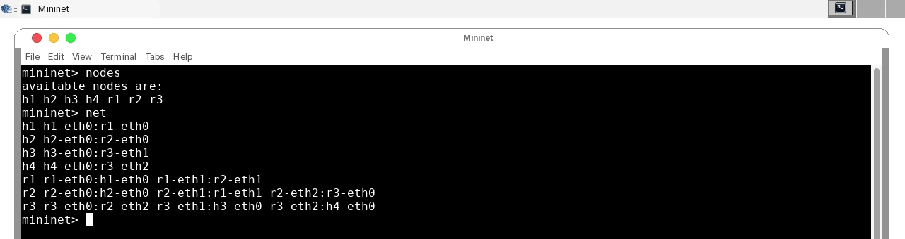

# Meilenstein 1 von 4 · Mininet und die Netzwerkwerkzeuge

*02 · IPv4-Subnetting & ARP* · [Übersicht des Blatts](index.md)

Diese Seite stellt Mininet und die Werkzeuge vor, mit denen ihr in diesem Blatt die Frage „Was ist hier eingestellt, und kommt etwas an?“ beantwortet.

<div class="schichtenbild" style="max-width:20rem;margin:0 0 1.2em 0;font-size:.72rem;line-height:1.5">
<div style="margin-bottom:.3em;color:#757575">In diesen Schichten des TCP/IP-Modells bewegt ihr euch hier:</div>
<div style="display:grid;gap:3px">
<div style="padding:.2em .7em;border-radius:3px;color:#9e9e9e;border:1px dashed #9e9e9e">Anwendungsschicht</div>
<div style="padding:.2em .7em;border-radius:3px;color:#9e9e9e;border:1px dashed #9e9e9e">Transportschicht</div>
<div style="padding:.2em .7em;border-radius:3px;background:#3f51b5;color:#fff;font-weight:600;border:1px solid #3f51b5">Netzwerkschicht · Schwerpunkt</div>
<div style="padding:.2em .7em;border-radius:3px;background:#3f51b5;color:#fff;font-weight:600;border:1px solid #3f51b5">Netzzugriffsschicht · Schwerpunkt</div>
</div>
</div>

## Werkzeugeinführung: Mininet und die Netzwerkwerkzeuge

Bevor wir rechnen, lernt ihr die Werkzeuge kennen, die in allen Teilen wieder
auftauchen. Nehmt euch dafür ruhig 20 bis 30 Minuten Zeit: Wer die Werkzeuge
sicher bedient, verliert später keine Zeit mit Tippfehlern und kann sich auf
das Netz selbst konzentrieren. Jedes Werkzeug hat einen eigenen Steckbrief
(Kasten „Werkzeug: …“) mit echter Ausgabe aus dem Praktikumsabbild; in den
späteren Teilen verweisen wir nur noch darauf.

!!! abstract "Auf einen Blick"
    **Lernziel:** Ihr könnt die Mininet-Topologie `topoP02` starten, mit einem
    Terminal pro Knoten arbeiten und mit den Werkzeugen dieses Abschnitts die Frage
    beantworten „Was ist hier eingestellt, und kommt etwas an?“.

    **Wozu?** Meldet morgens jemand „Die Abteilung Einkauf kommt nicht ins
    Netz“, öffnet ein Netzwerkadmin kein Dashboard, sondern tippt genau diese
    Befehle: `ip addr` (hat der Rechner eine Adresse?), `ip route` (wohin
    schickt er seine Pakete?), `ping` und `traceroute` (kommt etwas an, und wo
    bleibt es hängen?), `tcpdump` (was geht wirklich über die Leitung?). Sie
    laufen auf jedem Linux-Server, Router und Container – ihr nutzt sie später
    genauso in Cloud- und Kubernetes-Umgebungen, wenn ein Dienst „nicht
    erreichbar“ ist.

    **Vorwissen:** Ein Terminal öffnen und Befehle eintippen. Mehr nicht.

### Mininet: ein ganzes Netz auf einem Rechner

!!! info "Werkzeug: Mininet"
    **Was es tut:** Mininet baut aus Linux-Bordmitteln ein virtuelles Netz auf
    einem einzigen Rechner. Jeder „Rechner“ (`h1`, `h2`, …) und jeder „Router“
    (`r1`, `r2`, …) ist ein eigener **Netzwerk-Namespace**: ein abgeschottetes
    Stück Linux mit eigenen Netzwerkschnittstellen, eigener Routingtabelle und
    eigenem ARP-Cache. Die Knoten sind durch virtuelle Kabel verbunden. Was
    ihr in einem Knoten tippt, wirkt nur dort – so verhalten sich getrennte
    Geräte. Mininet selbst arbeitet auf keiner bestimmten Schicht; es stellt
    die Geräte und Leitungen bereit, auf denen die Schichten 2 und 3 laufen.

    **Aufruf-Muster:**

    | Eingabe | Wirkung |
    |---|---|
    | `./start-topoP02.sh` | im Desktop-Terminal: baut die Topologie auf und zeigt den Prompt `mininet>` |
    | `mininet> nodes` | listet alle Knoten |
    | `mininet> net` | zeigt, welche Schnittstelle mit welcher verbunden ist |
    | `mininet> h1 <befehl>` | führt einen einzelnen Befehl im Knoten `h1` aus |
    | `mininet> xterm h1` | öffnet ein eigenes Terminalfenster `Node: h1` |
    | `mininet> pingall` | pingt jeden Knoten von jedem aus an |
    | `mininet> quit` | beendet die Topologie und schließt die Knotenfenster |

    **Echte Ausgabe** (`nodes` und `net` in `topoP02`):

    ```text
    mininet> nodes
    available nodes are:
    h1 h2 h3 h4 r1 r2 r3
    mininet> net
    h1 h1-eth0:r1-eth0
    h2 h2-eth0:r2-eth0
    h3 h3-eth0:r3-eth1
    h4 h4-eth0:r3-eth2
    r1 r1-eth0:h1-eth0 r1-eth1:r2-eth1
    r2 r2-eth0:h2-eth0 r2-eth1:r1-eth1 r2-eth2:r3-eth0
    r3 r3-eth0:r2-eth2 r3-eth1:h3-eth0 r3-eth2:h4-eth0
    ```

    **So lest ihr das:** `nodes` nennt die sieben Knoten. Jede Zeile von `net`
    beginnt mit einem Knoten; danach folgen seine Schnittstellen in der Form
    `<eigene Schnittstelle>:<Schnittstelle der Gegenseite>`. `h1 h1-eth0:r1-eth0`
    heißt: Die Schnittstelle `h1-eth0` von `h1` ist per Kabel mit `r1-eth0` von
    `r1` verbunden. Die Namen sind systematisch: `<knoten>-eth<nummer>`.
    Ein Router wie `r2` hat mehrere Schnittstellen, ein Host nur eine.

    **Typische Meldungen:** `*** Unknown command: h9 ls` heißt: Den Knoten `h9`
    gibt es nicht (Tippfehler im Knotennamen – `nodes` zeigt die gültigen).
    `bash: foo: command not found` heißt dagegen: Der Knoten existiert, nur der
    Befehl dahinter nicht.

Startet die Referenztopologie dieses Blatts in einem Desktop-Terminal
(Doppelklick auf das Symbol `Terminal` auf dem Desktop; ist das Symbol von
Fenstern verdeckt, öffnet `Strg+Umschalt+N` in einem offenen Terminal ein neues)
und probiert `nodes` und `net` aus. Läuft noch eine andere Topologie (z. B. `topo01` aus Blatt 01),
beendet sie vorher mit `exit` bzw. `quit` auf ihrer Mininet-Konsole:

```bash
$ cd ~/rn-practice/topoP02
$ ./start-topoP02.sh
```

Nach einigen Sekunden erscheint der Prompt `mininet>`.


*Die Mininet-Kommandozeile von `topoP02` nach dem Start: `nodes` und `net`.*

Ein einzelner Befehl lässt sich direkt auf einem Knoten ausführen, indem man
den Knotennamen voranstellt:

```bash
mininet> h1 ip addr show h1-eth0
```

Für längere Arbeit öffnet ihr ein eigenes Terminal je Knoten:

```bash
mininet> xterm h1
```

Es erscheint ein Fenster mit dem Titel `Node: h1`. Alles, was ihr dort
eintippt, läuft im Namensraum von `h1` – als wäre das ein eigener Rechner.
Beendet wird die Topologie mit `mininet> quit`; dabei räumt das Startskript
auch die Knotenterminals auf.

!!! tip "Faustregel für das Arbeiten mit mehreren Fenstern"
    Gebt jedem Fenster eine feste Aufgabe: eines pro Knoten, den ihr
    beobachtet, und ein Terminal für die Mininet-Kommandozeile. Lest vor jedem
    Befehl die Titelzeile des Fensters (`Node: h1`) – die häufigste
    Fehlerquelle in diesem Praktikum ist ein Befehl im falschen Fenster.
    Knotenfenster liegen oft übereinander. Wie ihr ein verdecktes Fenster über
    die Fensterliste oben links wiederfindet und warum nach einem
    Fensterwechsel das erste Zeichen verloren gehen kann, steht unter
    [Fenster wiederfinden und tippen](../../reference/umgebung.md#fenster-wiederfinden-und-tippen).
    Das Fenster `Terminal` in dieser Liste ist die Mininet-Konsole (Prompt
    `mininet>`), kein Knotenfenster.

### `ip addr`: Welche Adressen hat dieser Knoten?

!!! info "Werkzeug: `ip addr`"
    **Was es tut:** Zeigt, welche Netzwerkschnittstellen ein Knoten hat und
    welche Adresse jede trägt. Es liest die Einstellungen von Schicht 2
    (MAC-Adresse) und Schicht 3 (IP-Adresse, Präfixlänge) aus dem Kernel.

    **Aufruf-Muster:**

    | Eingabe | Wirkung |
    |---|---|
    | `ip addr show h1-eth0` | alle Angaben zu einer Schnittstelle |
    | `ip -br addr` | Kurzform: eine Zeile je Schnittstelle |
    | `ip -o addr` | eine Zeile je Adresse, gut zum Durchsuchen mit `grep` |

    **Echte Ausgabe** (`h1$ ip addr show h1-eth0`; MAC-Adresse und die Zahl
    hinter `@if` unterscheiden sich bei euch, darunter steht noch eine
    `inet6`-Zeile):

    ```text
    2: h1-eth0@if2: <BROADCAST,MULTICAST,UP,LOWER_UP> mtu 1500 qdisc noqueue state UP group default qlen 1000
        link/ether fe:a2:b8:50:06:11 brd ff:ff:ff:ff:ff:ff link-netnsid 0
        inet 128.155.128.2/18 brd 128.155.191.255 scope global h1-eth0
    ```

    **So lest ihr das:**

    | Teil der Ausgabe | Bedeutung |
    |---|---|
    | `h1-eth0` | Name der Schnittstelle: `h1` ist der Knoten, `eth0` die erste Schnittstelle. |
    | `mtu 1500` | größte IP-Paketgröße (IP-Kopf eingeschlossen), die diese Schnittstelle in einem Rahmen sendet (mehr dazu in [Teil 3](m2-adressplan.md#teil-3-vertiefung-optional-mtu-und-fragmentierung-topop04)). |
    | `state UP` / `UP,LOWER_UP` | Die Schnittstelle ist eingeschaltet und das „Kabel“ ist verbunden. |
    | `link/ether fe:a2:…` | die **MAC-Adresse** (Hardware-Adresse, Schicht 2). |
    | `inet 128.155.128.2/18` | die **IPv4-Adresse** (Schicht 3) und die **Präfixlänge**: Die ersten 18 Bit bezeichnen das Netz. |
    | `brd 128.155.191.255` | die **Broadcast-Adresse** des Netzes: „alle Rechner in diesem Subnetz“. |

    Die Kurzform `ip -br addr` auf `h4` zeigt in einer Zeile je Schnittstelle
    Name, Zustand und Adressen. Darüber steht noch die Zeile `lo` (die
    Loopback-Schnittstelle des Knotens), die ihr hier ignorieren könnt:

    ```text
    h4-eth0@if4      UP             128.155.240.2/23 fe80::5496:fff:fed3:a928/64
    ```

    **Typische Fehlermeldung:** `Device "h1-eth9" does not exist.` – Die
    Schnittstelle gibt es nicht (Tippfehler oder falsches Fenster: `h1` hat nur
    `h1-eth0`). Fehlt in der Ausgabe die `inet`-Zeile, hat die Schnittstelle
    keine IPv4-Adresse – so sieht `topoP02-self` in [Teil 2](m2-adressplan.md#teil-2-eigene-konfiguration-uben-topop02-selfpy) am Anfang aus.

**Probiert es:** Lest auf `h4` die Adresse und die Präfixlänge ab
(`mininet> h4 ip -br addr`). Welche Präfixlänge sollte `h4` haben – und wo in
[Teil 1](m2-adressplan.md#teil-1-vlsm-subnetting-nachvollziehen-topop02) findet ihr den Beleg dafür?

### `ip route`: Wohin schickt dieser Knoten ein Paket?

!!! info "Werkzeug: `ip route`"
    **Was es tut:** Zeigt die **Routingtabelle** des Knotens. Sie beantwortet
    für jede Zieladresse: „Direkt zustellen oder an einen Router (Gateway)
    schicken – und über welche Schnittstelle?“ Das ist die Entscheidung von
    Schicht 3.

    **Aufruf-Muster:**

    | Eingabe | Wirkung |
    |---|---|
    | `ip route` | die ganze Tabelle |
    | `ip route get 128.155.224.2` | fragt den Kernel: Welche Route würdest du für dieses Ziel nehmen? Es wird **kein** Paket verschickt. |
    | `route -n` | dieselbe Tabelle im klassischen Spaltenformat (Destination, Gateway, Genmask, Iface) |
    | `ip route add <netz> via <gateway>` | trägt eine Route ein ([Teil 2](m2-adressplan.md#teil-2-eigene-konfiguration-uben-topop02-selfpy)) |

    **Echte Ausgabe** (`r1$ ip route`):

    ```text
    10.0.0.0/30 dev r1-eth1 proto kernel scope link src 10.0.0.1
    128.155.128.0/18 dev r1-eth0 proto kernel scope link src 128.155.128.1
    128.155.192.0/18 via 10.0.0.2 dev r1-eth1
    ```

    **So lest ihr das:** Jede Zeile ist eine Regel „Pakete an *Netz* gehen so
    raus“.

    - `… dev r1-eth0 proto kernel scope link` – ein **direkt angeschlossenes**
      Netz. Der Kernel hat die Zeile selbst angelegt, sobald die Schnittstelle
      eine Adresse bekam. Es gibt kein `via`: Das Ziel liegt am selben Kabel.
      `src 128.155.128.1` ist die Absenderadresse, die der Router dort benutzt.
    - `… via 10.0.0.2 dev r1-eth1` – ein **entferntes** Netz. Der Router
      `10.0.0.2` (das **Gateway** oder der **Nexthop**) kennt den weiteren Weg.
    - Eine Zeile `default via …` wäre die **Standardroute** (Netz `0.0.0.0/0`):
      „Für alles, was sonst nirgends passt“. Hosts haben meist genau diese eine.

    `ip route get` ist die Kontrolle, die kein Paket verschickt. Auf `h1`:

    ```text
    h1$ ip route get 128.155.224.2
    128.155.224.2 via 128.155.128.1 dev h1-eth0 src 128.155.128.2 uid 0
        cache
    ```

    Gelesen: Für `128.155.224.2` schickt `h1` das Paket über `h1-eth0` an das
    Gateway `128.155.128.1` und trägt als Absender `128.155.128.2` ein. Fehlt
    `via`, liegt das Ziel im selben Netz.

    **Typische Meldung:** Steht in `ip route` kein passender Eintrag und es
    gibt keine Standardroute, antwortet der Kernel beim Senden mit
    `Network is unreachable` – das Paket verlässt den Knoten gar nicht erst
    (in [Teil 2](m2-adressplan.md#teil-2-eigene-konfiguration-uben-topop02-selfpy) erlebt ihr das auf einem unkonfigurierten `h1`).

### `ping`: Ist das Ziel erreichbar?

!!! info "Werkzeug: `ping`"
    **Was es tut:** Schickt ICMP-Echo-Anfragen (Schicht 3) an ein Ziel und
    misst, ob und wie schnell Antworten zurückkommen. Es ist der erste Test
    für „geht es überhaupt?“.

    **Aufruf-Muster:**

    | Eingabe | Wirkung |
    |---|---|
    | `ping -c 4 128.155.224.2` | vier Anfragen, dann aufhören (ohne `-c` läuft `ping` endlos – abbrechen mit `Strg+C`) |
    | `ping -c 3 -i 0.3 <ziel>` | Abstand 0,3 Sekunden statt einer Sekunde |
    | `ping -s 1000 <ziel>` | Nutzlast 1000 Byte statt 56 ([Teil 3](m2-adressplan.md#teil-3-vertiefung-optional-mtu-und-fragmentierung-topop04)) |
    | `ping -M do -s 1000 <ziel>` | zusätzlich „nicht fragmentieren“ ([Teil 3](m2-adressplan.md#teil-3-vertiefung-optional-mtu-und-fragmentierung-topop04)) |
    | `ping -W 1 <ziel>` | höchstens 1 Sekunde auf eine Antwort warten (bei einer unbesetzten Adresse im eigenen Netz zu kurz, siehe `Destination Host Unreachable` unten) |

    **Echte Ausgabe** (`h1$ ping -c 4 128.155.224.2`):

    ```text
    PING 128.155.224.2 (128.155.224.2) 56(84) bytes of data.
    64 bytes from 128.155.224.2: icmp_seq=1 ttl=61 time=0.214 ms
    64 bytes from 128.155.224.2: icmp_seq=2 ttl=61 time=0.099 ms
    64 bytes from 128.155.224.2: icmp_seq=3 ttl=61 time=0.097 ms
    64 bytes from 128.155.224.2: icmp_seq=4 ttl=61 time=0.090 ms

    --- 128.155.224.2 ping statistics ---
    4 packets transmitted, 4 received, 0% packet loss, time 3067ms
    rtt min/avg/max/mdev = 0.090/0.125/0.214/0.051 ms
    ```

    **So lest ihr das:**

    - `56(84) bytes` – 56 Byte Nutzlast, mit IP- und ICMP-Kopf 84 Byte.
    - `icmp_seq` zählt die Anfragen; fehlt eine Nummer, ging ein Paket verloren.
    - `time` ist die Umlaufzeit (RTT) in Millisekunden.
    - `ttl=61`: Der **Time-To-Live**-Wert startet bei 64 und wird von jedem
      Router um 1 verringert. 64 − 61 = **3 Router** lagen auf dem Weg
      (`r1`, `r2`, `r3`). Das ist eine Messung der Weglänge, ohne dass ihr die
      Topologie kennen müsstet.
    - `4 packets transmitted, 4 received, 0% packet loss` ist, was ihr sehen
      wollt. Die letzte Zeile fasst die Laufzeiten zusammen (kleinste,
      mittlere, größte, Schwankung).

    **Typische Fehlermeldungen:**

    | Meldung | Bedeutung |
    |---|---|
    | `ping: connect: Network is unreachable` | Der sendende Knoten hat gar keine passende Route. |
    | `From 128.155.128.1 icmp_seq=1 Destination Net Unreachable` | Ein Router (hier `r1`) meldet: „Ich habe keine Route zu diesem Ziel.“ |
    | `From 10.0.10.10 icmp_seq=1 Destination Host Unreachable` | Der Absender selbst (im Beispiel `h0` aus `topo02`) meldet: Das Ziel liegt im eigenen Netz, antwortet aber auf ARP nicht. Die Meldung kommt erst, wenn die ARP-Auflösung nach etwa 3 Sekunden aufgibt; mit `-W 1` oder `-c 1` beendet sich `ping` vorher und zeigt nur `100% packet loss`. |
    | `ping: sendmsg: Message too long` | Das Paket ist größer als die MTU und darf nicht fragmentiert werden ([Teil 3](m2-adressplan.md#teil-3-vertiefung-optional-mtu-und-fragmentierung-topop04)). |
    | `100% packet loss` ohne jede Meldung | Irgendwo auf Hin- oder Rückweg wird das Paket still verworfen (fehlende Rückroute, Firewall, Verlust). |

### `traceroute`: Welchen Weg nimmt das Paket?

!!! info "Werkzeug: `traceroute`"
    **Was es tut:** Zeigt alle Router auf dem Weg zu einem Ziel (Schicht 3).
    `traceroute` schickt Pakete mit TTL 1, 2, 3, … Jeder Router, der die TTL
    auf 0 herunterzählt, meldet sich per ICMP – so erfährt der Absender, wer
    an Position 1, 2, 3 steht.

    **Aufruf-Muster:**

    | Eingabe | Wirkung |
    |---|---|
    | `traceroute -n 128.155.224.2` | Weg zum Ziel, Adressen ohne Namensauflösung (hier gibt es keine Namen, die Anfrage würde nur warten) |
    | `traceroute -n -w 1 <ziel>` | pro Hop höchstens 1 Sekunde auf Antwort warten |

    **Echte Ausgabe** (`h1$ traceroute -n 128.155.224.2` in `topoP02`):

    ```text
    traceroute to 128.155.224.2 (128.155.224.2), 30 hops max, 60 byte packets
     1  128.155.128.1  0.049 ms  0.019 ms  0.017 ms
     2  10.0.0.2  0.037 ms  0.025 ms  0.024 ms
     3  * * *
     4  128.155.224.2  0.046 ms  0.039 ms  0.038 ms
    ```

    **So lest ihr das:** Jede Zeile ist ein Hop (Router oder Ziel). Danach
    stehen die Adresse des Antwortenden und drei Laufzeiten – `traceroute`
    schickt je Hop drei Pakete. `* * *` heißt: Von diesem Hop kam keine
    Antwort. Das ist nicht automatisch ein Fehler; hier wird Hop 3 (`r3`) in
    [Teil 1](m2-adressplan.md#teil-1-vlsm-subnetting-nachvollziehen-topop02) zur Denkaufgabe. Hop 4 ist das Ziel selbst.

    **Typische Meldungen:** Ein angehängtes `!N` (etwa
    `128.155.128.1  0.030 ms !N`) heißt „Network unreachable“: Der Router hat
    keine Route zum Ziel. Startet ihr `traceroute` unmittelbar ein zweites
    Mal, kann ein Hop kurz stumm bleiben, weil Linux die Rate der
    ICMP-Antworten begrenzt: Wartet eine Sekunde und wiederholt.

### `tcpdump`: Was geht tatsächlich über das Kabel?

!!! info "Werkzeug: `tcpdump`"
    **Was es tut:** Schneidet Pakete an einer Schnittstelle mit und zeigt sie
    als Text – das „Mikroskop“ der Netzwerkdiagnose. Es sieht Schicht 2 bis 4.
    Wireshark (aus Blatt 01) tut dasselbe mit Oberfläche; `tcpdump` läuft
    direkt im Knotenterminal.

    **Aufruf-Muster:**

    | Eingabe | Wirkung |
    |---|---|
    | `tcpdump -n -i r1-eth0 arp` | an dieser Schnittstelle mitschneiden, nur ARP zeigen |
    | `-i any` | an allen Schnittstellen mitschneiden |
    | `-n` | Adressen nicht in Namen auflösen (schneller, eindeutiger) |
    | Filter `arp`, `icmp`, `host 10.0.0.2`, `tcp port 80` | nur passende Pakete; kombinierbar mit `and`/`or` |
    | `-c 4` | nach vier Paketen selbst aufhören |
    | `-v` | ausführlichere Kopfzeilen ([Teil 3](m2-adressplan.md#teil-3-vertiefung-optional-mtu-und-fragmentierung-topop04) braucht sie für Offsets) |
    | `-w datei.pcap` | Mitschnitt speichern, später in Wireshark öffnen |

    `tcpdump` läuft, bis ihr `Strg+C` drückt. Deshalb braucht es ein **eigenes
    Fenster**: In einem Fenster mitschneiden, im anderen den Verkehr erzeugen
    (z. B. mit `ping`).

    **Echte Ausgabe** (`r1$ tcpdump -n -i any arp`, während `h1` zum ersten
    Mal `h3` anpingt):

    ```text
    tcpdump: WARNING: any: That device doesn't support promiscuous mode
    (Promiscuous mode not supported on the "any" device)
    tcpdump: verbose output suppressed, use -v[v]... for full protocol decode
    listening on any, link-type LINUX_SLL2 (Linux cooked v2), snapshot length 262144 bytes
    23:08:55.492254 r1-eth0 B   ARP, Request who-has 128.155.128.1 tell 128.155.128.2, length 28
    23:08:55.492294 r1-eth0 Out ARP, Reply 128.155.128.1 is-at 22:48:82:30:b9:94, length 28
    23:08:55.492339 r1-eth1 Out ARP, Request who-has 10.0.0.2 tell 10.0.0.1, length 28
    23:08:55.492348 r1-eth1 In  ARP, Reply 10.0.0.2 is-at 86:6a:b0:07:10:3c, length 28
    ^C
    4 packets captured
    4 packets received by filter
    0 packets dropped by kernel
    ```

    Drückt ihr `Strg+C` nicht gleich nach dem Ping, zeigt eure Bilanz oft 8
    statt 4 Pakete: Router frischen ihre ARP-Einträge nach einigen Sekunden
    von selbst auf (etwa `who-has 128.155.128.2 tell 128.155.128.1`). Die vier
    gezeigten Zeilen sind die Auflösung, die der Ping ausgelöst hat.

    **So lest ihr das:** Die ersten vier Zeilen sind Meldungen von `tcpdump`
    selbst (bei `-i any` normal: Auf dem Sammelgerät `any` gibt es keinen
    Promiscuous-Modus). Jede Paketzeile besteht aus: Uhrzeit, Schnittstelle,
    Richtung (`B` Broadcast, `Out` von diesem Knoten gesendet, `In` bei ihm
    angekommen), Protokoll, Inhalt, Länge. Bei ARP lautet der Inhalt
    `Request who-has <IP> tell <IP>` („Wer hat diese Adresse? Antwort bitte
    an …“) bzw. `Reply <IP> is-at <MAC>`. Die letzten drei Zeilen nach
    `Strg+C` sind die Bilanz.

    **Typische Fehlermeldung:** `tcpdump: h1-eth9: No such device exists` –
    die Schnittstelle gibt es nicht (Tippfehler oder falsches Fenster).

### `ip neigh` und `arp -a`: Wen kennt dieser Knoten auf der Leitung?

!!! info "Werkzeug: `ip neigh` und `arp -a`"
    **Was es tut:** Zeigt den **ARP-/Nachbarschafts-Cache** (Schicht 2/3): die
    Zuordnung „IP-Adresse → MAC-Adresse“ für Geräte am selben Segment, samt
    Zustand des Eintrags.

    **Aufruf-Muster:**

    | Eingabe | Wirkung |
    |---|---|
    | `ip neigh` | alle Einträge |
    | `ip neigh show 128.155.128.1` | nur der Eintrag für diese Adresse |
    | `ip neigh flush all` | Cache leeren – nützlich, wenn ihr eine ARP-Auflösung noch einmal von vorn beobachten wollt |
    | `arp -a` | die ältere Darstellung derselben Information |

    **Echte Ausgabe** (`h1$ ip neigh` und `arp -a`, nachdem `h1` sein Gateway
    angepingt hat):

    ```text
    128.155.128.1 dev h1-eth0 lladdr 1e:8d:e9:7f:fb:3e REACHABLE
    ? (128.155.128.1) at 1e:8d:e9:7f:fb:3e [ether] on h1-eth0
    ```

    **So lest ihr das:** `128.155.128.1` ist die IP des Nachbarn, `dev
    h1-eth0` die Schnittstelle, über die er erreichbar ist, `lladdr` seine
    MAC-Adresse. Der letzte Begriff ist der **Zustand**: `REACHABLE`
    (kürzlich bestätigt), `STALE` (älter, aber weiter nutzbar), `DELAY` und
    `PROBE` (wird gerade neu geprüft). In `arp -a` heißt ein Gerät ohne Namen
    `?`.

    **Typische Meldung:** Pingt ihr eine Adresse im eigenen Netz, die niemandem
    gehört, steht kurz `128.155.128.99 dev h1-eth0 INCOMPLETE` (Anfrage
    gestellt, keine Antwort) und danach `… FAILED` im Cache; `ping` meldet nach
    etwa 3 Sekunden `Destination Host Unreachable`. `FAILED` heißt: Auf Schicht 2 antwortet
    niemand – das Problem liegt nicht im Routing.

!!! success "Geschafft: euer Werkzeugkasten"
    Merkt euch die Zuordnung: **`ip addr`** = „Was bin ich?“, **`ip route`** =
    „Wohin schicke ich?“, **`ping`/`traceroute`** = „Komme ich an, und auf
    welchem Weg?“, **`tcpdump`** = „Was geht wirklich über das Kabel?“,
    **`ip neigh`** = „Wen kenne ich nebenan?“. Mit diesen fünf Fragen lässt
    sich fast jedes Netzproblem eingrenzen.

!!! success "Meilenstein 1 geschafft"
    **Das habt ihr gelernt:**

    - Die Topologie topoP02 starten und mit einem Terminal je Knoten arbeiten.
    - Adressen mit ip addr und Routen mit ip route auslesen.
    - Mit ping, traceroute und tcpdump prüfen, ob und auf welchem Weg Pakete ankommen.
    - Mit ip neigh bzw. arp -a ablesen, welche Nachbarn ein Knoten auf der Leitung kennt.

    **Was Meilenstein 2 verspricht:** Als Nächstes teilt ihr einen Adressblock nach Hostzahlen in Subnetze auf (VLSM) und lest die Routingtabelle eines Routers. Dafür setzt ihr genau diese Werkzeuge ein.

    [Weiter zu Meilenstein 2: Adressplan: VLSM, Konfiguration, MTU, Broadcast](m2-adressplan.md){ .md-button }
