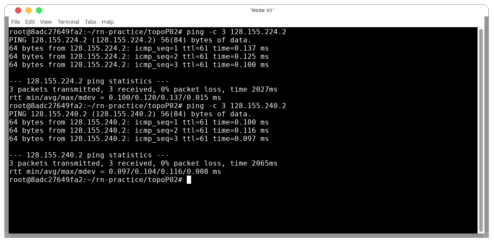
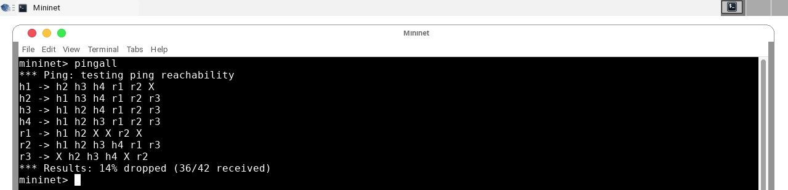
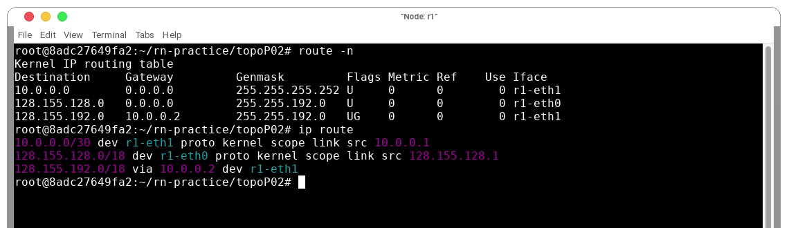
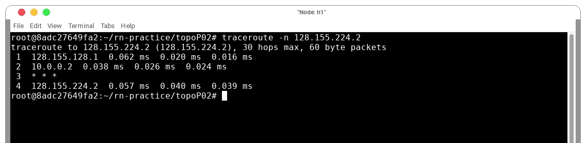

# Meilenstein 2 von 4 · Adressplan: VLSM, Konfiguration, MTU, Broadcast

*02 · IPv4-Subnetting & ARP* · [Übersicht des Blatts](index.md)

Hier lernt ihr, einen Adressblock sinnvoll aufzuteilen, die Konfiguration selbst vorzunehmen und Grenzen eines Subnetzes zu berechnen.

<div class="schichtenbild" style="max-width:20rem;margin:0 0 1.2em 0;font-size:.72rem;line-height:1.5">
<div style="margin-bottom:.3em;color:#757575">In diesen Schichten des TCP/IP-Modells bewegt ihr euch hier:</div>
<div style="display:grid;gap:3px">
<div style="padding:.2em .7em;border-radius:3px;color:#9e9e9e;border:1px dashed #9e9e9e">Anwendungsschicht</div>
<div style="padding:.2em .7em;border-radius:3px;color:#9e9e9e;border:1px dashed #9e9e9e">Transportschicht</div>
<div style="padding:.2em .7em;border-radius:3px;background:#3f51b5;color:#fff;font-weight:600;border:1px solid #3f51b5">Netzwerkschicht · Schwerpunkt</div>
<div style="padding:.2em .7em;border-radius:3px;background:#c5cae9;color:#1a237e;border:1px solid #9fa8da">Netzzugriffsschicht · beteiligt</div>
</div>
</div>

### Teil 1 – VLSM-Subnetting nachvollziehen (`topoP02`)

!!! abstract "Auf einen Blick"
    **Lernziel:** Ihr könnt aus der Zahl benötigter Hosts die passende
    Präfixlänge bestimmen, die Routingtabelle von `r1` lesen und mit
    `traceroute` und `tcpdump` nachweisen, dass jeder Hop eine eigene
    ARP-Auflösung braucht.

    **Wozu?** Zieht ein Unternehmen in ein neues Bürogebäude oder legt eine
    Firma ein Cloud-Netz (VPC) an, bekommt sie einen Adressblock und muss
    entscheiden, wie viele Adressen jede Abteilung erhält: zu wenige, und
    Rechner finden keinen Platz; zu viele, und Adressen, die Anbieter
    vermieten, liegen brach. Die Routingtabelle eines Routers zu lesen ist
    außerdem der schnellste Weg zu erklären, warum eine Abteilung nicht
    erreichbar ist: fehlende Route, falsches Gateway oder falsche Maske sind
    dort sofort zu sehen. Und wer ARP im Mitschnitt deuten kann, versteht, was
    auf jedem Hop wirklich passiert.

    **Vorwissen:** Dualsystem (2ⁿ), Aufbau einer IPv4-Adresse aus vier Oktetten.
    Wenn die Begriffe unten neu sind, lest zuerst den Kasten „Fachbegriff:
    Subnetz".

!!! info "Fachbegriff: Subnetz"
    Ein **Subnetz** ist ein zusammenhängender Ausschnitt eines
    IP-Adressraums, der als eigenes Netzsegment behandelt wird – festgelegt
    durch eine **Netzadresse** und eine **Präfixlänge** (z. B. `/18`), die
    angibt, wie viele der führenden Adressbits das Netz identifizieren; der
    Rest steht für einzelne Hosts zur Verfügung. Ein großer Adressraum wird
    in mehrere Subnetze aufgeteilt, damit Abteilungen, Standorte oder
    Funktionsbereiche getrennt adressiert und geroutet werden können.
    **VLSM** (Variable Length Subnet Masking) bedeutet: Die Subnetze eines
    Adressraums müssen nicht gleich groß sein – jedes bekommt so viele
    Adressen, wie sein Hostbedarf verlangt.

#### Das Szenario

Ein Unternehmen mit vier Abteilungen soll aus dem Adressraum
`128.155.128.0/17` versorgt werden. Der Hostbedarf pro Abteilung:

| Abteilung   | benötigte Hosts |
|-------------|-----------------|
| Entwicklung | 10.000          |
| Verkauf     | 7.500           |
| Einkauf     | 2.100           |
| Lager       | 400             |

#### Vorgemacht: Vom Hostbedarf zur Präfixlänge

Die Rechenregel: Ein Subnetz mit `n` Host-Bits bietet `2ⁿ − 2` nutzbare
Hostadressen. Die zwei fehlenden Adressen sind die **Netzadresse** (alle
Host-Bits 0) und die **Broadcast-Adresse** (alle Host-Bits 1). Die
Präfixlänge ist `32 − n`.

Beispiel **Entwicklung** (10.000 Hosts):

1. Gesucht: kleinstes `n` mit `2ⁿ − 2 ≥ 10.000`.
2. `2¹³ − 2 = 8.190` – zu wenig. `2¹⁴ − 2 = 16.382` – reicht. Also `n = 14`.
3. Präfixlänge: `32 − 14 = 18`, das Subnetz ist ein `/18`.

Ergebnis: Entwicklung bekommt ein `/18` mit 16.382 nutzbaren Adressen; 6.382
bleiben ungenutzt – das ist der Preis der Zweierpotenzen.

#### Selbst: Die übrigen drei Abteilungen

Bestimmt auf dieselbe Weise Host-Bits und Präfixlänge für **Verkauf**,
**Einkauf** und **Lager**. Notiert jeweils `n`, die nutzbaren Hosts und das
Präfix, bevor ihr weiterlest.

??? success "Lösung"
    | Abteilung | benötigt | `n` | nutzbar (`2ⁿ − 2`) | Präfix |
    |---|---|---|---|---|
    | Entwicklung | 10.000 | 14 | 16.382 | `/18` |
    | Verkauf | 7.500 | 13 | 8.190 | `/19` |
    | Einkauf | 2.100 | 12 | 4.094 | `/20` |
    | Lager | 400 | 9 | 510 | `/23` |

    Kontrolle der „Knappheitsgrenze": Für Einkauf würde `n = 11` nur 2.046
    nutzbare Hosts liefern – knapp zu wenig für 2.100. Für Lager liefert
    `n = 8` nur 254, `n = 9` dagegen 510.

#### Die Topologie lesen

Die Abteilungen hängen so an den Routern: `r3` hat zwei Host-Anschlüsse (`h3`
und `h4`); zusammen mit `h1` an `r1` und `h2` an `r2` ergibt das ein Subnetz
je Abteilung.

| Router-Interface | Subnetz | Nutzbare Hosts | Abteilung |
|---|---|---|---|
| `r1-eth0` (→ `h1`) | `128.155.128.0/18` | 16.382 | Entwicklung (10.000) |
| `r2-eth0` (→ `h2`) | `128.155.192.0/19` | 8.190 | Verkauf (7.500) |
| `r3-eth1` (→ `h3`) | `128.155.224.0/20` | 4.094 | Einkauf (2.100) |
| `r3-eth2` (→ `h4`) | `128.155.240.0/23` | 510 | Lager (400) |

Zusätzlich zu den vier Abteilungsnetzen gibt es zwei private
**Transitnetze** zwischen den Routern (`10.0.0.0/30` zwischen `r1` und `r2`,
`10.0.1.0/30` zwischen `r2` und `r3`) – ein in der Praxis übliches Muster,
um Backbone-Verbindungen von den Netzen der Endgeräte zu trennen. Ein `/30`
bietet genau zwei Hostadressen – für die beiden Router an den Enden der
Verbindung reicht das.

Ein Überblick über die Topologie:

```text
                  h2 (128.155.192.2/19)
                  |
 h1 --- r1 ------ r2 ------------ r3 --- h3 (128.155.224.2/20)
    (/18)  10.0.0.0/30   10.0.1.0/30  |
                                      +--- h4 (128.155.240.2/23)
```

(`h2` hängt an `r2`, `h3` und `h4` an `r3`; `/18` ist das Netz zwischen `h1`
und `r1`.) Prüft die Zuordnung am laufenden
Netz mit `mininet> net`.

#### Gemeinsam: Erreichbarkeit prüfen

Startet in Mininet (falls noch nicht geschehen: `./start-topoP02.sh`; beendet
vorher eine noch laufende andere Topologie mit `mininet> quit`) auf `h1`
einen Ping zu `h3` und `h4`. Öffnet dafür mit `mininet> xterm h1` ein
Terminal:

```bash
h1$ ping -c 4 128.155.224.2   # h3
h1$ ping -c 4 128.155.240.2   # h4
```


*Ping von `h1` über drei Router (`r1`→`r2`→`r3`) zu `h3` und `h4`. Die
TTL von 61 (Startwert 64) zeigt die drei Router-Hops.*

Beide Pings müssen ohne Verlust ankommen. Prüft jetzt, ob **alle** Rechner in
**allen** Netzen erreichbar sind. Es gibt vier Hosts, also sind sechs
Paarungen zu testen (`h1`↔`h2`, `h1`↔`h3`, `h1`↔`h4`, `h2`↔`h3`, `h2`↔`h4`,
`h3`↔`h4`). Legt euch dafür eine kleine Tabelle an und tragt „ok" oder
„Fehler" ein; die Adressen stehen in der Tabelle oben (die Hosts tragen jeweils
`.2` im Netz).

??? success "Lösung"
    Alle sechs Paarungen antworten. Beispiele:

    ```bash
    h2$ ping -c 2 128.155.128.2   # h1
    h3$ ping -c 2 128.155.192.2   # h2
    h4$ ping -c 2 128.155.224.2   # h3
    ```

    Dass auch `h3` und `h4` das Verkaufsnetz erreichen (und umgekehrt), liegt
    an der Route `128.155.192.0/19 via 10.0.1.1` auf `r3`: Ohne sie wüsste
    `r3` nicht, wohin es Pakete an `128.155.192.x` schicken soll – weder die
    Anfragen von `h3`/`h4` noch die Antworten auf Pings von `h2`.

Zum Abschluss lasst Mininet alle Paare auf einmal prüfen. Gebt in der
Mininet-Kommandozeile ein (das dauert bis zu einer Minute und bleibt dabei
eine Weile sichtbar bei `r3 ->` stehen – nicht abbrechen):

```bash
mininet> pingall
```


*`pingall` in `topoP02`: 36 von 42 Pings kommen an. Jedes `X` steht für ein
Paar, das nicht antwortet.*

Die Ausgabe lautet `14% dropped (36/42 received)`. Alle vier Hosts erreichen
sich gegenseitig; die `X` stehen bei Paaren, an denen ein Router beteiligt
ist. Notiert, welche Paare es sind, und überlegt, was sie gemeinsam haben.

??? success "Lösung"
    Es fehlen sechs Paare: `h1 -> r3`, `r1 -> h3`, `r1 -> h4`, `r1 -> r3`,
    `r3 -> h1`, `r3 -> r1` – 42 Paare minus 6 ergibt 36. Gemeinsam ist allen
    eine **Transitadresse** (`10.0.0.1` von `r1`, `10.0.1.2` von `r3`) auf
    einer Seite: `r1` kennt das Transitnetz `10.0.1.0/30` nicht und `r3` kennt
    `10.0.0.0/30` nicht, die Antwort findet also keinen Rückweg. Genau diese
    Lücke erklärt auch die Frage „Hop 3 bleibt stumm“ weiter unten.

#### Die Routingtabelle lesen

!!! info "Fachbegriff: Routingtabelle"
    Die **Routingtabelle** eines Rechners oder Routers listet, über welchen
    Weg (welche **Ausgangsschnittstelle**, ggf. über welchen **Gateway**/
    **Nexthop**) ein Paket zu einem bestimmten Zielnetz gelangt. Direkt
    angeschlossene Netze trägt der Kernel automatisch ein; jedes andere Ziel
    braucht entweder eine manuell gesetzte Route (wie in Teil 2) oder eine
    von einem Routing-Protokoll gelernte Route (siehe
    [Lab 03](../03-routing-rip-bgp/index.md)). Zwei gebräuchliche Werkzeuge zum
    Anzeigen sind `route -n` (klassisch) und `ip route` (Teil der
    `iproute2`-Sammlung) – beide zeigen dieselbe Tabelle in unterschiedlicher
    Formatierung.

Öffnet ein Terminal auf `r1` und lest die Tabelle:

```bash
mininet> xterm r1
r1$ route -n
r1$ ip route
```


*`route -n`/`ip route` auf `r1`. Die Zeile `128.155.192.0/18 via 10.0.0.2`
fasst die Netze von Verkauf (`/19`), Einkauf (`/20`) und Lager (`/23`) zu
einer einzigen Route über `r2` zusammen.*

**So lest ihr die drei Zeilen von `r1`:**

1. `10.0.0.0/30 dev r1-eth1` – das Transitnetz zu `r2`, direkt angeschlossen.
2. `128.155.128.0/18 dev r1-eth0` – das Netz von `h1`, direkt angeschlossen.
3. `128.155.192.0/18 via 10.0.0.2` – **alles** von `128.155.192.0` bis
   `128.155.255.255` geht über `r2`. Das nennt man **Routenzusammenfassung**
   (Aggregation): `r1` muss die drei Abteilungsnetze dahinter nicht einzeln
   kennen.

**Selbst:** Lest auf `r2` und `r3` die Tabellen ab (`ip route`). Notiert für
jede Zeile, ob sie ein direkt angeschlossenes oder ein entferntes Netz
beschreibt und welches Zielnetz sie zusammenfasst.

??? success "Lösung"
    `r2`: direkt angeschlossen sind `10.0.0.0/30` (`r2-eth1`),
    `10.0.1.0/30` (`r2-eth2`) und `128.155.192.0/19` (`r2-eth0`, Verkauf).
    Entfernt sind `128.155.128.0/18 via 10.0.0.1` (das Netz von `h1`, über
    `r1`) und `128.155.192.0/18 via 10.0.1.2` (alles hinter `r3`).

    `r3`: direkt angeschlossen sind `10.0.1.0/30` (`r3-eth0`),
    `128.155.224.0/20` (`r3-eth1`, Einkauf) und `128.155.240.0/23`
    (`r3-eth2`, Lager). Entfernt sind `128.155.128.0/18 via 10.0.1.1` (Netz von
    `h1`) und `128.155.192.0/19 via 10.0.1.1` (Netz von `h2`).

#### Traceroute und ARP

Ihr habt geprüft, *dass* die Pakete ankommen. Jetzt geht es darum, *wie*
sie unterwegs adressiert werden – dafür kommt mit ARP ein zweites Protokoll
ins Spiel, das IP-Adressen auf Hardware-Adressen abbildet.

!!! info "Fachbegriff: ARP (Address Resolution Protocol)"
    Eine IP-Adresse allein reicht nicht, um ein Paket auf einem Ethernet-
    Segment zuzustellen – dafür wird die **MAC-Adresse** der Netzwerkkarte
    gebraucht. **ARP** (Address Resolution Protocol, RFC 826) ist das
    Protokoll, mit dem ein Rechner diese Zuordnung klärt: Er fragt per
    Broadcast „wer hat diese IP-Adresse?" und die passende Netzwerkkarte
    antwortet mit ihrer MAC-Adresse. Jeder Rechner merkt sich das Ergebnis
    eine Zeit lang in seinem **ARP-/Nachbarschafts-Cache**. ARP wird immer
    nur **innerhalb eines Segments** verwendet, für den jeweils **nächsten**
    Hop – nie für das Endziel, wenn dieses in einem anderen Netz liegt.

**Vorgemacht – der Weg von `h1` zu `h3`:**

```bash
h1$ traceroute -n 128.155.224.2
```

Ihr bekommt eine Zeile je Router: `r1` (`128.155.128.1`) als Hop 1, `r2`
(`10.0.0.2`) als Hop 2, dann Hop 3 und zuletzt `h3` selbst als Hop 4.
Auffällig: Hop 3 (`r3`) erscheint nur als `* * *`. Das untersuchen wir
gleich.


*`traceroute` von `h1` zu `h3`: Hop 3 antwortet nicht.*

**Gemeinsam – ARP sichtbar machen.** Schon vorhandene ARP-Einträge
verhindern, dass ihr eine Auflösung beobachtet, denn jede Auflösung wird ja
zwischengespeichert. Löscht deshalb zuerst die Caches, dann schneidet ihr mit:

1. Öffnet Terminals auf `h1`, `r1`, `r2` und `r3`
   (`mininet> xterm h1`, `xterm r1`, …).
2. Leert in jedem der vier Fenster den Cache: `ip neigh flush all`.
3. Startet in den Fenstern von `r1`, `r2` und `r3` je
   `tcpdump -n -i any arp`.
4. Löst von `h1` aus genau eine Übertragung aus: `ping -c 1 128.155.224.2`.

Zu Beginn meldet `tcpdump` vier Zeilen über sich selbst (siehe Steckbrief
oben: `WARNING: any: …` und `listening on any …`); danach folgen die
ARP-Pakete.

**Erwartete Ausgabe** (Zeitstempel und MAC-Adressen weichen ab). Auf `r1`:

```text
23:08:55.492254 r1-eth0 B   ARP, Request who-has 128.155.128.1 tell 128.155.128.2, length 28
23:08:55.492294 r1-eth0 Out ARP, Reply 128.155.128.1 is-at 22:48:82:30:b9:94, length 28
23:08:55.492339 r1-eth1 Out ARP, Request who-has 10.0.0.2 tell 10.0.0.1, length 28
23:08:55.492348 r1-eth1 In  ARP, Reply 10.0.0.2 is-at 86:6a:b0:07:10:3c, length 28
```


*Oben der Mitschnitt auf `r1`, unten der auslösende Ping von `h1`. Die erste
Anfrage kommt von `h1` (Broadcast, `B`), die zweite stellt `r1` selbst an
`r2`.*

Gelesen: `B` steht für Broadcast, `Out` für „von diesem Router gesendet", `In`
für „bei diesem Router angekommen". Je Router seht ihr zwei Anfragen mit
je einer Antwort:

- auf `r1`: `who-has 128.155.128.1 tell 128.155.128.2` (`h1` sucht seinen
  Router) und `who-has 10.0.0.2 tell 10.0.0.1` (`r1` sucht `r2`);
- auf `r2`: `who-has 10.0.0.2 tell 10.0.0.1` (die Anfrage von `r1`, bei `r2`
  angekommen) und `who-has 10.0.1.2 tell 10.0.1.1` (`r2` sucht `r3`);
- auf `r3`: `who-has 10.0.1.2 tell 10.0.1.1` (die Anfrage von `r2`) und
  `who-has 128.155.224.2 tell 128.155.224.1` (`r3` sucht `h3`).

Dieselbe Anfrage taucht also auf zwei Routern auf: einmal beim Absender, einmal
beim Empfänger. Beendet die drei `tcpdump` mit `Strg+C`.

**So lest ihr das:** Die IP-Zieladresse des Pakets (`128.155.224.2`) blieb auf
dem gesamten Weg gleich. Gefragt wurde auf jedem Segment aber nach jeweils
**einem anderen Gerät** – dem nächsten Hop. Das Ziel `h3` wird erst auf dem
letzten Segment per ARP gesucht.

Schaut danach die Caches an (`ip neigh` auf `h1`, `r1`, `r2`, `r3`). `h1`
kennt nur seinen Router `128.155.128.1`, nicht `h3`:

```bash
h1$ ip neigh
```

```text
128.155.128.1 dev h1-eth0 lladdr 22:48:82:30:b9:94 REACHABLE
```

Auf den Routern stehen daneben auch Einträge im Zustand `DELAY` (der Nachbar,
der die Anfrage gestellt hat): Das ist ein Zwischenzustand, nach wenigen
Sekunden wird daraus `REACHABLE` oder `STALE`.

**Kernbeobachtung:** Obwohl die IP-Zieladresse (`128.155.224.2`) über den
gesamten Pfad unverändert bleibt, wird auf jedem der vier Segmente
(`h1`–`r1`, `r1`–`r2`, `r2`–`r3`, `r3`–`h3`) eine eigene ARP-Auflösung für
den jeweils nächsten Hop durchgeführt.

!!! question "Nachgedacht: Hop 3 bleibt stumm"
    `r3` schickt seine ICMP-Meldung mit der Absenderadresse `10.0.1.2`.
    Schaut in die Routing-Tabelle von `r1`: Kennt `r1` einen Weg zu
    `10.0.1.0/30`? Was macht ein Router, der Pakete von einer Quelle erhält,
    zu der er selbst keine Route hat (Stichwort *Reverse Path Filter*,
    `sysctl net.ipv4.conf.all.rp_filter`)?

??? success "Lösung"
    `r1` kennt nur `10.0.0.0/30`, `128.155.128.0/18` und `128.155.192.0/18`.
    Für `10.0.1.0/30` gibt es keine Route – auch keine Standardroute. Die
    Antwort von `r3` trägt als Absender `10.0.1.2` und läuft über `r2` zu
    `r1`. Der **Reverse Path Filter** (`rp_filter`) lässt ein Paket nur durch,
    wenn der Router zur Absenderadresse selbst eine Route hätte. Im Modus 1
    („streng") muss diese Route über genau die Schnittstelle führen, auf der
    das Paket ankam; im Modus 2 („locker") genügt irgendeine Route. In `topoP02`
    steht der Wert auf 2 (`r1$ sysctl net.ipv4.conf.all.rp_filter` zeigt
    `net.ipv4.conf.all.rp_filter = 2`). Auch der lockere Modus verwirft das
    Paket, denn `r1` hat zu `10.0.1.2` gar keine Route: `h1` bekommt für Hop 3
    nichts zu sehen. Hop 2 (`10.0.0.2`) und Hop 4 (`128.155.224.2`) sind über
    vorhandene Routen erreichbar und antworten normal.

    Ihr könnt das selbst belegen: Ergänzt auf `r1` die fehlende Route und
    wiederholt `traceroute`:

    ```bash
    r1$ ip route add 10.0.1.0/30 via 10.0.0.2
    h1$ traceroute -n 128.155.224.2
    ```

    Hop 3 erscheint dann mit `10.0.1.2`:

    ```text
     1  128.155.128.1  0.047 ms  0.019 ms  0.018 ms
     2  10.0.0.2  0.035 ms  0.024 ms  0.024 ms
     3  10.0.1.2  0.039 ms  0.031 ms  0.030 ms
     4  128.155.224.2  0.048 ms  0.048 ms  0.037 ms
    ```

    Die Route ist flüchtig: Nach einem Neustart der Topologie ist sie wieder
    weg.

!!! question "Nachgedacht: Warum fragt h1 nicht nach h3?"
    Wenn ARP nur innerhalb eines Segments gilt: Woher weiß `h1` dann
    überhaupt, dass es sein Paket an `r1` schicken soll, statt selbst nach
    der MAC-Adresse von `h3` zu fragen? (Hinweis: Schaut auf die
    Routing-Tabelle von `h1` – die Antwort liegt nicht bei ARP, sondern
    einen Schritt davor.)

??? success "Lösung"
    `h1` schaut zuerst in seine Routingtabelle (`h1$ ip route`).
    `128.155.224.2` liegt nicht im direkt angeschlossenen Netz
    `128.155.128.0/18`, deshalb greift die Standardroute
    `default via 128.155.128.1`. Das **Gateway** `128.155.128.1` *liegt* im
    eigenen Segment, also kann `h1` per ARP nach genau dessen MAC-Adresse
    fragen und das Paket dorthin schicken. Die Entscheidung „an wen"
    (Routing, Schicht 3) fällt vor der Frage „unter welcher MAC" (ARP,
    Schicht 2).

!!! example "Vertiefung (optional): Routing-Schnappschüsse über mehrere Anläufe vergleichen"
    Euer `~/rn-practice`-Verzeichnis bleibt über Container-Neustarts hinweg
    erhalten. Beim `mininet> quit` schreibt das Startskript die
    Routingtabellen aller Knoten nach
    `~/rn-practice/snapshots/topoP02/endzustand.txt`. Die Datei wird beim
    nächsten `quit` überschrieben; kopiert sie deshalb nach jedem Lauf, bevor
    ihr neu startet, z. B. mit
    `cp ~/rn-practice/snapshots/topoP02/endzustand.txt ~/rn-practice/snapshots/02-lauf1.txt`
    (und danach `02-lauf2.txt`). Beendet die Topologie
    (`mininet> quit`), startet sie erneut, beendet sie wieder und kopiert die
    Datei in `02-lauf2.txt`. Ein `diff` zwischen beiden Läufen zeigt, welche
    Einträge bei jedem Start identisch bleiben (die vom Skript
    vorkonfigurierten Routen) und welche verschwunden sind, falls ihr
    zwischendurch manuell etwas verändert hattet – also was an einer
    laufenden Konfiguration flüchtig ist.

### Teil 2 – Eigene Konfiguration üben (`topoP02-self.py`)

!!! abstract "Auf einen Blick"
    **Lernziel:** Ihr konfiguriert Adressen, Routen und Gateways selbst und
    schreibt die Befehle anschließend als wiederholbares Skript auf.

    **Wozu?** In Teil 1 hat euch jemand die Arbeit abgenommen. In der Praxis
    sitzt ihr beim Aufbau eines neuen Standorts, beim Einrichten eines
    Servers oder beim Test einer Cloud-Vorlage vor einem leeren System und
    müsst Adresse, Route und Gateway selbst eintragen – und feststellen, an
    welchem der drei Schritte es hakt. Dasselbe gilt für das Skript am Ende
    dieses Teils: Was nur von Hand getippt wurde, ist nach dem nächsten
    Neustart weg und lässt sich nicht an Kolleginnen weitergeben.
    Konfigurationen als wiederholbares Skript aufzuschreiben ist der erste
    Schritt zu Werkzeugen wie Ansible.

    **Vorwissen:** Teil 1 (Subnetze, Routingtabelle lesen).

Dieselbe Topologie steht auch unkonfiguriert zur Verfügung, damit ihr die
Adressierung und das Routing selbst nachbaut. Für diese Variante gibt es
kein Startskript; ruft die Python-Datei direkt auf (beendet zuvor die
laufende Topologie mit `mininet> quit`):

```bash
cd ~/rn-practice/topoP02
sudo python3 topoP02-self.py
```

Zuerst überzeugt euch, dass wirklich nichts konfiguriert ist: `mininet> h1 ip
addr show h1-eth0` zeigt keine `inet`-Zeile (nur eine `inet6 fe80::…`-Zeile,
die ist normal), und `mininet> h1 ping -c 1 128.155.128.1` scheitert mit
`ping: connect: Network is unreachable`.

#### Die drei Befehlsarten

!!! info "Werkzeug: `ifconfig`, `ip route add` und `route add default gw`"
    **Was sie tun:** Sie **ändern** die Einstellungen des Kernels (bisher habt
    ihr nur gelesen): eine Adresse auf eine Schnittstelle legen (Schicht 3),
    eine Route eintragen, das Standard-Gateway festlegen.

    **Aufruf-Muster:**

    ```bash
    # IP-Adresse für ein Router- oder Host-Interface konfigurieren
    ifconfig <interface> <ip_address>/<subnet_mask>

    # Route auf einem Router hinzufügen
    ip route add <ziel_netz> via <gateway_ip>

    # Standard-Gateway für einen Host festlegen
    route add default gw <gateway_ip>
    ```

    **Echte Ausgabe:** Alle drei Befehle sind bei Erfolg **stumm**. Ob sie
    gewirkt haben, zeigt erst eine Kontrolle. Nach
    `h1$ ifconfig h1-eth0 128.155.128.2/18` liefert `ifconfig h1-eth0` die
    Zeile

    ```text
    inet 128.155.128.2  netmask 255.255.192.0  broadcast 128.155.191.255
    ```

    gelesen: `ifconfig` schreibt die Präfixlänge `/18` als Netzmaske
    `255.255.192.0` (18 Einsen, dann Nullen); der Kernel setzt die
    Broadcast-Adresse passend zur Maske. Nach `route add default gw 128.155.128.1` zeigt `route -n` auf `h1`:

    ```text
    Destination     Gateway         Genmask         Flags Metric Ref    Use Iface
    0.0.0.0         128.155.128.1   0.0.0.0         UG    0      0        0 h1-eth0
    128.155.128.0   0.0.0.0         255.255.192.0   U     0      0        0 h1-eth0
    ```

    Die erste Zeile ist die Standardroute (`0.0.0.0/0`), `G` in `Flags` steht für
    „über ein Gateway“; die zweite ist das direkt angeschlossene Netz, das der
    Kernel beim Setzen der Adresse selbst angelegt hat.

    **Typische Fehlermeldungen:**

    | Meldung | Bedeutung |
    |---|---|
    | `SIOCADDRT: Network is unreachable` | Das Gateway liegt in keinem Netz, das der Knoten direkt erreicht – meist fehlt noch die Adresse auf der Schnittstelle (Reihenfolge!). |
    | `Error: Nexthop has invalid gateway.` | Dasselbe bei `ip route add`: Das `via`-Gateway ist über keine konfigurierte Schnittstelle direkt erreichbar. |
    | `RTNETLINK answers: File exists` / `SIOCADDRT: File exists` | Die Route gibt es schon (z. B. weil ihr den Befehl ein zweites Mal ausführt). |

Die IP-Weiterleitung ist auf allen Routern durch die `Router`-Klasse in
`topoP02-self.py` bereits aktiviert; ihr müsst sie nicht selbst setzen. Der
Befehl dafür lautet:

```bash
sysctl net.ipv4.ip_forward=1
```

#### Vorgemacht: Das Netz von `h1`

Wir konfigurieren die Strecke `h1`–`r1` gemeinsam. Ein Router mit zwei
Schnittstellen braucht auf jeder Seite eine Adresse aus dem jeweiligen Netz:

```bash
mininet> r1 ifconfig r1-eth0 128.155.128.1/18
mininet> h1 ifconfig h1-eth0 128.155.128.2/18
mininet> h1 route add default gw 128.155.128.1
mininet> h1 ping -c 2 128.155.128.1
```

Der Ping muss antworten (`2 packets transmitted, 2 received, 0% packet loss`,
`ttl=64`): `h1` und `r1` liegen jetzt im selben Subnetz. Beachtet
die **Reihenfolge**: Erst bekommt das Interface eine Adresse, dann lässt sich
ein Gateway eintragen, das über dieses Interface direkt erreichbar ist. Sonst
meldet `route add default gw` `SIOCADDRT: Network is unreachable`.


*Die ersten Schritte in `topoP02-self`: vorher ein Ping ins Leere (`Network is
unreachable`), nach der Konfiguration von `r1` und `h1` antwortet `r1`. Der
Ping zu `h2` meldet weiter `Destination Net Unreachable`, und `pingall` zählt
die noch fehlenden Adressen auf.*

#### Gemeinsam: Die Strecke `r1`–`r2`

Konfiguriert jetzt die Verbindung `r1-eth1` – `r2-eth1` (Transitnetz
`10.0.0.0/30`) und das Netz von `h2`. Die Netze stehen in Teil 1; hier alle
Adressen auf einen Blick (Router jeweils `.1`, Hosts jeweils `.2`; in den
Transitnetzen hat der linke Router `.1`). Die Hosts bekommen als
Standard-Gateway die Adresse ihres Routers (`.1`):

| Schnittstelle | Adresse | Schnittstelle | Adresse |
|---|---|---|---|
| `h1-eth0` | `128.155.128.2/18` | `r1-eth0` | `128.155.128.1/18` |
| `h2-eth0` | `128.155.192.2/19` | `r1-eth1` | `10.0.0.1/30` |
| `h3-eth0` | `128.155.224.2/20` | `r2-eth0` | `128.155.192.1/19` |
| `h4-eth0` | `128.155.240.2/23` | `r2-eth1` | `10.0.0.2/30` |
| | | `r2-eth2` | `10.0.1.1/30` |
| | | `r3-eth0` | `10.0.1.2/30` |
| | | `r3-eth1` | `128.155.224.1/20` |
| | | `r3-eth2` | `128.155.240.1/23` |

Die Adressen der Transitnetze: `r1-eth1` = `10.0.0.1/30`,
`r2-eth1` = `10.0.0.2/30`.

Das Netz von `h2` gehört dazu: `r2-eth0` = `128.155.192.1/19`, `h2-eth0` =
`128.155.192.2/19` und für `h2` das Standard-Gateway `128.155.192.1`.

Prüft jetzt **vor** den Routen, was fehlt:

```bash
mininet> h1 ping -c 2 128.155.192.2    # h2: noch nicht erreichbar? Was fehlt?
```

Erwartet: `From 128.155.128.1 icmp_seq=1 Destination Net Unreachable`. Die
Meldung kommt von `r1` und sagt: „Ich habe keine Route zu diesem Ziel".

Ergänzt dann die **Routen**: `r1` muss wissen, wohin Pakete für
`128.155.192.0/18` gehen sollen, `r2` für `128.155.128.0/18`. Setzt zuerst
nur die Route auf `r1` und pingt erneut: Jetzt kommt **gar keine** Meldung
mehr, der Ping bleibt stumm (`100% packet loss`). Der Hinweis auf den Fehler
ist verschwunden, weil das Paket zwar bei `h2` ankommt, `r2` aber die Antwort
nicht zurückschicken kann. Erst mit der Route auf `r2` klappt es.

Wenn ein Ping nicht ankommt, geht ihr systematisch vor: Zuerst `ip route get
<ziel>` auf dem Router, an dem es hakt – dann `ip addr` auf der Gegenseite.

??? success "Lösung"
    ```text
    mininet> r1 ifconfig r1-eth1 10.0.0.1/30
    mininet> r2 ifconfig r2-eth1 10.0.0.2/30
    mininet> r2 ifconfig r2-eth0 128.155.192.1/19
    mininet> h2 ifconfig h2-eth0 128.155.192.2/19
    mininet> h2 route add default gw 128.155.192.1
    mininet> r1 ip route add 128.155.192.0/18 via 10.0.0.2
    mininet> r2 ip route add 128.155.128.0/18 via 10.0.0.1
    mininet> h1 ping -c 2 128.155.192.2
    ```

    Der letzte Ping antwortet mit `ttl=62` (zwei Router auf dem Weg).

#### Selbst: Das ganze Netz

Konfiguriert nun alle Router und Hosts so, dass sich alle vier Hosts
gegenseitig erreichen. Die Adressen stehen in der Tabelle oben (Abschnitt
„Gemeinsam: Die Strecke `r1`–`r2`"); die Routen leitet ihr aus der
Routingtabelle in Teil 1 ab. Prüft mit Pings und mit `traceroute` von `h1` zu `h4`.
Zum Schluss könnt ihr `mininet> pingall` eingeben: Es meldet wie in Teil 1
`14% dropped (36/42 received)`. Solange noch Schnittstellen ohne Adresse
sind, listet `pingall` stattdessen auf, welche noch fehlen (`pingall braucht
auf allen Schnittstellen eine Adresse. Es fehlen noch: …`) – eure Checkliste
für die nächsten Befehle.

??? success "Lösung"
    Adressen:

    ```text
    r1 ifconfig r1-eth0 128.155.128.1/18
    r1 ifconfig r1-eth1 10.0.0.1/30
    r2 ifconfig r2-eth0 128.155.192.1/19
    r2 ifconfig r2-eth1 10.0.0.2/30
    r2 ifconfig r2-eth2 10.0.1.1/30
    r3 ifconfig r3-eth0 10.0.1.2/30
    r3 ifconfig r3-eth1 128.155.224.1/20
    r3 ifconfig r3-eth2 128.155.240.1/23
    h1 ifconfig h1-eth0 128.155.128.2/18
    h2 ifconfig h2-eth0 128.155.192.2/19
    h3 ifconfig h3-eth0 128.155.224.2/20
    h4 ifconfig h4-eth0 128.155.240.2/23
    ```

    Standard-Gateways der Hosts:

    ```text
    h1 route add default gw 128.155.128.1
    h2 route add default gw 128.155.192.1
    h3 route add default gw 128.155.224.1
    h4 route add default gw 128.155.240.1
    ```

    Routen auf den Routern:

    ```text
    r1 ip route add 128.155.192.0/18 via 10.0.0.2
    r2 ip route add 128.155.192.0/18 via 10.0.1.2
    r2 ip route add 128.155.128.0/18 via 10.0.0.1
    r3 ip route add 128.155.128.0/18 via 10.0.1.1
    r3 ip route add 128.155.192.0/19 via 10.0.1.1
    ```

    Wichtig: Alle Hosts einer Verbindung verwenden **dieselbe** Präfixlänge
    wie die Router-Schnittstelle am anderen Ende (z. B. `h4` und `r3-eth2`
    beide `/23`).

!!! example "Vertiefung (optional): Eure Konfiguration als wiederholbares Skript"
    **Wozu?** Alles, was ihr von Hand eingetippt habt, ist mit `mininet>
    quit` verschwunden. Wer ein Netz aufbaut, will es nicht jedes Mal neu
    eintippen – und wer es einem Kollegen übergibt, will es nicht beschreiben,
    sondern **abspielen**. Ein Skript ist die Aufschrift „so wurde es gebaut".

    **Das Gerüst.** Die Mininet-Kommandozeile kann eine Datei einlesen
    (`source`); jede Zeile ist ein Befehl **mit dem Knoten vorweg**. Die
    Datei bleibt bewusst ohne Kommentarzeilen, weil Mininet jede Zeile als
    Befehl liest; die Erklärung steht deshalb darunter. Legt die Datei
    `~/rn-practice/topoP02/meine-config.sh` mit genau diesem Inhalt an,
    zum Beispiel im Desktop-Terminal mit dem Editor `mousepad`
    (`mousepad ~/rn-practice/topoP02/meine-config.sh &`; `nano` ist im
    Image nicht installiert):

    ```text
    r1 ifconfig r1-eth0 128.155.128.1/18
    r1 ifconfig r1-eth1 10.0.0.1/30
    h1 ifconfig h1-eth0 128.155.128.2/18
    h1 route add default gw 128.155.128.1
    ```

    **Zeile für Zeile:**

    | Zeile | Was sie tut | Warum an dieser Stelle |
    |---|---|---|
    | `r1 ifconfig r1-eth0 128.155.128.1/18` | Router-Seite des Hostnetzes bekommt ihre Adresse. | Muss vor dem Gateway kommen, das auf diese Adresse zeigt. |
    | `r1 ifconfig r1-eth1 10.0.0.1/30` | Router-Seite des Transitnetzes. | Das Transitnetz wird später für die Routen gebraucht. |
    | `h1 ifconfig h1-eth0 128.155.128.2/18` | Der Host bekommt seine Adresse im selben Subnetz. | Ohne Adresse gibt es kein „direkt erreichbares Gateway". |
    | `h1 route add default gw 128.155.128.1` | Alles Unbekannte geht an `r1`. | Das Gateway ist jetzt über `h1-eth0` direkt erreichbar. |

    **Die Reihenfolge zählt:** erst die Adressen setzen, dann die Routen.
    Eine Route über ein Gateway lässt der Kernel nur zu, wenn das Gateway
    über ein bereits konfiguriertes Interface direkt erreichbar ist.

    **Ausprobieren:** Beendet die Topologie, startet `topoP02-self.py` neu und
    spielt die Datei ein:

    ```bash
    mininet> source meine-config.sh
    mininet> h1 ping -c 2 128.155.128.1
    ```

    **Schrittweise erweitern.** Nehmt dieselbe Datei und ergänzt Stufe für
    Stufe, nach jeder Stufe wird mit einem Ping geprüft:

    1. *Stufe 1* (steht oben): `h1` erreicht `r1`.
    2. *Stufe 2*: Transitnetz `r1`–`r2` und das Netz von `h2` ergänzen, dazu die
       Routen auf `r1` und `r2`. Prüfen: `h1` pingt `h2`.
    3. *Stufe 3*: den Rest (`r2`–`r3`, `h3`, `h4`) ergänzen. Prüfen: `h1` pingt
       `h4`. Eure Datei entspricht jetzt der Lösung oben.

    Prüft den Endzustand mit `ip -o addr` und einem Ping, ob er derselbe ist
    wie in Teil 1.

    **Zweiter Durchlauf – warum ein Skript wiederholbar sein sollte.** Spielt
    die Datei danach ein **zweites** Mal auf derselben laufenden Topologie
    ein. `ip route add` meldet dann `RTNETLINK answers: File exists`,
    `route add default gw` meldet `SIOCADDRT: File exists`, und
    `ip addr add` würde ebenfalls mit einer Fehlermeldung scheitern. Ein
    Befehl, der beim zweiten Aufruf scheitert, taugt nicht für
    automatisierte Konfiguration. (Die `ifconfig`-Zeilen melden beim zweiten
    Durchlauf nichts; `ip addr add` dagegen meldet
    `Error: ipv4: Address already assigned.`)

    Sucht die Varianten, die sich wiederholen lassen (Stichwort
    `ip route replace`, `ip addr replace`), und überlegt, warum diese
    Eigenschaft bei Konfigurationswerkzeugen einen eigenen Namen hat.

    ??? success "Lösung"
        Wiederholbare Fassungen: `ip addr replace 128.155.128.1/18 dev
        r1-eth0`, `ip route replace 128.155.192.0/18 via 10.0.0.2` und
        `ip route replace default via 128.155.128.1` (auf `h1`). `replace`
        legt den Eintrag an, falls er fehlt, und überschreibt ihn, falls er
        schon da ist – ein zweiter Durchlauf endet im selben Zustand und ohne
        Fehler. Diese Eigenschaft heißt **Idempotenz**: Eine Operation
        mehrfach auszuführen hat dieselbe Wirkung wie einmal. Werkzeuge wie
        Ansible bauen ihre Module darauf auf.

### Teil 3 (Vertiefung, optional) – MTU und Fragmentierung (`topoP04`)

!!! abstract "Auf einen Blick"
    **Lernziel:** Ihr beobachtet, wie ein zu großes Paket in Fragmente zerlegt
    wird, und schätzt ab, was ein Paketverlust für fragmentierte Datagramme
    bedeutet.

    **Wozu?** Ein Homeoffice-Mitarbeiter meldet: „Chat und Ping gehen, aber
    der Dateiupload hängt.“ Häufige Ursache: Ein VPN-Tunnel, eine
    Mobilfunkstrecke oder ein falsch eingestellter Router erlaubt nur
    Pakete, die kleiner sind als 1500 Byte. Kleine Pakete passen durch, große
    werden zerlegt oder verworfen. Admins grenzen das mit `ping -s …` und
    `tcpdump` ein; ihr seht hier den Mechanismus dahinter und rechnet nach,
    warum selbst 10 % Verlust je Leitung Fragmente so teuer machen.

    **Vorwissen:** Teil 1 (Pings lesen); `ping` und `tcpdump` aus der
    [Werkzeugeinführung](m1-werkzeuge.md#werkzeugeinfuhrung-mininet-und-die-netzwerkwerkzeuge).

Bisher ging es um Adressierung und Routing – die Frage, *wohin* ein Paket
geschickt wird. In diesem optionalen Teil geht es darum, *wie groß* ein
Paket sein darf, bevor es unterwegs zerlegt werden muss. Dafür wechselt ihr
zu `topoP04` (beendet vorher die laufende Topologie mit `mininet> quit`), einer
Zwei-Host-Topologie (`h1` = `10.0.0.1`, `h2` =
`10.0.0.2`) mit kleiner MTU (536 Byte statt der üblichen 1500) und 10 %
künstlichem Paketverlust auf jedem Link:

```python
self.addLink(h1, s1, cls=TCLink, bw=10, mtu=536, loss=10)
self.addLink(h2, s1, cls=TCLink, bw=10, mtu=536, loss=10)
```

(Das Schlüsselwort `mtu` kennt `TCLink` nicht; `topoP04.py` setzt die MTU 536
deshalb zusätzlich direkt an `h1-eth0` und `h2-eth0`.)

Im Verzeichnis liegen außerdem zwei Textdateien zum Verschicken:
`MehrAls500ByteText.txt` (632 Byte) und `MehrAls1500ByteText.txt`
(1638 Byte).

**Vorgemacht:** Die **MTU** (Maximum Transmission Unit) ist die größte
IP-Paketgröße – IP-Kopf eingeschlossen –, die ein Link in einem Rahmen
transportiert. Ist ein IP-Paket größer, muss es **fragmentiert** werden: Der
Absender teilt es in Stücke, die jeweils in die MTU passen; erst der Empfänger
setzt sie wieder zusammen. Die Stücke tragen Offset und das Flag `MF` („More
Fragments"). Bei MTU 536 bleiben nach Abzug des 20 Byte langen IP-Kopfs
516 Byte für die IP-Nutzlast; weil die Nutzlast eines Fragments (außer des
letzten) ein Vielfaches von 8 Byte sein muss, sind es 512 Byte.

**Gemeinsam:** Startet die Topologie und beobachtet mit `ping`, ab welcher
Paketgröße Fragmentierung nötig wird:

```bash
cd ~/rn-practice/topoP04
./start-topoP04.sh
h1$ ping -c 4 -M do -s 1000 10.0.0.2   # "do" = Don't Fragment
h1$ ping -c 4 -s 1000 10.0.0.2         # ohne DF-Bit
```

`start-topoP04.sh` öffnet die Terminalfenster `Node: h1` und `Node: h2`
selbst; sie liegen anfangs übereinander, und das zuletzt geöffnete
(`Node: h2`) hat den Fokus. Zieht sie auseinander und achtet auf die
Titelzeile: Die Zeilen mit `h1$` gehören in `Node: h1`. In den
Knoten-Fenstern tippt ihr den Befehl **ohne** den Knotennamen davor
(`ping …`, nicht `h1 ping …` – das gibt dort `bash: h1: command not found`).

**Erwartung:** Mit gesetztem DF-Bit verweigert schon `h1` das Senden
(`ping: sendmsg: Message too long`). Ohne DF-Bit wird jedes Echo in zwei
Fragmente zerlegt; durch die Verlustrate gehen einzelne Pings verloren
(gemessen: `4 packets transmitted, 2 received, 50% packet loss`; das erste
Echo braucht wegen des ARP-Vorlaufs oft über eine Sekunde, bei jedem Lauf
fallen andere Pings aus). Der Mitschnitt zeigt je Echo zwei Zeilen:

```text
23:19:38.193008 IP (tos 0x0, ttl 64, id 11425, offset 0, flags [+], proto ICMP (1), length 532)
    10.0.0.1 > 10.0.0.2: ICMP echo request, id 10797, seq 1, length 512
23:19:38.193030 IP (tos 0x0, ttl 64, id 11425, offset 512, flags [none], proto ICMP (1), length 516)
    10.0.0.1 > 10.0.0.2: ip-proto-1
```

`flags [+]` heißt „es folgen weitere Fragmente“; `id 11425` ist die
gemeinsame Kennung beider Fragmente. `length 532` ist das erste Fragment mit
20 Byte IP-Kopf und 512 Byte Nutzlast. Das zweite beginnt bei `offset 512`,
trägt die restlichen 496 Byte (1008 − 512; Länge 516 mit Kopf) und zeigt
`ip-proto-1` statt der ICMP-Zeile, weil nur das erste Fragment den ICMP-Kopf
enthält.

Beobachtet mit `tcpdump -n -v -i h1-eth0` den Unterschied zwischen beiden
Aufrufen (Felder `offset` und `flags [+]`). Startet dafür im offenen
Fenster `Node: h1` den Mitschnitt und schickt den Ping aus der
Mininet-Kommandozeile:

```bash
h1$ tcpdump -n -v -c 4 -i h1-eth0 icmp
mininet> h1 ping -c 1 -s 1000 10.0.0.2
```

Wegen der 10 % Verlust kommen nicht immer alle vier Pakete. Steht nach etwa
fünf Sekunden noch kein Prompt da, beendet den Mitschnitt mit `Strg+C` und
schickt den Ping noch einmal.

![Zwei Terminalfenster: oben "Node: h1" mit tcpdump-Mitschnitt von vier Paketen, zwei Fragmente pro Echo-Anfrage und Echo-Antwort (offset 0 mit flags [+], offset 512 mit flags [none]); unten "Mininet" mit dem erfolgreichen Ping über 1008 Byte](../../assets/screenshots/02-subnetting-arp/teil3-fragmente-tcpdump.png)
*Ein Ping mit 1000 Byte Nutzlast über die Leitung mit MTU 536: Anfrage und
Antwort bestehen je aus zwei Fragmenten.*

Schickt anschließend die Textdateien per UDP über die Leitung:

!!! info "Werkzeug: `nc` (netcat)"
    **Was es tut:** Schickt oder empfängt rohe Daten über TCP oder UDP
    (Schicht 4) – ein „Telefon“ für Text, ganz ohne Anwendungsprotokoll.

    **Aufruf-Muster:**

    | Eingabe | Wirkung |
    |---|---|
    | `nc -u -l -k 5000` | lauscht auf UDP-Port 5000 und nimmt Datagramme von jedem Absender an (`-k`); ohne `-k` hört `nc` nach dem ersten Datagramm nur noch diesem einen Absender zu |
    | `nc -u -w1 10.0.0.2 5000 < datei` | schickt den Inhalt der Datei als UDP-Datagramm an `10.0.0.2:5000`; `-w1` beendet nach 1 Sekunde Ruhe |
    | `-u` | UDP statt TCP |

    **Echte Ausgabe:** Der Sender schweigt. Leitet ihr die Ausgabe des
    Empfängers in eine Datei um (`> /tmp/nc.out`), wächst sie mit jedem
    vollständig angekommenen Datagramm um genau `1638` Byte (die ganze
    Datei). Ein halbes Datagramm gibt es nicht, weil UDP ein Datagramm nur
    vollständig oder gar nicht zustellt (Nachgedacht unten).

    **Typische Fehlermeldung:** Läuft schon ein Listener auf dem Port, meldet
    der zweite `nc` `Address already in use`. Bei `Connection refused` fehlt
    der Listener oder ihr habt Port oder Adresse vertippt.

Startet im Fenster `Node: h2` zuerst den Empfänger im Hintergrund und dann
den Mitschnitt; schickt die Datei danach aus dem Fenster `Node: h1` –
mindestens fünfmal hintereinander:

```bash
h2$ nc -u -l -k 5000 > /tmp/nc.out &
h2$ tcpdump -n -v -i h2-eth0 udp
h1$ nc -u -w1 10.0.0.2 5000 < MehrAls1500ByteText.txt
```

!!! danger "Nie `pkill` oder `killall` benutzen"
    Die Mininet-Knoten teilen sich die Prozessliste mit eurem Desktop.
    `pkill nc` beendet euren ganzen Desktop und meldet euch ab. Beendet
    Prozesse mit `Strg+C` oder `kill <PID>` (die PID steht in der Ausgabe von
    `jobs -l` bzw. `ps`). Den Empfänger mit `&` beendet ihr also in `Node: h2`
    mit `jobs -l` und `kill <PID>`.

Bei der 1638-Byte-Datei zeigt der Mitschnitt auf `h2` je Sendung bis zu vier
Fragmente der UDP-Nachricht (`offset 0`, `512`, `1024` mit `flags [+]`,
zuletzt `offset 1536` mit `flags [none]`, Länge 130). Beendet den Mitschnitt
mit Strg+C und zählt, wie viele Datagramme vollständig angekommen sind:

```bash
h2$ wc -c /tmp/nc.out
```

Die Bytezahl geteilt durch 1638 ist die Zahl der vollständig angekommenen
Datagramme: mal kommt eine Sendung ganz an, mal gar nicht – so viel zur
Rechnung in der folgenden Denkaufgabe.

!!! warning "Ohne `-k` kommt nach dem ersten Datagramm nichts mehr an"
    `nc -u -l 5000` (ohne `-k`) bindet sich nach dem ersten empfangenen
    Datagramm fest an Adresse und Port dieses Absenders (`ss -uanp` zeigt
    dann `ESTAB`). Jeder neue `nc` auf `h1` sendet von einem neuen Quellport
    und wird verworfen – das sieht aus wie Verlust, ist aber keiner. Nehmt
    deshalb `-k`, oder startet den Empfänger vor jedem Versuch neu.

!!! question "Nachgedacht: Ein Fragment geht verloren"
    Zählt die Fragmente im Mitschnitt und überlegt, was mit dem ganzen
    Datagramm passiert, wenn durch die 10 % Verlustrate nur eines seiner
    Fragmente verloren geht. Wie wahrscheinlich ist es, dass das gesamte
    Datagramm der 1638-Byte-Datei ankommt?

??? success "Lösung"
    Das UDP-Datagramm hat 1638 + 8 (UDP-Header) = 1646 Byte IP-Nutzlast. Bei
    512 Byte je Fragment sind das **4 Fragmente** (3 × 512 + 110). Der
    Empfänger kann nur dann zusammensetzen, wenn **alle** Fragmente ankommen;
    geht eines verloren, wird das ganze Datagramm verworfen (UDP wiederholt
    nichts). Auf dem Weg `h1` → Switch → `h2` liegen zwei Links mit je 10 %
    Verlust, ein Fragment kommt also mit 0,9 · 0,9 = 0,81 durch. Für alle vier
    gilt rechnerisch 0,81⁴ ≈ **0,43**: Nur gut zwei von fünf Datagrammen
    kommen an – obwohl jede einzelne Leitung „nur" 10 % verliert. Fragmentierung
    vervielfacht den Effekt von Verlust; deshalb vermeiden moderne Protokolle
    sie und passen ihre Paketgröße an die kleinste MTU des Wegs an.

### Teil 4 – Broadcast-Adressen selbst berechnen, bevor ihr sie prüft (`topoP02`)

!!! abstract "Auf einen Blick"
    **Lernziel:** Ihr berechnet aus Netzadresse und Präfixlänge die
    Broadcast-Adresse eines Subnetzes und kontrolliert sie am laufenden
    System.

    **Wozu?** Bei jedem Firewall-Eintrag, jeder Cloud-Subnetz-Planung und
    jeder Fehlersuche muss man wissen, wo ein Subnetz beginnt und endet. Ein
    Tippfehler in der Maske (`/23` statt `/22`) legt im Betrieb einen halben
    Standort lahm oder lässt zwei Netze sich überlappen; wer die Grenzen im
    Kopf nachrechnet, bemerkt ihn vorher – auch wenn gerade kein Werkzeug zur
    Hand ist. Es ist außerdem der Stoff, der in Zertifizierungen (z. B. CCNA)
    immer wieder drankommt.

    **Vorwissen:** Präfixlänge ↔ Netzmaske (Teil 1).

Die VLSM-Tabelle aus Teil 1 gibt euch für jedes der vier Subnetze
Netzadresse und Anzahl nutzbarer Hosts vor.

#### Vorgemacht: Das Netz von `h3` (Einkauf)

Netz `128.155.224.0`, Präfix `/20`.

1. Netzmaske: 20 Bit auf 1 → `255.255.240.0` (das dritte Oktett hat 4 Bit auf
   1: `11110000` = 240).
2. Invertiert (Host-Anteil): `0.0.15.255`.
3. Netzadresse + invertierte Maske, komponentenweise addiert:
   `128.155.(224+15).(0+255)` = **`128.155.239.255`**.

Das ist die Broadcast-Adresse: die letzte Adresse des Subnetzes, für Hosts
nicht nutzbar. Die erste nutzbare Adresse ist `128.155.224.1`, die letzte
`128.155.239.254`.

#### Selbst: `h1` und `h2`

Berechnet nach demselben Muster – **ohne vorher `ip addr` auf dem jeweiligen
Interface auszuführen** – die **Broadcast-Adresse** für die Subnetze von `h1`
(Entwicklung) und `h2` (Verkauf):

| Abteilung | Netz | Präfixlänge | Eure berechnete Broadcast-Adresse |
|---|---|---|---|
| Entwicklung (`h1`) | `128.155.128.0` | `/18` | ? |
| Verkauf (`h2`) | `128.155.192.0` | `/19` | ? |

**Vorgehen:** Bestimmt zunächst die Netzmaske in Dotted-Decimal-Schreibweise
(`/18` → `255.255.192.0`, `/19` → `255.255.224.0`), invertiert sie bitweise
(Host-Anteil), und setzt diesen invertierten Anteil auf die Netzadresse auf
– das Ergebnis ist die Broadcast-Adresse.

Startet anschließend `topoP02` (falls nicht mehr aktiv; beendet vorher eine
andere laufende Topologie mit `mininet> quit`) und prüft eure Rechnung gegen
die vom Kernel vergebene Broadcast-Adresse. Öffnet dafür mit `mininet> xterm h1`
und `mininet> xterm h2` je ein Knotenfenster:

```bash
cd ~/rn-practice/topoP02
./start-topoP02.sh
h1$ ip addr show h1-eth0
h2$ ip addr show h2-eth0
```

Das Feld `brd` in der Ausgabe von `ip addr show` zeigt die vom Kernel aus
Adresse und Präfixlänge berechnete Broadcast-Adresse – sie muss mit eurem
von Hand berechneten Wert übereinstimmen.

??? success "Lösung"
    `ip addr show h1-eth0` liefert `inet 128.155.128.2/18 brd
    128.155.191.255`, `ip addr show h2-eth0` liefert `inet
    128.155.192.2/19 brd 128.155.223.255`.

    Rechnung `h1`: `/18` → `255.255.192.0`, invertiert `0.0.63.255`, also
    `128.155.(128+63).255` = `128.155.191.255`. Rechnung `h2`: `/19` →
    `255.255.224.0`, invertiert `0.0.31.255`, also `128.155.(192+31).255` =
    `128.155.223.255`.

#### Zusatzaufgabe: Wie viele `/19` passen in das `/17`?

Berechnet zusätzlich, wie viele Subnetze der Größe `/19` (Verkauf)
rechnerisch insgesamt in das übergeordnete `/17`-Netz aus der
Aufgabenstellung passen würden, wenn das gesamte Netz ausschließlich in
gleich große `/19`-Subnetze aufgeteilt würde – und vergleicht das Ergebnis
mit der Anzahl der tatsächlich benötigten, unterschiedlich großen VLSM-Netze
aus der Tabelle in Teil 1. Was verliert man an nutzbaren Adressen, wenn man
statt VLSM eine starre, gleich große Aufteilung verwendet?

??? success "Lösung"
    Ein `/17` hat 2¹⁵ = 32.768 Adressen, ein `/19` 2¹³ = 8.192. Es passen
    32.768 / 8.192 = 2^(19−17) = **4** Subnetze der Größe `/19` hinein. Die
    Anzahl (4) stimmt mit den vier Abteilungen überein, aber jedes `/19` hat
    nur 8.190 nutzbare Hosts: Für Entwicklung (10.000) reicht das nicht. Die
    starre Aufteilung scheitert also nicht an der Anzahl der Netze, sondern
    an der Größe der größten Abteilung. Mehr dazu rechnet ihr in [Teil 10](m4-vertiefung.md#teil-10-der-preis-der-starren-aufteilung-vlsm-verschnitt-selbst-ausrechnen-topop02-handrechnung).

!!! success "Meilenstein 2 geschafft"
    **Das habt ihr gelernt:**

    - Aus der Hostzahl die Präfixlänge bestimmen sowie Netz-, Broadcast- und Hostadressen berechnen.
    - Die Routingtabelle von r1 lesen und mit traceroute und tcpdump zeigen, dass jeder Hop eine eigene ARP-Auflösung braucht.
    - Adressen, Routen und Gateways selbst setzen und als wiederholbares Skript aufschreiben.
    - Beobachten, wie eine kleine MTU zu IP-Fragmentierung führt und Fragmente bei Verlust teuer macht (Vertiefung).

    **Was Meilenstein 3 verspricht:** Als Nächstes geht es um die Sicherungsschicht: Ihr seht, wie ein Switch die Zuordnung von MAC-Adressen zu Ports lernt und wie ARP IP-Adressen in MAC-Adressen übersetzt.

    [Weiter zu Meilenstein 3: Switch und ARP](m3-switch-und-arp.md){ .md-button }
