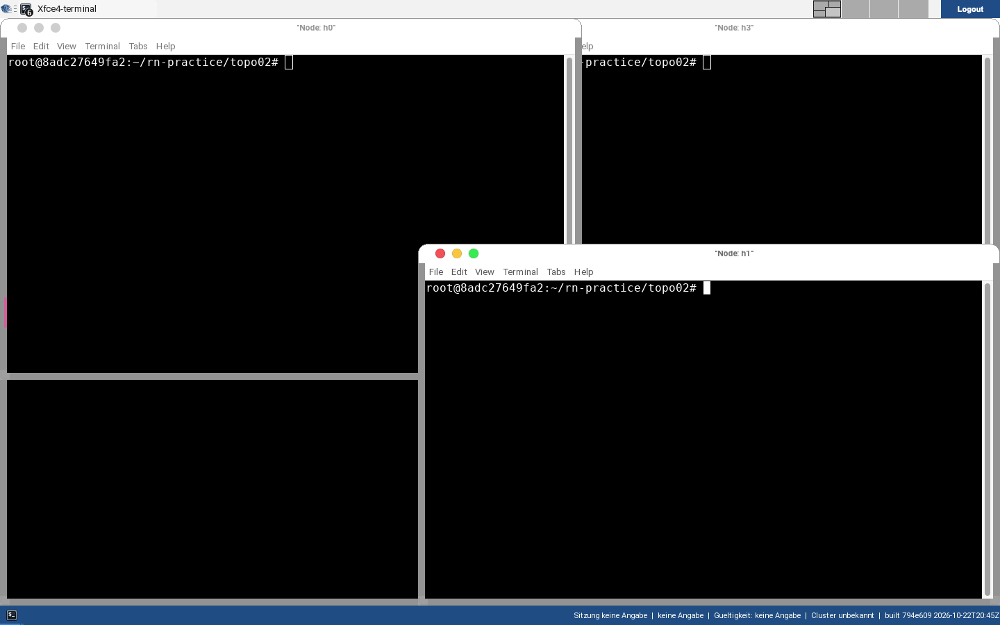
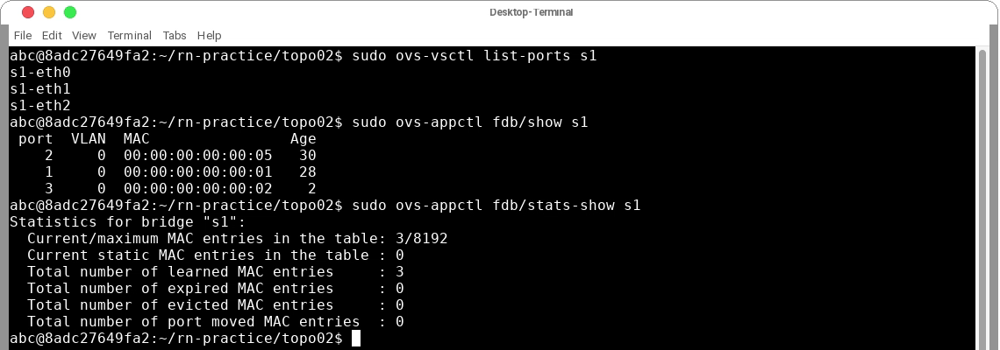
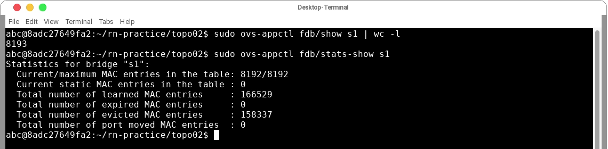
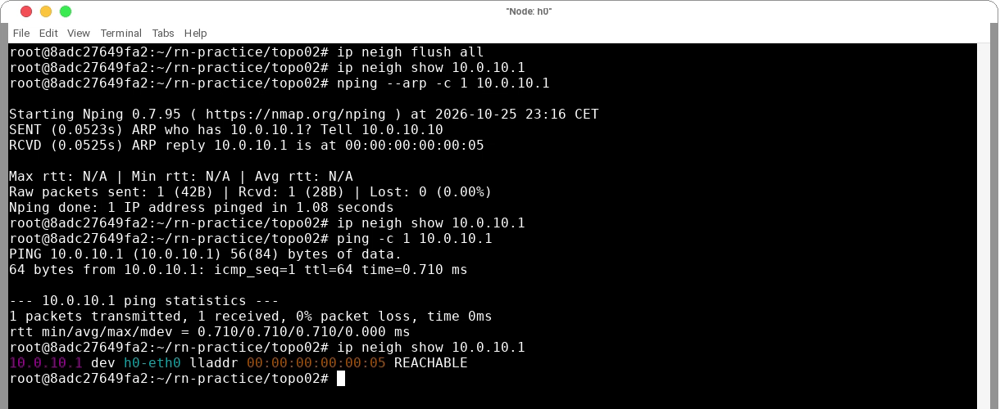

# Meilenstein 3 von 4 · Switch und ARP

*02 · IPv4-Subnetting & ARP* · [Übersicht des Blatts](index.md)

Auf dieser Seite untersucht ihr, wie ein Switch Rahmen weiterleitet und wie ARP IP- in MAC-Adressen auflöst.

<div class="schichtenbild" style="max-width:20rem;margin:0 0 1.2em 0;font-size:.72rem;line-height:1.5">
<div style="margin-bottom:.3em;color:#757575">In diesen Schichten des TCP/IP-Modells bewegt ihr euch hier:</div>
<div style="display:grid;gap:3px">
<div style="padding:.2em .7em;border-radius:3px;color:#9e9e9e;border:1px dashed #9e9e9e">Anwendungsschicht</div>
<div style="padding:.2em .7em;border-radius:3px;color:#9e9e9e;border:1px dashed #9e9e9e">Transportschicht</div>
<div style="padding:.2em .7em;border-radius:3px;background:#c5cae9;color:#1a237e;border:1px solid #9fa8da">Netzwerkschicht · beteiligt</div>
<div style="padding:.2em .7em;border-radius:3px;background:#3f51b5;color:#fff;font-weight:600;border:1px solid #3f51b5">Verbindungsschicht · Schwerpunkt</div>
</div>
</div>

### Teil 5 – Die Lerntabelle des Switches füllen (`topo02`)

!!! abstract "Auf einen Blick"
    **Lernziel:** Ihr messt, wie ein Switch lernt, flutet, vergisst und
    überläuft, und könnt daraus eine Schwachstelle ableiten.

    **Wozu?** Ein Switch gilt als „sicherer als ein Hub“, weil er Rahmen nur
    an den Port des Empfängers schickt. Dafür merkt er sich in einer Tabelle,
    welche MAC-Adresse an welchem Port hängt. Admins lesen diese Tabelle
    (`show mac address-table` bei Cisco-Geräten), wenn sie ein Gerät im
    Netz suchen („An welchem Port steckt der Drucker?“) oder wenn
    unerklärlich viel Verkehr an einem Port ankommt. Wer versteht, *wie* die
    Tabelle entsteht, altert und volllaufen kann, versteht auch, warum ein
    Angreifer im selben Segment mitlesen kann – und was die Gegenmaßnahme
    leistet.

    **Vorwissen:** MAC-Adressen und ARP ([Teil 1](m2-adressplan.md#teil-1-vlsm-subnetting-nachvollziehen-topop02)); `tcpdump` aus der
    [Werkzeugeinführung](m1-werkzeuge.md#werkzeugeinfuhrung-mininet-und-die-netzwerkwerkzeuge).

ARP war in [Teil 1](m2-adressplan.md#teil-1-vlsm-subnetting-nachvollziehen-topop02) die Frage „welche MAC-Adresse gehört zu dieser IP-Adresse?"
– gestellt von einem **Host**. Jetzt wechselt die Perspektive auf das Gerät in
der Mitte. Ein Switch stellt diese Frage nie. Er beantwortet eine andere,
ohne je gefragt zu haben: „über welchen Port erreiche ich diese MAC-Adresse?"

Er **lernt** dazu aus jedem Rahmen, der bei ihm ankommt, und zwar aus der
*Absender*-Adresse. Aus dieser einen Regel folgt alles Weitere – dass er ein
unbekanntes Ziel an alle Ports schicken muss, dass er wieder vergisst, und
dass seine Tabelle volllaufen kann.

!!! info "Werkzeug: `ovs-appctl` und `ovs-vsctl`"
    **Was sie tun:** Die Switches dieser Topologie sind Open-vSwitch-Instanzen
    (Schicht 2). `ovs-appctl` fragt den laufenden Switch („Was weißt du
    gerade?“), `ovs-vsctl` liest und ändert seine Einstellungen. `fdb` steht
    für *forwarding database* – der Name dessen, was in Vorlesungen meist
    „MAC-Tabelle“ oder „Lerntabelle“ heißt.

    **Aufruf-Muster** (immer mit `sudo`, in einem **normalen Desktop-Terminal**,
    nicht in der Mininet-Konsole oder einem Knotenfenster):

    | Eingabe | Wirkung |
    |---|---|
    | `sudo ovs-vsctl list-ports s1` | listet die Ports des Switches `s1` |
    | `sudo ovs-appctl fdb/show s1` | zeigt die Lerntabelle |
    | `sudo ovs-appctl fdb/stats-show s1` | Belegung, Obergrenze, Zähler für gelernt, abgelaufen, verdrängt |
    | `sudo ovs-appctl fdb/flush s1` | leert die Lerntabelle |
    | `sudo ovs-vsctl set bridge s1 other-config:mac-aging-time=15` | stellt die Alterungszeit auf 15 s |

    **Echte Ausgabe** (`fdb/show` kurz nach dem Start, `fdb/stats-show` darunter):

    ```text
    $ sudo ovs-appctl fdb/show s1
     port  VLAN  MAC                Age
        2     0  00:00:00:00:00:05   30
        1     0  00:00:00:00:00:01   28
        3     0  00:00:00:00:00:02    2

    $ sudo ovs-appctl fdb/stats-show s1
    Statistics for bridge "s1":
      Current/maximum MAC entries in the table: 3/8192
      Current static MAC entries in the table : 0
      Total number of learned MAC entries     : 3
      Total number of expired MAC entries     : 0
      Total number of evicted MAC entries     : 0
      Total number of port moved MAC entries  : 0
    ```

    **So lest ihr das:** `fdb/show` hat je gelernter Adresse eine Zeile: `port`
    ist die OVS-**Portnummer** (nicht der Name), `VLAN` ist 0 (ungenutzt), `MAC`
    die gelernte Adresse und `Age` ihr Alter in Sekunden. Bei `stats-show` ist
    `3/8192` die Belegung gegen die Obergrenze; `learned` zählt alle jemals
    gelernten Einträge, `expired` die wegen Alterung gelöschten, `evicted` die
    verdrängten, weil die Tabelle voll war (Schritt 5).

    **Typische Fehlermeldungen:** `database connection failed (Permission
    denied)` heißt: `sudo` vergessen. `no such bridge` mit
    `ovs-appctl: ovs-vswitchd: server returned an error` heißt: Der
    Switchname ist falsch (`s1`, nicht `S1` oder `br0`).

Beendet zuerst eine noch laufende Topologie mit `mininet> quit` (das
Startskript räumt sonst die laufende ab) und schließt übrig gebliebene
`Node:`-Fenster. Startet dann die Topologie. Der Switch `s1` von `topo02` hat
**drei** angeschlossene Geräte (`h0`, `h1`, `r1`) – das braucht ihr, um Fluten
beobachten zu können: Es muss jemanden geben, der einen Rahmen empfängt, der
nicht für ihn ist.

```bash
$ cd ~/rn-practice/topo02
$ ./start-topo02.sh
```

Beim Start öffnet `topo02` von selbst Terminalfenster für `r1`, `h0`, `h1`,
`h2` und `h3` (Titel `Node: <name>`). Sie liegen zunächst übereinander; zieht
sie mit der Maus an eine Stelle, an der ihr sie nebeneinander seht. Das Fenster
mit der Mininet-Kommandozeile (`mininet>`) liegt dahinter. Ein weiteres
Desktop-Terminal öffnet ihr mit dem Symbol `Terminal` auf dem Desktop.


*Der Bildschirm direkt nach dem Start von `topo02`: Die Knotenfenster öffnen
sich übereinander.*

An `s1` hängen `h0` (`10.0.10.10`), `h1` (`10.0.10.11`) und `r1`
(`10.0.10.1`). Verschafft euch zuerst Klarheit über Ports und Adressen:

```bash
$ sudo ovs-vsctl list-ports s1
$ sudo ovs-appctl fdb/show s1
```

`list-ports` nennt drei Ports: `s1-eth0` (zu `r1`), `s1-eth1` (zu `h0`) und
`s1-eth2` (zu `h1`). Die Lerntabelle `fdb/show` enthält schon kurz nach dem
Start meist drei Einträge, denn die Geräte haben beim Hochfahren von selbst
etwas gesendet:

```text
 port  VLAN  MAC                Age
    2     0  00:00:00:00:00:05   30
    1     0  00:00:00:00:00:01   28
    3     0  00:00:00:00:00:02    2
```


*Ports, Lerntabelle und Statistik des Switches `s1` kurz nach dem Start.*

Das Format ist `port VLAN MAC Age` – der Port erscheint dort als
OVS-Portnummer, nicht als Name (hier `1` = `h0`, `2` = `r1`, `3` = `h1`); die
MAC-Adressen `…:01`, `…:05`, `…:02` gehören zu `h0`, `r1`, `h1`; `Age` ist
das Alter des Eintrags in Sekunden. Die Zahlen bei euch weichen ab.

#### Schritt 1 – Erst vorhersagen

Beantwortet diese vier Fragen schriftlich, **bevor** ihr ein Kommando absetzt:

| Frage | Eure Vorhersage |
|---|---|
| `h0` schickt einen Rahmen an eine MAC-Adresse, die dem Switch unbekannt ist. Wie viele der drei Ports sehen ihn? | ? |
| Danach schickt `h0` an eine MAC-Adresse, die der Switch kennt. Wie viele Ports sehen ihn jetzt? | ? |
| Ihr setzt die Alterungszeit auf 15 Sekunden. Nach wie vielen Sekunden Stille ist ein Eintrag verschwunden? | ? s |
| Die Tabelle fasst höchstens `n` Einträge. Was passiert beim `n+1`-ten? | ? |

??? success "Lösung"
    Ein unbekanntes Ziel wird an alle Ports **außer dem Eingangsport**
    geflutet: von den drei Ports sehen es **zwei** (`h1` und `r1`; der Sender
    `h0` bekommt seinen eigenen Rahmen nicht zurück). Ein bekanntes Ziel geht
    nur an **einen** Port, den des Ziels. Ein Eintrag verschwindet
    **frühestens** nach der Alterungszeit (hier 15 s); gemessen wurde in
    Schritt 4 meist etwas später (15 bis 20 s). Beim `n+1`-ten Eintrag muss ein vorhandener weichen
    (*evicted*); die Tabelle bleibt bei `n`.

#### Schritt 2 – Fluten an ein unbekanntes Ziel messen

Ein unbekanntes Ziel stellt ihr am einfachsten mit einer MAC-Adresse her, die
**niemandem** gehört. Dann kann der Switch sie nie lernen, und jeder Rahmen
dorthin wird geflutet. Tragt sie auf `h0` von Hand ein, damit kein ARP
dazwischenkommt. Ihr braucht dafür **zwei** Knotenterminals, `h0` und `h1`;
beide sind seit dem Start offen (`Node: h0`, `Node: h1`):

```bash
h0$ ip neigh replace 10.0.10.99 lladdr 02:00:00:00:00:99 dev h0-eth0 nud permanent
```

Lasst `h1` mithören – `h1` ist weder Absender noch Empfänger dieser Rahmen.
Startet zuerst das Mithören, dann den Ping (`tcpdump` läuft, bis ihr
`Strg+C` drückt):

```bash
h1$ tcpdump -i h1-eth0 -n icmp
h0$ ping -c 3 10.0.10.99
```

**Messwert:** Wie viele der drei gesendeten Rahmen kommen bei `h1` an?
(`ping` meldet `100% packet loss`: Die Adresse existiert nicht, das ist
gewollt. Gezählt werden die Zeilen `ICMP echo request` im Fenster von `h1`.)

#### Schritt 3 – Die Gegenprobe

Ein Befund „`h1` sieht die Rahmen" belegt für sich genommen noch nichts – er
könnte auch bedeuten, dass dieser Switch *grundsätzlich* alles an alle
schickt, also gar nicht lernt. Leert deshalb die Tabelle und wiederholt den
Versuch mit einem Ziel, das existiert:

```bash
$ sudo ovs-appctl fdb/flush s1
h1$ tcpdump -i h1-eth0 -n icmp
h0$ ping -c 5 10.0.20.10
```

**Messwert:** Wie viele `ICMP echo request`- und `ICMP echo reply`-Zeilen
sieht `h1` jetzt insgesamt (von höchstens zehn)? Das Ergebnis
schwankt von Lauf zu Lauf: Gemessen wurden 0, 1 und 2 Zeilen insgesamt (die
erste Anfrage und/oder die erste Antwort), aber nie mehr. Das liegt daran, dass
`h0` und `r1` kurz nach dem Leeren schon wieder etwas senden und der Switch
sie sofort neu lernt. Entscheidend ist der Unterschied zu Schritt 2: dort
alle drei Rahmen, hier höchstens zwei von zehn.

Schaut euch anschließend an, was der Switch dabei gelernt hat:

```bash
$ sudo ovs-appctl fdb/show s1
```

Die Spalte `Age` ist das Alter des Eintrags in Sekunden. Lasst die Ausgabe
zweimal im Abstand einiger Sekunden laufen und achtet darauf, wann `Age` von
selbst wieder auf einen kleinen Wert springt – und was das über den Verkehr
aussagt, der in der Zwischenzeit geflossen ist.

#### Schritt 4 – Die Alterungszeit messen

Ein Switch, der nie vergisst, wäre unbrauchbar: Ein an einen anderen Port
umgesteckter Rechner bliebe für immer unerreichbar. Setzt die Alterungszeit
herunter, erzeugt einmal Verkehr und beobachtet dann, **ohne weiteren
Verkehr**, wie lange der Eintrag überlebt:

```bash
$ sudo ovs-vsctl set bridge s1 other-config:mac-aging-time=15
$ sudo ovs-vsctl get bridge s1 other-config
h0$ ping -c 2 10.0.20.10
$ sudo watch -n 1 ovs-appctl fdb/show s1    # beenden mit Strg+C
```

`get` bestätigt die Einstellung, in der Ausgabe steht `mac-aging-time="15"`.

**Messwert:** Nach wie vielen Sekunden ist der Eintrag für `h0`s MAC-Adresse
(`00:00:00:00:00:01`) verschwunden? Lest dafür die Spalte `Age`: Der letzte
Wert, den ihr vor dem Verschwinden seht, ist die Lebensdauer. Wiederholt die
Messung zwei- bis dreimal, vergleicht mit den eingestellten 15 Sekunden und
erklärt die Abweichung. Gemessen wurde: Der Eintrag war nie früher weg (`Age`
erreichte 14), verschwand aber erst etwa 15 bis 20 Sekunden nach dem letzten
Paket. Hat `h0` zwischendurch weiter gesendet (z. B. ein ARP-Refresh), beginnt
das Alter von vorn und die Zeit wird länger.

!!! question "Nachgedacht: Zusage oder Untergrenze?"
    Ein Switch hält keinen Wecker für jeden einzelnen Eintrag – er räumt
    in Durchläufen auf. Ist eine Alterungszeit damit eine Zusage oder eine
    Untergrenze?

??? success "Lösung"
    Eher eine **Untergrenze**: Gemessen war der Eintrag nie vor Ablauf der
    eingestellten Zeit weg, verschwand aber oft einige Sekunden später. Der
    Grund: Der Switch prüft die Tabelle in periodischen Durchläufen und führt
    nicht je Eintrag einen eigenen Timer. Rechnet deshalb nicht mit einer
    exakten Frist; für die Praxis genügt: „mindestens die eingestellte Zeit,
    meist etwas mehr".

#### Schritt 5 – Die Tabelle zum Überlaufen bringen

Die Lerntabelle ist endlich. Fragt zuerst nach, wie groß sie ist:

```bash
$ sudo ovs-appctl fdb/stats-show s1
```

Das Werkzeug, mit dem man eine solche Tabelle füllt, heißt `macof` (aus dem
Paket `dsniff`). Es erzeugt Rahmen mit **zufälligen** Absenderadressen – und
weil der Switch aus genau diesem Feld lernt, legt er für jeden einzelnen einen
Eintrag an.

!!! info "Werkzeug: `macof`"
    **Was es tut:** Schickt in hoher Rate Ethernet-Rahmen (Schicht 2) mit
    zufälligen Absender-MAC-Adressen. Es ist ein Prüfwerkzeug für Switches –
    setzt es nur in diesem Praktikumsnetz ein.

    **Aufruf-Muster:**

    | Eingabe | Wirkung |
    |---|---|
    | `macof -i h0-eth0` | Rahmen auf dieser Schnittstelle senden, bis ihr `Strg+C` drückt |
    | `timeout 5 macof -i h0-eth0` | nach 5 Sekunden automatisch beenden |
    | `macof -i h0-eth0 -n 1000` | genau 1000 Rahmen senden |

    **Echte Ausgabe** (die ersten Zeilen von `macof -i h0-eth0`):

    ```text
    6e:ee:f2:0:81:e5 ca:c7:61:4f:fd:b5 0.0.0.0.1509 > 0.0.0.0.50899: S 365803438:365803438(0) win 512
    95:8d:d2:73:d3:1 c1:b2:47:73:89:8b 0.0.0.0.11547 > 0.0.0.0.13515: S 1118972713:1118972713(0) win 512
    33:1e:e1:28:71:3f 45:3d:3f:27:fb:1c 0.0.0.0.58866 > 0.0.0.0.39633: S 1815607821:1815607821(0) win 512
    ```

    **So lest ihr das:** Pro Zeile ein gesendeter Rahmen: erst die zufällige
    **Absender-MAC** (die der Switch lernt), dann die ebenso zufällige
    Ziel-MAC, danach ein TCP-SYN-Paket mit Zufallsadressen und -ports als
    Füllung. Die Zeilen scrollen in Sekunden zu Tausenden vorbei – das ist
    normal. Interessant ist nicht die Ausgabe, sondern die Tabelle des
    Switches (`fdb/stats-show`).

    **Typische Fehlermeldung:** `macof: libnet_check_iface() ioctl: No such
    device` heißt: Die Schnittstelle gibt es nicht – Name vertippt oder Befehl
    im falschen Fenster (`macof` läuft im Fenster von `h0`, Schnittstelle
    `h0-eth0`).

```bash
h0$ timeout 5 macof -i h0-eth0
$ sudo ovs-appctl fdb/show s1 | wc -l
$ sudo ovs-appctl fdb/stats-show s1
```

`macof` schreibt fünf Sekunden lang sehr viele Zeilen mit zufälligen
Adressen in das Fenster von `h0`; das ist normal. (`wc -l` zählt die
Kopfzeile von `fdb/show` mit; gemessen wurden `8193` Zeilen und
`Current/maximum MAC entries in the table: 8192/8192`.)


*Nach fünf Sekunden `macof`: Die Lerntabelle ist mit 8192 von 8192 Einträgen
voll, über 150.000 Einträge wurden verdrängt.*

Verkleinert die Tabelle
danach absichtlich und wiederholt den Versuch:

```bash
$ sudo ovs-vsctl set bridge s1 other-config:mac-table-size=64
h0$ timeout 5 macof -i h0-eth0
$ sudo ovs-appctl fdb/stats-show s1
```

**Messwerte:** Wie viele Einträge stehen danach in der Tabelle, und um wie
viel ist die Zeile `evicted` (verdrängt) gestiegen? Die Zähler in
`fdb/stats-show` laufen seit dem Start des Switches mit; vergleicht deshalb
die Werte vor und nach `macof`. Setzt die Einstellungen danach wieder zurück:

```bash
$ sudo ovs-vsctl remove bridge s1 other-config mac-table-size
$ sudo ovs-vsctl remove bridge s1 other-config mac-aging-time
```

!!! question "Nachgedacht: Der Bogen zur Sicherheit – und die Grenze dieser Übung"
    Ihr habt dafür gesorgt, dass ein Switch keinen Platz mehr hat, um echte
    Adressen zu lernen. Überlegt, was das für einen Angreifer am selben
    Segment bedeutet: Welche Rahmen sieht er danach, die er vorher nicht sah?
    Der Angriff hat einen Namen (*MAC flooding*), und die Gegenmaßnahme in
    verwalteten Switches auch (*port security*).

    Gemessen habt ihr hier aber nur die **Verdrängung von Einträgen**
    (`evicted`). Dass der Switch daraufhin fremden Verkehr an euren Port
    flutet, ist damit **nicht** gezeigt – das wäre eine eigene Messung mit
    `tcpdump` auf `h1`, während `macof` läuft. Formuliert, wie ihr sie
    anlegen würdet; in [Teil 9](m4-vertiefung.md#teil-9-die-offene-frage-aus-teil-5-uberlauf-ja-und-flutung-topo02) führt ihr sie durch. Wie ein Lauschangriff auf
    einem geteilten Segment praktisch aussieht, steht in
    [Lab 05 – ARP-Spoofing & Denial-of-Service](../05-arp-spoofing-dos/index.md).

??? success "Lösung"
    Ein Switch, dessen Tabelle voll ist, kann neue Adressen nur noch lernen,
    indem er andere vergisst. Rahmen an eine **vergessene** (unbekannte)
    Adresse flutet er an alle Ports – also auch an den des Angreifers. Der
    Angreifer sieht danach Unicast-Verkehr, der nicht für ihn bestimmt ist.
    **Port Security** begrenzt auf verwalteten Switches die Zahl der pro Port
    lernbaren MAC-Adressen (oft nur eine oder wenige) und sperrt den Port
    oder verwirft Rahmen, wenn die Grenze überschritten wird – `macof`
    scheitert dann nach den ersten Rahmen.

    Eine saubere Messung dazu startet `tcpdump` auf `h1`, lässt `h0` und
    `r1` miteinander kommunizieren, und vergleicht die Rahmenzahl bei `h1`
    **vor** und **während** `macof`. Genau das ist [Teil 9](m4-vertiefung.md#teil-9-die-offene-frage-aus-teil-5-uberlauf-ja-und-flutung-topo02).

??? success "Lösung: typische Messwerte (erst nach der eigenen Messung öffnen)"
    | Messung | Typisches Ergebnis |
    |---|---|
    | Ports von `s1` | `s1-eth1` (`h0`), `s1-eth0` (`r1`), `s1-eth2` (`h1`) |
    | Fluten an ein unbekanntes Ziel (Schritt 2) | `h1` sieht **3 von 3** Rahmen |
    | Gegenprobe mit bekanntem Ziel (Schritt 3) | `h1` sieht 0 bis 2 Zeilen (erste Anfrage und/oder erste Antwort direkt nach dem Leeren), danach nichts mehr |
    | Alterung bei `mac-aging-time=15` | Eintrag verschwindet frühestens nach 15 s, gemessen etwa 15 bis 20 s nach dem letzten Paket (`Age` höchstens 14 zu sehen); der Wert streut, weil der Switch nicht pro Eintrag einen Wecker hält |
    | Obergrenze der Tabelle (Standard) | **8192** Einträge |
    | `macof` 5 s gegen die Standardtabelle | Tabelle voll: `8192/8192`, `evicted` sechsstellig (im Beispiel 158.337) |
    | `macof` 5 s bei `mac-table-size=64` | genau **64** Einträge (`64/64`, 65 Zeilen mit Kopfzeile), `evicted` steigt um mehrere 100.000 |

    Der Kontrast „alle Rahmen" gegen „nur der erste" ist der eigentliche
    Befund dieses Teils: derselbe Switch, dieselbe Quelle, derselbe
    Beobachter – nur einmal mit und einmal ohne Eintrag in der Lerntabelle.
    Die Zahlen für `evicted` hängen davon ab, wie schnell `macof` Rahmen
    erzeugt.

--8<-- "issue-feedback.md"

### Teil 6 – ARP von Hand auslösen und die Zustände lesen (`topo02`)

!!! abstract "Auf einen Blick"
    **Lernziel:** Ihr löst **eine einzelne** ARP-Auflösung aus, lest Frage und
    Antwort und deutet die Zustände im Nachbarschafts-Cache.

    **Wozu?** „Der Drucker ist nicht erreichbar, obwohl die Route stimmt“:
    Der erste Blick eines Admins geht in den ARP-Cache. Steht der Nachbar dort
    als `FAILED`, antwortet auf Schicht 2 niemand – dann liegt der Fehler bei
    Kabel, VLAN oder Maske, nicht beim Routing. Dasselbe Vorgehen entlarvt
    doppelt vergebene IP-Adressen (zwei MAC-Adressen für eine IP) und
    ARP-Angriffe. Dazu muss man die Zustandsnamen kennen und eine einzelne
    Auflösung gezielt auslösen können.

    **Vorwissen:** [Teil 1](m2-adressplan.md#teil-1-vlsm-subnetting-nachvollziehen-topop02) (ARP-Kasten), [Werkzeugeinführung](m1-werkzeuge.md#werkzeugeinfuhrung-mininet-und-die-netzwerkwerkzeuge) (`ip neigh`).

[Teil 1](m2-adressplan.md#teil-1-vlsm-subnetting-nachvollziehen-topop02) hat ARP als Beiwerk des Routings gezeigt: auf jedem Segment eine eigene
Auflösung. Jetzt betrachtet ihr ARP als eigenständiges Protokoll und macht
**eine einzelne** Auflösung sichtbar – Frage und Antwort, und was der Kernel
danach im Nachbarschafts-Cache über den Nachbarn notiert.

!!! info "Werkzeug: `nping --arp`"
    **Was es tut:** `nping` (aus der Nmap-Sammlung) erzeugt Pakete von Hand.
    Mit `--arp` verschickt es **eine** ARP-Anfrage (Schicht 2) und zeigt Frage
    und Antwort im Klartext – genau einen Auflösungsvorgang, ohne das Rauschen
    eines Dauer-Mitschnitts. `nping` sendet den Rahmen selbst über einen
    Raw-Socket am Kernel vorbei; der Kernel erfährt von dieser Auflösung nichts
    und legt deshalb **keinen** Eintrag im Nachbarschafts-Cache an.

    **Aufruf-Muster:**

    | Eingabe | Wirkung |
    |---|---|
    | `nping --arp -c 1 10.0.10.1` | eine ARP-Anfrage („Wer hat 10.0.10.1?“) senden |
    | `-c 1` | nur ein Paket senden, dann aufhören |

    **Echte Ausgabe** (`h0$ nping --arp -c 1 10.0.10.1`):

    ```text
    Starting Nping 0.7.95 ( https://nmap.org/nping ) at 2026-10-25 22:58 CET
    SENT (0.0494s) ARP who has 10.0.10.1? Tell 10.0.10.10
    RCVD (0.0496s) ARP reply 10.0.10.1 is at 00:00:00:00:00:05

    Max rtt: N/A | Min rtt: N/A | Avg rtt: N/A
    Raw packets sent: 1 (42B) | Rcvd: 1 (28B) | Lost: 0 (0.00%)
    Nping done: 1 IP address pinged in 1.07 seconds
    ```

    **So lest ihr das:** `SENT` ist die Frage – „Wer hat `10.0.10.1`? Antwort
    bitte an `10.0.10.10`“; die Zahl in Klammern ist die Sekunde seit dem
    Start. `RCVD` ist die Antwort des Besitzers: `10.0.10.1` ist unter
    `00:00:00:00:00:05` zu erreichen. Die Zeile `Rcvd: 1 … Lost: 0` ist die
    Bilanz. `Max rtt: N/A` ist bei ARP normal (`nping` misst die Laufzeit nur
    für IP-Pakete).

    **Typische Meldung:** Fragt ihr nach einer Adresse, die niemandem gehört
    (`nping --arp -c 1 10.0.10.99`), steht dort nur `SENT …`, und die Bilanz
    lautet `Rcvd: 0 (0B) | Lost: 1 (100.00%)` – niemand antwortet.

Den Zustand der Einträge zeigt `ip neigh` (siehe [Werkzeugeinführung](m1-werkzeuge.md#werkzeugeinfuhrung-mininet-und-die-netzwerkwerkzeuge)): `REACHABLE`
(kürzlich bestätigt), `STALE` (alt, aber nutzbar), `DELAY`/`PROBE` (wird gerade
neu geprüft). `STALE` ist kein Fehler: Der Eintrag wird beim nächsten Verkehr
weiterverwendet und erst bei Bedarf neu geprüft.

**Ziel:** Eine ARP-Auflösung erzwingen, Anfrage und Antwort sehen und den
Übergang der Cache-Zustände nachvollziehen.

**Vorbedingung:** `topo02` läuft (`cd ~/rn-practice/topo02 && ./start-topo02.sh`;
beendet vorher eine andere laufende Topologie mit `mininet> quit`).
`h0` (`10.0.10.10`) und das Gateway `r1` (`10.0.10.1`) liegen am selben Segment.
Das Terminal `Node: h0` ist seit dem Start offen.

**Schritte:**

```bash
h0$ ip neigh flush all
h0$ ip neigh show 10.0.10.1          # leer
h0$ nping --arp -c 1 10.0.10.1       # eine ARP-Anfrage, Antwort im Klartext
h0$ ip neigh show 10.0.10.1          # weiterhin leer: nping umgeht den Kernel
h0$ ping -c 1 10.0.10.1 ; ip neigh show 10.0.10.1
```

**Erwartete Ausgabe:** `ip neigh show 10.0.10.1` ist nach dem Flush leer.
`nping` zeigt `SENT (…) ARP who has 10.0.10.1? Tell 10.0.10.10` und darunter
`RCVD (…) ARP reply 10.0.10.1 is at 00:00:00:00:00:05`. Nach `nping` ist
`ip neigh show 10.0.10.1` weiterhin leer – der Kernel hat die Antwort nicht
selbst ausgelöst. Erst nach dem Ping steht
`10.0.10.1 dev h0-eth0 lladdr 00:00:00:00:00:05 REACHABLE`: Der Ping zwingt
den Kernel zur eigenen ARP-Auflösung.

**So lest ihr die Ausgabe:** `who has 10.0.10.1? Tell 10.0.10.10` ist die
Frage („wer hat diese IP? Antwort bitte an …"); `is at 00:00:00:00:00:05`
ist die Antwort des Besitzers. Die MAC-Adresse in der Antwort ist genau das,
was später im Cache steht.


*Der Ablauf aus Teil 6 in einem Fenster: Nach `nping` ist der Cache leer, erst
der `ping` füllt ihn.*

!!! quote "Hintergrund: ARP ist älter als das Sicherheitsdenken"
    ARP wurde im **November 1982** von David C. Plummer in **RFC 826** definiert
    (Titel: „An Ethernet Address Resolution Protocol"). Es ist bis heute
    Internet Standard (STD 37) und praktisch unverändert – und kennt deshalb
    keinerlei Schutz gegen gefälschte Antworten. RFC 826 entstand, bevor die
    Absicherung von LANs ein Thema war. Genau das nutzt der Angriff in
    [Lab 05](../05-arp-spoofing-dos/index.md) aus.

    - RFC 826 (rfc-editor): <https://www.rfc-editor.org/rfc/rfc826.html>
    - IETF-Datatracker, Status STD 37: <https://datatracker.ietf.org/doc/rfc826/>

!!! success "Meilenstein 3 geschafft"
    **Das habt ihr gelernt:**

    - Das Verhalten eines Switches messen: Lernen, Fluten, Altern und Überlaufen der Lerntabelle.
    - Aus dem Überlauf der Tabelle eine Schwachstelle ableiten.
    - Eine einzelne ARP-Auflösung auslösen, Frage und Antwort lesen und die Zustände im Nachbarschafts-Cache deuten.

    **Was Meilenstein 4 verspricht:** Die Vertiefung festigt die Adress- und Routenentscheidung (längstes Präfix, Subnetz-Zugehörigkeit), führt IPv6 mit Neighbor Discovery als Gegenstück zu ARP ein und prüft per Messung, ob ein überlaufender Switch tatsächlich flutet.

    [Weiter zu Meilenstein 4: Vertiefung: Präfixe, IPv6, Flutung, Verschnitt](m4-vertiefung.md){ .md-button }
