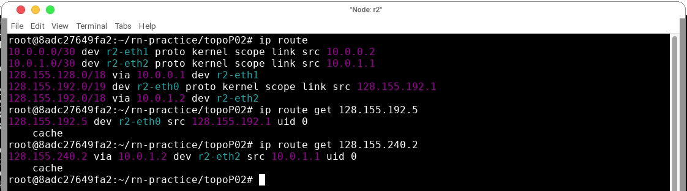

# Meilenstein 4 von 4 · Vertiefung: Präfixe, IPv6, Flutung, Verschnitt

*02 · IPv4-Subnetting & ARP* · [Übersicht des Blatts](index.md)

Diese Seite vertieft das Blatt: Ihr entscheidet Adress- und Routenfragen zuerst selbst, bevor ihr sie am System prüft, und messt offene Behauptungen nach.

<div class="schichtenbild" style="max-width:20rem;margin:0 0 1.2em 0;font-size:.72rem;line-height:1.5">
<div style="margin-bottom:.3em;color:#757575">In diesen Schichten des TCP/IP-Modells bewegt ihr euch hier:</div>
<div style="display:grid;gap:3px">
<div style="padding:.2em .7em;border-radius:3px;color:#9e9e9e;border:1px dashed #9e9e9e">Anwendungsschicht</div>
<div style="padding:.2em .7em;border-radius:3px;color:#9e9e9e;border:1px dashed #9e9e9e">Transportschicht</div>
<div style="padding:.2em .7em;border-radius:3px;background:#3f51b5;color:#fff;font-weight:600;border:1px solid #3f51b5">Netzwerkschicht · Schwerpunkt</div>
<div style="padding:.2em .7em;border-radius:3px;background:#c5cae9;color:#1a237e;border:1px solid #9fa8da">Netzzugriffsschicht · beteiligt</div>
</div>
</div>

### Teil 7 – Longest-Prefix-Match selbst entscheiden, bevor der Kernel es tut (`topoP02`)

!!! abstract "Auf einen Blick"
    **Lernziel:** Ihr bestimmt bei überlappenden Routen von Hand die
    gewinnende Route (längstes Präfix) und prüft sie mit `ip route get`.

    **Wozu?** In echten Routingtabellen überlappen Routen ständig: Die
    Standardroute passt auf alles, spezifischere Routen auf Teile davon.
    Fügt jemand im Rechenzentrum eine neue, spezifischere Route ein, „klaut“
    sie plötzlich Verkehr von einer älteren – dieselbe Regel nutzen auch
    Angreifer, die per BGP ein kleineres Präfix eines fremden Netzes
    ankündigen (Route Hijacking). Admins prüfen mit `ip route get <ziel>`,
    welchen Weg der Kernel wirklich wählt; ohne die Regel „längstes Präfix
    gewinnt“ ließe sich keine Tabelle vorhersagen und kein Routingfehler
    erklären.

    **Vorwissen:** [Teil 1](m2-adressplan.md#teil-1-vlsm-subnetting-nachvollziehen-topop02) (Routingtabelle lesen).

In [Teil 1](m2-adressplan.md#teil-1-vlsm-subnetting-nachvollziehen-topop02) habt ihr die Routing-Tabellen *gelesen*. Jetzt trefft ihr selbst die
Entscheidung, die ein Router bei **überlappenden** Routen treffen muss: Wenn
zwei Einträge auf dasselbe Ziel passen, gewinnt der mit dem **längeren Präfix**.
`topoP02` liefert dafür einen Fall auf `r2`.

!!! info "Hintergrund: warum das längste Präfix gewinnt (CNP3, RFC 1519)"
    Mit CIDR (RFC 1519) wurden die starren Adressklassen A/B/C durch Präfixe
    beliebiger Länge ersetzt. Damit kann dieselbe Zieladresse auf mehrere
    Routen passen. Die Regel dafür ist eindeutig: Das Lehrbuch CNP3
    formuliert sie als „when a router knows several routes towards the same
    destination address, it must forward packets along the route having the
    longest prefix length." `0.0.0.0/0` passt auf alles und ist deshalb die
    Default-Route – das kürzeste mögliche Präfix, der letzte Ausweg.

    Quelle: *Computer Networking: Principles, Protocols and Practice*,
    O. Bonaventure u. a., UCLouvain, Kapitel „IP version 4" (CC BY-SA 3.0),
    zitiert RFC 1519; <https://www.computer-networking.info>

**Ziel:** Für eine Zieladresse, auf die zwei Routen passen, von Hand die
gewinnende Route bestimmen und mit `ip route get` prüfen.

**Vorbedingung:** `topoP02` läuft (`cd ~/rn-practice/topoP02 && ./start-topoP02.sh`;
beendet vorher eine andere laufende Topologie mit `mininet> quit`).
Öffnet ein Terminal auf `r2` (`mininet> xterm r2`; `topoP02` öffnet beim
Start keine Knotenfenster, anders als `topo02`). Liegen Fenster übereinander,
hilft [Fenster wiederfinden und tippen](../../reference/umgebung.md#fenster-wiederfinden-und-tippen);
das Fenster `Terminal` in der Fensterliste ist die Mininet-Konsole. In dieser
Anleitung steht `r2$` als Kürzel für den echten Prompt im Fenster `Node: r2`
(`root@<Containername>:~/rn-practice/topoP02#`); das `r2$` tippt ihr nie mit.
`xterm r2` und `mininet> h1 ping …` gehören in die Mininet-Konsole (dort fehlt
ohne den Knotennamen `h1` die Zuordnung: `*** Unknown command: ping`).

**Vorgemacht:** Ein Paket an `128.155.200.1` (liegt im Verkaufsnetz). Auf `r2`
passen zwei Routen: `128.155.192.0/19` (Adressen 192.0 bis 223.255) und
`128.155.192.0/18` (192.0 bis 255.255). Beide enthalten die Adresse. Das `/19`
hat das längere Präfix und gewinnt – das Paket geht direkt in das
angeschlossene Netz.

**Schritte:** Schaut euch zuerst die Routing-Tabelle von `r2` an:

```bash
r2$ ip route
```

Ihr findet dort für das Verkaufsnetz **zwei** passende Einträge:
`128.155.192.0/19` (direkt angeschlossen, `dev r2-eth0`) und
`128.155.192.0/18 via 10.0.1.2` (der Weg über `r3`). Entscheidet **auf Papier**,
über welchen der beiden ein Paket an `128.155.192.5` (ein Host im Verkaufsnetz)
geht, und prüft erst dann:

```bash
r2$ ip route get 128.155.192.5
r2$ ip route get 128.155.240.2     # h4, nur über /18 erreichbar
```


*Die Routingtabelle von `r2` und zwei Entscheidungen des Kernels: Für
`128.155.192.5` gewinnt das längere `/19`, für `128.155.240.2` bleibt nur das
`/18`.*

Die Ausgabe von `ip route get` enthält außerdem `uid 0` und eine Zeile
`cache`; beides könnt ihr ignorieren.

**Erwartete Ausgabe:** `ip route get 128.155.192.5` nennt
`dev r2-eth0 src 128.155.192.1` **ohne** `via` (das direkt angeschlossene `/19`
gewinnt, weil sein Präfix länger ist); `ip route get 128.155.240.2` nennt
dagegen `via 10.0.1.2 dev r2-eth2 src 10.0.1.1` (nur das `/18` passt).

**Selbst:** Welche Route nimmt ein Paket von `r2` an `128.155.128.7` (ein
Host im Entwicklungsnetz)? Entscheidet auf Papier und prüft mit
`ip route get`.

??? success "Lösung"
    Es passt nur `128.155.128.0/18 via 10.0.0.1` (Adressen 128.0 bis 191.255)
    – das `/18` über `r2-eth1` zu `r1`. Die beiden anderen Routen
    (`192.0/19`, `192.0/18`) beginnen bei 192.0 und enthalten die Adresse
    nicht. Der Kernel nennt `via 10.0.0.1 dev r2-eth1 src 10.0.0.2`.

!!! question "Nachgedacht: Was wäre ohne das /19?"
    Angenommen, die direkt angeschlossene Route `128.155.192.0/19` fehlte auf
    `r2`. Wohin ginge dann ein Paket an `128.155.192.5`? Was würde `r3` damit
    machen?

??? success "Lösung"
    Es bliebe nur `128.155.192.0/18 via 10.0.1.2`: `r2` schickte das Paket an
    `r3`. `r3` hat keine Route in das Verkaufsnetz hinein – ohne die Route
    `128.155.192.0/19 via 10.0.1.1` würde es das Paket verwerfen und eine
    ICMP-Meldung „Destination Net Unreachable" zurückschicken; mit dieser
    Route schickte `r3` es sofort wieder an `r2` zurück, und das Paket
    pendelte, bis die TTL abläuft (**Routingschleife**). Die längere,
    spezifischere Route verhindert genau das.

    **Gemessen** (ohne das `/19`):

    - `r2$ ip route get 128.155.192.5` zeigt die Route `via 10.0.1.2 dev r2-eth2`.
    - Ein Ping von `h1` zu `h2` endet mit
      `From 10.0.0.2 icmp_seq=1 Time to live exceeded`.
    - `traceroute` zeigt abwechselnd `10.0.0.2` (`r2`) und `* * *` (`r3` bleibt
      aus demselben `rp_filter`-Grund stumm wie bei Hop 3); steht die Route aus
      der Hop-3-Lösung noch, wechseln `10.0.0.2` und `10.0.1.2`. Ab etwa Hop 5
      kommen nur noch Sterne, weil die Router ihre ICMP-Meldungen begrenzen.

    **Zum Ausprobieren:** `r2$ ip route del 128.155.192.0/19`. Zurück geht es
    nur mit einem Neustart der Topologie (`quit`, dann `./start-topoP02.sh`).
    `h2` hat die Adresse `128.155.192.2`; ihr pingt und verfolgt den Weg aus der
    Mininet-Konsole mit `mininet> h1 ping -c 2 128.155.192.2` und
    `mininet> h1 traceroute -n -m 8 128.155.192.2`.

### Teil 8 – IPv6 nebenher: Link-Local-Adressen und Neighbor Discovery statt ARP (`topo02`)

!!! abstract "Auf einen Blick"
    **Lernziel:** Ihr zeigt, dass IPv6-Nachbarn sich ohne Konfiguration und
    ohne ARP finden, und lest den von NDP gefüllten Nachbar-Cache.

    **Wozu?** In Mobilfunk, Cloud und Universitätsnetzen läuft IPv6 längst
    neben IPv4 – oft, ohne dass es jemand konfiguriert hat: Jedes Gerät hat
    automatisch eine `fe80::`-Adresse und ist darüber im Segment erreichbar,
    auch an der IPv4-Firewall vorbei. Wer IPv6-Nachbarn findet und den
    NDP-Cache liest, kann solche Geräte inventarisieren, Fehler eingrenzen und
    das Gegenstück zum ARP-Spoofing (gefälschte Neighbor Advertisements)
    verstehen.

    **Vorwissen:** [Teil 6](m3-switch-und-arp.md#teil-6-arp-von-hand-auslosen-und-die-zustande-lesen-topo02) (ARP-Cache lesen).

Bisher war alles IPv4, und ARP war die Antwort auf „welche MAC gehört zu dieser
IP?". Unter IPv6 gibt es **kein ARP** – dieselbe Aufgabe erledigt das *Neighbor
Discovery Protocol* (NDP). Konfigurieren müsst ihr dafür nichts: Jede
Schnittstelle bekommt automatisch eine **Link-Local-Adresse** (`fe80::/10`),
mit der Nachbarn auf demselben Segment sich schon vor jeder IPv6-Konfiguration
erreichen.

!!! info "Werkzeug: `ip -6` und `ping6`"
    **Was sie tun:** `ip -6 addr` und `ip -6 neigh` zeigen Adressen und
    Nachbarn für IPv6 (Schichten 2 und 3), `ping6` ist der IPv6-Ping.

    **Aufruf-Muster:**

    | Eingabe | Wirkung |
    |---|---|
    | `ip -6 addr show h0-eth0` | zeigt die automatisch vergebene `fe80:…`-Adresse |
    | `ping6 -c 2 ff02::1%h0-eth0` | pingt alle Geräte am Segment (All-Nodes-Multicast) |
    | `ping6 <fe80-adresse>%<schnittstelle>` | erreicht einen Link-Local-Nachbarn; `%h0-eth0` legt die Schnittstelle fest |
    | `ip -6 neigh show dev h0-eth0` | von NDP gefüllte Nachbarn |

    **Echte Ausgabe** (`h0$ ping6 -c 2 ff02::1%h0-eth0`):

    ```text
    PING ff02::1%h0-eth0 (ff02::1%h0-eth0) 56 data bytes
    64 bytes from fe80::200:ff:fe00:1%h0-eth0: icmp_seq=1 ttl=64 time=0.055 ms
    64 bytes from fe80::200:ff:fe00:5%h0-eth0: icmp_seq=1 ttl=64 time=1.15 ms
    64 bytes from fe80::200:ff:fe00:2%h0-eth0: icmp_seq=1 ttl=64 time=1.17 ms
    64 bytes from fe80::200:ff:fe00:1%h0-eth0: icmp_seq=2 ttl=64 time=0.059 ms

    --- ff02::1%h0-eth0 ping statistics ---
    2 packets transmitted, 2 received, +2 duplicates, 0% packet loss, time 1001ms
    ```

    **So lest ihr das:** Eine Anfrage an die Multicast-Adresse `ff02::1` ist an
    **alle** Geräte im Segment gerichtet, deshalb antworten mehrere: `h0` selbst
    (`…:1`), `r1` (`…:5`) und `h1` (`…:2`). Es kommen mehr Antworten an, als
    Anfragen gesendet wurden;
    `ping6` zählt sie als `+2 duplicates` – das ist hier erwünscht. Der Zusatz
    `%h0-eth0` legt die Schnittstelle fest: `fe80::`-Adressen gelten auf
    **jeder** Schnittstelle, und ohne Zusatz wählt der Kernel auf einem Knoten
    mit mehreren Schnittstellen womöglich die falsche. Eine `fe80:`-Adresse
    bedeutet nicht „nicht konfiguriert“: Sie ist der Normalzustand und für NDP
    unverzichtbar.

    **Typische Fehlermeldung:** `From fe80::… Destination unreachable: Address
    unreachable` – das Ziel liegt an einer anderen Schnittstelle, als der
    Kernel gewählt hat: `%<schnittstelle>` vergessen (auf `r1` mit mehreren
    Schnittstellen der Normalfall).

**Ziel:** Zeigen, dass IPv6-Nachbarn sich ohne Konfiguration und ohne ARP
finden, und den von NDP gefüllten Nachbar-Cache lesen.

**Vorbedingung:** `topo02` läuft. Das Terminal `Node: h0` ist seit dem Start offen.

**Schritte:**

```bash
h0$ ip -6 addr show h0-eth0            # die fe80:...-Adresse ablesen
h0$ ping6 -c 2 ff02::1%h0-eth0         # all-nodes-Multicast auf dem Segment
h0$ ip -6 neigh show dev h0-eth0       # von NDP gefüllte Nachbarn
```

**Erwartete Ausgabe:** `ip -6 addr` zeigt `inet6 fe80::200:ff:fe00:1/64 scope
link`. Auf den Ping an die All-Nodes-Adresse antworten `h0` selbst sowie
`fe80::200:ff:fe00:2` (`h1`) und `fe80::200:ff:fe00:5` (`r1`). Danach stehen
in `ip -6 neigh` diese beiden Nachbarn mit ihrer MAC-Adresse
(`00:00:00:00:00:02`, `00:00:00:00:00:05`) – gefüllt durch NDP, nicht durch
ARP. Als Zustand steht dort je nach Zeitpunkt `REACHABLE` oder kurz `DELAY`
(wie bei ARP in Teil 6).

Probiert den Zusatz `%…` auch auf `r1` aus, das mehrere Schnittstellen hat
(öffnet dafür das Fenster `Node: r1`, es ist seit dem Start offen):
`r1$ ping6 -c 1 fe80::200:ff:fe00:1` ohne Zusatz endet mit
`Destination unreachable: Address unreachable`, mit `%r1-eth0` kommt die
Antwort von `h0`.

!!! info "Hintergrund: NDP ist RFC 4861"
    Was ARP (RFC 826) für IPv4 tut, erledigt für IPv6 das *Neighbor Discovery
    Protocol* (RFC 4861) – allerdings nicht über einen eigenen Ethertype,
    sondern als Teil von ICMPv6. Die `fe80::…`-Adresse leitet sich in dieser
    Umgebung erkennbar aus der MAC ab (`…00:ff:fe00:5` gehört zur MAC
    `00:00:00:00:00:05`) – das ist das EUI-64-Verfahren, an dem man Adresse
    und Hardware einander zuordnen kann. Dabei wird ein Bit des ersten Bytes
    umgedreht (`00` wird `02`), deshalb steht am Anfang `200`.

### Teil 9 – Die offene Frage aus Teil 5: Überlauf ja – und Flutung? (`topo02`)

!!! abstract "Auf einen Blick"
    **Lernziel:** Ihr plant und führt eine Messung durch, die eine offene
    Behauptung prüft („Überlauf der Lerntabelle führt zu geflutetem
    Fremdverkehr"), und lest das Ergebnis richtig.

    **Wozu?** Sicherheitsberichte schreiben gern: „MAC-Flooding macht den
    Switch zum Hub.“ Ob das für *das Gerät in eurem Netz* stimmt, muss jemand
    messen – bei Penetrationstests, bei der Abnahme neuer Switches und in
    der Forschung. Wer sich auf Messungen statt auf Erwartungen stützt, findet
    auch Verhalten, das nicht im Lehrbuch steht (hier: nur *eine* Richtung
    wird geflutet) und kann Behauptung, Messaufbau, Baseline und Auswertung
    sauber voneinander trennen.

    **Vorwissen:** [Teil 5](m3-switch-und-arp.md#teil-5-die-lerntabelle-des-switches-fullen-topo02) (Lerntabelle, `macof`, `fdb/stats-show`).

[Teil 5](m3-switch-und-arp.md#teil-5-die-lerntabelle-des-switches-fullen-topo02) endete mit einer offenen Frage: Ihr habt die Lerntabelle mit `macof`
zum Überlaufen gebracht (Einträge wurden verdrängt), aber **nicht** gezeigt,
dass der Switch daraufhin fremden Verkehr an euren Port flutet. Diese Messung
legt ihr jetzt an.

**Ziel:** Prüfen, ob der Überlauf der Lerntabelle dazu führt, dass ein
Unbeteiligter (`h1`) den Unicast-Verkehr zwischen `h0` und dem Gateway `r1`
mitsieht – und in welche Richtung.

**Vorbedingung:** `topo02` läuft (`cd ~/rn-practice/topo02 &&
./start-topo02.sh`; beendet vorher eine andere laufende Topologie mit
`mininet> quit`). Ihr braucht **drei** Fenster:

| Fenster | Wie öffnen | Aufgabe |
|---|---|---|
| **A**: `Node: h1` | seit dem Start offen | Lauscher: schneidet den Verkehr mit |
| **B**: `Node: h0` | seit dem Start offen | Sender: `ping` und `macof` |
| **C**: Desktop-Terminal | `Terminal`-Symbol auf dem Desktop; bei maximierten Fenstern ist es verdeckt, dann `Xfce4-terminal` oben links anklicken und in der Fensterliste `Launch New Instance` wählen (nicht `Strg+Umschalt+N` in `Node: h0`/`Node: h1`: Das öffnet eine root-Shell im Netz des Knotens; Prompt `cads@…` ist richtig, `mininet>` nicht) | Switch einstellen und auslesen (mit `sudo`) |

#### Schritt 1 – Lauscher einrichten (Fenster A)

```bash
h1$ tcpdump -i h1-eth0 -n icmp and host 10.0.10.1
```

`h1` lauscht auf Verkehr, an dem es **nicht** beteiligt ist (`h0` ↔ `r1`).
Das Fenster bleibt jetzt belegt (`tcpdump` läuft bis `Strg+C`); alles Weitere
passiert in den Fenstern B und C.

#### Schritt 2 – Baseline ohne Angriff (Fenster B)

```bash
h0$ ping -c 3 10.0.10.1
```

**Erwartung:** Fenster A bleibt **leer**. Der Switch hat `h0` und `r1`
gelernt und schickt Unicast nur an den jeweiligen Zielport.

*Zwischenprüfung:* Zeigt Fenster A schon jetzt Pakete, ist die Tabelle
leer oder das Alter abgelaufen – wiederholt den Ping, bis Fenster A still
bleibt.

#### Schritt 3 – Tabelle verkleinern und überfluten (Fenster C, dann B)

```bash
$ sudo ovs-vsctl set bridge s1 other-config:mac-table-size=16
h0$ timeout 6 macof -i h0-eth0 > /dev/null 2>&1 &
```

Die erste Zeile gehört in **Fenster C**, die zweite in **Fenster B**. Das `&`
schickt `macof` in den Hintergrund, damit ihr im selben Fenster weiterarbeiten
könnt; `> /dev/null 2>&1` verwirft seine vielen Ausgabezeilen, sonst
verschwindet die Ausgabe von `ping` darin.

#### Schritt 4 – Während `macof` läuft messen (Fenster B, dann C)

Gebt in Fenster B sofort danach ein:

```bash
h0$ ping -c 8 -i 0.3 10.0.10.1
```

und in Fenster C:

```bash
$ sudo ovs-appctl fdb/stats-show s1
$ sudo ovs-vsctl remove bridge s1 other-config mac-table-size
```

(Die letzte Zeile stellt die Standardgröße der Tabelle wieder her.)

**Erwartete Ausgabe:** In der Baseline sieht `h1` nichts. Während `macof`
läuft, zeigt `fdb/stats-show` eine volle Tabelle (`16/16`) und stark
steigende `evicted`-Zahlen (fünf- bis sechsstellig, je nach Hardware).
Gemessen sah `h1` 6 bis 8 **Echo-Antworten** von `r1` an `h0`; einzelne
Nummern fehlen, und welche, wechselt von Lauf zu Lauf (manchmal die erste,
weil der Switch `h0` beim ersten Paket noch kennt und per Unicast zustellt;
`tcpdump` meldet dann je nach Lauf `6 packets captured`, `7 packets captured`
oder mehr). Bei euch können es also ein paar weniger sein; wichtig ist nur:
keine einzige Echo-Anfrage von `h0` taucht auf. Das ist euer Messergebnis:

```text
21:03:12.405922 IP 10.0.10.1 > 10.0.10.10: ICMP echo reply, id 8886, seq 2, length 64
...
21:03:14.534392 IP 10.0.10.1 > 10.0.10.10: ICMP echo reply, id 8886, seq 8, length 64
```

aber **keine** Echo-Anfragen von `h0` an `r1`. Ihr seht live, wie ein Switch
fremden Verkehr preisgibt, und warum die Aussage „MAC-Flooding macht den Switch
zum Hub“ nur halb stimmt. Die Zähler `learned` und
`evicted` in `fdb/stats-show` laufen weiter und bleiben nach den sechs
Sekunden stehen: Ihr müsst die Statistik nicht in Hektik abfragen.


*Die Messung aus Teil 9: `h1` (links oben) sieht ausschließlich Echo-Antworten,
`h0` (rechts oben) sendet Ping und `macof`, das Desktop-Terminal (unten) zeigt die
volle Tabelle `16/16`.*

**So lest ihr das Ergebnis:** Nur Antworten erscheinen bei `h1`. Das heißt:
Der Switch kannte `r1` noch (Anfragen gingen per Unicast an `r1`), aber nicht
mehr `h0` (Antworten an `h0` wurden geflutet).

!!! question "Nachgedacht: Warum nur eine Richtung geflutet wird"
    Verdrängt werden nicht wahllos irgendwelche Einträge: Open vSwitch
    verdrängt bei voller Tabelle bevorzugt Einträge des Ports, der die
    meisten Einträge belegt. Überlegt:

    1. An welchem Port lernt der Switch die zufälligen `macof`-Adressen, und
       welche echte Adresse hängt am selben Port?
    2. Welcher der beiden Einträge (`h0` oder `r1`) wird deshalb ständig
       verdrängt, welcher bleibt stehen?
    3. Erklärt damit, warum `h1` die Antworten an `h0` sieht, die Anfragen an
       `r1` aber nicht.
    4. Wie müsste ein Angreifer den Aufbau wählen, um den Verkehr zwischen
       zwei *anderen* Geräten mitzulesen? Was leistet *port security* dagegen?

??? success "Lösung"
    1. Alle `macof`-Rahmen kommen von `h0` und werden deshalb am **Port von
       `h0`** (`s1-eth1`) gelernt. Die einzige echte Adresse an diesem Port
       ist die MAC-Adresse von `h0` selbst.
    2. Der Port von `h0` belegt mit Abstand die meisten Einträge; also werden
       Einträge **dieses** Ports verdrängt – auch der von `h0`. Der Eintrag
       von `r1` (ein einziger Eintrag an einem anderen Port) bleibt stehen.
    3. Anfragen `h0` → `r1`: Ziel `r1` ist bekannt, der Rahmen geht
       ausschließlich an den Port von `r1` – `h1` sieht ihn nicht.
       Antworten `r1` → `h0`: Ziel `h0` ist vergessen (unbekannt), der Rahmen
       wird an alle Ports außer dem Eingangsport geflutet – auch an `h1`.
    4. Bei diesem Verdrängungsverfahren trifft es vor allem den Port des
       Angreifers; er liest dann Verkehr mit, der an Geräte **an seinem
       eigenen Port** gerichtet ist. Um zwei *fremde* Geräte zu belauschen,
       müssten deren Einträge verdrängt werden, etwa weil der Switch einfach
       den ältesten Eintrag verwirft (das tun andere Switch-Modelle). Dann
       wird jede einige Zeit still gebliebene Adresse unbekannt und der
       Verkehr dorthin geflutet. **Port Security** begrenzt die Zahl der
       lernbaren Adressen je Port und unterbindet damit schon das Füllen
       der Tabelle.

!!! quote "Hintergrund: `macof` und die dsniff-Sammlung"
    `macof` gehört wie `arpspoof` (siehe [Lab 05](../05-arp-spoofing-dos/index.md)) zur
    **dsniff**-Sammlung von Dug Song. dsniff 1.0 erschien am 17. Dezember 1999;
    die Werkzeuge funktionieren bis heute, weil die zugrundeliegenden
    Mechanismen (ARP, Ethernet-Lernen) unverändert sind.

    - dsniff-Projektseite (Dug Song): <https://www.monkey.org/~dugsong/dsniff/>
    - dsniff CHANGES (v1.0, 17.12.1999): <https://raw.githubusercontent.com/tecknicaltom/dsniff/master/CHANGES>

### Teil 10 – Der Preis der starren Aufteilung: VLSM-Verschnitt selbst ausrechnen (`topoP02`, Handrechnung)

!!! abstract "Auf einen Blick"
    **Lernziel:** Ihr beziffert den Adressverlust einer gleich großen
    Aufteilung gegenüber VLSM und begründet, warum VLSM existiert.

    **Wozu?** IPv4-Adressen sind knapp: Provider und Cloud-Anbieter
    vermieten zusätzliche öffentliche Adressen, und ein zugeteilter Block lässt
    sich nicht beliebig erweitern. Wer in der Planung „einfach gleich große
    Netze“ vergibt, verschwendet Adressen oder passt gar nicht in den
    Adressraum. Im Gespräch mit dem Management oder dem Provider („Warum
    brauchen wir ein größeres Netz?“ – „Brauchen wir nicht, mit VLSM passt es.“)
    muss man das mit Zahlen belegen können.

    **Vorwissen:** Teile 1 und 4.

[Teil 4](m2-adressplan.md#teil-4-broadcast-adressen-selbst-berechnen-bevor-ihr-sie-pruft-topop02) hat euch am Ende gefragt, wie viele gleich große `/19`-Subnetze in das
`/17` passen; das `/19` war dort die Größe von Verkauf. Für die starre Variante
hier gilt aber die **größte** Abteilung als Maß (Entwicklung mit 10.000 Hosts):
Ob ein `/19` dafür reicht oder welches Präfix stattdessen nötig ist, bestimmt
ihr in Schritt 2 selbst. Jetzt rechnet ihr den **Verschnitt** aus – den Adressverlust, den
eine starre, gleich große Aufteilung gegenüber VLSM verursacht. Das ist reine
Handrechnung; ihr braucht keine laufende Topologie.

**Ziel:** Den Adress-Overhead einer gleich großen Aufteilung gegen VLSM
beziffern und begründen, warum VLSM überhaupt existiert.

**Vorbedingung:** Die VLSM-Tabelle aus [Teil 1](m2-adressplan.md#teil-1-vlsm-subnetting-nachvollziehen-topop02) (Entwicklung `/18`, Verkauf `/19`,
Einkauf `/20`, Lager `/23`) und der Adressraum `128.155.128.0/17`.

**Vorgemacht (Entwicklung):** benötigt 10.000, nutzbar im `/18` 16.382,
Verschnitt 16.382 − 10.000 = **6.382** Adressen.

**Schritte (auf Papier):**

1. Bestimmt für jede der vier Abteilungen die Zahl der **tatsächlich benötigten**
   Hosts (aus [Teil 1](m2-adressplan.md#teil-1-vlsm-subnetting-nachvollziehen-topop02)) und die Zahl der **im gewählten VLSM-Präfix nutzbaren**
   Hosts. Die Differenz ist der VLSM-Verschnitt je Netz.
2. Rechnet nun die Alternative: Alle vier Abteilungen bekommen ein gleich großes
   Präfix, groß genug für die **größte** Abteilung (Entwicklung, 10.000 Hosts →
   welches Präfix?). Wie viele Adressen verbraucht diese starre Variante
   insgesamt, und passt sie überhaupt noch in das `/17`?
3. Stellt beide Summen nebeneinander: Wie viele nutzbare Adressen „verschenkt"
   die starre Aufteilung gegenüber VLSM?

**Erwartete Ausgabe:** Eine kleine Tabelle mit „benötigt / nutzbar / Verschnitt"
je Abteilung für beide Varianten und ein Satz, der den Unterschied benennt.

??? success "Lösung"
    **VLSM:**

    | Abteilung | benötigt | nutzbar | Verschnitt |
    |---|---|---|---|
    | Entwicklung (`/18`) | 10.000 | 16.382 | 6.382 |
    | Verkauf (`/19`) | 7.500 | 8.190 | 690 |
    | Einkauf (`/20`) | 2.100 | 4.094 | 1.994 |
    | Lager (`/23`) | 400 | 510 | 110 |
    | **Summe** | 20.000 | 29.176 | **9.176** |

    **Starr (vier gleich große `/18`):** Jede Abteilung bekäme 16.382 nutzbare
    Adressen, zusammen 65.528 für 20.000 Hosts – 45.528 Adressen Verschnitt.
    Vier `/18` belegen 4 × 2¹⁴ = 65.536 Adressen, also einen ganzen `/16`.
    Das ist **doppelt so viel**, wie das vorgegebene `/17` (32.768 Adressen)
    hergibt – die starre Variante passt gar nicht in den zugewiesenen
    Adressraum, während VLSM (`/18` + `/19` + `/20` + `/23`, zusammen 29.184
    Adressen inklusive Netz- und Broadcast-Adressen) hineinpasst.

    **Differenz:** 65.528 − 29.176 = **36.352** nutzbare Adressen „verschenkt"
    die starre Aufteilung. Genau dafür gibt es variabel lange Präfixe (siehe
    [Teil 1](m2-adressplan.md#teil-1-vlsm-subnetting-nachvollziehen-topop02)).

### Teil 11 – Subnetz-Zugehörigkeit selbst berechnen, bevor ihr sie prüft (`topo01`)

!!! abstract "Auf einen Blick"
    **Lernziel:** Ihr entscheidet allein anhand von Adresse und Präfixlänge,
    ob ein Ziel im selben Subnetz liegt oder einen Router braucht, und
    prüft das mit `ip route get`.

    **Wozu?** Genau diese Entscheidung trifft jeder Host bei jedem Paket:
    „Direkt zustellen oder an den Router?“ Wenn zwei Rechner „im selben Kabel“
    sich nicht erreichen, ist die Ursache oft eine falsche Maske (etwa `/24`
    auf der einen und `/25` auf der anderen Seite): Der eine hält den anderen
    für „nicht im selben Netz“ und schickt alles an einen Router, der nichts
    damit anfangen kann. Wer die Entscheidung von Hand nachvollziehen kann,
    findet das in Sekunden.

    **Vorwissen:** Teile 1 und 4; [Aufgabenblatt 01](../01-netzwerkgrundlagen-tools/index.md)
    (`topo01`).

In [Aufgabenblatt 01](../01-netzwerkgrundlagen-tools/index.md) meldet `pingall` in
`topo01` Verluste, obwohl einzelne Pings zwischen `h1` und `h2` ankommen.
Berechnet jetzt selbst, welche Ziele im selben Subnetz liegen und welche nur
über Router erreichbar sind – bevor ihr es mit einem Befehl nachprüft.

`topo01` vergibt folgende Adressen: `h1` hat **zwei** Interfaces,
`h1-eth0` mit `10.0.5.2/24` und `h1-eth1` mit `10.0.1.2/24`; `h2` hat ein
Interface `h2-eth0` mit `10.0.6.2/24`.

Bestimmt für jedes der folgenden Ziele – **auf Papier oder im Kopf, ohne
vorher `ip route` oder Ähnliches auszuführen** – ob es im selben Subnetz wie
der jeweilige Startpunkt liegt (Netzwerk- und Broadcast-Adresse aus der
`/24`-Maske berechnen genügt) oder ob eine Weiterleitung über einen Router
nötig ist:

| Startpunkt | Ziel | Gleiches Subnetz? | Begründung |
|---|---|---|---|
| `h1` (`10.0.5.2/24` auf `h1-eth0`) | `10.0.6.2` (`h2`) | ? | ? |
| `h1` (`10.0.5.2/24` auf `h1-eth0`) | `10.0.5.1` | ? | ? |
| `h1` (hat `h1-eth0` `10.0.5.2/24` und `h1-eth1` `10.0.1.2/24`) | `1.1.1.1` | ? | ? |
| `h2` (`10.0.6.2/24` auf `h2-eth0`) | `10.0.1.1` | ? | ? |

??? success "Lösung"
    Bei einem `/24` entscheiden die ersten drei Oktette. `10.0.5.2` und
    `10.0.6.2` unterscheiden sich im dritten Oktett (5 ≠ 6): **anderes
    Subnetz**. `10.0.5.1` liegt im Netz `10.0.5.0/24` von `h1-eth0`:
    **dasselbe Subnetz**. `1.1.1.1` liegt außerhalb jedes lokalen `/24`:
    **anderes Subnetz**, Weiterleitung über die Standardroute (`h1` hat zwei
    Schnittstellen; `1.1.1.1` passt zu keinem der beiden `/24`, deshalb gilt
    die Standardroute über `h1-eth0`). `10.0.1.1` liegt nicht in
    `10.0.6.0/24`: **anderes Subnetz** für `h2`.

**Vorbereitung:** Beendet eine noch laufende Topologie mit `mininet> quit`.
Startet dann `topo01` in einem Desktop-Terminal mit `cd ~/rn-practice/topo01`
und `./start-topo01.sh` (nicht mit `python3 topo01.py`). Es öffnen sich die
Fenster `Node: h1` und `Node: h2`; Zeilen mit `h1$` gehören in `Node: h1`,
Zeilen mit `h2$` in `Node: h2`. Für `r2$` tippt ihr in der Mininet-Kommandozeile
`xterm r2` (nur dort: In einem Knotenfenster erscheint statt des Fensters eine
Xfconf-Warnung). Auch hier steht `r2$` nur als Kürzel für den echten Prompt
`root@<Containername>:…#`.

Prüft anschließend jede Zeile eurer Tabelle mit dem Weiterleitungsentscheid
des Kernels – `ip route get` beantwortet pro Ziel genau die Frage, die ihr
gerade von Hand beantwortet habt, ohne ein Paket zu verschicken:

```bash
h1$ ip route get 10.0.6.2
h1$ ip route get 10.0.5.1
h1$ ip route get 1.1.1.1
h2$ ip route get 10.0.1.1
```

**So lest ihr die Ausgabe:** Steht in der Zeile ein `via <IP>` vor dem
`dev <interface>`, wird das Paket über einen Router (die angegebene
Gateway-Adresse) weitergeleitet – das Ziel liegt in einem anderen Subnetz.
Fehlt `via` und steht nur `dev <interface>` da, ist das Ziel direkt über
dieses Interface erreichbar (gleiches Subnetz, Auflösung per ARP statt per
Routing).

**Erwartung:** `ip route get 10.0.6.2` auf `h1` zeigt
`via 10.0.1.1 dev h1-eth1` (anderes Subnetz, Route über `r1`);
`ip route get 10.0.5.1` zeigt nur `dev h1-eth0` ohne `via` (`10.0.5.1` liegt
im selben `/24` wie `h1-eth0`); `1.1.1.1` liegt außerhalb aller lokalen Netze
und geht über die Default-Route `via 10.0.5.1 dev h1-eth0` (Weg ins
Internet); `ip route get 10.0.1.1` auf `h2` zeigt `via 10.0.6.1 dev h2-eth0`.

Prüft danach die Erreichbarkeit in beide Richtungen:

```bash
h1$ ping -c 3 10.0.6.2
h2$ ping -c 3 10.0.1.2
h2$ ping -c 3 10.0.5.2
```

**Aufgabe:** Die ersten beiden Pings kommen an (mit rund 60 ms RTT), der
dritte endet mit `From 10.0.6.1 … Destination Net Unreachable`. Erklärt
anhand eurer Tabelle und der Routing-Tabelle von `r2` (`r2$ ip route`),
warum `h2` die Adresse `10.0.1.2` von `h1` erreicht, die Adresse `10.0.5.2`
desselben Rechners aber nicht – und warum das eine direkte Folge der
Subnetz- und Routing-Struktur ist.

??? success "Lösung"
    `h2` schickt alles, was nicht in `10.0.6.0/24` liegt, über seine
    Standardroute an `r2` (`10.0.6.1`). `r2$ ip route` zeigt nur die beiden
    direkt angeschlossenen Netze `10.0.4.0/24` und `10.0.6.0/24` sowie
    `10.0.1.0/24 via 10.0.4.1` – aber **keine Route nach `10.0.5.0/24` und
    keine Standardroute**. Für `10.0.1.2` findet `r2` also einen Eintrag und
    leitet über `r1` weiter (Rückweg: `h1` kennt `10.0.6.0/24 via 10.0.1.1`).
    Für `10.0.5.2` findet `r2` keinen passenden Eintrag und antwortet selbst
    mit `Destination Net Unreachable` (Absender `10.0.6.1`). Dass beide
    Adressen zum selben Rechner gehören, spielt keine Rolle: Router
    entscheiden nach dem **Zielnetz**, nicht nach dem Rechner. `10.0.5.0/24`
    hängt nur an `h1-eth0` und ist nur über `s0` angebunden, das `r1` und
    `r2` nicht kennen.

--8<-- "issue-feedback.md"

!!! success "Meilenstein 4 geschafft"
    **Das habt ihr gelernt:**

    - Bei überlappenden Routen von Hand bestimmen, welche gewinnt (längstes Präfix), und mit ip route get prüfen.
    - Anhand von Adresse und Präfixlänge entscheiden, ob ein Ziel im selben Subnetz liegt oder einen Router braucht.
    - IPv6-Nachbarn über Link-Local-Adressen und Neighbor Discovery finden und den Nachbar-Cache lesen.
    - Den Adressverlust gleich großer Subnetze gegenüber VLSM beziffern und eine Behauptung zur Switch-Flutung messend prüfen.

    **Wie es weitergeht:** Blatt 03 (Routing mit RIP und BGP) baut darauf auf: Statt Routen von Hand zu setzen, lernen Router sie per Protokoll voneinander, und ihr lest, woher jede Route stammt und welche der Router benutzt.

    [Weiter zu Blatt 03 · Routing (RIP/BGP)](../03-routing-rip-bgp/index.md){ .md-button }
