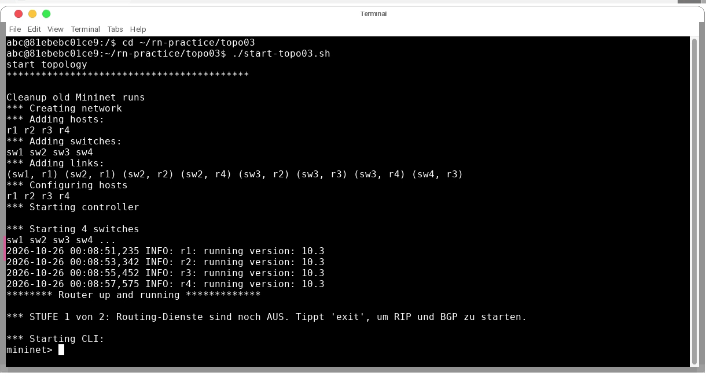

# 03 · Routing (RIP/BGP)

[:material-file-pdf-box: Als PDF herunterladen](../../pdf/03-routing-rip-bgp.pdf){ .md-button }

## Lernziele

- Das Grundprinzip von Routing-Tabellen verstehen: direkt angeschlossene
  Netze werden automatisch eingetragen, entfernte Netze benötigen eine
  Route (statisch oder dynamisch gelernt).
- Routing zwischen zwei Netzen manuell mit `ip route add` konfigurieren –
  ganz ohne Routing-Protokoll.
- RIP (Distance Vector) und BGP (Path Vector) im gleichzeitigen Einsatz auf
  denselben Routern beobachten und ihr Konvergenzverhalten (periodischer
  Nachrichtenaustausch) im Wireshark-Mitschnitt erkennen.
- `vtysh`/FRR als Konfigurations- und Diagnosewerkzeug für Routing-Software
  bedienen (`show ip route`, `configure terminal`, Protokoll-Module).
- Administrative Distanz als Auswahlkriterium zwischen konkurrierenden
  Routing-Quellen verstehen und gezielt verändern.
- IPv4- und IPv6-Routing als getrennte, parallele Strukturen einordnen
  (separate Tabellen, weil nicht direkt kompatible Adressfamilien).
- RP-Filtering als Schutzmechanismus gegen IP-Spoofing verstehen und
  kontrolliert (für Diagnosezwecke) deaktivieren können.
- Die Zeitkonstanten und den Protokoll-Overhead eines Routing-Protokolls aus
  einer eigenen Aufzeichnung selbst berechnen, statt sie aus einem Lehrbuch zu
  übernehmen (Nachrichten je Minute, Byte je Minute, Abstand zweier Updates).

--8<-- "issue-feedback.md"

## So lest ihr die Befehle in diesem Blatt

Ihr tippt Befehle an verschiedenen Stellen. Das Wort vor dem Dollar- oder
Rautenzeichen sagt euch, **wo**:

| Präfix | Wo ihr tippt | Beispiel |
|---|---|---|
| `$` | im normalen Terminal des Desktops | `./start-topo03.sh` |
| `mininet>` | an der Mininet-Konsole, die nach dem Start der Topologie im selben Terminal erscheint | `mininet> xterm r1` |
| `r1$`, `h1$`, … | in dem Terminalfenster, das `mininet> xterm r1` (bzw. `h1`) geöffnet hat; es gehört zu diesem einen Knoten | `r1$ ip route` |
| `r1#` | in `vtysh`, der Konsole der Routing-Software auf `r1` | `r1# show ip route` |

Nur der Text **nach** dem Präfix wird getippt, das Präfix selbst nicht.

## Aufgaben

### Teil 1 – Manuelles Routing zwischen zwei Netzen (`topoP03`)

!!! abstract "Auf einen Blick"
    **Lernziel:** Ihr könnt zwei Netze mit einem Router verbinden: Adressen
    vergeben, auf den Hosts je eine Route zum anderen Netz eintragen und mit
    `ping` und `traceroute` prüfen, dass der Weg über den Router führt.

    **Wozu?** Jede Firma, jede Hochschule und jedes Heimnetz besteht aus
    Teilnetzen, die ein Router verbindet. Wenn dort „Abteilung B ist nicht
    erreichbar" gemeldet wird, ist die erste Frage eines Administrators:
    „Kennt der Rechner den Weg dorthin – und kennt das Ziel den Weg zurück?"
    Wer einmal jede Route selbst gesetzt hat, versteht, was Routing-Protokolle
    wie RIP und BGP später automatisch erledigen – und wo sie scheitern
    können.

    **Vorwissen:** IP-Adressen und Subnetze (Blatt 02), `ping` (Blatt 01).

In diesem Teil konfiguriert ihr Routing einmal komplett von Hand. Das schärft
das Verständnis dafür, was RIP und BGP in Teil 2 automatisieren.

**Topologie `topoP03`:** Zwei Switches `s1` und `s2`, dazwischen ein Router
`r1` (`r1-eth0` an `s1`, `r1-eth1` an `s2`). An `s1` hängen `h1` und `h2`
(Netz 1), an `s2` hängen `h3` und `h4` (Netz 2). Alle Knoten starten **ohne
IPv4-Adresse**; die Adressierung und die Routen sind eure Aufgabe. Auf `r1`
ist die IP-Weiterleitung bereits eingeschaltet, `r1` darf also Pakete von
einem Netz ins andere weitergeben.

!!! info "Werkzeug: Mininet-Konsole und Knoten-Terminal"
    Mininet baut das Netz aus Hosts, Switches und Routern auf dem einen
    Rechner nach. Nach dem Start landet ihr an der **Mininet-Konsole**
    (`mininet>`). Zwei Wege führen von dort in einen Knoten:

    - `mininet> xterm r1` öffnet ein eigenes Terminalfenster für `r1`
      (`mininet> xterm r1 h1 h3` öffnet mehrere). In diesem Fenster gilt
      alles, was ihr tippt, nur für diesen Knoten.
    - `mininet> h2 ip addr` stellt den Knotennamen vor einen Befehl: Er läuft
      dann einmalig in `h2`, ohne ein Fenster zu öffnen.

    Mit `exit` an der Mininet-Konsole beendet ihr die Emulation.

!!! info "Werkzeug: `ip` – Adressen und Routen anzeigen und setzen"
    `ip` ist das Standardwerkzeug von Linux für die Netzwerkeinstellungen. Es
    arbeitet auf der Vermittlungsschicht (Schicht 3).

    | Aufruf | Bedeutung |
    |---|---|
    | `ip -br addr` | alle Schnittstellen mit ihren Adressen, eine Zeile je Schnittstelle (`-br` = kurz) |
    | `ip addr add 10.0.0.1/24 dev h1-eth0` | Adresse `10.0.0.1` mit Präfixlänge 24 auf die Schnittstelle `h1-eth0` legen |
    | `ip route` | die Routing-Tabelle des Kernels anzeigen |
    | `ip route add 20.0.0.0/24 via 10.0.0.254` | Route eintragen: „Pakete für `20.0.0.0/24` gebe an `10.0.0.254` weiter" |
    | `ip route del 20.0.0.0/24` | die Route wieder löschen |

    Eine echte Ausgabe von `ip -br addr` auf einem Knoten ohne Adresse:

    ```text
    h1$ ip -br addr
    lo               UNKNOWN        127.0.0.1/8 ::1/128
    h1-eth0@if390    UP             fe80::6ced:c9ff:feff:34e/64
    ```

    Erste Spalte: Name der Schnittstelle (`lo` ist die interne Schleife
    des Rechners, `h1-eth0` der Anschluss ans Netz). Zweite Spalte: Zustand
    (`UP` = eingeschaltet). Rest: die Adressen. Hier hat `h1-eth0` nur eine
    **Link-Local-Adresse** `fe80::…` (IPv6, gilt nur im eigenen Segment) und
    noch keine IPv4-Adresse. Typische Fehlermeldung:
    `ping: connect: Network is unreachable` bedeutet „in meiner
    Routing-Tabelle steht für dieses Ziel nichts, nicht einmal ein
    Standard-Gateway".

**Vorgemacht.** Startet die Topologie:

```bash
$ cd ~/rn-practice/topoP03
$ ./start-topoP03.sh
```

Nach etwa zehn Sekunden erscheint `mininet>`. Öffnet Terminals für den Router
und die Hosts `h1` und `h3`:

```bash
mininet> xterm r1 h1 h3
```

Prüft in `h1`, dass noch nichts konfiguriert ist, und versucht einen Ping zu
`h2`, der im selben Netz liegen soll:

```bash
h1$ ip -br addr
h1$ ping -c 1 10.0.0.2
```

Der Ping scheitert mit `ping: connect: Network is unreachable`: `h1` hat keine
Adresse und damit auch kein Netz, in dem `10.0.0.2` liegen könnte.

**Gemeinsam.** Wir vergeben die Adressen nach diesem Plan:

| Knoten | Schnittstelle | Adresse |
|---|---|---|
| `h1` | `h1-eth0` | `10.0.0.1/24` |
| `h2` | `h2-eth0` | `10.0.0.2/24` |
| `r1` | `r1-eth0` | `10.0.0.254/24` |
| `r1` | `r1-eth1` | `20.0.0.254/24` |
| `h3` | `h3-eth0` | `20.0.0.1/24` |
| `h4` | `h4-eth0` | `20.0.0.2/24` |

Beide Schnittstellen von `r1` brauchen eine Adresse aus dem jeweiligen Netz,
sonst kann `r1` nichts weiterleiten. Setzt zuerst `r1` und `h1`:

```bash
r1$ ip addr add 10.0.0.254/24 dev r1-eth0
r1$ ip addr add 20.0.0.254/24 dev r1-eth1
h1$ ip addr add 10.0.0.1/24 dev h1-eth0
h1$ ip route
```

`ip route` zeigt auf `h1` jetzt genau eine Zeile:

```text
10.0.0.0/24 dev h1-eth0 proto kernel scope link src 10.0.0.1
```

Gelesen: „Das Netz `10.0.0.0/24` ist direkt über `h1-eth0` erreichbar; als
Absender benutzt `h1` dabei `10.0.0.1`." `proto kernel` heißt: Der Kernel hat
diese Route selbst angelegt, als ihr die Adresse vergeben habt. Das sind die
**direkt angeschlossenen Netze**; für sie braucht es keine Route von Hand.

**Selbst.**

1. Vergebt die übrigen Adressen aus der Tabelle. Für `h2` und `h4` müsst ihr
   kein Fenster öffnen: `mininet> h2 ip addr add 10.0.0.2/24 dev h2-eth0`.
   Für `h3` nutzt das Terminal von `h3`.
2. Pingt von `h1` aus `h2` (`ping -c 2 10.0.0.2`): Das gelingt, beide stehen
   im selben Netz.
3. Pingt von `h1` aus `h3` (`ping -c 2 20.0.0.1`): Das scheitert mit
   `Network is unreachable`. `h1` kennt kein Netz `20.0.0.0/24`.
4. Tragt auf `h1` und `h2` die Route zum Netz 2 über `r1` ein, auf `h3` und
   `h4` die Route zum Netz 1:

    ```bash
    h1$ ip route add 20.0.0.0/24 via 10.0.0.254
    h2$ ip route add 20.0.0.0/24 via 10.0.0.254
    h3$ ip route add 10.0.0.0/24 via 20.0.0.254
    h4$ ip route add 10.0.0.0/24 via 20.0.0.254
    ```

    (`h2`/`h4` wieder mit `mininet> h2 …`, bzw. `mininet> h4 …`.)
5. Prüft mit `ping` und `traceroute` von `h1` zu `h3` und vergleicht die
   Routing-Tabelle von `r1` (`ip route`) mit der von `h1`.

!!! info "Werkzeug: `traceroute` – den Weg eines Pakets sichtbar machen"
    `traceroute` schickt Pakete mit absichtlich kleiner Lebensdauer (TTL).
    Jeder Router, der ein Paket verwirft, weil die TTL abgelaufen ist, meldet
    sich mit seiner Adresse zurück. So seht ihr Hop für Hop, welchen Weg die
    Pakete nehmen (Schicht 3).

    | Aufruf | Bedeutung |
    |---|---|
    | `traceroute -n 20.0.0.1` | Weg zum Ziel; `-n` zeigt Adressen statt Namen (schneller, kein DNS) |
    | `traceroute -n -q 1 20.0.0.1` | nur eine Probe je Hop statt drei |

    Echte Ausgabe auf `h1`:

    ```text
    h1$ traceroute -n 20.0.0.1
    traceroute to 20.0.0.1 (20.0.0.1), 30 hops max, 60 byte packets
     1  10.0.0.254  0.108 ms  0.030 ms  0.022 ms
     2  20.0.0.1  0.055 ms  0.035 ms  0.039 ms
    ```

    Kopfzeile: Ziel, höchstens 30 Hops, 60 Byte große Proben. Danach je Zeile
    ein Hop: Nummer, Adresse des Routers, drei Laufzeiten (eine je Probe).
    Hop 1 ist `r1` (`10.0.0.254`), Hop 2 das Ziel selbst. Ein `*` statt einer
    Laufzeit heißt: Auf diese Probe kam keine Antwort.

Erwartet:

```text
h1$ ping -c 3 20.0.0.1
PING 20.0.0.1 (20.0.0.1) 56(84) bytes of data.
64 bytes from 20.0.0.1: icmp_seq=1 ttl=63 time=1.79 ms
64 bytes from 20.0.0.1: icmp_seq=2 ttl=63 time=0.116 ms
64 bytes from 20.0.0.1: icmp_seq=3 ttl=63 time=0.123 ms

--- 20.0.0.1 ping statistics ---
3 packets transmitted, 3 received, 0% packet loss, time 2022ms
```

`ttl=63` zeigt, dass ein Router dazwischen lag: `h3` startet seine Antwort mit
TTL 64, `r1` zieht eins ab.


*Von Hand eingetragene Adressierung und Routen in `topoP03`: `r1` bekommt
`10.0.0.254/24` und `20.0.0.254/24`, `h1` und `h3` je eine Route über `r1`. Der
`ping` von `h1` zu `h3` zeigt `ttl=63`, `traceroute` zwei Hops: `r1`, dann das
Ziel.*

!!! question "Nachgedacht: Warum scheitert der Ping, wenn nur eine Richtung stimmt?"
    Löscht auf `h3` die Rückroute (`h3$ ip route del 10.0.0.0/24`) und pingt
    erneut von `h1` aus. Startet vorher in einem zweiten Fenster auf `h3`
    `tcpdump -n -i h3-eth0 icmp` (siehe Werkzeug-Kasten unten). Kommen die
    Anfragen bei `h3` an? Setzt die Route danach wieder
    (`h3$ ip route add 10.0.0.0/24 via 20.0.0.254`).

    !!! info "Werkzeug: `tcpdump` – Pakete auf einer Schnittstelle mitlesen"
        `tcpdump` schreibt jedes Paket, das über eine Schnittstelle läuft, als
        eine Zeile auf den Bildschirm (Schichten 2 bis 4; Wireshark in Blatt 01
        macht dasselbe grafisch).

        | Aufruf | Bedeutung |
        |---|---|
        | `tcpdump -n -i h3-eth0 icmp` | auf `h3-eth0` nur ICMP-Pakete (ping) zeigen; `-n` ohne Namensauflösung |
        | ++ctrl+c++ | beendet den Mitschnitt und gibt die Zusammenfassung aus |

        Echte Ausgabe, während `h1` ein `ping` schickt:

        ```text
        h3$ tcpdump -n -i h3-eth0 icmp
        tcpdump: verbose output suppressed, use -v[v]... for full protocol decode
        listening on h3-eth0, link-type EN10MB (Ethernet), snapshot length 262144 bytes
        00:01:26.730067 IP 10.0.0.1 > 20.0.0.1: ICMP echo request, id 1185, seq 1, length 64
        00:01:27.742507 IP 10.0.0.1 > 20.0.0.1: ICMP echo request, id 1185, seq 2, length 64
        ```

        Je Zeile: Uhrzeit, Absender `>` Empfänger, Art des Pakets (`echo
        request` = Ping-Anfrage), Kennung und laufende Nummer. Die Zeile
        `listening on …` sagt, dass der Mitschnitt läuft. Meldet `tcpdump`
        `No such device exists` oder `You don't have permission to perform this
        capture`, habt ihr den Befehl nicht im Terminal des Knotens getippt
        (`mininet> xterm h3`).

    ??? success druck-zu "Lösung"
        Ergebnis: Der Ping schlägt fehl (`100% packet loss`), obwohl `tcpdump` auf `h3`
        die Anfragen `echo request` sehr wohl zeigt. Es fehlen nur die
        Antworten: `h3` hat keine Route zurück in das Netz `10.0.0.0/24` und
        kann deshalb nicht antworten. Ein fehlgeschlagener Ping heißt also nicht
        „das Paket kam nicht an", sondern „ich habe keine Antwort gesehen".
        Routing ist **je Richtung** zu betrachten, nicht je Verbindung.

Ihr habt jetzt einen Router, der zwei Netze verbindet, und beide Seiten
vertrauen darauf, dass die Antworten von der richtigen Station kommen. Was
passiert, wenn sich ein dritter Rechner genau in diesen Weg drängt? Das ist
ARP-Spoofing – und dafür gibt es ein eigenes Blatt:
[Lab 05 – ARP-Spoofing & Denial-of-Service](05-arp-spoofing-dos.md).

### Teil 2 – Dynamisches Routing mit RIP und BGP (`topo03`, FRR/`vtysh`)

!!! abstract "Auf einen Blick"
    **Lernziel:** Ihr könnt in einem Netz mit vier Routern erklären, woher eine
    Route stammt (direkt angeschlossen, RIP oder BGP), die Routing-Tabellen mit
    `ip route` und `vtysh` lesen und begründen, welche von zwei konkurrierenden
    Routen der Router benutzt.

    **Wozu?** In jedem größeren Netz pflegt niemand die Routen von Hand:
    Router sagen sich per Protokoll, welche Netze sie erreichen. Fällt dann
    abends um 22 Uhr eine Strecke aus, ist die Frage des Netzbetreibers
    „welches Protokoll hat welche Route gelernt, und warum benutzt der Router
    genau diese?". Mit `show ip route` auf einem Router und `traceroute` von
    außen beantwortet ein Admin sie in einer Minute. Genau das übt ihr hier.

    **Vorwissen:** Teil 1 (Routen und `ip route`), `ping`/`traceroute`,
    Wireshark (Blatt 01).

In Teil 1 habt ihr für **zwei** Netze jede Route von Hand eingetragen – bei
vier Routern und mehreren Netzen wäre das schnell unübersichtlich, und bei
jedem Ausfall müsstet ihr erneut von Hand eingreifen. Genau dafür gibt es
**Routing-Protokolle**: Router tauschen automatisch untereinander aus,
welche Netze sie erreichen können, und tragen die passenden Routen selbst
in ihre Tabelle ein – auch dann, wenn sich die Topologie ändert. Ihr
wechselt dafür von `topoP03` (ein Router, manuell konfiguriert) zu `topo03`:
vier Router, bereits mit RIP und BGP vorkonfiguriert.

Bei so vielen beteiligten Knoten hilft eine Skizze. Die Topologie für dieses
Experiment:

```text
                      r2
                     /  \
 sw1 --- r1 --- sw2        sw3 --- r3 --- sw4
                     \  /
                      r4

 sw1: 192.168.1.0/24 (Stub-Netz von r1)   sw2: 193.1.1.0/26
 sw3: 193.1.2.0/24                        sw4: 192.168.3.0/24 (Stub-Netz von r3)

 sw steht für Switch, r für Vermittlungsknoten (Router)
```

#### Einführung in Routing, RIP und BGP

RIP (Routing Information Protocol) ist eines der einfachsten
Routing-Protokolle: Es verwendet eine simple Metrik (Hop-Zählung) und ist
leicht zu konfigurieren – ein guter Einstieg, um Konzepte wie
Routing-Tabellen und Konvergenz (das Zurückkehren zu einem stabilen Zustand
nach einer Änderung) zu verstehen. BGP (Border Gateway Protocol) ist
komplexer, aber das Protokoll, das das Internet zusammenhält: Es ermöglicht
die Kommunikation zwischen unterschiedlichen autonomen Systemen (AS) und
führt in Konzepte wie Pfadvektoren, Routing-Policies und Multi-Homing ein.
Beide Protokolle unterscheiden sich grundlegend darin, wie sie eine Route
"bewerten" und weitergeben – RIP zählt nur Hops, BGP wägt AS-Pfade und
Policies ab.

!!! info "Hintergrund: RIP kann nur bis 15 zählen – und das ist Absicht"
    RIPs Metrik ist die Zahl der Zwischenstationen, und bei **16** gilt ein
    Ziel als unerreichbar. Das wirkt wie eine willkürliche Grenze, löst aber
    ein echtes Problem. In einem Distance-Vector-Verfahren erzählt jeder
    Router seinen Nachbarn nur, *wie weit* ein Ziel entfernt ist – nicht,
    *worüber* der Weg führt. Fällt eine Verbindung aus, können sich zwei
    Router deshalb gegenseitig immer größere Entfernungen zurückmelden, ohne
    je zu merken, dass jeder den Weg über den anderen meint. Dieses
    *Count-to-Infinity*-Problem würde ohne Obergrenze niemals enden.

    RIP erklärt darum einfach 16 zu „unendlich". Der Preis: in Netzen mit
    mehr als 15 Zwischenstationen ist RIP nicht einsetzbar. Genau diese
    Abwägung – Einfachheit gegen Reichweite – ist einer der Gründe, warum
    später Link-State-Verfahren wie OSPF entstanden sind.

!!! info "Hintergrund: die Nummern, an denen das Internet hängt"
    Die Zahlen 65001, 65002 und 65003, die euch in dieser Übung begegnen,
    sind **AS-Nummern** (Autonomous System). Ein autonomes System ist ein
    Netz unter einheitlicher Verwaltung – ein Rechenzentrum, ein
    Internetanbieter, ein großes Unternehmen. BGP ist das Protokoll, mit dem
    diese Systeme einander mitteilen, welche Adressbereiche über sie
    erreichbar sind. Weltweit sind Zehntausende AS aktiv, und
    praktisch jede Verbindung, die euer Browser aufbaut, verlässt sich auf
    Ankündigungen, die über BGP verteilt wurden.

    Der Bereich 64512–65534 ist ausdrücklich für den privaten Gebrauch
    reserviert – vergleichbar mit `192.168.x.x` bei IP-Adressen. Deshalb
    stehen hier 65001 bis 65003 und keine echten, registrierten Nummern.
    Und weil BGP darauf aufbaut, dass man diesen Ankündigungen glaubt, hat
    eine falsche Ankündigung schon mehrfach ganze Landesnetze vom Internet
    abgeschnitten. Wer wissen will, wie folgenreich das ist, sucht nach
    *BGP-Hijacking*.

!!! info "Hintergrund: Zebra, Quagga, FRR"
    Aus dem Routing-Projekt *Zebra* entstand **Quagga**, aus Quagga wiederum
    **FRR** (FRRouting), das in dieser Umgebung läuft. In Büchern und
    Anleitungen stehen die Namen deshalb oft nebeneinander. FRR hat die
    `vtysh`-Syntax von Quagga weitgehend übernommen; ein Befehl aus einer
    Quagga-Anleitung funktioniert hier in der Regel unverändert.

#### Start der Topologie in zwei Stufen

```bash
$ cd ~/rn-practice/topo03
$ ./start-topo03.sh
```

Nach etwa 30 Sekunden meldet sich die Mininet-Konsole. Die Topologie läuft in
**zwei Stufen**, und das Skript sagt euch jeweils, in welcher ihr seid:

- **Stufe 1:** Das Netz steht, aber die Routing-Dienste (RIP und BGP) sind noch
  aus. Ihr seht die Zeile `STUFE 1 von 2`.
- Ein einmaliges `exit` an der Mininet-Konsole beendet **nicht** die Emulation,
  sondern startet RIP und BGP auf allen vier Routern.
- **Stufe 2:** RIP und BGP laufen (`STUFE 2 von 2`). Erst ein *weiteres*
  `exit` beendet die Emulation.


*`topo03` nach dem Start: die Mininet-Konsole in Stufe 1. Die Routing-Dienste
laufen noch nicht.*

#### Adressen und direkt angeschlossene Netze

!!! info "Werkzeug: `ip -br addr` und IPv6-Link-Local-Adressen"
    Das Werkzeug kennt ihr aus Teil 1. Hier kommt `-6` dazu: `ip -br -6 addr`
    zeigt nur die IPv6-Adressen. Jede Schnittstelle bekommt vom Kernel von
    selbst eine Adresse `fe80::…` (*link-local*), die nur im direkten Segment
    gilt, auch wenn ihr IPv6 nie eingerichtet habt.

Öffnet ein Terminal auf `r1` und seht euch die Adressen an:

```bash
mininet> xterm r1
r1$ ip -br addr
```

Echte Ausgabe:

```text
lo               UNKNOWN        127.0.0.1/8 fe80::200:ff:fe00:0/64 ::1/128
r1-eth0@if329    UP             192.168.1.1/24 fe80::f036:e4ff:fe9d:cffb/64
r1-eth1@if330    UP             193.1.1.1/26 fe80::c087:6eff:febb:3337/64
```

`r1-eth0` (`192.168.1.1/24`) hängt am Stub-Netz, `r1-eth1` (`193.1.1.1/26`) am
Segment, das sich `r1`, `r2` und `r4` teilen. Die Zahl hinter dem `@if` ist
eine interne Nummer und bei euch eine andere. Die `fe80::…`-Adressen sind
ebenfalls bei jedem Start anders.

Für direkt angeschlossene Netze ist kein zusätzlicher Routing-Aufwand nötig.
Öffnet zusätzlich ein Terminal für `r2` und pingt von dort die beiden
IPv4-Adressen von `r1` an:

```bash
mininet> xterm r2
r2$ ping -c 1 193.1.1.1
r2$ ping -c 1 192.168.1.1
```

Echte Ausgabe:

```text
r2$ ping -c 1 193.1.1.1
64 bytes from 193.1.1.1: icmp_seq=1 ttl=64 time=1.44 ms
...
1 packets transmitted, 1 received, 0% packet loss, time 0ms

r2$ ping -c 1 192.168.1.1
ping: connect: Network is unreachable
```

Nur die erste Adresse ist erreichbar. Sie liegt im selben `/26`-Netz wie `r2`s
eigene Schnittstelle (`193.1.1.0/26`). Das Stub-Netz `192.168.1.0/24` kennt `r2`
noch nicht, ohne Routing-Protokoll kann es sie nicht erfahren.

**Selbst:** Wiederholt den Test mit IPv6. Link-Local-Adressen brauchen die
Angabe, über welche Schnittstelle sie erreichbar sind. Lest die
Link-Local-Adresse von `r1-eth1` mit `ip -br -6 addr` ab und setzt sie ein:

```bash
r2$ ping6 -c 1 fe80::<rest-der-adresse>%r2-eth0
```

Der Zusatz `%r2-eth0` sagt: „diese Adresse liegt an meiner Schnittstelle
`r2-eth0`". Das Ergebnis sieht so aus:

```text
PING fe80::b438:9ff:fe1f:9c3%r2-eth0 (fe80::b438:9ff:fe1f:9c3%r2-eth0) 56 data bytes
64 bytes from fe80::b438:9ff:fe1f:9c3%r2-eth0: icmp_seq=1 ttl=64 time=1.33 ms
```

!!! question "Nachgedacht: Warum braucht IPv6 hier ein `%r2-eth0`?"
    `r2` hat zwei Schnittstellen, und `fe80::…`-Adressen sind nur im jeweiligen
    Segment eindeutig. Könnt ihr sagen, was `r2` ohne den Zusatz nicht wüsste?

    ??? success druck-zu "Lösung"
        Dieselbe Link-Local-Adresse könnte an `r2-eth0` und an `r2-eth1` in
        verschiedenen Segmenten vergeben sein. Ohne die Schnittstellenangabe
        weiß `r2` nicht, über welches Segment es das Paket schicken soll.
        Eine Routing-Tabelle kann das bei `fe80::/64` nicht entscheiden, weil
        dieses Präfix an jeder Schnittstelle gilt.

#### Routing-Tabellen im Detail: `topo03` konkret

Die vorkonfigurierten FRR-Router (`r1`–`r4`, nachlesbar unter
`~/rn-practice/topo03/r*/zebra.conf`, `ripd.conf`, `bgpd.conf`):

| Router | Schnittstellen (IPv4) | RIP | BGP (AS) |
|---|---|---|---|
| `r1` | `r1-eth0`=`192.168.1.1/24` (Stub), `r1-eth1`=`193.1.1.1/26` | ja (nur `r1-eth1`) | 65001, Nachbar `193.1.1.2` |
| `r2` | `r2-eth0`=`193.1.1.2/26`, `r2-eth1`=`193.1.2.1/24` | ja | 65002, Nachbarn `193.1.1.1` und `193.1.2.2` |
| `r3` | `r3-eth0`=`192.168.3.1/24` (Stub), `r3-eth1`=`193.1.2.2/24` | ja | 65003, Nachbar `193.1.2.1` |
| `r4` | `r4-eth0`=`193.1.1.4/26`, `r4-eth1`=`193.1.2.4/24` | ja | **kein `bgpd.conf`** |

`r4` besitzt keine `bgpd.conf` – er nimmt ausschließlich am RIP-Verbund
teil, nicht am BGP-Verbund zwischen `r1`/`r2`/`r3` (AS 65001/65002/65003).
`r1` lernt `192.168.3.0/24` deshalb aus zwei Quellen: per BGP und per RIP.
Welche davon gewinnt und was `r4` beiträgt, untersucht ihr im weiteren
Verlauf.

Prüft zunächst in Stufe 1, also noch vor dem Start von RIP und BGP, die
Routing-Tabelle von `r1` und versucht einen Ping zu `192.168.3.1`:

```bash
r1$ ip route
r1$ ping -c 1 192.168.3.1
```

```text
192.168.1.0/24 dev r1-eth0 proto kernel scope link src 192.168.1.1
193.1.1.0/26 dev r1-eth1 proto kernel scope link src 193.1.1.1
ping: connect: Network is unreachable
```

Die Tabelle enthält nur die beiden direkt angeschlossenen Netze; für
`192.168.3.0/24` steht nichts drin, der Ping scheitert.

#### RIP und BGP starten und die Nachrichten mitlesen

!!! info "Werkzeug: Wireshark auf einer Schnittstelle von `r1`"
    Wireshark kennt ihr aus Blatt 01. Hier soll es nicht den ganzen Desktop,
    sondern nur den Verkehr auf **einer Schnittstelle des Routers** `r1`
    mitschneiden. Dafür startet ihr es im Terminal von `r1`:

    | Aufruf | Bedeutung |
    |---|---|
    | `wireshark -i r1-eth1 -k &` | startet Wireshark, schneidet sofort auf `r1-eth1` mit (`-k`) und gibt das Terminal frei (`&`) |
    | Anzeigefilter `rip or bgp` | blendet alles außer den RIP- und BGP-Nachrichten aus (Eingabefeld oben, mit ++ctrl+slash++ erreichbar) |

    Die Spalten: **No.** laufende Nummer, **Time** Sekunden seit dem Start des
    Mitschnitts, **Source/Destination** Absender und Empfänger, **Protocol**
    das erkannte Protokoll, **Length** Größe des Rahmens in Byte, **Info**
    Nachrichtenart.

Startet Wireshark in Stufe 1 und wechselt dann an der Mininet-Konsole mit
**einem** `exit` in Stufe 2:

```bash
r1$ wireshark -i r1-eth1 -k &
mininet> exit
```

Gebt in Wireshark den Anzeigefilter `rip or bgp` ein (Wireshark akzeptiert auch `rip || bgp`). Nach wenigen Sekunden beginnt ein
reger Paketaustausch, in dem RIP und BGP versuchen, Konvergenz zu erreichen:


*Mitschnitt auf `r1-eth1` direkt nach dem Start von RIP und BGP. Oben die
RIP-Nachrichten, die jeder Router an die Multicast-Adresse `224.0.0.9`
schickt, darunter der BGP-Verbindungsaufbau: `OPEN`, `KEEPALIVE`, dann `UPDATE`
mit den Routen.*

Lest den Mitschnitt von oben nach unten:

1. `RIPv2 Request` von `193.1.1.1` (`r1`): „schickt mir eure Tabellen".
2. `RIPv2 Response` von `193.1.1.2` und `193.1.1.4`: die Antworten von `r2` und
   `r4` an die Multicast-Adresse `224.0.0.9`, die alle RIP-Router abhören.
3. `OPEN Message`: `r1` und `r2` bauen ihre BGP-Sitzung auf und stellen sich
   mit ihrer AS-Nummer vor.
4. `KEEPALIVE Message`: „Sitzung steht".
5. `UPDATE Message`: Die Nachbarn tauschen ihre Routen.

Danach wiederholen sich die `RIPv2 Response`-Nachrichten in festen
Zeitabständen. Das ist typisch für Distance-Vector-Protokolle wie RIP, im
Gegensatz zu Link-State-Protokollen wie OSPF, die Topologie-Informationen nur
bei Änderungen verschicken und dazwischen nur kleine Hello-Pakete senden.
Wie groß dieser Abstand wirklich ist, messt ihr in Teil 4.

Beendet Wireshark mit dem Schließen des Fensters. Nach etwa zehn Sekunden
haben alle Router ihre Tabellen gefüllt.

#### Zwei Tabellen: Kernel und Routing-Software

Prüft die Routing-Tabelle auf `r1` erneut. Zusätzlich zu den beiden direkt
angeschlossenen Netzen sind nun zwei neue Routen sichtbar:

```bash
r1$ ip route
```

```text
192.168.1.0/24 dev r1-eth0 proto kernel scope link src 192.168.1.1
192.168.3.0/24 nhid 12 via 193.1.1.2 dev r1-eth1 proto bgp metric 20
193.1.1.0/26 dev r1-eth1 proto kernel scope link src 193.1.1.1
193.1.2.0/24 nhid 12 via 193.1.1.2 dev r1-eth1 proto bgp metric 20
```

Neu sind `192.168.3.0/24` und `193.1.2.0/24`, beide über `193.1.1.2` (also `r2`),
`proto bgp` verrät, welches Protokoll sie gelernt hat. Verfolgt den Pfad:

```bash
r1$ traceroute -n 192.168.3.1
```

```text
traceroute to 192.168.3.1 (192.168.3.1), 30 hops max, 60 byte packets
 1  193.1.1.2  0.072 ms  0.026 ms  0.037 ms
 2  192.168.3.1  0.077 ms  0.034 ms  0.032 ms
```

Hop 1 ist `193.1.1.2` (`r2`), Hop 2 das Ziel in `r3`s Stub-Netz.

#### Administrative Distanz: Warum gewinnt BGP?

Bis hierher habt ihr die Routing-Tabelle des Linux-Kernels gelesen. Für den
nächsten Schritt braucht ihr ein zweites Werkzeug.

!!! info "Werkzeug: `vtysh` – die Konsole der Routing-Software"
    `vtysh` ist die Befehlszeilenschnittstelle von FRR, der Routing-Software
    auf `r1`–`r4`. Sie sieht wie eine gewöhnliche Shell aus, erwartet aber
    statt Linux-Befehlen die Kommandosprache, die auch auf kommerziellen
    Routern üblich ist. Aus `ip route` wird dort `show ip route`: dieselbe
    Information, andere Wortstellung. Es arbeitet auf Schicht 3 und zeigt die
    Entscheidungen der Routing-Protokolle.

    | Aufruf | Bedeutung |
    |---|---|
    | `vtysh` | interaktive Konsole; Prompt `r1#` (zeigt eigentlich den Rechnernamen) |
    | `vtysh -c "show ip route"` | genau einen Befehl ausführen und zurück in die Linux-Shell |
    | `show ip route 192.168.3.0/24` | nur die Einträge zu einem Präfix |
    | `?` | an jeder Stelle: zeigt die möglichen Fortsetzungen |
    | `configure terminal` … `end` | Konfigurationsmodus betreten und verlassen |

    Echte Ausgabe auf `r1` (Zeilen mit `Codes:` gekürzt):

    ```text
    r1$ vtysh -c "show ip route"
    Codes: K - kernel route, C - connected, L - local, S - static,
           R - RIP, O - OSPF, I - IS-IS, B - BGP, ...
           > - selected route, * - FIB route, ...

    IPv4 unicast VRF default:
    C>* 192.168.1.0/24 is directly connected, r1-eth0, weight 1, 00:00:54
    L>* 192.168.1.1/32 is directly connected, r1-eth0, weight 1, 00:00:54
    B>* 192.168.3.0/24 [20/0] via 193.1.1.2, r1-eth1, weight 1, 00:00:39
    R   192.168.3.0/24 [120/3] via 193.1.1.2, r1-eth1, weight 1, 00:00:41
    B   193.1.1.0/26 [20/0] via 193.1.1.2 inactive, weight 1, 00:00:39
    C>* 193.1.1.0/26 is directly connected, r1-eth1, weight 1, 00:00:54
    L>* 193.1.1.1/32 is directly connected, r1-eth1, weight 1, 00:00:54
    B>* 193.1.2.0/24 [20/0] via 193.1.1.2, r1-eth1, weight 1, 00:00:39
    R   193.1.2.0/24 [120/2] via 193.1.1.2, r1-eth1, weight 1, 00:00:42
    ```

    Gelesen, Zeile `B>* 192.168.3.0/24 [20/0] via 193.1.1.2, r1-eth1, …`:

    - `B` – die Route stammt von **BGP** (`C` = direkt angeschlossen, `R` = RIP,
      `L` = lokale Adresse des Routers selbst);
    - `>*` – diese Route ist die **gewählte** und steht in der Kernel-Tabelle
      (`>` ausgewählt, `*` in die Weiterleitungstabelle eingetragen); Zeilen
      ohne `>*` sind Kandidaten, die nicht gewonnen haben;
    - `192.168.3.0/24` – das Ziel-Netz;
    - `[20/0]` – **administrative Distanz 20**, **Metrik 0** (dazu gleich mehr);
    - `via 193.1.1.2, r1-eth1` – nächster Router und Schnittstelle;
    - `00:00:39` – so lange kennt der Router die Route schon.

    Typische Stolpersteine: Der Prompt von `vtysh` zeigt den Rechnernamen eures
    Containers, nicht `r1`; in diesem Blatt steht stellvertretend `r1#`. Ein
    `show ip route` ohne vorheriges `vtysh` liefert in der Linux-Shell
    `show: command not found`. Meldet `vtysh` `failed to connect to any
    daemons`, habt ihr es nicht im Terminal eines Routers getippt
    (`mininet> xterm r1`).

![Zwei Terminalfenster: im Fenster "Node: r1" die Ausgabe von vtysh -c "show ip route" mit den Zeilen C>* und L>* für direkt angeschlossene Netze, B>* 192.168.3.0/24 [20/0] via 193.1.1.2 und darunter R 192.168.3.0/24 [120/3] via 193.1.1.2](../assets/screenshots/03-routing-rip-bgp/topo03-vtysh-show-ip-route.png)
*`show ip route` auf `r1` in Stufe 2: `192.168.3.0/24` steht zweimal in der
Tabelle, einmal von BGP (`B>*`, gewählt) und einmal von RIP (`R`, nicht
gewählt).*

!!! warning "Zwei Tabellen, nicht eine"
    `ip route` zeigt die Tabelle des **Linux-Kernels** – das, was
    tatsächlich weitergeleitet wird. `show ip route` in `vtysh` zeigt die
    Tabelle der **Routing-Software** – alles, was sie gelernt hat,
    einschließlich der Routen, für die sie sich *nicht* entschieden hat. Die
    zweite Tabelle ist deshalb größer als die erste.

Die Tabelle enthält Dopplungen: `192.168.3.0/24` und `193.1.2.0/24` erscheinen
je zweimal, einmal mit `B` (BGP) und einmal mit `R` (RIP), beide
`via 193.1.1.2`. In der eckigen Klammer steht zuerst die **administrative
Distanz**, dann die Metrik (`[20/0]` bzw. `[120/3]`). Je niedriger die Distanz,
desto vertrauenswürdiger die Quelle. BGP gewinnt hier, weil seine
administrative Distanz (20) niedriger ist als die von RIP (120). Ebenso steht
`193.1.1.0/26` zweimal: einmal als `C>*` (direkt angeschlossen) und einmal als
`B … inactive`. Die direkt angeschlossene Route hat die Distanz 0 und gewinnt
immer.

!!! info "Werkzeug: `show ip rip` – was RIP für sich gelernt hat"
    `show ip rip` (in `vtysh`) zeigt die Tabelle, die **nur RIP** führt, bevor
    die administrative Distanz entscheidet, welche Route in den Kernel kommt.

    ```text
    r1$ vtysh -c "show ip rip"
         Network            Next Hop         Metric From            Tag Time
    R(n) 192.168.3.0/24     193.1.1.2             3 193.1.1.2         0 02:57
    C(i) 193.1.1.0/26       0.0.0.0               1 self              0
    R(n) 193.1.2.0/24       193.1.1.2             2 193.1.1.2         0 02:57
    ```

    Spalten: **Network** das Ziel; **Next Hop** der Router, über den es geht
    (`0.0.0.0` bei direkt angeschlossenen Netzen); **Metric** die Zahl der Hops
    (1 bis 15; 16 heißt unerreichbar); **From** wer die Route gemeldet hat;
    **Time** der Countdown bis zum Ablauf der Route (Start bei 3 Minuten, wird
    mit jedem Update des Nachbarn wieder zurückgesetzt). `R(n)` = von RIP
    gelernt, `C(i)` = direkt an einer RIP-Schnittstelle. **Typische
    Fehldeutung:** `show ip rip` als „die aktiven RIP-Routen" zu lesen. Es
    zeigt *alles*, was RIP kennt – auch Routen, die BGP im Wettbewerb um die
    Kernel-Tabelle geschlagen hat.

Ändert nun die administrative Distanz von BGP, um es unattraktiver zu machen:

```bash
r1$ vtysh
r1# configure terminal
r1(config)# router bgp
r1(config-router)# distance bgp 200 200 200
r1(config-router)# end
r1# exit
```

Die drei Werte stehen für eBGP-Routen (von einem anderen autonomen System
gelernt), iBGP-Routen (innerhalb desselben AS gelernt) und lokal auf dem Router
konfigurierte BGP-Routen. Die Änderung gilt sofort. Prüft die Auswirkung:

```bash
r1$ traceroute -n 192.168.3.1
r1$ ip route
r1$ vtysh -c "show ip route 192.168.3.0/24"
```

```text
192.168.3.0/24 nhid 12 via 193.1.1.2 dev r1-eth1 proto rip metric 20

Routing entry for 192.168.3.0/24
  Known via "bgp", distance 200, metric 0
  Last update 00:00:04 ago
    193.1.1.2, via r1-eth1, weight 1

Routing entry for 192.168.3.0/24
  Known via "rip", distance 120, metric 3, best
  Last update 00:00:06 ago
  * 193.1.1.2, via r1-eth1, weight 1
```

Der `traceroute` zeigt unverändert `193.1.1.2` als ersten Hop. Im Kernel steht
jetzt aber `proto rip` statt `proto bgp`, und in `vtysh` trägt der
RIP-Eintrag das Wort `best`.

!!! question "Nachgedacht: Wechselt der Weg – oder nur die Quelle?"
    Es liegt nahe zu erwarten, dass sich mit der Distanz auch der Weg der
    Pakete ändert. Schaut euch dazu `show ip rip` auf `r1` an: Von wem hat `r1`
    die RIP-Route zu `192.168.3.0/24` gelernt, und was folgt daraus für den
    Weg?

    ??? success druck-zu "Lösung"
        In `show ip rip` stehen ausschließlich Routen, die von `193.1.1.2`
        (`r2`) gelernt wurden, keine von `r4`, obwohl `r1` und `r4` am selben
        Switch-Segment hängen. `r4` bietet `192.168.3.0/24` zwar ebenfalls an,
        aber mit derselben Metrik; RIP behält bei gleicher Metrik die zuerst
        gelernte Route. `r1` hat für `192.168.3.0/24` also nur einen Nexthop:
        `r2`. Er ist ihm zweimal bekannt, einmal per BGP, einmal per RIP,
        beide über `193.1.1.2`.

        Die geänderte Distanz bewirkt deshalb keinen anderen Weg, sondern eine
        andere Quelle in der Tabelle: aus `bgp` wird `rip`, weil RIPs Distanz
        von 120 nun unter dem auf 200 gesetzten BGP-Wert liegt. Die Pakete
        nehmen denselben Weg wie vorher. Eine veränderte Routing-Tabelle heißt
        also nicht automatisch veränderter Datenfluss. `r4` wird dennoch
        gebraucht – aus der Sicht von `r2`, und davon handelt Teil 3.

#### Lokale Gültigkeit manueller Routen

Routing-Änderungen gelten immer nur lokal auf dem jeweiligen Router. Öffnet
ein Terminal für `r3` und pingt von dort `192.168.1.1` an:

```bash
mininet> xterm r3
r3$ ping -c 3 192.168.1.1
```

Der Ping gelingt: `r3` kennt `192.168.1.0/24` per BGP über `r2`, und `r1`
kennt den Rückweg zu `193.1.2.0/24` ebenfalls über `r2`. Setzt nun auf `r1`
von Hand eine Host-Route, die den Verkehr zu `192.168.3.1` über `r4`
schickt, und vergleicht die Wege in beiden Richtungen:

```bash
r1$ ip route add 192.168.3.1/32 via 193.1.1.4
r1$ traceroute -n 192.168.3.1
r3$ traceroute -n 192.168.1.1
```

```text
r1$ traceroute -n 192.168.3.1
 1  193.1.1.4  1.088 ms  0.965 ms  0.890 ms
 2  192.168.3.1  1.039 ms  0.973 ms  0.795 ms

r3$ traceroute -n 192.168.1.1
 1  193.1.2.1  0.087 ms  0.024 ms  0.022 ms
 2  192.168.1.1  0.057 ms  0.035 ms  0.032 ms
```

Von `r1` aus ist der erste Hop jetzt `193.1.1.4` (`r4`): die `/32`-Route
gewinnt gegen die `/24`-Routen aus BGP und RIP, weil der längste passende
Präfix entscheidet. Von `r3` aus führt der Weg weiterhin über `193.1.2.1`
(`r2`). Die manuelle Route wirkt nur auf `r1`; `r2`, `r3` und `r4` wissen
nichts von ihr, und der Weg ist jetzt asymmetrisch: hin über `r4`, zurück
über `r2`.

#### RP-Filtering: Schutz vor IP-Spoofing

Lasst die Host-Route auf `r1` stehen und erzwingt, dass `r3` die Adresse
`192.168.3.1` als Quelladresse für einen Ping auf `192.168.1.1` verwendet
(`-I` wählt die Absenderadresse):

```bash
r3$ ping -c 3 -W 2 -I 192.168.3.1 192.168.1.1
```

Der Ping schlägt fehl (`100% packet loss`), ohne Quelladresse
(`ping -c 3 192.168.1.1`) gelingt er dagegen. Die Anfrage läuft über `r2` zu
`r1`. Die Antwort an `192.168.3.1` nimmt wegen eurer Host-Route den Weg über
`r4`, und `r4` kennt keine Route zurück zu `192.168.1.1` (`r4` spricht kein
BGP, und `r1` kündigt `192.168.1.0/24` nicht per RIP an). Deshalb verwirft
**RP-Filtering** (Reverse Path Filtering) auf `r4` das Paket: ein
Schutzmechanismus gegen IP-Spoofing, der Pakete verwirft, deren
Absenderadresse laut eigener Routing-Tabelle nicht erreichbar wäre.

!!! info "Werkzeug: `sysctl`, `nstat` und `unshare` – Kernel-Einstellungen lesen, zählen, ändern"
    `sysctl` liest und setzt Einstellungen des Linux-Kernels (hier die des
    Netzwerk-Stapels des Knotens). `nstat` liest die Zähler des Kernels.
    `unshare -m` führt einen Befehl in einem eigenen Dateisystem-Ausschnitt aus:
    Der Befehl darf die sonst schreibgeschützte Kernel-Einstellungsliste
    `/proc/sys` beschreiben, ohne dass der Rest des Desktops davon etwas
    merkt.

    | Aufruf | Bedeutung |
    |---|---|
    | `sysctl net.ipv4.conf.all.rp_filter` | Einstellung anzeigen |
    | `nstat -az TcpExtIPReversePathFilter` | Zähler der durch RP-Filtering verworfenen Pakete (`-a` absoluter Wert, `-z` auch wenn 0) |
    | `unshare -m sh -c '…'` | den Befehl in `'…'` mit schreibbarem `/proc/sys` ausführen |

    Echte Ausgabe:

    ```text
    r4$ sysctl net.ipv4.conf.all.rp_filter net.ipv4.conf.r4-eth0.rp_filter
    net.ipv4.conf.all.rp_filter = 2
    net.ipv4.conf.r4-eth0.rp_filter = 2
    r4$ nstat -az TcpExtIPReversePathFilter
    #kernel
    TcpExtIPReversePathFilter       3                  0.0
    ```

    Der Wert `rp_filter` kennt drei Stufen: `0` aus; `1` strikt (der Rückweg
    muss über dasselbe Interface führen, über das das Paket hereinkam); `2`
    lose (irgendein Rückweg genügt). `r4` steht auf `2`: Es gibt für
    `192.168.1.0/24` überhaupt keinen Rückweg, also fällt das Paket durch. Der
    Zähler `TcpExtIPReversePathFilter` steht dort auf 3: je ein verworfenes
    Paket pro Ping (bei euch steigt er mit jedem Ping um 1). Typische Fehlermeldung bei `sysctl -w` ohne `unshare`:
    `permission denied on key …`.

Deaktiviert RP-Filtering testweise auf `r4`. Die Einstellung gilt nur im
Netz-Namensraum von `r4`:

```bash
r4$ unshare -m sh -c 'mount -o remount,rw /proc/sys && sysctl -w net.ipv4.conf.all.rp_filter=0 net.ipv4.conf.r4-eth0.rp_filter=0'
r3$ ping -c 3 -I 192.168.3.1 192.168.1.1
```

Danach gelingt der Ping mit der erzwungenen Quelladresse (`3 received`).
Entfernt die Host-Route auf `r1` wieder, bevor ihr weitermacht:

```bash
r1$ ip route del 192.168.3.1/32
```

#### Ausfall eines Pfads beobachten

!!! info "Werkzeug: `ifconfig … down` – eine Schnittstelle abschalten"
    `ifconfig r4-eth1 down` schaltet die Schnittstelle `r4-eth1` aus (Schicht
    2), als hättet ihr das Kabel gezogen; `ifconfig r4-eth1 up` schaltet sie
    wieder ein. `ifconfig` ohne Argument listet alle Schnittstellen auf.

!!! question "Nachgedacht: Ein Ausfall, der niemanden trifft"
    Schaltet auf `r4` das Interface in Richtung `r3` ab und beobachtet dabei
    `r1`:

    ```bash
    r4$ ifconfig r4-eth1 down
    r1$ vtysh -c "show ip route 192.168.3.0/24"
    r1$ ping -c 4 192.168.3.1
    ```

    Erklärt, warum sich für `r1` nichts ändert. Der Hinweis zu `show ip rip`
    oben enthält alles, was ihr dazu braucht. Schaltet das Interface danach
    wieder ein (`r4$ ifconfig r4-eth1 up`).

    ??? success druck-zu "Lösung"
        Für `r1` ändert sich nichts: derselbe Routen-Eintrag, kein
        Paketverlust (`4 received`), keine erhöhte Laufzeit. `r1` benutzt `r2`
        als einzigen Nexthop; `r4` war für `r1` nie im Spiel. Bei einer
        Störungsmeldung ist „wen trifft dieser Ausfall überhaupt?" oft die
        ergiebigere Frage als „ist etwas ausgefallen?". Einen Ausfall, der
        tatsächlich eine Rekonvergenz erzwingt, untersucht ihr in Teil 3.

!!! example "Vertiefung (optional): Routing wirklich kaputt machen"
    Eure Topologie läuft in einer eigenen Mininet-Instanz; ihr könnt hier
    also gefahrlos weiter gehen. Deaktiviert den RIP-Dienst auf `r2` *und*
    `r4` (`vtysh -c "configure terminal" -c "no router rip" -c "end"` auf
    jedem der beiden). Prüft nach einer Weile, ob `192.168.3.0/24` von `r1`
    aus noch erreichbar ist, obwohl nur noch BGP läuft. Setzt anschließend
    `distance bgp 200 200 200` auf allen drei BGP-Routern. Fällt das Netz
    auseinander, oder bleibt eine Restkonnektivität übrig? Startet die
    Topologie danach neu.

    ??? success druck-zu "Lösung"
        Beobachtung: `show ip rip` auf `r1` zeigt die bereits gelernten RIP-Routen nach
        dem Abschalten zunächst weiter, dann mit Metrik `16` (= unerreichbar),
        und nach ablaufendem RIP-Timeout (180 s) sind sie weg. Die Routen über
        BGP bleiben die ganze Zeit; `ping 192.168.3.1` gelingt weiter. Auch
        mit `distance bgp 200 200 200` auf allen Routern fällt nichts
        auseinander: Die administrative Distanz entscheidet nur zwischen
        *konkurrierenden* Quellen. Ist BGP die einzige Quelle, gewinnt es, egal
        wie hoch seine Distanz ist.

### Teil 3 – Redundanz im RIP-Netz testen: reale Rekonvergenz messen (`topo03`)

!!! abstract "Auf einen Blick"
    **Lernziel:** Ihr könnt messen, wie lange ein Netz nach dem Ausfall einer
    Verbindung braucht, bis ein Ersatzweg benutzt wird, und begründen, warum
    verschiedene Router dafür unterschiedlich lange brauchen.

    **Wozu?** Verfügbarkeit ist das, woran ein Netz gemessen wird: „Wie lange
    war der Dienst weg, als die Leitung ausfiel?" Netzbetreiber legen solche
    Ausfallzeiten in Verträgen fest (Service Level Agreements). Wer Ausfälle
    nachstellen und die Umschaltzeit selbst messen kann, kann solche Zusagen
    überprüfen und weiß, warum eine Umschaltung mal Sekunden und mal Minuten
    dauert.

    **Vorwissen:** Teil 2 (`vtysh`, `show ip route`, RIP und BGP nebeneinander).

Teil 2 hat gezeigt, dass `r1` für `192.168.3.0/24`, solange `r2-eth1`
funktioniert, nur `r2` als Nexthop kennt – `r4` spielt aus Sicht von `r1`
in diesem Zustand keine Rolle. `r4` bildet aber eine **Backup-Route**, weil
er sowohl am gemeinsamen Switch-Segment von `r1` und `r2`
(`193.1.1.0/26`, `sw2`) als auch am Segment von `r3` (`193.1.2.0/24`,
`sw3`) sitzt; er ist für `r1` und `r2` direkt per RIP erreichbar. Solange
`r2` direkt mit `r3` verbunden ist, bleibt der Pfad über `r2` die bessere
(kürzere) Route für `r2` und `r4` bleibt ungenutzt – bis genau diese
direkte Verbindung ausfällt. Dann ändert sich der Weg nicht nur bei `r2`,
sondern auch bei `r1`.

In diesem Teil legt ihr diese direkte Verbindung lahm und messt, wie
schnell RIP auf den Ersatzpfad über `r4` umschaltet. Startet dafür `topo03`
neu und wechselt mit `exit` in Stufe 2; wartet etwa zehn Sekunden.

**Vorgemacht.** Stellt auf `r2` den funktionierenden Zustand fest:

```bash
mininet> xterm r2
r2$ vtysh -c "show ip route 192.168.3.0/24"
```

Echte Ausgabe (nach etwa einer Minute Laufzeit):

```text
Routing entry for 192.168.3.0/24
  Known via "bgp", distance 20, metric 0, best
  Last update 00:01:17 ago
  * 193.1.2.2, via r2-eth1, weight 1

Routing entry for 192.168.3.0/24
  Known via "rip", distance 120, metric 2
  Last update 00:01:18 ago
    193.1.2.2, via r2-eth1, weight 1
```

Beide Einträge zeigen als Nexthop `193.1.2.2` über `r2-eth1` – die direkte
Verbindung zu `r3`. (In den ersten Sekunden nach dem Start steht dort nur der
RIP-Eintrag: BGP baut seine Sitzungen erst nach RIP auf.)

**Gemeinsam.** Startet auf `r1` einen dauerhaften Ping auf `192.168.3.1` in
einem eigenen Terminal, damit ihr die Auswirkung auf die Ende-zu-Ende-
Konnektivität mitverfolgen könnt:

```bash
mininet> xterm r1
r1$ ping 192.168.3.1
```

Schaltet auf `r2` die direkte Verbindung zu `r3` ab und messt, wie lange `r2`
braucht, bis es eine Ersatzroute über `193.1.1.4` (`r4`) hat. Die Schleife
fragt jede Sekunde nach und gibt vorher und nachher die Uhrzeit aus; die
Differenz ist eure Messzeit:

```bash
r2$ date +%T; ifconfig r2-eth1 down; until vtysh -c "show ip route 192.168.3.0/24" | grep -q 193.1.1.4; do sleep 1; done; date +%T
```

Echte Ausgabe einer Messung:

```text
00:07:36
00:07:58
```

Hier hat die Umschaltung auf `r2` 22 Sekunden gedauert. Danach sieht `r2`:

```text
r2$ vtysh -c "show ip route 192.168.3.0/24"
Routing entry for 192.168.3.0/24
  Known via "rip", distance 120, metric 3, best
  Last update 00:00:22 ago
  * 193.1.1.4, via r2-eth0, weight 1
```

Beobachtet auch den laufenden Ping auf `r1` und lasst ihn mindestens vier
Minuten laufen. Er bleibt eine ganze Weile stumm und läuft dann von selbst
weiter. Die Pause erkennt ihr an dem Sprung in `icmp_seq`: Der `ping` zählt
jede Sekunde ein Paket weiter, Antworten gibt es aber erst später wieder.


*Links der Ping von `r1`: Die Antworten setzen nach `icmp_seq=6` für 170
Sekunden aus. Rechts `r2`: Es hat nach dem Abschalten von `r2-eth1` die
Ersatzroute über `193.1.1.4` (`r4`).*

**Selbst.**

1. Schaltet `r2-eth1` wieder ein (`r2$ ifconfig r2-eth1 up`) und wiederholt die
   Messung zwei- bis dreimal. Bei der Wiederholung genügt die Messschleife auf
   `r2`; den Ping braucht ihr dazu nicht. Notiert jedes Mal die Zeit. Bei uns
   kamen fünf Messungen auf 5 bis 25 Sekunden.
2. Vergleicht eure Zeiten mit RIPs periodischem Update-Intervall von 30
   Sekunden.
3. Notiert, nach wie vielen Sekunden der Ping auf `r1` wieder Antworten
   bekommt (Sprung in `icmp_seq`, ein Paket je Sekunde).

!!! question "Nachgedacht: Warum so verschieden – und warum die lange Pause?"
    1. Erklärt anhand eurer Messung den Unterschied zwischen einem
       *periodischen* Update (RIP sendet ohnehin alle 30 Sekunden seine
       komplette Routing-Tabelle) und einem *ausgelösten* Update (*triggered
       update*: eine Änderung wird sofort, ohne auf den nächsten Zeitzyklus zu
       warten, an die Nachbarn gemeldet): Wer meldet hier sofort etwas, und auf
       wessen Meldung muss `r2` warten?
    2. Erklärt, warum der Ping auf `r1` viel länger aussetzt als die Umstellung
       auf `r2` dauert. Tipp: Schaut während des Aussetzers mit `ip route` auf
       `r3` nach, über welchen Nexthop `r3` die Antworten an `193.1.1.1`
       schickt.

    ??? success druck-zu "Lösung"
        **Auf `r2`:** `r2` meldet den Ausfall sofort weiter (triggered update
        mit Metrik 16, dazu der Rückzug der BGP-Route an `r1`). `r1` verliert
        seine Route zu `192.168.3.0/24` deshalb innerhalb weniger Sekunden. Die
        Ersatzroute über `r4` erscheint auf `r2` dagegen erst mit dem nächsten
        periodischen Update von `r4`: `r4`s eigene Route ist vom Ausfall nicht
        betroffen, er hat also keinen Anlass für ein triggered update. Je
        nachdem, wo im 30-Sekunden-Zyklus von `r4` der Ausfall liegt, dauert das
        wenige Sekunden bis gut 30 Sekunden; die Messwerte streuen deshalb
        zwischen den Wiederholungen.

        **Auf `r1`:** `r1` ist selbst RIP-Nachbar von `r4` und übernimmt die
        Route aus derselben Meldung: Seine Kernel-Route zu `192.168.3.1` zeigt
        dann `via 193.1.1.4 dev r1-eth1`.

        **Der Ping auf `r1`** setzt trotzdem knapp drei Minuten aus (bei uns
        170 und 185 Sekunden). Der Hinweg über `r4` funktioniert, aber der
        Rückweg nicht: `r3`s eigenes Interface bleibt aktiv, `r3` bemerkt den
        Ausfall von `r2-eth1` also nicht direkt. Er behält seine BGP-Route zu
        `193.1.1.0/26` über `193.1.2.1` (`r2`), bis die BGP-Sitzung zu `r2`
        nach Ablauf der Hold Time (180 s ohne Nachricht von `r2`) abgebaut
        wird. Erst dann übernimmt `r3` die RIP-Route über `r4`, die er die
        ganze Zeit kannte, die aber wegen der höheren administrativen Distanz
        nicht gewählt war. Die direkten Nachbarschaften bleiben die ganze Zeit
        intakt – `r4` erreicht `r2` und `r3` durchgehend ohne Verlust.

        **Der Merksatz dahinter:** Konvergenz ist kein Zeitpunkt, sondern ein
        Verlauf, und verschiedene Knoten erreichen sie zu verschiedenen Zeiten.
        Wer nur an einer Stelle misst, hält die Umstellung für schneller oder
        langsamer, als sie für das Netz als Ganzes ist.

Prüft abschließend, dass die Wiederherstellung ebenso funktioniert:

```bash
r2$ ifconfig r2-eth1 up
r2$ vtysh -c "show ip route 192.168.3.0/24"
```

Die Route wechselt innerhalb von ein bis zwei Sekunden auf den direkten Pfad
über `193.1.2.2` zurück (`Known via "rip", … metric 2`). Die BGP-Sitzung
zwischen `r2` und `r3` braucht danach noch länger, bis sie wieder steht; in
`show ip bgp summary` steht sie bis dahin auf `Idle`. Beendet den Ping auf
`r1` mit ++ctrl+c++.

--8<-- "issue-feedback.md"

### Teil 4 – Protokollspuren vermessen statt anschauen (`topo03`)

!!! abstract "Auf einen Blick"
    **Lernziel:** Ihr könnt aus einer aufgezeichneten Datei die Zeitkonstanten
    und den Datenaufwand eines Routing-Protokolls ausrechnen: Abstand zweier
    Updates, Pakete und Byte je Minute, getrennt nach RIP und BGP.

    **Wozu?** Wer ein Netz plant oder eine Störung sucht, braucht Zahlen statt
    Bauchgefühl: „Wie viel Verkehr erzeugt das Routing allein, wenn nichts los
    ist?", „In welchem Takt melden sich die Router?" Netzwerkingenieure
    zeichnen dafür eine Spur auf und werten sie hinterher aus – auch dann, wenn
    der Fehler längst vorbei ist und nur die Datei übrig bleibt. Ihr übt genau
    diesen Ablauf.

    **Vorwissen:** Teil 2 (RIP und BGP laufen, `r1-eth1`), `tcpdump` aus Teil 1.

In Teil 2 habt ihr den Paketaustausch von RIP und BGP in Wireshark *gesehen*.
Sehen ist aber nicht messen. Ein Routing-Protokoll hat Zeitkonstanten und einen
Preis, und beides steht in keiner Ausgabe: Wie oft meldet sich ein Router, auch
wenn sich gar nichts geändert hat? Was kostet das an Byte je Minute, während
kein einziges Nutzdatenpaket unterwegs ist? In diesem Teil zeichnet ihr eine
Spur auf und rechnet diese Zahlen selbst aus ihr heraus.

Eine Aufzeichnung ist eine Datei, die bleibt: Die Topologie braucht ihr nur
zum Aufnehmen. Die Auswertung könnt ihr danach beliebig oft wiederholen,
verfeinern und mit den Spuren eurer Kommiliton:innen vergleichen – auch in
einer späteren Sitzung, in der nichts mehr läuft. Weil die Spur aus eurer
eigenen Topologie stammt, wisst ihr genau, welche Router gesprochen haben und
wie sie konfiguriert sind.

#### Schritt 1 – Erst rechnen, dann aufzeichnen

Füllt diese Tabelle **bevor** ihr etwas startet. Alles, was ihr dafür braucht,
steht in Teil 2 und 3 dieses Blattes.

| Frage | Eure Vorhersage |
|---|---|
| In welchem Abstand sendet ein RIP-Router seine Tabelle, wenn sich nichts ändert? | ? s |
| Wie viele RIP-Nachrichten sind das in 2,5 Minuten, von **einem** Sprecher? | ? |
| Wie viele Router auf `193.1.1.0/26` sprechen überhaupt RIP – und wie viele davon hört `r1` auf `r1-eth1`? | ? |
| Welchen Transportweg nutzt RIP, welchen BGP? | ? |
| Wie viele Byte je Minute kostet RIP auf diesem Segment im Ruhezustand? | ? Byte/min |

Die letzte Zeile ist die interessanteste, weil sie sich nicht erraten lässt:
Ihr braucht die Nachrichtengröße **und** die Häufigkeit. Schätzt trotzdem eine
Größenordnung – zehn, hundert oder tausend Byte je Minute? – und notiert sie.

#### Schritt 2 – Die Spur aufzeichnen

Startet `topo03` wie in Teil 2 und bleibt zunächst in **Stufe 1**, also vor dem
ersten `exit`. Die Routing-Dienste laufen dann noch nicht, das Segment ist
still – genau der richtige Zeitpunkt, um mit dem Mitschnitt zu beginnen:

```bash
$ cd ~/rn-practice/topo03
$ ./start-topo03.sh
```

Legt das Verzeichnis für Aufzeichnungen an und startet `tcpdump` auf `r1`:

```bash
mininet> xterm r1
r1$ mkdir -p ~/rn-practice/pcaps
r1$ tcpdump -i r1-eth1 -w ~/rn-practice/pcaps/03-teil4-protokollspuren.pcap -U -n
```

!!! info "Werkzeug: `tcpdump -w` – in eine Datei mitschneiden"
    Das Werkzeug kennt ihr aus Teil 1; hier schreibt es keine Zeilen auf den
    Bildschirm, sondern speichert die Pakete in einer `pcap`-Datei, die ihr
    später auswertet (oder in Wireshark öffnet).

    | Option | Bedeutung |
    |---|---|
    | `-i r1-eth1` | die Schnittstelle zum gemeinsamen Segment mit `r2` und `r4` |
    | `-w datei.pcap` | in diese Datei schreiben statt auf den Bildschirm |
    | `-U` | jedes Paket sofort schreiben (ohne `-U` verliert ein abgebrochener Mitschnitt den letzten Puffer) |
    | `-n` | keine Namensauflösung |

    Echte Ausgabe nach dem Beenden mit ++ctrl+c++:

    ```text
    tcpdump: listening on r1-eth1, link-type EN10MB (Ethernet), snapshot length 262144 bytes
    82 packets captured
    83 packets received by filter
    0 packets dropped by kernel
    ```

    `82 packets captured`: so viele Pakete sind in der Datei. `received by
    filter`: so viele hat der Kernel an `tcpdump` übergeben; der Unterschied
    sind Pakete, die beim Beenden noch nicht verarbeitet waren. Wichtig ist
    `0 packets dropped`: Es ging nichts verloren.

Wechselt nun an der Mininet-Konsole mit einmaligem `exit` in **Stufe 2**
(RIP und BGP starten) und lasst den Mitschnitt **mindestens 2,5 Minuten**
laufen. Diese Dauer ist kein Zufall: Ihr braucht mehrere Abstände zwischen
periodischen Updates, um aus ihnen einen Mittelwert bilden zu können – bei
einem einzigen Abstand wäre jede Aussage über die Streuung erfunden. Beendet
`tcpdump` danach mit ++ctrl+c++ und prüft, dass die Datei wirklich gefüllt ist:

```bash
r1$ ls -l ~/rn-practice/pcaps/03-teil4-protokollspuren.pcap
```

Die Dateigröße liegt bei etwa 7 bis 8 Kilobyte.

#### Schritt 3 – Die Zahlen aus der Datei holen

Legt euch den Pfad in eine Variable, damit die folgenden Befehle kurz bleiben:

```bash
r1$ P=~/rn-practice/pcaps/03-teil4-protokollspuren.pcap
```

!!! info "Werkzeug: `capinfos` – die Eckdaten einer Aufzeichnung"
    `capinfos` liest eine `pcap`-Datei und gibt Kennzahlen aus, ohne einzelne
    Pakete anzuzeigen.

    | Option | Bedeutung |
    |---|---|
    | `-c` | Zahl der Pakete |
    | `-d` | Summe der Paketgrößen in Byte (komplette Rahmen mit Ethernet-, IP- und UDP/TCP-Kopf) |
    | `-u` | Dauer der Aufzeichnung in Sekunden |

    Echte Ausgabe für die ganze Datei:

    ```text
    r1$ capinfos -c -d -u "$P"
    File name:           /config/rn-practice/pcaps/03-teil4-protokollspuren.pcap
    Number of packets:   82
    Data size:           6,130 bytes
    Capture duration:    141.339753 seconds
    ```

    Gelesen: 82 Pakete mit zusammen 6.130 Byte in 141,3 Sekunden (das Komma in
    `6,130` ist ein Tausendertrenner).

**Das Ganze zuerst.** Aus den drei Zahlen berechnet ihr den Overhead je Minute
selbst – nicht ausrechnen lassen, sondern ausrechnen:

```text
Byte je Minute = Data size / Capture duration * 60
```

Für die ganze Datei: 6130 / 141,3 · 60 ≈ 2.600 Byte je Minute.

**Dann je Protokoll.** Dieselbe Rechnung wird erst aussagekräftig, wenn ihr RIP
und BGP getrennt betrachtet. `tcpdump` kann eine Datei lesen (`-r`) und
gefiltert in eine neue schreiben (`-w`). RIP läuft über UDP-Port 520, BGP über
TCP-Port 179:

```bash
r1$ tcpdump -r "$P" -w /tmp/rip.pcap udp port 520
r1$ capinfos -c -d -u /tmp/rip.pcap
r1$ tcpdump -r "$P" -w /tmp/bgp.pcap tcp port 179
r1$ capinfos -c -d -u /tmp/bgp.pcap
```

Die Zeile `reading from file …` von `tcpdump -r` ist nur eine Statusmeldung.
Echte Ergebnisse:

```text
RIP:  Number of packets:   14
      Data size:           1,104 bytes
      Capture duration:    139.212571 seconds
BGP:  Number of packets:   28
      Data size:           2,554 bytes
      Capture duration:    120.002807 seconds
```

**Und schließlich die Zeitkonstante.** Der Abstand zweier Updates steckt in den
Zeitstempeln. `-tt` gibt sie als reine Sekundenzahl aus, `awk` bildet die
Differenz zur Vorzeile:

```bash
r1$ tcpdump -tt -n -r "$P" 'udp port 520 and src 193.1.1.2' \
      | awk '{if (p != "") printf "%.2f s\n", $1-p; p=$1}'
```

Beachtet die Einschränkung auf **einen** Sprecher (`src 193.1.1.2`, also `r2`).
Ohne sie mischt ihr die Zeitreihen mehrerer Router und erhaltet Abstände, die
kein einzelner Router je eingehalten hat. Echte Ausgabe:

```text
1.00 s
1.06 s
23.96 s
35.00 s
28.02 s
36.02 s
```

Wiederholt den Aufruf mit `src 193.1.1.4` (`r4`) und vergleicht (bei uns
`1.00`, `36.01`, `31.01`, `37.01`, `31.01 s`).

Dasselbe für BGP. Hier interessieren nur die Nachrichten mit Inhalt, nicht die
reinen TCP-Bestätigungen. Eine leere Bestätigung ist ein 66 Byte großer Rahmen,
alles mit Inhalt ist größer; `greater 80` filtert die leeren Bestätigungen
heraus. Betrachtet wieder nur einen Sprecher (`r2`):

```bash
r1$ tcpdump -tt -n -r "$P" 'tcp port 179 and src 193.1.1.2 and greater 80' \
      | awk '{if (p != "") printf "%.1f s\n", $1-p; p=$1}'
```

```text
0.0 s
1.1 s
0.1 s
58.8 s
60.0 s
```

Die ersten drei Abstände (0,0 s, 1,1 s und 0,1 s) stammen aus dem Verbindungs-
aufbau direkt nach dem Start der Dienste; bei RIP sind es die ersten ein bis
zwei Sekunden. Für die Zeitkonstanten zählen die Abstände danach: BGP sendet
alle 60 Sekunden ein Lebenszeichen (`Keepalive`).

#### Schritt 4 – Auswerten

**Aufgabe:** Vergleicht jede Zeile eurer Vorhersage aus Schritt 1 mit dem
gemessenen Wert und begründet jede Abweichung.

!!! question "Nachgedacht: Drei Fragen zur Messung"
    1. **Die Abstände sind nicht alle gleich.** RIP nennt 30 Sekunden, ihr messt
       Werte darunter und darüber. Das ist kein Messfehler: RIP versieht seinen
       Zeitgeber absichtlich mit einer Zufallsschwankung. Überlegt, was
       passieren würde, wenn alle Router eines Segments ihre Tabelle *exakt*
       gleichzeitig senden würden – und warum die Schwankung damit kein
       Schönheitsfehler, sondern eine Notwendigkeit ist.
    2. **BGP sendet seltener, kostet aber mehr.** Rechnet beide
       Byte-je-Minute-Werte aus und stellt sie nebeneinander. Begründet das
       Ergebnis damit, dass RIP auf UDP aufsetzt und BGP auf TCP – und dass zu
       jeder TCP-Nachricht eine Bestätigung gehört, die in eurer gefilterten
       Datei mitzählt.
    3. **Der Preis des Ruhezustands.** Rechnet euren RIP-Wert auf eine Woche
       hoch und stellt ihn der Nutzlast eines einzigen Bildes im Browser
       gegenüber. Formuliert in einem Satz, warum dieser Aufwand trotzdem
       gerechtfertigt ist.

    ??? success druck-zu "Lösung"
        Eure Zahlen weichen im Detail ab; die Größenordnungen sollten passen.
        Bei rund 140 Sekunden Aufzeichnung auf `r1-eth1`:

        | Größe | Typischer Wert |
        |---|---|
        | Pakete gesamt | etwa 80 |
        | RIP (UDP/520) | 14 Pakete, 1.104 Byte, über 139 s |
        | BGP (TCP/179) | 28 Pakete, 2.554 Byte, über 120 s |
        | Abstände der RIP-Updates eines Sprechers | zwischen etwa 24 und 37 s |
        | Abstand der BGP-Keepalives | 60 s |

        Daraus ergeben sich für RIP rund 480 Byte je Minute (1104 / 139,2 · 60),
        für BGP rund 1.280 Byte je Minute (2554 / 120 · 60) – BGP kostet auf
        diesem Segment also mehr als das Doppelte von RIP, obwohl es deutlich
        seltener sendet: Jede Nachricht trägt einen TCP-Kopf und wird einzeln
        bestätigt. RIP sprechen auf dem Segment `r1`, `r2` und `r4`; `r1` hört
        periodische Updates von `r2` und `r4` und sendet selbst nur eine
        Anfrage beim Start. Die RIP-Nachrichten sind 24 Byte (Anfrage, Antwort
        mit einer Route) bzw. 44 Byte (Antwort mit zwei Routen) groß, die
        Ethernet-Rahmen 66 bzw. 86 Byte.

        Zu 1: Würden alle Router gleichzeitig senden, entstünden regelmäßige
        Lastspitzen, in denen Pakete kollidieren oder Warteschlangen
        überlaufen; die Zufallsschwankung verteilt die Updates über die Zeit.
        Zu 3: 480 Byte/min ergeben rund 4,8 MB je Woche, etwa so viel wie ein
        einziges Foto. Dafür kennt jeder Router jederzeit den aktuellen
        Zustand des Netzes und reagiert von selbst auf einen Ausfall.

--8<-- "issue-feedback.md"
### Teil 5 – Drei Tabellen, drei Wahrheiten: Kernel, RIP und BGP nebeneinander (`topo03`)

!!! abstract "Auf einen Blick"
    **Lernziel:** Ihr könnt für ein einzelnes Präfix zeigen, in welchen der drei
    Tabellen (Kernel, RIP, BGP) es steht, mit welcher Distanz und Metrik, und
    welche Tabelle die Entscheidung trifft.

    **Wozu?** „Warum nimmt das Paket genau diesen Weg?" ist die häufigste
    Frage im Netzbetrieb. Die Antwort steht nie an einer einzigen Stelle: Der
    Kernel kennt nur die Entscheidung, die Protokolle kennen die Kandidaten.
    Wer die drei Ansichten nebeneinander legen kann, findet auch die Route,
    die „eigentlich gewinnen sollte" und es nicht tut.

    **Vorwissen:** Teil 2 (`vtysh`, administrative Distanz).

Teil 2 hat schon angedeutet, dass es *zwei* Tabellen gibt: die des Kernels
(`ip route`) und die der Routing-Software (`show ip route`). Tatsächlich sind
es sogar drei, denn die Routing-Software hält je Protokoll eine eigene: `show
ip rip` und `show ip bgp` zeigen, was **RIP** bzw. **BGP** jeweils für sich
gelernt haben, bevor die administrative Distanz entscheidet, welcher Eintrag es
in die Kernel-FIB schafft. In diesem Teil legt ihr alle drei nebeneinander und
verfolgt ein einzelnes Präfix durch sie hindurch.

!!! info "Werkzeug: die drei `show`-Ansichten von `vtysh`"
    `show ip route` ist die **Entscheidung** (was tatsächlich weitergeleitet
    wird, mit Protokoll-Kennbuchstabe und `[Distanz/Metrik]`). `show ip rip` und
    `show ip bgp` sind die **Kandidaten** je Protokoll.

    | Aufruf | Bedeutung |
    |---|---|
    | `show ip route 192.168.3.0/24` | alle Einträge der Routing-Software zu diesem Präfix |
    | `show ip rip` | Tabelle von RIP (Spalten siehe Teil 2) |
    | `show ip bgp` | Tabelle von BGP |

    Echte Ausgabe von `show ip bgp` auf `r1`:

    ```text
         Network          Next Hop            Metric LocPrf Weight Path
     *>  192.168.1.0/24   0.0.0.0                  0         32768 i
     *>  192.168.3.0/24   193.1.1.2                              0 65002 65003 i
     *>  193.1.1.0/26     193.1.1.2                0             0 65002 i
     *>  193.1.2.0/24     193.1.1.2                0             0 65002 i
    ```

    Gelesen: `*>` bedeutet „gültig und beste Route". **Network** das Ziel;
    **Next Hop** der nächste Router (`0.0.0.0` heißt: stammt vom Router
    selbst); **Weight** `32768` markiert Routen, die `r1` selbst ankündigt;
    **Path** der **AS-Pfad**: die Autonomen Systeme, durch die die Route zu
    `r1` kam (`65002 65003` = erst AS 65002, dann AS 65003); `i` am Ende: das
    Präfix wurde im Ursprungs-AS direkt konfiguriert.

    **Typische Fehldeutung:** `show ip rip` als „die aktiven RIP-Routen" zu
    lesen. Es zeigt *alles*, was RIP kennt – auch Routen, die BGP im Wettbewerb
    um die FIB geschlagen hat.

**Vorbedingung:** `topo03` läuft in Stufe 2 und ist frisch gestartet (RIP und
BGP aktiv, siehe Teil 2). Habt ihr in Teil 2 die BGP-Distanz verändert, startet
die Topologie vorher neu, sonst seht ihr 200 statt 20. Terminal auf `r1`
(`mininet> xterm r1`).

**Vorgemacht:**

```bash
r1$ vtysh -c "show ip route 192.168.3.0/24"
```

```text
Routing entry for 192.168.3.0/24
  Known via "bgp", distance 20, metric 0, best
  Last update 00:00:40 ago
  * 193.1.1.2, via r1-eth1, weight 1

Routing entry for 192.168.3.0/24
  Known via "rip", distance 120, metric 3
  Last update 00:00:41 ago
    193.1.1.2, via r1-eth1, weight 1
```

Zwei Einträge für dasselbe Präfix mit demselben Nexthop `193.1.1.2`: BGP mit
Distanz 20 und dem Wort `best` (in die FIB gewählt), RIP mit Distanz 120 und
Metrik 3 (nicht gewählt).

**Selbst:** Legt die drei Ansichten nebeneinander und notiert für
`192.168.3.0/24` je Tabelle, was dort steht:

```bash
r1$ vtysh -c "show ip rip"
r1$ vtysh -c "show ip bgp"
r1$ ip route
```

!!! question "Nachgedacht: Warum ist `193.1.2.0/24` auch doppelt?"
    Im vollständigen `show ip route` stehen `192.168.3.0/24` und `193.1.2.0/24`
    jeweils als `B>*` und als `R`. Aus welcher Tabelle stammt die RIP-Zeile, und
    warum ist sie nicht im Kernel?

    ??? success druck-zu "Lösung"
        Die RIP-Zeile stammt aus der RIP-Tabelle (`show ip rip`, Metrik 3 bzw.
        2). Die Routing-Software hat beide Kandidaten und wählt anhand der
        administrativen Distanz (BGP 20 < RIP 120) den BGP-Eintrag. Nur dieser
        steht im Kernel (`proto bgp` in `ip route`); der RIP-Eintrag bleibt als
        Reserve in der Routing-Software.

!!! info "Hintergrund: administrative Distanz ist Konvention, kein Standard"
    Die Zahl vor der Metrik (20 für BGP, 120 für RIP) ist die *administrative
    Distanz*. Sie steht in **keinem** RFC – sie ist eine Hersteller-Konvention
    (ursprünglich von Cisco), die praktisch alle Router übernommen haben, damit
    ein Gerät zwischen mehreren Protokollen, die dieselbe Route kennen,
    reproduzierbar wählt. Die *Metrik* dahinter ist dagegen protokolldefiniert:
    RIPs Hop-Zahl steht in RFC 2453, BGPs Entscheidungsprozess in RFC 4271
    (siehe Teil 6 und 7).

### Teil 6 – BGP-Nachbarschaften und der AS-Pfad lesen (`topo03`)

!!! abstract "Auf einen Blick"
    **Lernziel:** Ihr könnt an `show ip bgp summary` ablesen, mit wem ein
    Router BGP spricht und wie viele Routen er erhalten hat, und aus dem
    AS-Pfad erkennen, durch welche Netze eine Route gelaufen ist.

    **Wozu?** Zwischen Internetanbietern hängt alles an BGP-Sitzungen. Wenn ein
    Dienst weltweit nicht erreichbar ist, schaut ein Netzbetreiber zuerst:
    „Steht die Sitzung zum Nachbarn, und kommt das Präfix mit dem erwarteten
    Pfad an?" Dieselben zwei Befehle benutzen die Teams großer Anbieter.

    **Vorwissen:** Teil 2 und 5 (`vtysh`, `show ip bgp`).

BGP ist das Protokoll, das das Internet zusammenhält (siehe die Hintergrundbox
in Teil 2). In `topo03` seht ihr es im Kleinen: drei autonome Systeme
(65001/65002/65003), die einander Präfixe ankündigen. In diesem Teil lest ihr
die Nachbarschaftstabelle und den AS-Pfad – die beiden Dinge, an denen sich in
einem echten Betrieb entscheidet, ob eine Route geglaubt wird.

**Vorbedingung:** `topo03` in Stufe 2, Terminal auf `r1`.

**Vorgemacht:**

```bash
r1$ vtysh -c "show ip bgp summary"
```

Echte Ausgabe:

```text
IPv4 Unicast Summary:
BGP router identifier 193.1.1.1, local AS number 65001 VRF default vrf-id 0
BGP table version 4
RIB entries 7, using 896 bytes of memory
Peers 1, using 23 KiB of memory

Neighbor        V         AS   MsgRcvd   MsgSent   TblVer  InQ OutQ  Up/Down State/PfxRcd   PfxSnt Desc
193.1.1.2       4      65002         6         6        4    0    0 00:00:41            3        4 N/A

Total number of neighbors 1
```

Zeile für Zeile: `local AS number 65001` ist die eigene AS-Nummer von `r1`;
`Peers 1` die Zahl der Nachbarn. In der Nachbarzeile steht `193.1.1.2` (die
Adresse von `r2`) mit **AS** 65002; **MsgRcvd/MsgSent** zählen die
ausgetauschten BGP-Nachrichten; **Up/Down** nennt, wie lange die Sitzung steht
(`00:00:41` = 41 Sekunden); **State/PfxRcd** ist entweder ein Zustandswort
(`Idle`, `Active`: die Sitzung steht nicht) oder, wenn die Sitzung steht, die
Zahl der empfangenen Präfixe (hier 3); **PfxSnt** die Zahl der gesendeten (hier 4).
Eine Zahl in `State/PfxRcd` ist also das Zeichen für eine gesunde Sitzung.

Schaut nun auf den AS-Pfad zu `192.168.3.0/24`:

```bash
r1$ vtysh -c "show ip bgp 192.168.3.0/24"
```

```text
BGP routing table entry for 192.168.3.0/24, version 2
Paths: (1 available, best #1, table default)
  Advertised to non peer-group peers:
  193.1.1.2
  65002 65003
    193.1.1.2 from 193.1.1.2 (193.1.1.2)
      Origin IGP, valid, external, best (First path received)
      Last update: Sun Oct 25 23:02:05 2026
```

`65002 65003` ist der **AS-Pfad**: Die Route entstand in AS 65003 (`r3`), lief
durch AS 65002 (`r2`) und kam so zu `r1` (AS 65001). `external` heißt: Sie
kam von einem Router in einem anderen AS (eBGP).

**Selbst:** Vergleicht den AS-Pfad zu `192.168.3.0/24` mit dem zu
`193.1.2.0/24` (`show ip bgp 193.1.2.0/24`) und notiert, warum der zweite Pfad
kürzer ist.

!!! question "Nachgedacht: Was verhindert Schleifen in BGP?"
    RIP schützt sich vor Count-to-Infinity mit der Grenze 16. Wie erkennt BGP
    eine Schleife, ohne zu zählen?

    ??? success druck-zu "Lösung"
        Der AS-Pfad zeigt jedes durchlaufene AS. **RFC 4271, Abschnitt 9.1.2**
        schreibt vor, dass ein Router eine Route verwirft, deren AS-Pfad seine
        eigene AS-Nummer schon enthält – eine Schleife ist damit sofort
        erkennbar. (Der Pfad zu `193.1.2.0/24` ist nur `65002` lang, weil dieses
        Netz direkt im AS von `r2` liegt.)

!!! quote "Hintergrund: das Zwei-Servietten-Protokoll"
    BGP wurde **1989** von Kirk Lougheed (Cisco) und Yakov Rekhter (IBM) bei
    einem IETF-Treffen auf Papierservietten skizziert – daher der Spitzname
    „two-napkin protocol". Die Servietten selbst sind verloren; im Cisco Archive
    des Computer History Museum liegen nur Fotokopien (3 Seiten). Ob es zwei oder
    drei Servietten waren, ist widersprüchlich überliefert – Rekhter selbst
    spricht von drei.

    - Computer History Museum, „The Two-Napkin Protocol": <https://computerhistory.org/blog/the-two-napkin-protocol/>
    - Cisco Archive / CHM Katalog (Identifier 2014-57-001, „3 pages"): <http://ciscoarchive.lunaimaging.com/luna/servlet/detail/CHMC~4~4~265~943>

### Teil 7 – Die RIP-Metrik und die Grenze bei 16 selbst ablesen (`topo03`)

!!! abstract "Auf einen Blick"
    **Lernziel:** Ihr könnt aus `show ip rip` die Hop-Zahl jeder Route ablesen
    und erklären, warum RIP bei 16 „unendlich" sagt.

    **Wozu?** Eine Metrik ist die Antwort auf „wie weit ist das Ziel?". Wer sie
    lesen kann, erkennt sofort, ob ein Router einen langen Umweg nimmt oder ob
    ein Ziel kurz vor der Unerreichbarkeit steht. Bei RIP bedeutet die Zahl 16:
    „Route ist ausgefallen" – ein Wert, den ihr in Störungen oft zuerst seht.

    **Vorwissen:** Teil 2 (`show ip rip`), Teil 3 (Rekonvergenz).

Laut der Hintergrundbox in Teil 2 kann RIP nur bis 15 zählen, und 16 bedeutet
„unerreichbar". Jetzt lest ihr die Metrik direkt aus `show ip rip` und
verbindet die Zahl mit dem, was ihr in Teil 3 über Rekonvergenz gemessen habt.

**Vorbedingung:** `topo03` in Stufe 2, Terminal auf `r1`.

**Vorgemacht:**

```bash
r1$ vtysh -c "show ip rip"
```

```text
     Network            Next Hop         Metric From            Tag Time
R(n) 192.168.3.0/24     193.1.1.2             3 193.1.1.2         0 02:46
C(i) 193.1.1.0/26       0.0.0.0               1 self              0
R(n) 193.1.2.0/24       193.1.1.2             2 193.1.1.2         0 02:46
```

Gelesen: Direkt angeschlossene Netze haben Metrik 1 (`C(i)`); jeder Router, den
die Meldung auf dem Weg zu `r1` durchläuft, zählt eins dazu. `192.168.3.0/24`
steht mit Metrik **3** da: `r3` kennt das Netz direkt (1), `r2` meldet es mit 2,
`r1` lernt es von `r2` mit 3. `193.1.2.0/24` liegt mit Metrik 2 eine Station
näher.

**Selbst:** Schaltet wie in Teil 3 `r2-eth1` aus und beobachtet auf `r1` etwa
eine Minute lang `show ip rip`. Über welchen Nexthop und mit welcher Metrik
kennt `r1` das Netz `192.168.3.0/24` danach? Warum hat sich die Metrik nicht
verändert, obwohl der Weg ein anderer ist? Schaltet `r2-eth1` danach wieder
ein.

??? success druck-zu "Lösung zur Selbst-Aufgabe"
    Nach etwa einer halben Minute steht in `show ip rip` auf `r1`
    `192.168.3.0/24` mit Next Hop `193.1.1.4` (`r4`) und Metrik **3**. Der Weg
    `r1` → `r4` → `r3` hat genauso viele Zählschritte wie vorher `r1` → `r2` →
    `r3`: `r3` kennt das Netz direkt (1), `r4` meldet es mit 2, `r1` lernt es
    mit 3. RIP kennt nur diese Zahl, nicht die Strecke oder die Bandbreite
    dahinter.

!!! question "Nachgedacht: Warum 15 und nicht 255?"
    Die Obergrenze von RIP ist 15 Hops, die Zahl 16 bedeutet „unerreichbar".
    Warum ist eine so kleine Grenze sinnvoll?

    ??? success druck-zu "Lösung"
        Die niedrige Grenze ist die Bremse gegen das *Count-to-Infinity*-Problem
        aus der Hintergrundbox in Teil 2: Je kleiner „unendlich", desto
        schneller endet das gegenseitige Hochzählen nach einem Ausfall. Der
        Preis ist die Reichweite: Netze mit mehr als 15 Hops lassen sich mit RIP
        nicht betreiben.

!!! quote "Hintergrund: RFC 2453 und die Ports"
    RIP ist auf Pfade von höchstens **15** Hops begrenzt; der Metrikwert **16**
    bedeutet „unerreichbar" (RFC 2453).

    - RFC 2453 (rfc-editor): <https://www.rfc-editor.org/rfc/rfc2453.txt>
    - Cisco, „An unreachable network has a metric of 16": <https://www.cisco.com/c/en/us/td/docs/ios-xml/ios/iproute_rip/configuration/15-mt/irr-15-mt-book/irr-cfg-info-prot.html>

    Zum Port: Klassisches RIP über IPv4 nutzt UDP-Port **520** (RFC 2453), wie
    in eurer Aufzeichnung aus Teil 4; Port **521** gehört zu RIPng für IPv6
    (RFC 2080). Manche Quellen verwechseln die beiden.

### Teil 8 – Nachrichtentypen lesen: `tcpdump` dekodiert RIP und BGP selbst (`topo03`)

!!! abstract "Auf einen Blick"
    **Lernziel:** Ihr könnt in einer Aufzeichnung RIP-Anfragen von
    RIP-Antworten und BGP-`Open`-, `Update`- und `Keepalive`-Nachrichten
    unterscheiden, ohne ein grafisches Werkzeug zu öffnen.

    **Wozu?** Auf einem entfernten Router, auf den ihr nur per Textkonsole
    zugreift, gibt es kein Wireshark-Fenster. Dort liest ein Admin den
    Mitschnitt mit `tcpdump` direkt im Terminal und erkennt am Nachrichtentyp,
    ob ein Nachbar gerade „Hallo" sagt (`Open`), Routen verteilt (`Update`) oder
    nur noch lebt (`Keepalive`).

    **Vorwissen:** Teil 4 (die `pcap`-Datei und `tcpdump -r`).

Teil 4 hat die Protokollspur *vermessen* (wie viele Byte, wie oft). Jetzt schaut
ihr in die Nachrichten **hinein**. `tcpdump` bringt eigene Dekoder für RIP und
BGP mit und benennt jeden Nachrichtentyp im Klartext.

!!! info "Werkzeug: `tcpdump -v` als Protokoll-Dekoder"
    Mit `-v` (verbose) wertet `tcpdump` den Inhalt bekannter Protokolle aus,
    nicht nur die Header. Für RIP druckt es `RIPv2, Request/Response, length: …`,
    für BGP `Open Message (1)`, `Update Message (2)`, `Keepalive Message (4)`.

    | Aufruf | Bedeutung |
    |---|---|
    | `tcpdump -r "$P" -v -n udp port 520` | die RIP-Pakete der Datei mit Inhaltsangabe |
    | `grep RIPv2` hinter einem senkrechten Strich | behält nur die Zeilen mit dem RIP-Nachrichtentyp (der Strich `\|` reicht die Ausgabe an `grep` weiter) |

    Was es kann: die Nachrichtentypen benennen. Was es nicht ersetzt: die
    tiefe, feldweise Zerlegung und Statistik von Wireshark – für das Erkennen
    der Typen genügt es aber vollständig.

**Vorbedingung:** Die `pcap`-Datei aus Teil 4
(`~/rn-practice/pcaps/03-teil4-protokollspuren.pcap`) oder eine frische
Aufzeichnung von `r1-eth1` (siehe Teil 4, Schritt 2).

**Vorgemacht:**

```bash
r1$ P=~/rn-practice/pcaps/03-teil4-protokollspuren.pcap
r1$ tcpdump -r "$P" -v -n udp port 520 | grep RIPv2
```

```text
	RIPv2, Request, length: 24, routes: 1 or less
	RIPv2, Request, length: 24, routes: 1 or less
	RIPv2, Response, length: 24, routes: 1 or less
	RIPv2, Response, length: 24, routes: 1 or less
	RIPv2, Request, length: 24, routes: 1 or less
	RIPv2, Response, length: 44, routes: 2 or less
	RIPv2, Response, length: 44, routes: 2 or less
	...
```

Gelesen: Zuerst fragen die Router mit `Request` (24 Byte) „schick mir deine
Tabelle", dann antworten sie mit `Response`. Die Antworten werden länger
(`44` statt `24` Byte), sobald sie zwei Routen tragen.

**Selbst:** Dieselbe Auswertung für BGP:

```bash
r1$ tcpdump -r "$P" -v -n tcp port 179 | grep Message
```

```text
	Open Message (1), length: 99
	Open Message (1), length: 99
	Keepalive Message (4), length: 19
	Keepalive Message (4), length: 19
	Update Message (2), length: 60
	Update Message (2), length: 23
	Update Message (2), length: 55
	...
	Keepalive Message (4), length: 19
```

Notiert, in welcher Reihenfolge die Typen auftreten, und vergleicht das mit
dem Wireshark-Mitschnitt aus Teil 2.

!!! question "Nachgedacht: Warum ist die Antwort länger als die Anfrage?"
    Eine RIP-Anfrage hat 24 Byte, eine Antwort mit zwei Routen 44 Byte. Woher
    kommt der Unterschied von 20 Byte?

    ??? success druck-zu "Lösung"
        Eine RIP-*Anfrage* fragt „schick mir deine Tabelle" und ist minimal
        (24 Byte). Eine *Antwort* trägt je Route einen 20-Byte-Eintrag – deshalb
        wächst ihre Länge mit der Zahl der Routen (im Mitschnitt: 24 Byte für
        eine Route, 44 Byte für zwei). Das RIP-Nachrichtenformat mit genau
        diesen Feldern steht in RFC 2453, Abschnitt 3.6.

--8<-- "issue-feedback.md"

## Fazit

Ihr habt Routing in dieser Übung von zwei Seiten kennengelernt. In Teil 1
habt ihr jede Route selbst eingetragen und dabei gesehen, dass ein Netz ohne
Routing-Wissen nicht weiter reicht als bis zum eigenen Switch – und dass
Routing **je Richtung** zu betrachten ist, nicht je Verbindung. In Teil 2
haben RIP und BGP dieselbe Arbeit selbstständig übernommen, und an der
administrativen Distanz konntet ihr nachvollziehen, wie ein Router zwischen
zwei Quellen für dasselbe Ziel entscheidet – und dass eine veränderte
Tabelle nicht automatisch einen veränderten Weg bedeutet. Teil 3 hat
gezeigt, dass Konvergenz kein Zeitpunkt ist, sondern ein Verlauf, den
verschiedene Knoten zu verschiedenen Zeiten erreichen.

Damit habt ihr vier Werkzeuge in der Hand, mit denen in echten Netzen
gearbeitet wird: `ip route` für den Kernel, `vtysh` für die
Routing-Software, `traceroute` für den tatsächlich genommenen Weg und
Wireshark bzw. `tcpdump` für die Frage, wer eigentlich mit wem spricht. Wer
diese beherrscht, kann in einem fremden Netz begründen, *warum* ein Paket den
Weg nimmt, den es nimmt.

In der Vorlesung werden die Konzepte dahinter vertieft: Distance Vector
gegen Link State, das Count-to-Infinity-Problem und seine Gegenmittel,
autonome Systeme, und die Frage, warum ein Netz von der Größe des Internets
überhaupt mit einem Protokoll wie BGP zusammenhält.

## Quellen

- `mininet-labs/intro/03-Deep-Network.tex`
- `mininet-labs/vertiefung/Labor-03-Routing.tex` (Routing-Teil; ARP-Spoofing
  und MitM siehe [Lab 05](05-arp-spoofing-dos.md))
- `mininet-labs/rn-practice/topoP03/` (`topoP03.py`, `start-topoP03.sh`) –
  für Teil 1
- `mininet-labs/rn-practice/topo03/` (`topo03.py`, `start-topo03.sh`,
  `tryping.sh`, FRR-Configs `r1`–`r4` (`zebra.conf`, `ripd.conf`,
  `bgpd.conf`), `lib/topotest.py`, `lib/topolog.py`) – für Teil 2 bis 8
- Olivier Bonaventure u. a.: *Computer Networking: Principles, Protocols and
  Practice*, UCLouvain (Université catholique de Louvain), Repository
  `cnp3/ebook`, Verzeichnis `exercises/traces/` – Lizenz CC BY-SA 3.0.
  Von dort stammt die Idee zu Teil 4, Zeitkonstanten und Overhead aus
  Protokollspuren selbst zu berechnen. Es wird keine Datei aus diesem Werk
  verwendet; die Spur in Teil 4 entsteht in der eigenen Topologie.
