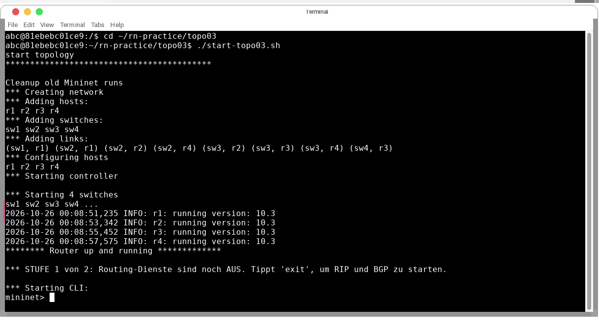

# Meilenstein 2 von 4 · Dynamisches Routing mit RIP und BGP

*03 · Routing (RIP/BGP)* · [Übersicht des Blatts](index.md)

Hier laufen RIP und BGP gleichzeitig auf denselben Routern, und ihr lest mit vtysh und ip route, was sie gelernt haben.

<div class="schichtenbild" style="max-width:20rem;margin:0 0 1.2em 0;font-size:.72rem;line-height:1.5">
<div style="margin-bottom:.3em;color:#757575">In diesen Schichten des TCP/IP-Modells bewegt ihr euch hier:</div>
<div style="display:grid;gap:3px">
<div style="padding:.2em .7em;border-radius:3px;background:#c5cae9;color:#1a237e;border:1px solid #9fa8da">Anwendungsschicht · beteiligt</div>
<div style="padding:.2em .7em;border-radius:3px;background:#c5cae9;color:#1a237e;border:1px solid #9fa8da">Transportschicht · beteiligt</div>
<div style="padding:.2em .7em;border-radius:3px;background:#3f51b5;color:#fff;font-weight:600;border:1px solid #3f51b5">Netzwerkschicht · Schwerpunkt</div>
<div style="padding:.2em .7em;border-radius:3px;color:#9e9e9e;border:1px dashed #9e9e9e">Netzzugriffsschicht</div>
</div>
</div>

### Teil 2 – Dynamisches Routing mit RIP und BGP (`topo03`, FRR/`vtysh`)

!!! abstract "Auf einen Blick"
    **Lernziel:** Ihr könnt in einem Netz mit vier Routern erklären, woher eine
    Route stammt (direkt angeschlossen, RIP oder BGP), die Routing-Tabellen mit
    `ip route` und `vtysh` lesen und begründen, welche von zwei konkurrierenden
    Routen der Router benutzt.

    **Wozu?** In jedem größeren Netz pflegt niemand die Routen von Hand:
    Router sagen sich per Protokoll, welche Netze sie erreichen. Fällt dann
    abends um 22 Uhr eine Strecke aus, ist die Frage des Netzbetreibers
    „welches Protokoll hat welche Route gelernt, und warum benutzt der Router
    genau diese?". Mit `show ip route` auf einem Router und `traceroute` von
    außen beantwortet ein Admin sie in einer Minute. Genau das übt ihr hier.

    **Vorwissen:** [Teil 1](m1-manuelles-routing.md#teil-1-manuelles-routing-zwischen-zwei-netzen-topop03) (Routen und `ip route`), `ping`/`traceroute`,
    Wireshark (Blatt 01).

In [Teil 1](m1-manuelles-routing.md#teil-1-manuelles-routing-zwischen-zwei-netzen-topop03) habt ihr für **zwei** Netze jede Route von Hand eingetragen – bei
vier Routern und mehreren Netzen wäre das schnell unübersichtlich, und bei
jedem Ausfall müsstet ihr erneut von Hand eingreifen. Genau dafür gibt es
**Routing-Protokolle**: Router tauschen automatisch untereinander aus,
welche Netze sie erreichen können, und tragen die passenden Routen selbst
in ihre Tabelle ein – auch dann, wenn sich die Topologie ändert. Ihr
wechselt dafür von `topoP03` (ein Router, manuell konfiguriert) zu `topo03`:
vier Router, bereits mit RIP und BGP vorkonfiguriert.

Bei so vielen beteiligten Knoten hilft eine Skizze. Die Topologie für dieses
Experiment:

```text
                      r2
                     /  \
 sw1 --- r1 --- sw2        sw3 --- r3 --- sw4
                     \  /
                      r4

 sw1: 192.168.1.0/24 (Stub-Netz von r1)   sw2: 193.1.1.0/26
 sw3: 193.1.2.0/24                        sw4: 192.168.3.0/24 (Stub-Netz von r3)

 sw steht für Switch, r für Vermittlungsknoten (Router)
```

#### Einführung in Routing, RIP und BGP

RIP (Routing Information Protocol) ist eines der einfachsten
Routing-Protokolle: Es verwendet eine simple Metrik (Hop-Zählung) und ist
leicht zu konfigurieren – ein guter Einstieg, um Konzepte wie
Routing-Tabellen und Konvergenz (das Zurückkehren zu einem stabilen Zustand
nach einer Änderung) zu verstehen. BGP (Border Gateway Protocol) ist
komplexer, aber das Protokoll, das das Internet zusammenhält: Es ermöglicht
die Kommunikation zwischen unterschiedlichen autonomen Systemen (AS) und
führt in Konzepte wie Pfadvektoren, Routing-Policies und Multi-Homing ein.
Beide Protokolle unterscheiden sich grundlegend darin, wie sie eine Route
"bewerten" und weitergeben – RIP zählt nur Hops, BGP wägt AS-Pfade und
Policies ab.

!!! info "Hintergrund: RIP kann nur bis 15 zählen – und das ist Absicht"
    RIPs Metrik ist die Zahl der Teilstrecken (Hops) bis zum Ziel, ein direkt
    angeschlossenes Netz zählt 1, und bei **16** gilt ein Ziel als
    unerreichbar. Das wirkt wie eine willkürliche Grenze, löst aber
    ein echtes Problem. In einem Distance-Vector-Verfahren erzählt jeder
    Router seinen Nachbarn nur, *wie weit* ein Ziel entfernt ist – nicht,
    *worüber* der Weg führt. Fällt eine Verbindung aus, können sich zwei
    Router deshalb gegenseitig immer größere Entfernungen zurückmelden, ohne
    je zu merken, dass jeder den Weg über den anderen meint. Dieses
    *Count-to-Infinity*-Problem würde ohne Obergrenze niemals enden.

    RIP erklärt darum einfach 16 zu „unendlich". Der Preis: in Netzen mit
    Pfaden von mehr als 15 Hops ist RIP nicht einsetzbar. Genau diese
    Abwägung – Einfachheit gegen Reichweite – ist einer der Gründe, warum
    später Link-State-Verfahren wie OSPF entstanden sind.

!!! info "Hintergrund: die Nummern, an denen das Internet hängt"
    Die Zahlen 65001, 65002 und 65003, die euch in dieser Übung begegnen,
    sind **AS-Nummern** (Autonomous System). Ein autonomes System ist ein
    Netz unter einheitlicher Verwaltung – ein Rechenzentrum, ein
    Internetanbieter, ein großes Unternehmen. BGP ist das Protokoll, mit dem
    diese Systeme einander mitteilen, welche Adressbereiche über sie
    erreichbar sind. Weltweit sind Zehntausende AS aktiv, und
    praktisch jede Verbindung, die euer Browser aufbaut, verlässt sich auf
    Ankündigungen, die über BGP verteilt wurden.

    Der Bereich 64512–65534 ist ausdrücklich für den privaten Gebrauch
    reserviert – vergleichbar mit `192.168.x.x` bei IP-Adressen. Deshalb
    stehen hier 65001 bis 65003 und keine echten, registrierten Nummern.
    Und weil BGP darauf aufbaut, dass man diesen Ankündigungen glaubt, hat
    eine falsche Ankündigung schon mehrfach ganze Landesnetze vom Internet
    abgeschnitten. Wer wissen will, wie folgenreich das ist, sucht nach
    *BGP-Hijacking*.

!!! info "Hintergrund: Zebra, Quagga, FRR"
    Aus dem Routing-Projekt *Zebra* entstand **Quagga**, aus Quagga wiederum
    **FRR** (FRRouting), das in dieser Umgebung läuft. In Büchern und
    Anleitungen stehen die Namen deshalb oft nebeneinander. FRR hat die
    `vtysh`-Syntax von Quagga weitgehend übernommen; ein Befehl aus einer
    Quagga-Anleitung funktioniert hier in der Regel unverändert.

#### Start der Topologie in zwei Stufen

```bash
$ cd ~/rn-practice/topo03
$ ./start-topo03.sh
```

Nach etwa 30 Sekunden meldet sich die Mininet-Konsole. Die Topologie läuft in
**zwei Stufen**, und das Skript sagt euch jeweils, in welcher ihr seid:

- **Stufe 1:** Das Netz steht, aber die Routing-Dienste (RIP und BGP) sind noch
  aus (Zeile `STUFE 1 von 2`). Hier könnt ihr schon Terminals öffnen. Ein
  **erstes** `exit` (oder `quit`) beendet nicht die Emulation, sondern startet
  RIP und BGP auf allen vier Routern.
- **Stufe 2:** RIP und BGP laufen (Zeile `STUFE 2 von 2`). Erst ein **zweites**
  `exit` beendet die Emulation und schließt alle Knoten-Fenster.

**Neustart:** Beendet `topo03` mit `exit` (in Stufe 2), wartet, bis die normale
Eingabezeile des Terminals zurück ist, und startet mit `./start-topo03.sh`
neu. Beendet auch `topoP03` aus [Teil 1](m1-manuelles-routing.md#teil-1-manuelles-routing-zwischen-zwei-netzen-topop03) vorher mit `exit`: Das Startskript
räumt alles auf, was es findet, auch ein noch laufendes Netz.


*`topo03` nach dem Start: die Mininet-Konsole in Stufe 1. Die Routing-Dienste
laufen noch nicht.*

#### Adressen und direkt angeschlossene Netze

!!! info "Werkzeug: `ip -br addr` und IPv6-Link-Local-Adressen"
    Das Werkzeug kennt ihr aus [Teil 1](m1-manuelles-routing.md#teil-1-manuelles-routing-zwischen-zwei-netzen-topop03). Hier kommt `-6` dazu: `ip -br -6 addr`
    zeigt nur die IPv6-Adressen. Jede Schnittstelle bekommt von
    selbst eine Adresse `fe80::…` (*link-local*), die nur im direkten Segment
    gilt, auch wenn ihr IPv6 nie eingerichtet habt (die zusätzliche Adresse an
    `lo` legt das Übungsskript an; ignoriert sie).

Öffnet ein Terminal auf `r1` und seht euch die Adressen an:

```bash
mininet> xterm r1
r1$ ip -br addr
```

Echte Ausgabe:

```text
lo               UNKNOWN        127.0.0.1/8 fe80::200:ff:fe00:0/64 ::1/128
r1-eth0@if329    UP             192.168.1.1/24 fe80::f036:e4ff:fe9d:cffb/64
r1-eth1@if330    UP             193.1.1.1/26 fe80::c087:6eff:febb:3337/64
```

`r1-eth0` (`192.168.1.1/24`) hängt am Stub-Netz, `r1-eth1` (`193.1.1.1/26`) am
Segment, das sich `r1`, `r2` und `r4` teilen. Die Zahl hinter dem `@if` ist
eine interne Nummer und bei euch eine andere. Die `fe80::…`-Adressen sind
ebenfalls bei jedem Start anders.

Für direkt angeschlossene Netze ist kein zusätzlicher Routing-Aufwand nötig.
Öffnet zusätzlich ein Terminal für `r2` und pingt von dort die beiden
IPv4-Adressen von `r1` an:

```bash
mininet> xterm r2
r2$ ping -c 1 193.1.1.1
r2$ ping -c 1 192.168.1.1
```

Echte Ausgabe:

```text
r2$ ping -c 1 193.1.1.1
64 bytes from 193.1.1.1: icmp_seq=1 ttl=64 time=1.44 ms
...
1 packets transmitted, 1 received, 0% packet loss, time 0ms

r2$ ping -c 1 192.168.1.1
ping: connect: Network is unreachable
```

Nur die erste Adresse ist erreichbar. Sie liegt im selben `/26`-Netz wie `r2`s
eigene Schnittstelle (`193.1.1.0/26`). Das Stub-Netz `192.168.1.0/24` kennt `r2`
noch nicht, ohne Routing-Protokoll kann es sie nicht erfahren.

**Selbst:** Wiederholt den Test mit IPv6. Link-Local-Adressen brauchen die
Angabe, über welche Schnittstelle sie erreichbar sind.

1. Wechselt in das Fenster von `r1` und tippt `ip -br -6 addr`. Merkt euch die
   Adresse in der Zeile `r1-eth1` (ohne `/64`), zum Beispiel
   `fe80::c087:6eff:febb:3337`.
2. Tippt im Fenster von `r2` den Ping mit **eurer** Adresse; die spitzen
   Klammern der Vorlage gehören nicht in den Befehl:

```bash
r2$ ping -6 -c 1 fe80::c087:6eff:febb:3337%r2-eth0
```

Der Zusatz `%r2-eth0` sagt: „diese Adresse liegt an meiner Schnittstelle
`r2-eth0`". Das Ergebnis sieht so aus:

```text
PING fe80::b438:9ff:fe1f:9c3%r2-eth0 (fe80::b438:9ff:fe1f:9c3%r2-eth0) 56 data bytes
64 bytes from fe80::b438:9ff:fe1f:9c3%r2-eth0: icmp_seq=1 ttl=64 time=1.33 ms
```

(Die Adresse in dieser Beispielausgabe weicht von der im Befehl oben ab: Jeder
Start vergibt andere `fe80::…`-Adressen.) Ein Blick auf `r1$ ip -6 route` zeigt
für `fe80::/64` einen Eintrag je Schnittstelle: IPv6 führt eine eigene Tabelle
neben `ip route`.

!!! question "Nachgedacht: Warum braucht IPv6 hier ein `%r2-eth0`?"
    `r2` hat zwei Schnittstellen, und `fe80::…`-Adressen sind nur im jeweiligen
    Segment eindeutig. Könnt ihr sagen, was `r2` ohne den Zusatz nicht wüsste?

    ??? success druck-zu "Lösung"
        Dieselbe Link-Local-Adresse könnte an `r2-eth0` und an `r2-eth1` in
        verschiedenen Segmenten vergeben sein. Ohne die Schnittstellenangabe
        weiß `r2` nicht, über welches Segment es das Paket schicken soll.
        Eine Routing-Tabelle kann das bei `fe80::/64` nicht entscheiden, weil
        dieses Präfix an jeder Schnittstelle gilt.

#### Routing-Tabellen im Detail: `topo03` konkret

Die vorkonfigurierten FRR-Router (`r1`–`r4`, nachlesbar unter
`~/rn-practice/topo03/r*/zebra.conf`, `ripd.conf`, `bgpd.conf`):

| Router | Schnittstellen (IPv4) | RIP | BGP (AS) |
|---|---|---|---|
| `r1` | `r1-eth0`=`192.168.1.1/24` (Stub), `r1-eth1`=`193.1.1.1/26` | ja (nur `r1-eth1`) | 65001, Nachbar `193.1.1.2` |
| `r2` | `r2-eth0`=`193.1.1.2/26`, `r2-eth1`=`193.1.2.1/24` | ja | 65002, Nachbarn `193.1.1.1` und `193.1.2.2` |
| `r3` | `r3-eth0`=`192.168.3.1/24` (Stub), `r3-eth1`=`193.1.2.2/24` | ja | 65003, Nachbar `193.1.2.1` |
| `r4` | `r4-eth0`=`193.1.1.4/26`, `r4-eth1`=`193.1.2.4/24` | ja | **kein `bgpd.conf`** |

`r4` besitzt keine `bgpd.conf` – er nimmt ausschließlich am RIP-Verbund
teil, nicht am BGP-Verbund zwischen `r1`/`r2`/`r3` (AS 65001/65002/65003).
`r1` lernt `192.168.3.0/24` aus zwei Quellen: `r3` kündigt es per BGP an und
(über `redistribute connected`) auch per RIP.

Öffnet ihr die Konfigurationsdateien, lasst die Dateien `*.ref` und die
Kommentare am Dateianfang außer Acht; sie stammen aus einem Test. Wichtig sind
nur die Zeilen `router rip`, `network …`, `router bgp …` und `neighbor …`.
Welche davon gewinnt und was `r4` beiträgt, untersucht ihr im weiteren
Verlauf.

Prüft zunächst in Stufe 1, also noch vor dem Start von RIP und BGP, die
Routing-Tabelle von `r1` und versucht einen Ping zu `192.168.3.1`:

```bash
r1$ ip route
r1$ ping -c 1 192.168.3.1
```

```text
192.168.1.0/24 dev r1-eth0 proto kernel scope link src 192.168.1.1
193.1.1.0/26 dev r1-eth1 proto kernel scope link src 193.1.1.1
ping: connect: Network is unreachable
```

Die Tabelle enthält nur die beiden direkt angeschlossenen Netze; für
`192.168.3.0/24` steht nichts drin, der Ping scheitert.

#### RIP und BGP starten und die Nachrichten mitlesen

!!! info "Werkzeug: Wireshark auf einer Schnittstelle von `r1`"
    Wireshark kennt ihr aus Blatt 01. Hier soll es nicht den ganzen Desktop,
    sondern nur den Verkehr auf **einer Schnittstelle des Routers** `r1`
    mitschneiden. Dafür startet ihr es im Terminal von `r1`:

    | Aufruf | Bedeutung |
    |---|---|
    | `wireshark -i r1-eth1 -k &` | startet Wireshark, schneidet sofort auf `r1-eth1` mit (`-k`) und gibt das Terminal frei (`&`) |
    | Anzeigefilter `rip or bgp` | blendet alles außer den RIP- und BGP-Nachrichten aus (Eingabefeld oben, mit ++ctrl+slash++ erreichbar) |

    Die Spalten: **No.** laufende Nummer, **Time** Sekunden seit dem Start des
    Mitschnitts, **Source/Destination** Absender und Empfänger, **Protocol**
    das erkannte Protokoll, **Length** Größe des Rahmens in Byte, **Info**
    Nachrichtenart.

Startet Wireshark in Stufe 1 und wechselt dann an der Mininet-Konsole mit
**einem** `exit` in Stufe 2:

```bash
r1$ wireshark -i r1-eth1 -k &
mininet> exit
```

Gebt in Wireshark den Anzeigefilter `rip or bgp` ein. (Das Bild unten zeigt
`rip || bgp`; beide Schreibweisen sind gleichbedeutend.) Nach wenigen Sekunden
beginnt ein reger Paketaustausch, in dem RIP und BGP versuchen, Konvergenz zu erreichen:


*Mitschnitt auf `r1-eth1` direkt nach dem Start von RIP und BGP. Oben die
RIP-Nachrichten, die jeder Router an die Multicast-Adresse `224.0.0.9`
schickt, darunter der BGP-Verbindungsaufbau: `OPEN`, `KEEPALIVE`, dann `UPDATE`
mit den Routen.*

Lest den Mitschnitt von oben nach unten:

1. `RIPv2 Request` von `193.1.1.1` (`r1`): „schickt mir eure Tabellen".
2. `RIPv2 Response` von `193.1.1.2` und `193.1.1.4`: die Antworten von `r2` und
   `r4` an die Multicast-Adresse `224.0.0.9`, die alle RIP-Router abhören.
3. `OPEN Message`: `r1` und `r2` bauen ihre BGP-Sitzung auf und stellen sich
   mit ihrer AS-Nummer vor.
4. `KEEPALIVE Message`: „Sitzung steht".
5. `UPDATE Message`: Die Nachbarn tauschen ihre Routen.

Danach wiederholen sich die `RIPv2 Response`-Nachrichten in festen
Zeitabständen. Das ist typisch für Distance-Vector-Protokolle wie RIP, im
Gegensatz zu Link-State-Protokollen wie OSPF, die Topologie-Informationen nur
bei Änderungen verschicken und dazwischen nur kleine Hello-Pakete senden.
Wie groß dieser Abstand wirklich ist, messt ihr in [Teil 4](m3-rekonvergenz-und-spuren.md#teil-4-protokollspuren-vermessen-statt-anschauen-topo03).

Schließt Wireshark mit dem Schließen des Fensters. Fragt Wireshark, ob ihr den
Mitschnitt speichern wollt (Dialog „Stop and Save“ bzw. „Quit without
Saving“), antwortet mit **Quit without Saving**. Wartet danach bis zu etwa
einer Minute: So lange kann es dauern, bis alle RIP-Routen eingetragen sind
(BGP-Routen stehen meist nach wenigen Sekunden). Mit `r1$ ip route` seht ihr
den Stand.

!!! info "Hinweis: Zeilen `FD Limit set … stupidly large` in der Konsole"
    Auf manchen Desktops schreibt der BGP-Dienst bei fast jedem Befehl, der
    `vtysh` oder `bgpd` berührt, mehrere Zeilen wie `BGP: … FD Limit set:
    1048576 is stupidly large. Is this what you intended? …` in die
    Mininet-Konsole. Sie sind harmlos, können aber die erwartete Ausgabe
    verdecken. Die eigentliche Ausgabe steht direkt darüber oder darunter;
    überlest die Meldung. Am wenigsten stört sie, wenn ihr Befehle im
    Knoten-Fenster (`mininet> xterm r1`) tippt statt mit `mininet> r1 …`.

#### Zwei Tabellen: Kernel und Routing-Software

Prüft die Routing-Tabelle auf `r1` erneut. Zusätzlich zu den beiden direkt
angeschlossenen Netzen sind nun zwei neue Routen sichtbar:

```bash
r1$ ip route
```

```text
192.168.1.0/24 dev r1-eth0 proto kernel scope link src 192.168.1.1
192.168.3.0/24 nhid 12 via 193.1.1.2 dev r1-eth1 proto bgp metric 20
193.1.1.0/26 dev r1-eth1 proto kernel scope link src 193.1.1.1
193.1.2.0/24 nhid 12 via 193.1.1.2 dev r1-eth1 proto bgp metric 20
```

Neu sind `192.168.3.0/24` und `193.1.2.0/24`, beide über `193.1.1.2` (also `r2`),
`proto bgp` verrät, welches Protokoll sie gelernt hat. `nhid 12` ist eine
interne Nummer des Kernels für den nächsten Router; ihr könnt sie ignorieren. Verfolgt den Pfad:

```bash
r1$ traceroute -n 192.168.3.1
```

```text
traceroute to 192.168.3.1 (192.168.3.1), 30 hops max, 60 byte packets
 1  193.1.1.2  0.072 ms  0.026 ms  0.037 ms
 2  192.168.3.1  0.077 ms  0.034 ms  0.032 ms
```

Hop 1 ist `193.1.1.2` (`r2`), Hop 2 das Ziel in `r3`s Stub-Netz.

#### Administrative Distanz: Warum gewinnt BGP?

Bis hierher habt ihr die Routing-Tabelle des Linux-Kernels gelesen. Für den
nächsten Schritt braucht ihr ein zweites Werkzeug.

!!! info "Werkzeug: `vtysh` – die Konsole der Routing-Software"
    `vtysh` ist die Befehlszeilenschnittstelle von FRR, der Routing-Software
    auf `r1`–`r4`. Sie sieht wie eine gewöhnliche Shell aus, erwartet aber
    statt Linux-Befehlen die Kommandosprache, die auch auf kommerziellen
    Routern üblich ist. Aus `ip route` wird dort `show ip route`: dieselbe
    Information, andere Wortstellung. Es arbeitet auf Schicht 3 und zeigt die
    Entscheidungen der Routing-Protokolle.

    | Aufruf | Bedeutung |
    |---|---|
    | `vtysh` | interaktive Konsole; Prompt `r1#` (zeigt eigentlich die Container-Kennung statt `r1`) |
    | `exit` | `vtysh` verlassen und zurück in die Linux-Shell des Knotens |
    | `vtysh -c "show ip route"` | genau einen Befehl ausführen und zurück in die Linux-Shell |
    | `show ip route 192.168.3.0/24` | nur die Einträge zu einem Präfix |
    | `?` | an jeder Stelle: zeigt die möglichen Fortsetzungen |
    | `configure terminal` … `end` | Konfigurationsmodus betreten und verlassen |

    Echte Ausgabe auf `r1` (Zeilen mit `Codes:` gekürzt):

    ```text
    r1$ vtysh -c "show ip route"
    Codes: K - kernel route, C - connected, L - local, S - static,
           R - RIP, O - OSPF, I - IS-IS, B - BGP, ...
           > - selected route, * - FIB route, ...

    IPv4 unicast VRF default:
    C>* 192.168.1.0/24 is directly connected, r1-eth0, weight 1, 00:00:54
    L>* 192.168.1.1/32 is directly connected, r1-eth0, weight 1, 00:00:54
    B>* 192.168.3.0/24 [20/0] via 193.1.1.2, r1-eth1, weight 1, 00:00:39
    R   192.168.3.0/24 [120/3] via 193.1.1.2, r1-eth1, weight 1, 00:00:41
    B   193.1.1.0/26 [20/0] via 193.1.1.2 inactive, weight 1, 00:00:39
    C>* 193.1.1.0/26 is directly connected, r1-eth1, weight 1, 00:00:54
    L>* 193.1.1.1/32 is directly connected, r1-eth1, weight 1, 00:00:54
    B>* 193.1.2.0/24 [20/0] via 193.1.1.2, r1-eth1, weight 1, 00:00:39
    R   193.1.2.0/24 [120/2] via 193.1.1.2, r1-eth1, weight 1, 00:00:42
    ```

    Gelesen, Zeile `B>* 192.168.3.0/24 [20/0] via 193.1.1.2, r1-eth1, …`:

    - `B` – die Route stammt von **BGP** (`C` = direkt angeschlossen, `R` = RIP,
      `L` = lokale Adresse des Routers selbst);
    - `>*` – diese Route ist die **gewählte** und steht in der Kernel-Tabelle
      (`>` ausgewählt, `*` in die Weiterleitungstabelle eingetragen); Zeilen
      ohne `>*` sind Kandidaten, die nicht gewonnen haben;
    - `192.168.3.0/24` – das Ziel-Netz;
    - `[20/0]` – **administrative Distanz 20**, **Metrik 0** (dazu gleich mehr);
    - `via 193.1.1.2, r1-eth1` – nächster Router und Schnittstelle;
    - `00:00:39` – so lange kennt der Router die Route schon.

    Typische Stolpersteine: Der Prompt von `vtysh` zeigt den Rechnernamen eures
    Containers, nicht `r1`; in diesem Blatt steht stellvertretend `r1#`. Ein
    `show ip route` ohne vorheriges `vtysh` liefert in der Linux-Shell
    `show: command not found`. Meldet `vtysh` `failed to connect to any
    daemons`, habt ihr es nicht im Terminal eines Routers getippt
    (`mininet> xterm r1`).

![Zwei Terminalfenster: im Fenster "Node: r1" die Ausgabe von vtysh -c "show ip route" mit den Zeilen C>* und L>* für direkt angeschlossene Netze, B>* 192.168.3.0/24 [20/0] via 193.1.1.2 und darunter R 192.168.3.0/24 [120/3] via 193.1.1.2](../../assets/screenshots/03-routing-rip-bgp/topo03-vtysh-show-ip-route.png)
*`show ip route` auf `r1` in Stufe 2: `192.168.3.0/24` steht zweimal in der
Tabelle, einmal von BGP (`B>*`, gewählt) und einmal von RIP (`R`, nicht
gewählt).*

!!! warning "Zwei Tabellen, nicht eine"
    `ip route` zeigt die Tabelle des **Linux-Kernels** – das, was
    tatsächlich weitergeleitet wird. `show ip route` in `vtysh` zeigt die
    Tabelle der **Routing-Software** – alles, was sie gelernt hat,
    einschließlich der Routen, für die sie sich *nicht* entschieden hat. Die
    zweite Tabelle ist deshalb größer als die erste.

Die Tabelle enthält Dopplungen: `192.168.3.0/24` und `193.1.2.0/24` erscheinen
je zweimal, einmal mit `B` (BGP) und einmal mit `R` (RIP), beide
`via 193.1.1.2`. In der eckigen Klammer steht zuerst die **administrative
Distanz**, dann die Metrik (`[20/0]` bzw. `[120/3]`). Je niedriger die Distanz,
desto vertrauenswürdiger die Quelle. BGP gewinnt hier, weil seine
administrative Distanz (20) niedriger ist als die von RIP (120). Ebenso steht
`193.1.1.0/26` zweimal: einmal als `C>*` (direkt angeschlossen) und einmal als
`B … inactive`. Die direkt angeschlossene Route hat die Distanz 0 und gewinnt
immer.

!!! info "Werkzeug: `show ip rip` – was RIP für sich gelernt hat"
    `show ip rip` (in `vtysh`) zeigt die Tabelle, die **nur RIP** führt, bevor
    die administrative Distanz entscheidet, welche Route in den Kernel kommt.

    ```text
    r1$ vtysh -c "show ip rip"
         Network            Next Hop         Metric From            Tag Time
    R(n) 192.168.3.0/24     193.1.1.2             3 193.1.1.2         0 02:57
    C(i) 193.1.1.0/26       0.0.0.0               1 self              0
    R(n) 193.1.2.0/24       193.1.1.2             2 193.1.1.2         0 02:57
    ```

    Spalten: **Network** das Ziel; **Next Hop** der Router, über den es geht
    (`0.0.0.0` bei direkt angeschlossenen Netzen); **Metric** die Zahl der Hops
    (1 bis 15; 16 heißt unerreichbar); **From** wer die Route gemeldet hat;
    **Time** der Countdown bis zum Ablauf der Route (Start bei 3 Minuten, wird
    mit jedem Update des Nachbarn wieder zurückgesetzt). `R(n)` = von RIP
    gelernt, `C(i)` = direkt an einer RIP-Schnittstelle. **Typische
    Fehldeutung:** `show ip rip` als „die aktiven RIP-Routen" zu lesen. Es
    zeigt *alles*, was RIP kennt – auch Routen, die BGP im Wettbewerb um die
    Kernel-Tabelle geschlagen hat.

Ändert nun die administrative Distanz von BGP, um es unattraktiver zu machen:

```bash
r1$ vtysh
r1# configure terminal
r1(config)# router bgp
r1(config-router)# distance bgp 200 200 200
r1(config-router)# end
r1# exit
```

Die drei Werte stehen für eBGP-Routen (von einem anderen autonomen System
gelernt), iBGP-Routen (innerhalb desselben AS gelernt) und lokal auf dem Router
konfigurierte BGP-Routen. Die Änderung gilt sofort. Prüft die Auswirkung:

```bash
r1$ traceroute -n 192.168.3.1
r1$ ip route
r1$ vtysh -c "show ip route 192.168.3.0/24"
```

```text
192.168.3.0/24 nhid 12 via 193.1.1.2 dev r1-eth1 proto rip metric 20

Routing entry for 192.168.3.0/24
  Known via "bgp", distance 200, metric 0
  Last update 00:00:04 ago
    193.1.1.2, via r1-eth1, weight 1

Routing entry for 192.168.3.0/24
  Known via "rip", distance 120, metric 3, best
  Last update 00:00:06 ago
  * 193.1.1.2, via r1-eth1, weight 1
```

Der `traceroute` zeigt unverändert `193.1.1.2` als ersten Hop. Im Kernel steht
jetzt aber `proto rip` statt `proto bgp`, und in `vtysh` trägt der
RIP-Eintrag das Wort `best`.

!!! question "Nachgedacht: Wechselt der Weg – oder nur die Quelle?"
    Es liegt nahe zu erwarten, dass sich mit der Distanz auch der Weg der
    Pakete ändert. Schaut euch dazu `show ip rip` auf `r1` an: Von wem hat `r1`
    die RIP-Route zu `192.168.3.0/24` gelernt, und was folgt daraus für den
    Weg?

    ??? success druck-zu "Lösung"
        In `show ip rip` steht bei euch als Nexthop fast immer `193.1.1.2`
        (`r2`); je nach Start kann es auch `193.1.1.4` (`r4`) sein, denn `r1`
        und `r4` hängen am selben Switch-Segment. `r4` bietet
        `192.168.3.0/24` ebenfalls an, aber mit derselben Metrik. RIP speichert
        je Ziel nur **eine** Quelle: bei gleicher Metrik die zuerst gelernte.
        Lest in der Spalte **From** nach, welcher Fall bei euch gilt. `r1` hat
        für `192.168.3.0/24` also nur einen RIP-Nexthop (hier `r2`); bekannt
        ist ihm das Ziel zweimal, einmal per BGP, einmal per RIP.

        Die geänderte Distanz bewirkt deshalb keinen anderen Weg, sondern eine
        andere Quelle in der Tabelle: aus `bgp` wird `rip`, weil RIPs Distanz
        von 120 nun unter dem auf 200 gesetzten BGP-Wert liegt. Die Pakete
        nehmen denselben Weg wie vorher (Voraussetzung: der RIP-Nexthop ist
        derselbe Router wie der BGP-Nexthop; das habt ihr in der Spalte
        **From** geprüft). Eine veränderte Routing-Tabelle heißt
        also nicht automatisch veränderter Datenfluss. `r4` wird dennoch
        gebraucht – aus der Sicht von `r2`, und davon handelt [Teil 3](m3-rekonvergenz-und-spuren.md#teil-3-redundanz-im-rip-netz-testen-reale-rekonvergenz-messen-topo03).

#### Lokale Gültigkeit manueller Routen

Routing-Änderungen gelten immer nur lokal auf dem jeweiligen Router. Öffnet
ein Terminal für `r3` und pingt von dort `192.168.1.1` an:

```bash
mininet> xterm r3
r3$ ping -c 3 192.168.1.1
```

Der Ping gelingt: `r3` kennt `192.168.1.0/24` per BGP über `r2`, und `r1`
kennt den Rückweg zu `193.1.2.0/24` ebenfalls über `r2`. Setzt nun auf `r1`
von Hand eine Host-Route, die den Verkehr zu `192.168.3.1` über `r4`
schickt, und vergleicht die Wege in beiden Richtungen:

```bash
r1$ ip route add 192.168.3.1/32 via 193.1.1.4
r1$ traceroute -n 192.168.3.1
r3$ traceroute -n 192.168.1.1
```

```text
r1$ traceroute -n 192.168.3.1
 1  193.1.1.4  1.088 ms  0.965 ms  0.890 ms
 2  192.168.3.1  1.039 ms  0.973 ms  0.795 ms

r3$ traceroute -n 192.168.1.1
 1  193.1.2.1  0.087 ms  0.024 ms  0.022 ms
 2  192.168.1.1  0.057 ms  0.035 ms  0.032 ms
```

Von `r1` aus ist der erste Hop jetzt `193.1.1.4` (`r4`): die `/32`-Route
gewinnt gegen die `/24`-Routen aus BGP und RIP, weil der längste passende
Präfix entscheidet. Von `r3` aus führt der Weg weiterhin über `193.1.2.1`
(`r2`). Die manuelle Route wirkt nur auf `r1`; `r2`, `r3` und `r4` wissen
nichts von ihr, und der Weg ist jetzt asymmetrisch: hin über `r4`, zurück
über `r2`.

#### RP-Filtering: Schutz vor IP-Spoofing

Lasst die Host-Route auf `r1` stehen und erzwingt, dass `r3` die Adresse
`192.168.3.1` als Quelladresse für einen Ping auf `192.168.1.1` verwendet
(`-I` wählt die Absenderadresse):

```bash
r3$ ping -c 3 -W 2 -I 192.168.3.1 192.168.1.1
```

Der Ping schlägt fehl (`100% packet loss`), ohne Quelladresse
(`ping -c 3 192.168.1.1`) gelingt er dagegen. Die Anfrage läuft über `r2` zu
`r1`. Die Antwort an `192.168.3.1` nimmt wegen eurer Host-Route den Weg über
`r4`, und `r4` kennt keine Route zurück zu `192.168.1.1` (`r4` spricht kein
BGP, und `r1` kündigt `192.168.1.0/24` nicht per RIP an). Deshalb verwirft
**RP-Filtering** (Reverse Path Filtering) auf `r4` das Paket: ein
Schutzmechanismus gegen IP-Spoofing, der Pakete verwirft, deren
Absenderadresse laut eigener Routing-Tabelle nicht erreichbar wäre.

!!! info "Werkzeug: `sysctl`, `nstat` und `unshare` – Kernel-Einstellungen lesen, zählen, ändern"
    `sysctl` liest und setzt Einstellungen des Linux-Kernels (hier die des
    Netzwerk-Stapels des Knotens). `nstat` liest die Zähler des Kernels.
    `unshare -m` führt einen Befehl in einem eigenen Dateisystem-Ausschnitt aus:
    Der Befehl darf die sonst schreibgeschützte Kernel-Einstellungsliste
    `/proc/sys` beschreiben, ohne dass der Rest des Desktops davon etwas
    merkt.

    | Aufruf | Bedeutung |
    |---|---|
    | `sysctl net.ipv4.conf.all.rp_filter` | Einstellung anzeigen |
    | `nstat -az TcpExtIPReversePathFilter` | Zähler der durch RP-Filtering verworfenen Pakete (`-a` absoluter Wert, `-z` auch wenn 0) |
    | `unshare -m sh -c '…'` | den Befehl in `'…'` mit schreibbarem `/proc/sys` ausführen |

    Echte Ausgabe:

    ```text
    r4$ sysctl net.ipv4.conf.all.rp_filter net.ipv4.conf.r4-eth0.rp_filter
    net.ipv4.conf.all.rp_filter = 2
    net.ipv4.conf.r4-eth0.rp_filter = 2
    r4$ nstat -az TcpExtIPReversePathFilter
    #kernel
    TcpExtIPReversePathFilter       3                  0.0
    ```

    Der Wert `rp_filter` kennt drei Stufen: `0` aus; `1` strikt (der Rückweg
    muss über dasselbe Interface führen, über das das Paket hereinkam); `2`
    lose (irgendein Rückweg genügt). `r4` steht auf `2`: Es gibt für
    `192.168.1.0/24` überhaupt keinen Rückweg, also fällt das Paket durch. Der
    Zähler `TcpExtIPReversePathFilter` steht dort auf 3: je ein verworfenes
    Paket pro Ping (bei euch steigt er mit jedem Ping um 1). Typische Fehlermeldung bei `sysctl -w` ohne `unshare`:
    `permission denied on key …`.

Deaktiviert RP-Filtering testweise auf `r4`. Die Einstellung gilt nur im
Netz-Namensraum von `r4`:

```bash
r4$ unshare -m sh -c 'mount -o remount,rw /proc/sys && sysctl -w net.ipv4.conf.all.rp_filter=0 net.ipv4.conf.r4-eth0.rp_filter=0'
r3$ ping -c 3 -I 192.168.3.1 192.168.1.1
```

Danach gelingt der Ping mit der erzwungenen Quelladresse (`3 received`).
Entfernt die Host-Route auf `r1` wieder, bevor ihr weitermacht:

```bash
r1$ ip route del 192.168.3.1/32
```

#### Ausfall eines Pfads beobachten

!!! info "Werkzeug: `ifconfig … down` – eine Schnittstelle abschalten"
    `ifconfig r4-eth1 down` schaltet die Schnittstelle `r4-eth1` aus (Schicht
    2), als hättet ihr das Kabel gezogen; `ifconfig r4-eth1 up` schaltet sie
    wieder ein. `ifconfig` ohne Argument listet alle Schnittstellen auf.

!!! question "Nachgedacht: Ein Ausfall, der niemanden trifft"
    Schaltet auf `r4` das Interface in Richtung `r3` ab und beobachtet dabei
    `r1`:

    ```bash
    r4$ ifconfig r4-eth1 down
    r1$ vtysh -c "show ip route 192.168.3.0/24"
    r1$ ping -c 4 192.168.3.1
    ```

    Erklärt, warum sich für `r1` nichts ändert. Schaut dazu mit
    `r1$ vtysh -c "show ip rip"` in die Spalte **From**: Von welchem Router
    hat `r1` die Route zu `192.168.3.0/24`? Berührt der abgeschaltete Link
    `r4-eth1` diesen Router? Schaltet das Interface danach wieder ein
    (`r4$ ifconfig r4-eth1 up`).

    ??? success druck-zu "Lösung"
        Für `r1` ändert sich nichts: derselbe Routen-Eintrag, kein
        Paketverlust (`4 received`), keine erhöhte Laufzeit. `r1` hat die Route
        zu `192.168.3.0/24` laut Spalte **From** von `r2` (selten von `r4`);
        BGP (Distanz 20) liefert sie ohnehin über `r2`. Der Ausfall von
        `r4-eth1` trifft `r2` nicht – beim RIP-Nexthop `r4` verschwindet
        höchstens der RIP-Eintrag, die Pings laufen weiter. `r1` merkt also
        nichts. Bei einer
        Störungsmeldung ist „wen trifft dieser Ausfall überhaupt?" oft die
        ergiebigere Frage als „ist etwas ausgefallen?". Einen Ausfall, der
        tatsächlich eine Rekonvergenz erzwingt, untersucht ihr in [Teil 3](m3-rekonvergenz-und-spuren.md#teil-3-redundanz-im-rip-netz-testen-reale-rekonvergenz-messen-topo03).

!!! example "Vertiefung (optional): Routing wirklich kaputt machen"
    Eure Topologie läuft in einer eigenen Mininet-Instanz; ihr könnt hier
    also gefahrlos weiter gehen. Deaktiviert den RIP-Dienst auf `r2` *und*
    `r4` (`vtysh -c "configure terminal" -c "no router rip" -c "end"` auf
    jedem der beiden). Prüft nach einer Weile, ob `192.168.3.0/24` von `r1`
    aus noch erreichbar ist, obwohl nur noch BGP läuft. Setzt anschließend
    `distance bgp 200 200 200` auf allen drei BGP-Routern. Fällt das Netz
    auseinander, oder bleibt eine Restkonnektivität übrig? Startet die
    Topologie danach neu.

    ??? success druck-zu "Lösung"
        Beobachtung: `show ip rip` auf `r1` zeigt die bereits gelernten RIP-Routen nach
        dem Abschalten zunächst weiter, nach 180 s (RIP-Timeout) mit Metrik
        `16` (= unerreichbar) und nach weiteren 120 s (Garbage Collection) ganz weg. Die Routen über
        BGP bleiben die ganze Zeit; `ping 192.168.3.1` gelingt weiter. Auch
        mit `distance bgp 200 200 200` auf allen Routern fällt nichts
        auseinander: Die administrative Distanz entscheidet nur zwischen
        *konkurrierenden* Quellen. Ist BGP die einzige Quelle, gewinnt es, egal
        wie hoch seine Distanz ist.

!!! success "Meilenstein 2 geschafft"
    **Das habt ihr gelernt:**

    - Bei einer Route erklären, ob sie direkt angeschlossen, per RIP oder per BGP gelernt ist.
    - Die Routingtabellen mit ip route und vtysh (show ip route) lesen.
    - Mit der administrativen Distanz begründen, welche von zwei konkurrierenden Routen gewählt wird.

    **Was Meilenstein 3 verspricht:** Als Nächstes unterbrecht ihr eine Verbindung und messt, wie lange das Netz bis zum Ersatzweg braucht. Außerdem vermesst ihr den Nachrichtenaufwand der Protokolle aus einer Aufzeichnung.

    [Weiter zu Meilenstein 3: Rekonvergenz und Protokollspuren messen](m3-rekonvergenz-und-spuren.md){ .md-button }
