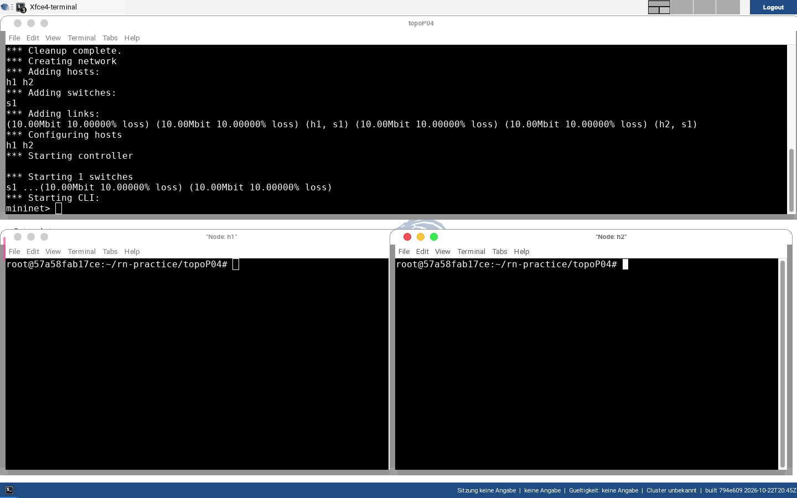
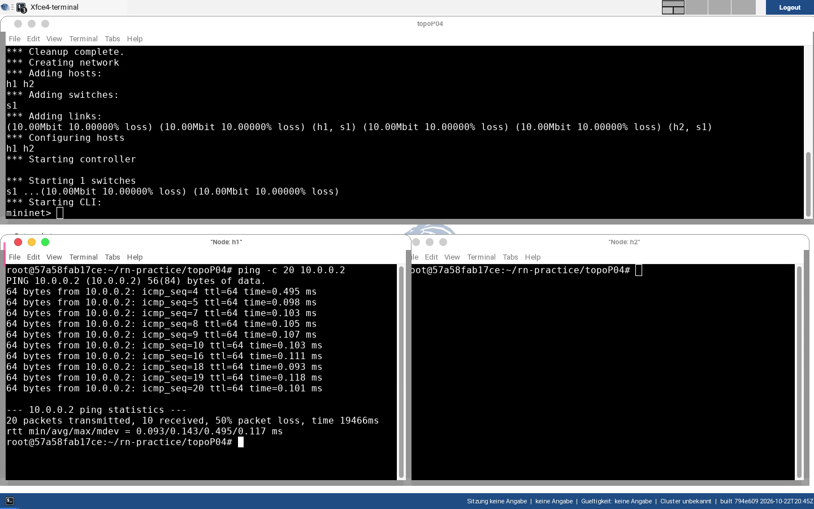
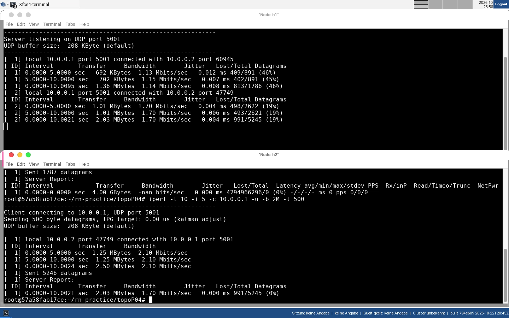
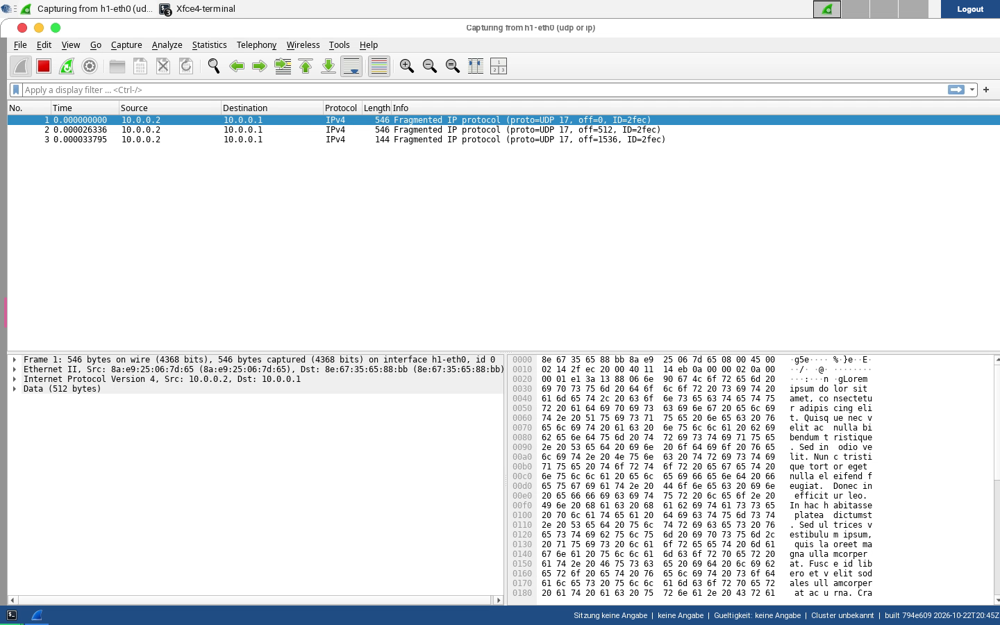
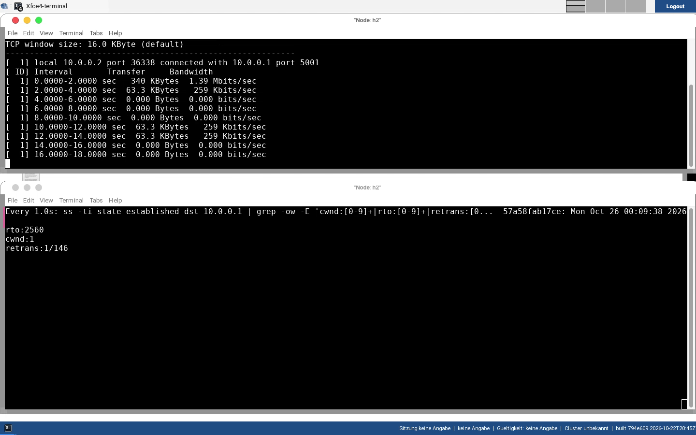
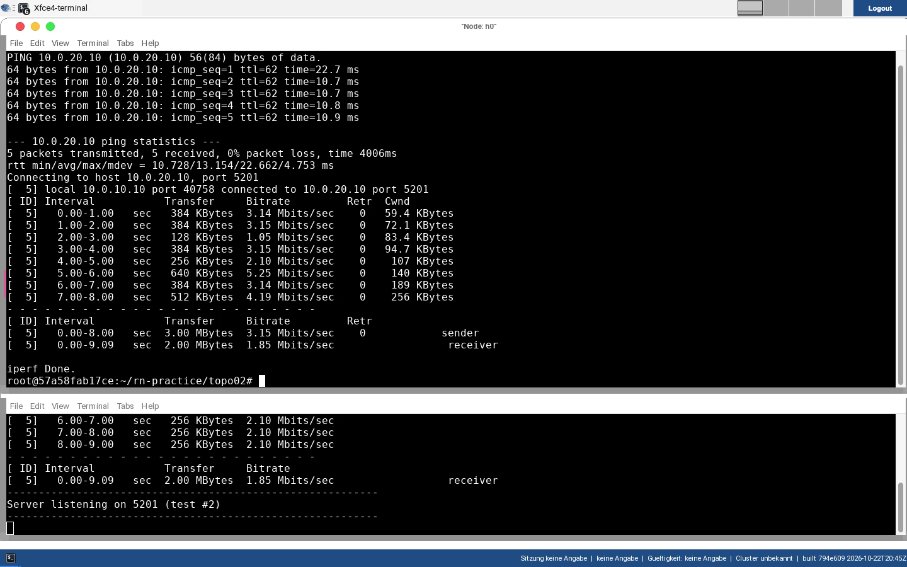

# 04 · TCP/UDP & Congestion Control

[:material-file-pdf-box: Als PDF herunterladen](../../pdf/04-tcp-udp-congestion.pdf){ .md-button }

## Lernziele

- Erklären, wie sich eine Link-Fehlerrate (zufälliger Paketverlust) auf Ping,
  UDP und TCP unterschiedlich auswirkt, und die Größenordnung vorher
  ausrechnen.
- Den Zusammenhang zwischen MTU-Begrenzung, IP-Fragmentierung und
  UDP-Paketverlust im Mitschnitt nachweisen.
- Durchsatz, Latenz und das Zusammenspiel von Pufferung und
  Verbindungskonkurrenz mit `iperf`/`iperf3` messen und die gemessenen Werte
  gegen vorher gebildete Erwartungswerte prüfen.
- Beobachten, wie eine TCP-Verbindung (roher `iperf`-Strom wie auch eine
  SSH-Sitzung) auf eine kurzzeitige Unterbrechung des Pfads reagiert, im
  Unterschied zu einer laufenden `ping`-Messung.
- Das Congestion Window (`cwnd`) einer laufenden Verbindung mit `ss -ti`
  ablesen und Reno und Cubic vergleichen.
- Störungen (Verzögerung, Verlust, Bandbreite) mit `tc`/`netem` selbst
  erzeugen und eine eingestellte Netzeigenschaft gegen den gemessenen Wert
  halten, die Abweichung in Prozent angeben und begründen.

--8<-- "issue-feedback.md"

## So arbeitet ihr an diesem Blatt

Die Aufgaben laufen in zwei Mininet-Topologien. In `topoP04` (Teile A, C, F)
liegt zwischen zwei Hosts ein Link mit Verlust, in `topo02` (Teile B, D, E, G
bis J) ein verlustfreier Link mit 10 Mbit/s zwischen zwei Routern.

Ein Präfix vor einem Befehl zeigt, in welchem Fenster ihr ihn tippt:

| Präfix | Fenster |
|---|---|
| `h1$`, `h2$`, `h0$`, … | das Terminal des Knotens (Fenstertitel „Node: h1“ usw.) |
| `r1$` | das Terminal des Routers `r1` (Fenstertitel „Node: r1“) |
| `mininet>` | das Fenster, in dem ihr das Start-Skript gestartet habt |
| `$` | ein normales Terminal des Desktops |

Ein zusätzliches Terminal für einen Knoten öffnet ihr im Mininet-Fenster mit
`mininet> xterm h2`. Verlust ist zufällig: Eure Zahlen weichen von den
Beispielwerten ab. Zu jeder Messung nennt das Blatt deshalb die Spannweite, die
ihr erwarten könnt.

## Aufgaben

### Teil A — Fehlerrate, MTU und IP-Fragmentierung (`topoP04`)

!!! abstract "Auf einen Blick"
    **Lernziel:** Ihr könnt vorab ausrechnen, wie viele Pakete ein Link mit
    10 % Fehlerrate bei `ping` und bei UDP verliert, und ihr erkennt im
    Mitschnitt, wann und warum ein IP-Paket in Fragmente zerlegt wird.

    **Wozu?** Funkstrecken (WLAN, Mobilfunk, Satellit) verlieren Pakete, ohne
    dass ein Kabel defekt ist. Wer als Admin eine Videokonferenz oder einen
    VPN-Tunnel betreut, muss wissen, wie viel Verlust die Anwendung verträgt.
    Ein VPN-Tunnel verkleinert außerdem die nutzbare Paketgröße (MTU). Große
    UDP-Pakete werden dann fragmentiert, und ein einziges verlorenes
    Fragment kostet die ganze Nachricht. „Es geht nur manchmal“ ist das
    typische Symptom.

    **Vorwissen:** Terminals der Mininet-Knoten und `ping` aus
    [Blatt 01](01-netzwerkgrundlagen-tools.md), MTU und Fragmentierung aus
    [Blatt 02, Teil 3](02-subnetting-arp.md#teil-3-vertiefung-optional-mtu-und-fragmentierung-topop04).

#### Die Topologie

Startet das Setup im Aufgabenverzeichnis:

```bash
$ cd ~/rn-practice/topoP04
$ ./start-topoP04.sh
```

Es öffnet sich ein Fenster `topoP04` mit dem Mininet-Prompt `mininet>` und
zwei Terminals „Node: h1“ und „Node: h2“.


*Nach dem Start: das Mininet-Fenster oben, darunter die Terminals der beiden
Hosts. Die Zeilen `10.00Mbit 10.00000% loss` zeigen die Eigenschaften der
beiden Links.*

Die Topologie besteht aus `h1` (`10.0.0.1`), `h2` (`10.0.0.2`) und einem
Switch. Beide Host-Switch-Verbindungen sind auf 10 Mbit/s, eine MTU von
536 Byte und 10 % Paketverlust eingestellt. Der Verlust gilt für jede
Verbindung in jeder Richtung.

#### Schritt 1: Verlust mit `ping` sichtbar machen

!!! info "Werkzeug: `ping`"
    `ping` schickt ICMP-Echo-Anfragen an einen Rechner und misst, ob und wie
    schnell die Antwort zurückkommt (Schicht 3, Vermittlungsschicht). Ihr
    kennt es aus Blatt 01. Hier braucht ihr vier Optionen:

    | Aufruf | Bedeutung |
    |---|---|
    | `ping -c 20 <ziel>` | genau 20 Anfragen senden, dann Zusammenfassung ausgeben |
    | `ping -D <ziel>` | jeder Antwortzeile einen Unix-Zeitstempel voranstellen |
    | `ping -i 0.3 <ziel>` | alle 0,3 s statt jede Sekunde senden |
    | `ping -W 1 <ziel>` | höchstens 1 s auf eine Antwort warten |

    Eine Ausgabe aus diesem Blatt, Zeile für Zeile gelesen:

    ```text
    64 bytes from 10.0.0.2: icmp_seq=4 ttl=64 time=0.495 ms
    20 packets transmitted, 10 received, 50% packet loss, time 19466ms
    rtt min/avg/max/mdev = 0.093/0.143/0.495/0.117 ms
    ```

    - `icmp_seq=4`: laufende Nummer der Anfrage. **Fehlen Nummern in der
      Folge, sind die zugehörigen Pakete verloren gegangen.**
    - `ttl=64`: wie viele Router das Paket noch hätte durchqueren dürfen.
    - `time=0.495 ms`: Umlaufzeit (Round-Trip-Time) dieser einen Anfrage.
    - `50% packet loss`: Anteil der Anfragen ohne Antwort.
    - `rtt min/avg/max/mdev`: kleinste, mittlere, größte Umlaufzeit und die
      mittlere Abweichung (die Streuung, auch **Jitter** genannt).

    Typische Fehlermeldung: `Destination Host Unreachable` heißt, dass für
    das Ziel keine Adresse aufgelöst oder keine Route gefunden wurde. Das ist
    etwas anderes als Paketverlust, bei dem einfach keine Zeile erscheint.

**Vorgemacht.** Wir senden 20 Anfragen von `h1` zu `h2`:

```bash
h1$ ping -c 20 10.0.0.2
```


*Ping über die verlustbehaftete Verbindung. In diesem Lauf fehlen die
Nummern 1 bis 3, 6, 11 bis 15 und 17: 50 % Verlust. In anderen Läufen liegt
der Wert zwischen etwa 25 % und 50 %.*

Mit `-D` seht ihr die Lücken zusätzlich an den Zeitstempeln:

```bash
h1$ ping -c 20 -D 10.0.0.2
```

**Erklärung.** Warum liegt der Verlust nicht bei 10 %? Eine Echo-Anfrage und
ihre Antwort müssen zusammen vier Teilstrecken überstehen: `h1` → Switch,
Switch → `h2` (Anfrage), `h2` → Switch, Switch → `h1` (Antwort). Jede Teilstrecke
lässt 90 % der Pakete durch. Beide Hälften der Reise müssen gelingen:

```text
Erfolgsrate = 0,9 · 0,9 · 0,9 · 0,9 = 0,656      Verlust = 1 − 0,656 ≈ 34 %
```

Bei nur 20 Anfragen schwankt der Zufall stark, deshalb reicht die Spannweite
von 25 bis 50 % in Einzelläufen.

**Selbst.** Wiederholt den Lauf dreimal und notiert die Verlustrate. Liegen
eure Werte in der Spannweite?

!!! question "Nachgedacht: Was würde sich ändern, wenn nur ein Link 10 % Verlust hätte?"
    Überlegt vorab, welcher Verlust bei `ping` dann zu erwarten wäre.

    ??? success "Lösung"
        Dann müssten Anfrage und Antwort nur je eine verlustbehaftete Strecke
        überstehen: `1 − 0,9 · 0,9 = 19 %`. Mit zwei verlustbehafteten Links
        und je zwei Richtungen sind es vier Strecken, also 34 %.

#### Schritt 2: UDP und TCP unter Verlust vergleichen

!!! info "Werkzeug: `iperf` (Version 2)"
    `iperf` misst den Datendurchsatz zwischen zwei Rechnern. Ein Rechner läuft
    als Server, der andere als Client und sendet Daten (Schicht 4,
    Transportschicht). Ihr braucht diese Optionen:

    | Aufruf | Bedeutung |
    |---|---|
    | `iperf -s` | Server starten (TCP, Port 5001) |
    | `iperf -s -u` | Server für UDP |
    | `iperf -c <server>` | Client: Daten an den Server senden |
    | `-t 10` | 10 Sekunden lang senden |
    | `-i 2` | alle 2 Sekunden eine Zwischenzeile ausgeben |
    | `-u -b 2M` | UDP mit einer festen Senderate (Option `-b`, hier 2 M) |
    | `-l 500` | Datagramme mit 500 Byte Nutzlast statt 1470 Byte |

    Eine UDP-Ausgabe des **Servers**, Zeile für Zeile gelesen:

    ```text
    [ ID] Interval       Transfer     Bandwidth        Jitter   Lost/Total Datagrams
    [  2] 0.0000-5.0000 sec  1.01 MBytes  1.70 Mbits/sec   0.004 ms 498/2622 (19%)
    ```

    - `Interval`: Zeitfenster der Zeile in Sekunden.
    - `Transfer`, `Bandwidth`: was im Fenster **beim Server ankam**.
    - `Jitter`: Schwankung der Ankunftsabstände.
    - `Lost/Total`: 498 von 2622 gesendeten Datagrammen kamen nicht an (19 %).

    **Wichtig:** Maßgeblich ist immer die Server-Seite. Die Zeile „Server
    Report“, die der Client am Ende ausgibt, zeigt hier unbrauchbare Werte
    (`(0%)` oder riesige Zahlen), weil auch dieser Bericht über den
    verlustbehafteten Link muss. Beim iperf-Parameter `-b` steht `M` für
    1 048 576 Bit/s, nicht für 1 000 000.

    Typische Fehlermeldung: `connect failed: Connection refused` (oder
    `tcp connect … failed`) heißt, dass auf dem Zielrechner kein Server
    läuft. Startet zuerst den Server.

**Vorgemacht, UDP.** Wir senden bewusst nur 2 Mbit/s, weit unter der
Kapazität von 10 Mbit/s. So misst ihr den Verlust durch die Fehlerrate, nicht
durch Überlast. Zuerst mit den iperf-Standarddatagrammen (1470 Byte), dann mit
Datagrammen von 500 Byte:

```bash
h1$ iperf -i 5 -s -u
h2$ iperf -t 10 -i 5 -c 10.0.0.1 -u -b 2M
h2$ iperf -t 10 -i 5 -c 10.0.0.1 -u -b 2M -l 500
```


*Die beiden UDP-Läufe aus Sicht des Servers (oben, Spalte `Lost/Total`): 46 %
Verlust mit 1470-Byte-Datagrammen, 19 % mit 500-Byte-Datagrammen. Die
Client-Fenster darunter zeigen die unzuverlässige „Server Report“-Zeile.*

**Erklärung.** Mit `-l 500` passt jedes Datagramm in ein Paket (500 Byte
Nutzlast + 28 Byte Kopf ≤ MTU 536). Es muss zwei Teilstrecken überstehen:
`1 − 0,9² = 19 %`. Ein 1470-Byte-Datagramm passt nicht und wird in **drei
Fragmente** zerlegt. Jedes Fragment muss zwei Teilstrecken überstehen, und nur
wenn alle drei ankommen, ist das Datagramm vollständig:
`1 − 0,81³ ≈ 47 %`. Erwartet bei 2 Mbit/s: 45 bis 50 % mit dem
Standard, 18 bis 21 % mit `-l 500`. UDP bemerkt den Verlust nicht und gleicht
ihn nicht aus.

!!! tip "Senderate nicht zu hoch wählen"
    Mit `-b 5M` bricht die Ausgabe des Servers nach etwa 8 Sekunden auf
    `0.000 Bytes` ab, bei `-b 20M` schon nach etwa 5 Sekunden. Der Empfänger
    hebt unvollständig angekommene Fragmente auf, um sie vielleicht noch zu
    ergänzen. Sein Speicher dafür ist auf etwa 4 MiB begrenzt. Ist er voll,
    verwirft der Kernel alle weiteren Fragmente, bis die alten nach 30 Sekunden
    verfallen. Bei 2 Mbit/s tritt das nicht auf.

**Vorgemacht, TCP.** Dieselbe Strecke mit TCP:

```bash
h1$ iperf -s
h2$ iperf -t 10 -i 2 -c 10.0.0.1
```

Ausgabe des Clients (`h2`) in einem Lauf:

```text
[ ID] Interval       Transfer     Bandwidth
[  1] 0.0000-2.0000 sec   105 KBytes   430 Kbits/sec
[  1] 2.0000-4.0000 sec  31.7 KBytes   130 Kbits/sec
[  1] 4.0000-6.0000 sec  0.000 Bytes  0.000 bits/sec
[  1] 6.0000-8.0000 sec  0.000 Bytes  0.000 bits/sec
[  1] 8.0000-10.0000 sec  31.7 KBytes   130 Kbits/sec
[  1] 0.0000-20.4582 sec   168 KBytes  67.4 Kbits/sec
```

TCP erreicht in der Summe nur etwa 40 bis 110 Kbit/s, also rund ein
Hundertstel der 10 Mbit/s. Mehrere Zwei-Sekunden-Intervalle zeigen 0 Bit/s. Die
Zeile „0.0000-20.4582 sec“ ist länger als die 10 Sekunden, die ihr
angefordert habt: Der Client wartet, bis alle gesendeten Daten bestätigt sind.
Warum das so ist, klärt Teil C.

**Selbst.** Passen diese Messwerte zu euren Erwartungen? Vergleicht UDP und
TCP: Wie wirkt sich dieselbe Fehlerrate von 10 % auf beide Protokolle aus?

!!! question "Nachgedacht: Warum verliert UDP „nur“ etwa die Hälfte, TCP aber fast alles?"
    ??? success "Lösung"
        UDP sendet mit fester Rate weiter und nimmt Verlust hin. Die Hälfte
        der Datagramme kommt an. TCP behandelt jeden Verlust als Zeichen von
        Überlast, verkleinert sein Sendefenster und wartet auf
        Neuübertragungen (Timeouts). Bei 10 % Verlust auf vier Teilstrecken
        trifft das fast jedes Fenster. Der Durchsatz sinkt auf wenige
        Prozent der Linkrate. Die Zahlen dazu seht ihr in Teil C.

#### Schritt 3: Zu große Nachrichten bei UDP

Da die MTU auf 536 Byte begrenzt ist, wird jedes IP-Paket, das größer als
diese Grenze ist, in **Fragmente** zerlegt. Im Verzeichnis `topoP04` liegen
zwei Textdateien (632 und 1638 Byte), die ihr als UDP-Nachricht schickt.

!!! info "Werkzeug: `nc` (netcat)"
    `nc` schickt Text von der Tastatur oder aus einer Datei an eine
    Rechner/Port-Kombination und gibt Empfangenes aus (Schicht 4, UDP oder
    TCP). Ihr braucht diese Formen:

    | Aufruf | Bedeutung |
    |---|---|
    | `nc -lu 5000` | auf UDP-Port 5000 lauschen und Empfangenes anzeigen |
    | `nc -u 10.0.0.1 5000 < datei` | den Inhalt der Datei per UDP senden |
    | `nc -l 5000` | auf TCP-Port 5000 lauschen |
    | `nc -N 10.0.0.1 5000 < datei` | per TCP senden, danach die Verbindung beenden |

    Empfangener Text erscheint im Server-Terminal, zum Beispiel der Anfang
    der Datei: `Lorem ipsum dolor sit amet, consectetur …`. Mit Strg+C beendet
    ihr `nc`. Ein UDP-`nc` nimmt nach der ersten Nachricht nur noch Daten vom
    selben Absender an, startet es also für jeden neuen Versuch neu.

!!! info "Werkzeug: Wireshark im Mininet-Knoten"
    Wireshark zeichnet Pakete auf einer Schnittstelle auf und zeigt sie
    aufgeschlüsselt nach Schichten (siehe Blatt 01). In einem Knoten-Terminal
    startet ihr es für genau die Schnittstelle dieses Knotens:

    | Aufruf | Bedeutung |
    |---|---|
    | `wireshark -i h1-eth0 -k &` | Aufzeichnung auf `h1-eth0` sofort starten, im Hintergrund |

    Im oberen Fenster steht je Paket eine Zeile (laufende Nummer, Zeit,
    Quelle, Ziel, Protokoll, Länge, Info). Im unteren Fenster klappt ihr die
    Schichten des gewählten Pakets auf. Im Prompt erscheinen Zeilen wie
    `Capture Start …`, das ist normal.

**Vorgemacht.** Wir starten Wireshark und den Empfänger auf `h1`, dann sendet
`h2` den längeren Text:

```bash
h1$ wireshark -i h1-eth0 -k &
h1$ nc -lu 5000
h2$ nc -u 10.0.0.1 5000 < MehrAls1500ByteText.txt
```

Beendet `nc` mit Strg+C und wiederholt das Senden einige Male. Der Text
(1638 Byte) wird in vier Fragmente zerlegt. Im Mitschnitt zeigt
Wireshark sie als `Fragmented IP protocol`:


*Mehrere Sendeversuche in einem Mitschnitt. Jede vollständige Gruppe besteht
aus Fragmenten mit `off=0`, `512`, `1024` (je 512 Byte Nutzlast) und
`off=1536`. Wireshark setzt sie zur UDP-Zeile `Len=1638` zusammen
(`[Reassembled in #8]`). Die Gruppe mit `ID=cf2c` ist unvollständig: Das
Fragment `off=1024` fehlt.*

Genau das ist das Problem der Fragmentierung. Fehlt ein Fragment, kann der
Empfänger nichts zusammensetzen und verwirft die ganze Nachricht. Nach etwa
30 Sekunden meldet er dem Absender per ICMP (`Time-to-live exceeded
(Fragment reassembly time exceeded)`, in der Abbildung die dunkle Zeile),
dass das Zusammensetzen aufgegeben wurde. Ein Mitschnitt, der nur drei Fragmente
zeigt, sieht so aus:


*Ein Sendeversuch, bei dem das dritte Fragment (`off=1024`) unterwegs verloren
ging. Der Empfänger bekommt keine UDP-Nachricht.*

**Erwartung.** Der kürzere Text (632 Byte) besteht aus zwei Fragmenten
(IP-Längen 532 und 148 Byte), der längere (1638 Byte) aus vier. Jedes
Fragment übersteht die Strecke mit `0,9² = 81 %`. Der Text kommt also mit
`0,81² ≈ 66 %` (zwei Fragmente) bzw. `0,81⁴ ≈ 43 %` (vier Fragmente) an. Meist
braucht ihr einige Versuche, bis der Text im `nc`-Fenster erscheint.

**Selbst.** Sendet beide Dateien jeweils fünfmal und zählt, wie oft der Text
ankommt. Wiederholt das Experiment dann mit TCP:

```bash
h1$ nc -l 5000
h2$ nc -N 10.0.0.1 5000 < MehrAls1500ByteText.txt
```

Betrachtet den Mitschnitt: Gibt es IP-Fragmente? Erklärt (Stichwort: MSS), was
TCP anders macht.

!!! question "Nachgedacht: Warum entstehen bei TCP keine IP-Fragmente?"
    ??? success "Lösung"
        Im Mitschnitt tragen alle TCP-Segmente höchstens 484 Byte Nutzlast
        (IP-Länge 536 Byte) und das Flag `DF` (Don't Fragment). Die Nachricht
        kommt in allen Versuchen vollständig an, in 0,4 bis 1,3 Sekunden. Beim
        Verbindungsaufbau handeln die Partner die **MSS** (Maximum Segment
        Size) aus: die größte Nutzlast, die in ein Paket der Pfad-MTU passt
        (hier mit `mss 496` im SYN-Paket angekündigt). TCP zerlegt den
        Datenstrom selbst in Segmente dieser Größe, IP muss nichts
        fragmentieren. Geht ein Segment verloren, sendet TCP nur dieses Segment
        erneut (im Mitschnitt erscheint `seq 1:485` zweimal), nicht die ganze
        Nachricht.

**Hintergrund:** IP-Fragmentierung wird in modernen Netzwerken aus mehreren
Gründen oft vermieden oder deaktiviert:

- **Leistungsprobleme:** Fragmentierung und Reassemblierung erfordern
  zusätzliche Verarbeitung durch Router und Endgeräte und können die
  Netzwerkleistung beeinträchtigen.
- **Sicherheitsbedenken:** Fragmentierte Pakete können missbraucht werden, um
  Firewalls und Intrusion-Detection-Systeme zu umgehen oder zu überlasten.
- **Komplexität:** Die Handhabung fragmentierter Pakete erhöht die
  Komplexität von Netzwerkgeräten und -protokollen; Implementierungs- oder
  Konfigurationsfehler können zu verlorenen oder unvollständigen Paketen
  führen.
- **Unzuverlässigkeit:** Geht ein Fragment verloren, muss das gesamte
  ursprüngliche Paket erneut gesendet werden, selbst wenn andere Fragmente
  bereits erfolgreich übertragen wurden.
- **Path MTU Discovery:** Statt Fragmentierung zuzulassen, ermitteln viele
  Netzwerke heute per Path MTU Discovery die maximale Übertragungseinheit
  entlang des Pfades, sodass Endgeräte von vornherein passend große Pakete
  senden.
- **IPv6:** Bei IPv6 ist Fragmentierung durch Zwischenrouter nicht mehr
  erlaubt; Endgeräte sind selbst dafür verantwortlich, Pakete in
  akzeptabler Größe zu senden.
- **Quality of Service:** Fragmentierte Pakete können die QoS beeinträchtigen,
  da Reihenfolge und Vollständigkeit nicht garantiert sind.

Im Gegenzug müssen Endgeräte und Anwendungen Pakete innerhalb der Pfad-MTU
senden.

### Teil B — iperf/iperf3 in `topo02`: Durchsatz, Latenz, Fairness und Congestion Control

!!! abstract "Auf einen Blick"
    **Lernziel:** Ihr könnt Durchsatz und Latenz einer Strecke messen,
    vorab abschätzen und die Abweichung begründen. Ihr beobachtet, wie sich
    TCP bei Konkurrenz, bei einem unkooperativen UDP-Strom und bei einer
    Pfadunterbrechung verhält.

    **Wozu?** „Das Netz ist langsam“ ist die häufigste Störungsmeldung. Mit
    `iperf` und `ping` unterscheidet ihr, ob die Leitung wirklich zu klein
    ist, ob ein anderer Datenstrom sie belegt oder ob eine volle
    Warteschlange (Bufferbloat) die Latenz hochtreibt. Wer das messen kann,
    erkennt auch, ob eine Telefonkonferenz oder ein Backup auf einer
    Strecke vertretbar ist.

    **Vorwissen:** `iperf`, `ping` und die Knoten-Terminals aus Teil A,
    Routing aus Blatt 03.

Die Messungen laufen auf einer **verlustfreien** Strecke mit mehreren Hosts und
Routern: `topo02`, dieselbe Vier-Host-Topologie wie in [Blatt 05](05-arp-spoofing-dos.md).

```text
h0 (10.0.10.10) --+                        +-- h2 (10.0.20.10)
                  s1 -- r1 ==10 Mbit/s== r2 -- s2
h1 (10.0.10.11) --+                        +-- h3 (10.0.20.11)
```

Nur die Verbindung zwischen `r1` und `r2` ist auf 10 Mbit/s begrenzt. Beendet
die Topologie aus Teil A mit `mininet> exit` und startet diese:

```bash
$ cd ~/rn-practice/topo02
$ ./start-topo02.sh
```

Es öffnen sich Terminals für `r1`, `h0`, `h1`, `h2` und `h3`. Ein weiteres
Terminal für einen Knoten öffnet ihr mit `mininet> xterm h0`.

**Vorgemacht, Schritt 1: Erwartungswert bilden, dann Durchsatz messen.** Die
Verbindung erlaubt nominell 10 Mbit/s. In 30 Sekunden sollten sich also
`10 Mbit/s · 30 s / 8 = 37,5 MByte` übertragen lassen. Messung:

```bash
h2$ iperf -i 10 -s
h0$ iperf -t 30 -i 10 -c 10.0.20.10
```

Ausgabe des Clients (`h0`):

```text
[ ID] Interval       Transfer     Bandwidth
[  1] 0.0000-10.0000 sec  14.8 MBytes  12.4 Mbits/sec
[  1] 10.0000-20.0000 sec  11.7 MBytes  9.77 Mbits/sec
[  1] 20.0000-30.0000 sec  10.5 MBytes  8.82 Mbits/sec
[  1] 30.0000-32.5046 sec  62.7 KBytes   205 Kbits/sec
[  1] 0.0000-32.5046 sec  37.0 MBytes  9.56 Mbits/sec
```

Gesamt 37,0 MByte statt 37,5 MByte, 9,56 Mbit/s über 32,5 Sekunden. Das passt zum
Erwartungswert. Das erste Intervall zeigt mit 12,4 Mbit/s mehr als die
Link-Kapazität: Der Client zählt auch das, was noch in Sende- und
Router-Puffern wartet. Auf der Server-Seite (`h2`) liegt der Wert bei
9,1 bis 9,6 Mbit/s je Zehn-Sekunden-Intervall.

**Selbst.** Wiederholt die Messung mit einer auf 536 Byte reduzierten maximalen
Segmentgröße:

```bash
h0$ iperf -M 536 -l 1 -t 10 -i 5 -c 10.0.20.10
```

Bildet vorher eine These, wie sich die kleinere Segmentgröße auf den Durchsatz
auswirken sollte, und gleicht sie mit dem Ergebnis ab.

??? success "Erwartung und Lösung"
    Gemessen: etwa 4,4 Mbit/s (4,4 bis 4,5), also etwa halb so viel wie vorher. Jedes
    Segment trägt nur 536 statt 1448 Byte Nutzlast, aber den gleichen Kopf
    (rund 52 Byte). Dazu kommen dreimal so viele Pakete pro Sekunde, und
    `-l 1` zwingt `iperf`, jedes Byte einzeln an den Kernel zu übergeben.
    Der genaue Wert hängt von der Rechnerleistung ab.

**Schritt 2: Latenz und der Effekt einer konkurrierenden Übertragung.**
Startet auf `h1` einen fortlaufenden `ping` zu `h3` (und optional umgekehrt):

```bash
h1$ ping 10.0.20.11
h3$ ping 10.0.10.11
```

Beurteilt anhand der gemessenen Round-Trip-Time, ob eine Telefonkonferenz über
diese Verbindung praktikabel wäre (Richtwert: unter 150–200 ms). Bildet dann eine
Annahme, wie stark sich die Latenz verändert, wenn `h0` gleichzeitig einen
`iperf`-Strom zu `h2` startet (Stichwort: Pufferung auf gemeinsam genutzten
Verbindungen):

```bash
h0$ iperf -t 30 -i 10 -c 10.0.20.10
```

Prüft eure Annahme an der laufenden `ping`-Ausgabe auf `h1`.

??? success "Erwartung und Lösung"
    Ohne Last: 0,3 bis 0,4 ms (die erste Antwort kann einige Millisekunden
    länger dauern). Mit dem `iperf`-Strom: **1,4 bis 1,8 Sekunden**, ohne dass ein
    Ping verloren geht. Der TCP-Strom füllt die Warteschlange vor dem
    10-Mbit/s-Link, und die Ping-Pakete warten hinter den Daten. Eine
    Telefonkonferenz wäre in dieser Zeit unmöglich. Den Effekt untersucht
    Teil I genauer.

**Schritt 3: TCP gegen UDP im direkten Vergleich.** Lasst auf `h2` den
TCP-Server weiterlaufen und startet auf `h3` einen UDP-Server:

```bash
h3$ iperf -u -i 10 -s
```

Sendet von `h0` UDP-Verkehr mit steigender Rate zu `h3`, während `h1`
weiterhin `h3` anpingt:

```bash
h0$ iperf -u -b 8.6M -t 30 -i 10 -c 10.0.20.11
h0$ iperf -u -b 9.8M -t 30 -i 10 -c 10.0.20.11
h0$ iperf -u -b 100M -t 30 -i 10 -c 10.0.20.11
```

Beobachtet jeweils Durchsatz und Verlust auf `h3` (Server) sowie die Latenz auf
`h1`. Bei `-b 100M` überschreitet ihr die Link-Kapazität deutlich. Vergleicht
das Sendevolumen des Clients mit dem, was beim Server ankommt. Vereinzelte
„Out of Order“-Pakete bei UDP sind dabei normal.

??? success "Erwartung und Lösung"
    Denkt an `M = 1 048 576`: `8.6M` sind 9,02 Mbit/s (unter der Kapazität),
    `9.8M` sind 10,3 Mbit/s (darüber).

    | Rate | Ankunft am Server | Verlust | Ping-RTT auf `h1` |
    |---|---|---|---|
    | `8.6M` | 9,02 Mbit/s | 0 % | 0,3 bis 1,6 ms |
    | `9.8M` | 9,72 Mbit/s | 0 % (kurzzeitig) | bis 540 ms, im Mittel 260 ms |
    | `100M` | 9,72 Mbit/s | rund 90 % | bis 1,2 s, etwa 2 von 3 Pings gehen verloren |

    Der Link kann nie mehr als etwa 9,7 Mbit/s ausliefern. Der Überschuss geht
    verloren oder staut sich in der Warteschlange.

**Schritt 4: Pfadunterbrechung während einer laufenden TCP-Übertragung.**
Startet erneut eine TCP-Messung `h0` → `h2` (mit `-t 40 -i 5`) und beobachtet
parallel `h1$ ping 10.0.20.10`. Deaktiviert dann nach etwa 10 Sekunden für
20 bis 30 Sekunden das Interface `r1-eth0` des Routers `r1` (Richtung `s1`, also
zu `h0` und `h1`) und aktiviert es danach wieder:

```bash
r1$ ifconfig r1-eth0 down
# 20-30 Sekunden warten, Client-/Server-/Ping-Ausgabe beobachten
r1$ ifconfig r1-eth0 up
```

Haltet fest, wie sich Iperf-Client (`h0`), Iperf-Server (`h2`) und der `ping`
auf `h1` jeweils während der Unterbrechung und nach der Wiederherstellung
verhalten.

??? success "Erwartung und Lösung"
    Die Übertragung **bricht nicht ab**. Der Client zeigt während der
    Unterbrechung `0.000 Bytes`, der Server ebenfalls. Der `ping` bekommt
    keine Antworten (nach der Wiederherstellung erscheinen kurz
    `Destination Host Unreachable`-Zeilen vom eigenen Host). Nach `ifconfig
    … up` fließen die Daten erst nach einigen Sekunden wieder, denn TCP wartet
    auf seinen Retransmission-Timer, und der verdoppelt sich bei jedem
    Fehlversuch. Im Beispiellauf (Unterbrechung von Sekunde 10 bis 35) lief
    der Transfer ab Sekunde 35 bis 40 mit 2,9 Mbit/s weiter. Auf dem Server
    kamen die ersten Daten erst nach Sekunde 40 an.

**Schritt 5: Dieselbe Unterbrechung mit einer Anwendung (SSH) statt einem
rohen Iperf-Strom.**

!!! info "Werkzeug: `ssh` und `sshd`"
    `ssh` öffnet eine verschlüsselte Fernsitzung auf einem anderen Rechner
    (Schicht 7, Anwendung; sie läuft über eine TCP-Verbindung), `sshd` ist der
    zugehörige Server. Ihr braucht:

    | Aufruf | Bedeutung |
    |---|---|
    | `/usr/sbin/sshd -D -o StrictModes=no` | Server im Vordergrund starten; `-o StrictModes=no` schaltet die Dateirechte-Prüfung für das gemeinsame Home-Verzeichnis ab |
    | `ssh-keygen -t ed25519 -N "" -f <datei> -q` | Schlüsselpaar ohne Passwort erzeugen |
    | `ssh -i <schlüssel> <nutzer>@<ziel>` | mit diesem Schlüssel anmelden |

    Typische Fehlermeldung: `Permission denied (publickey)` heißt, dass der
    Server euren öffentlichen Schlüssel nicht in `authorized_keys` des
    Nutzers gefunden hat oder die Rechte der Dateien nicht stimmen.

Startet auf `h2` den SSH-Server:

```bash
h2$ /usr/sbin/sshd -D -o StrictModes=no
```

Ihr meldet euch als Nutzer `cads` an, dessen Passwort ihr nicht kennt. Erzeugt
deshalb auf `h0` ein Schlüsselpaar und tragt den öffentlichen Teil als
vertrauenswürdig ein (alle Knoten teilen sich dasselbe Dateisystem, `~/.ssh`
gilt also auch auf `h2`):

```bash
h0$ rm -f ~/.ssh/rn-practice-key ~/.ssh/rn-practice-key.pub
h0$ mkdir -p ~/.ssh && chmod 700 ~/.ssh
h0$ ssh-keygen -t ed25519 -N "" -f ~/.ssh/rn-practice-key -q
h0$ cat ~/.ssh/rn-practice-key.pub >> ~/.ssh/authorized_keys
h0$ chmod 600 ~/.ssh/authorized_keys
h0$ chown -R cads ~/.ssh
```

Verbindet euch dann von `h0` aus (die Rückfrage zum Host-Schlüssel mit `yes`
beantworten) und prüft, auf welchem Knoten ihr gelandet seid:

```bash
h0$ ssh -i ~/.ssh/rn-practice-key cads@10.0.20.10
$ /sbin/ifconfig   # Interface h2-eth0 sichtbar?
```

Bildet eine Erwartung, wie sich die SSH-Sitzung bei derselben Pfadunterbrechung
verhalten sollte. Unterbrecht dann erneut `r1-eth0` wie in Schritt 4 und gebt in der
SSH-Sitzung währenddessen `date` ein. Stellt den Pfad danach wieder her. Beendet
die Sitzung anschließend mit `exit`.

??? success "Erwartung und Lösung"
    Die Sitzung **bleibt bestehen**. Während der Unterbrechung erscheint eure
    Eingabe nicht, die Sitzung wirkt eingefroren. Nach der Wiederherstellung
    kommt die Ausgabe von `date` nach einigen Sekunden. Der Zeitstempel ist
    der Moment, zu dem `h2` den Befehl tatsächlich ausgeführt hat, also nach
    der Wiederherstellung. Eine TCP-Verbindung hält eine Unterbrechung von
    Sekunden bis Minuten aus. Erst nach sehr vielen erfolglosen
    Neuübertragungen (Standard: rund 15 Minuten) bricht sie ab.

**Schritt 6: Fairness zwischen zwei gleichzeitigen Verbindungen.** Startet
Iperf-TCP-Server auf `h2` und `h3` (`&`, damit ihr das Terminal weiterverwenden
könnt):

```bash
h2$ iperf -i 10 -s
h3$ iperf -i 10 -s &
```

Startet zunächst nur `h0` → `h2`, wartet etwa 15 Sekunden und startet dann
zusätzlich `h1` → `h3`:

```bash
h0$ iperf -t 100 -i 10 -c 10.0.20.10
h1$ iperf -t 80 -i 10 -c 10.0.20.11
```

Wiederholt den Versuch mit einem TCP-Strom (`h0` → `h2`) neben einem
*unlimitierten* UDP-Strom mit 100 Mbit/s (`h1` → `h3`, ohne dass dafür ein
eigener UDP-Server läuft):

```bash
h0$ iperf -t 30 -i 10 -c 10.0.20.10
h1$ iperf -u -b 100M -t 25 -i 10 -c 10.0.20.11
```

Vergleicht, wie fair sich TCP gegenüber einem konkurrierenden TCP-Strom verhält
und wie gegenüber einem unkooperativen UDP-Strom, der keine Rücksicht auf
Überlast nimmt.

??? success "Erwartung und Lösung"
    **TCP gegen TCP:** Beide Ströme teilen den Link, aber nicht sofort gleich.
    Der später gestartete Strom (`h1` → `h3`) liegt in den ersten 20 bis
    30 Sekunden bei nur 0,1 bis 1,5 Mbit/s, weil der erste Strom die
    Warteschlange schon gefüllt hat. Danach pendeln beide stark schwankend
    zwischen etwa 2 und 7 Mbit/s. Über 80 Sekunden gemittelt erreichen sie
    etwa 7,4 Mbit/s (`h0`) und 2,7 Mbit/s (`h1`). **Faire Aufteilung stellt
    sich erst über längere Zeit ein.**

    **TCP gegen UDP:** Der UDP-Strom nimmt keine Rücksicht. Der TCP-Strom
    erreicht nur noch 0 bis 2,4 Mbit/s je Intervall. Der UDP-Client meldet
    ohne Server auf `h3` rund 105 Mbit/s gesendet und
    `Read UDP fin failed: Connection refused`. Das ist erwartet, denn es
    ist kein Server da, der antwortet, die Pakete belegen den Link trotzdem.

**Schritt 7: Reno und Cubic mit iperf3.**

!!! info "Werkzeug: `iperf3`"
    `iperf3` ist die Neuimplementierung von `iperf` mit anderer Ausgabe und
    einer eigenen TCP-Steuerverbindung neben dem Messstrom. Es nutzt Port
    5201 statt 5001. Ihr braucht:

    | Aufruf | Bedeutung |
    |---|---|
    | `iperf3 -s` | Server starten |
    | `iperf3 -c <server> -t 8` | 8 Sekunden messen |
    | `-f m` | Ausgabe in Mbit/s |
    | `-C reno` | TCP-Staukontroll-Algorithmus für diese Verbindung wählen |
    | `-u -b 8M` | UDP mit 8 Mbit/s (hier bedeutet `M` 1 000 000) |

    Eine Ausgabe, Zeile für Zeile gelesen:

    ```text
    [ ID] Interval           Transfer     Bitrate         Retr
    [  5]   0.00-8.00   sec  3.00 MBytes  3.15 Mbits/sec    0            sender
    [  5]   0.00-9.09   sec  2.00 MBytes  1.85 Mbits/sec                  receiver
    ```

    - `Retr`: Anzahl der Neuübertragungen (Pakete, die wiederholt werden
      mussten).
    - `sender`: was der **Sender in seinen Sendepuffer geschrieben** hat. Die
      Zahl kann über dem liegen, was der Link transportieren kann.
    - `receiver`: was beim **Empfänger angekommen** ist. Das ist die Zahl,
      die zählt.

    Typische Fehlermeldungen: `unable to connect to server … Connection
    refused` heißt, dass kein Server läuft. `the server is busy running a
    test` heißt, dass ein anderer Lauf den Server noch belegt. Wartet einige
    Sekunden.

Prüft zunächst, welche Congestion-Control-Algorithmen der Kernel anbietet:

```bash
h0$ sysctl -A | grep tcp | grep congestion
```

Die Ausgabe nennt `net.ipv4.tcp_congestion_control = cubic` (Standard) und
`net.ipv4.tcp_available_congestion_control = reno cubic`.

Beendet auf `h2` und `h3` vorher laufende `iperf`-Server mit Strg+C. Startet auf
`h2` und `h3` je einen Iperf3-Server und vergleicht zwei gleichzeitige
Client-Verbindungen mit unterschiedlicher Congestion Control: einmal mit der
Standardeinstellung (Cubic) von `h0` zu `h2`, einmal mit Reno von `h1` zu `h3`:

```bash
h2$ iperf3 -i 10 -s
h3$ iperf3 -i 10 -s
h0$ iperf3 -t 60 -i 10 -c 10.0.20.10
h1$ iperf3 -C reno -t 60 -i 10 -c 10.0.20.11
```

Beobachtet den Durchsatzverlauf über die gesamte Laufzeit. Führt danach, wenn
beide Läufe beendet sind, dieselbe Messung mit `-C cubic` statt `-C reno` durch.

??? success "Erwartung und Lösung"
    In diesem verlustfreien Aufbau unterscheiden sich Reno und Cubic kaum:
    Beide Ströme teilen sich den Link nach etwa 20 Sekunden in zwei Hälften zu
    je etwa 4,6 Mbit/s (Spannweite über zwei Läufe: 4,1 bis 5,9 Mbit/s für
    60 Sekunden). Die große Warteschlange verhindert Verluste (`Retr` 0 bis 1),
    und ohne Verlust greift der Unterschied der Algorithmen nicht. Welcher
    Strom in den ersten Sekunden mehr bekommt, entscheidet der Zufall.

**Aufgabe:** Fasst zusammen, wie TCP auf Konkurrenz durch einen weiteren
TCP-Strom reagiert (Fairness) und wie es sich gegenüber einem unlimitierten
UDP-Strom verhält, der selbst keine Überlastkontrolle betreibt. Welche
Konsequenz hat das für Anwendungen, die UDP direkt nutzen (z. B. eigene
Verlustbehandlung, Rate-Limiting auf Anwendungsebene)?

!!! question "Nachgedacht: Warum bringt ein UDP-Strom ohne Rücksicht TCP zum Stillstand?"
    ??? success "Lösung"
        TCP drosselt bei Verlust sein Tempo, UDP nicht. Der UDP-Strom füllt
        die Warteschlange, TCP sieht Verlust und Verzögerung, verkleinert sein
        Fenster und bekommt nur noch den Rest. Wer UDP einsetzt (Streaming,
        Spiele, Sprache), muss deshalb selbst Rücksicht einbauen, etwa mit
        Ratenbegrenzung oder einer eigenen Überlastkontrolle (wie QUIC
        sie hat, siehe Blatt 07).

!!! example "Vertiefung (optional): TCP-Retransmission-Timeout und Backoff selbst vermessen"
    Schritt 4 hat gezeigt, dass eine laufende TCP-Übertragung eine
    Pfadunterbrechung übersteht. Schaut euch mit einem Mitschnitt genauer an,
    *wie* TCP das tut. Startet auf `h0` den Mitschnitt, dazu in einem zweiten
    Terminal auf `h0` eine TCP-Übertragung `h0` → `h2` wie in Schritt 1, und
    deaktiviert währenddessen für etwa eine Minute `r1-eth0`:

    ```bash
    h0$ tcpdump -i h0-eth0 -w /tmp/rto.pcap
    ```

    Beendet `tcpdump` nach dem Wiederherstellen mit Strg+C. Öffnet den
    Mitschnitt in Wireshark (`h0$ wireshark -r /tmp/rto.pcap &`) und tippt in
    die Filterzeile `tcp.analysis.retransmission`. Vergleicht die
    Zeitabstände zwischen aufeinanderfolgenden Retransmissionen desselben
    Segments.

    ??? success "Erwartung"
        Die Abstände verdoppeln sich näherungsweise (exponentieller Backoff
        des Retransmission-Timeouts). Beispiel aus einem Lauf, Zeitpunkte in
        Sekunden nach Beginn des Mitschnitts: 8,8, 13,3, 21,5, 37,9, 73,7. Die
        Abstände dazwischen sind 4,5, 8,2, 16,4 und 35,8 Sekunden.

### Teil C — Das TCP Congestion Window unter Paketverlust live beobachten (`topoP04`)

!!! abstract "Auf einen Blick"
    **Lernziel:** Ihr lest `cwnd`, `rto` und `retrans` einer laufenden
    TCP-Verbindung mit `ss -ti` ab und erklärt damit, warum der Durchsatz auf
    einer verlustbehafteten Strecke einbricht.

    **Wozu?** Wenn ein Download über eine schlechte Funkstrecke langsam
    bleibt, obwohl die Leitung nominell schnell ist, ist `ss -ti` der erste
    Befehl, den ein Admin auf dem Server tippt. Er zeigt in Sekunden, ob
    die Verbindung wegen Verlusten ausgebremst wird oder ob es an etwas
    anderem liegt.

    **Vorwissen:** TCP-Messung mit `iperf` und die Verlustrate von
    `topoP04` aus Teil A.

!!! info "Werkzeug: `ss -ti`"
    `ss` (aus `iproute2`) listet die Netzwerkverbindungen des eigenen Rechners
    (Schicht 4). Mit `-t` nur TCP, mit `-i` zusätzlich die internen
    Kernel-Zähler jeder Verbindung. Ihr braucht:

    | Aufruf | Bedeutung |
    |---|---|
    | `ss -ti` | alle TCP-Verbindungen mit Zählern |
    | `ss -ti dst 10.0.0.1` | nur Verbindungen zum Ziel 10.0.0.1 |
    | `ss -ti state established dst 10.0.0.1` | nur aktuell bestehende Verbindungen |

    Eine echte Ausgabe (Verbindung `h2` → `h1` auf `topoP04`, mitten in der
    Übertragung):

    ```text
    State Recv-Q Send-Q Local Address:Port  Peer Address:Port
    ESTAB 28     60500       10.0.0.2:41040     10.0.0.1:5001
         cubic wscale:7,7 rto:560 backoff:1 rtt:7.285/13.085 mss:484 pmtu:536 cwnd:1 ssthresh:2 … retrans:1/20 …
    ```

    - `Send-Q 60500`: Bytes, die der Sender noch loswerden will.
    - `cubic`: der verwendete Staukontroll-Algorithmus.
    - `rto:560`: Retransmission-Timeout in Millisekunden. So lange wartet TCP
      auf eine Bestätigung, bevor es ein Segment erneut sendet.
    - `backoff:1`: wie oft der Timeout schon verdoppelt wurde.
    - `rtt:7.285/13.085`: gemessene Umlaufzeit und ihre Streuung in ms.
    - `mss:484`, `pmtu:536`: größte Nutzlast je Segment (484 Byte) und
      Pfad-MTU.
    - `cwnd:1`: **Congestion Window**, wie viele Segmente (je 1 `mss`) der
      Sender gleichzeitig unbestätigt unterwegs haben darf.
    - `ssthresh:2`: Schwelle, ab der das Fenster nur noch langsam wächst.
    - `retrans:1/20`: ein Segment ist gerade zur Neuübertragung
      ausstehend, insgesamt 20 wurden bisher wiederholt.

    **Was es nicht misst:** den Verlauf. `ss` ist eine Momentaufnahme, ruft es
    deshalb wiederholt auf. Ein niedriges `cwnd` ist bei Verlust die Folge von
    TCPs Reaktion, nicht die Ursache der Störung.

Teil A hat gezeigt, dass der verlustbehaftete Link aus `topoP04` (10 %
Fehlerrate, 10 Mbit/s, MTU 536 Byte) TCP zu Retransmissions zwingt. In diesem
Teil macht ihr sichtbar, *wie* TCP auf diesen Verlust reagiert. Startet die
Topologie, falls sie nicht mehr läuft:

```bash
$ cd ~/rn-practice/topoP04
$ ./start-topoP04.sh
```

**Vorgemacht.** Startet auf `h1` einen Iperf-Server und auf `h2` einen
Client-Transfer von 20 Sekunden:

```bash
h1$ iperf -s
h2$ iperf -t 20 -i 2 -c 10.0.0.1
```

Öffnet parallel ein zweites Terminal auf `h2` (`mininet> xterm h2`) und
beobachtet dort jede Sekunde die drei wichtigsten Zähler der Verbindung:

```bash
h2$ watch -n 1 "ss -ti state established dst 10.0.0.1 | grep -ow -E 'cwnd:[0-9]+|rto:[0-9]+|retrans:[0-9/]+'"
```

`watch -n 1` wiederholt den Befehl jede Sekunde, `grep -ow -E` zeigt nur die
drei Felder `cwnd`, `rto` und `retrans`. Beenden mit Strg+C.


*Oben der Client-Durchsatz je Zwei-Sekunden-Intervall, unten `cwnd`, `rto` und
`retrans` im selben Moment: Das Fenster steht bei einem Segment, der Timeout
bei 2,5 Sekunden, und 146 Segmente mussten bereits wiederholt werden.*

**Selbst.** Notiert den `cwnd`-Wert alle paar Sekunden mit, vom Start der
Übertragung bis zu ihrem Ende. Vergleicht den Verlauf mit den
Intervall-Durchsatzwerten, die `iperf` auf `h2` selbst ausgibt (die Spalte
`Bandwidth` je Zwei-Sekunden-Intervall). Erklärt: Was passiert mit `cwnd`,
sobald der erste Paketverlust auftritt, und warum bricht der gemessene
Durchsatz danach so stark ein?

??? success "Erwartung und Lösung"
    Nach den ersten Verlusten fällt `cwnd` auf 1 bis 3 Segmente und bleibt in
    diesem Bereich. `rto:` wächst dabei von etwa 200 ms bis auf mehrere
    Sekunden (in Einzelläufen über 10 Sekunden), `retrans:` zählt hoch
    (in 20 Sekunden 20 bis über 130 Wiederholungen). `iperf` meldet im ersten
    Intervall einige hundert Kbit/s bis 1,4 Mbit/s, danach
    wenig bis gar nichts; mehrere Intervalle zeigen 0 Bit/s. TCP deutet den
    zufälligen Linkverlust als Überlast und hält sein Sendefenster klein,
    obwohl der Link nicht überlastet, sondern nur fehlerbehaftet ist.

**Vergleich.** Wiederholt die Messung auf einer Verbindung *ohne* die
10-%-Fehlerrate. Das geht in Teil G mit `topo02`, dort zeigt `ss -ti` ohne
Verlustregel ein `cwnd` von mehreren hundert Segmenten. Notiert, wie sich der
`cwnd`-Verlauf dort unterscheidet.

--8<-- "issue-feedback.md"

### Teil D — Störungen selbst erzeugen: Verzögerung, Verlust und Bandbreite mit `tc` (`topo02`)

!!! abstract "Auf einen Blick"
    **Lernziel:** Ihr erzeugt mit `tc`/`netem` gezielt Verzögerung,
    Schwankung, Verlust und eine Bandbreitengrenze und lest an `ping` und
    `iperf` ab, welche Wirkung jede Störung hat.

    **Wozu?** Netzwerkingenieure testen Anwendungen, bevor sie ausgeliefert
    werden: Wie verhält sich die App auf einer Satellitenstrecke mit 600 ms
    oder im Mobilfunk mit 2 % Verlust? Wer die Störung selbst herstellen kann,
    kann bei einer echten Beschwerde („manchmal hängt es“) die Ursache
    am Symptom unterscheiden.

    **Vorwissen:** `ping` (Teil A) und `iperf` (Teil B).

!!! info "Werkzeug: `tc` (traffic control) mit `netem`"
    `tc` ist das Werkzeug des Linux-Kernels, mit dem man den **ausgehenden**
    Verkehr einer Schnittstelle steuert (Schicht 2/3). Es hängt an die
    Schnittstelle eine **qdisc** (queueing discipline, eine
    Warteschlangenregel). `netem` ist die qdisc, die Verzögerung, Verlust,
    Umsortierung und eine Ratengrenze nachbildet. `tbf` ist eine qdisc, die
    nur eine Rate begrenzt. Ihr braucht:

    | Aufruf | Bedeutung |
    |---|---|
    | `tc qdisc add dev h0-eth0 root netem delay 100ms` | 100 ms Verzögerung anlegen |
    | `tc qdisc change dev h0-eth0 root netem delay 100ms 40ms` | Regel ändern: 100 ms ± 40 ms |
    | `tc qdisc show dev h0-eth0` | anzeigen, was aktiv ist |
    | `tc qdisc del dev h0-eth0 root` | wieder entfernen |
    | `tc qdisc add netem help` | alle Optionen von `netem` |

    Eine echte Ausgabe von `tc qdisc show` nach `… netem rate 2mbit delay 10ms`:

    ```text
    qdisc netem 8018: root refcnt 37 limit 1000 delay 10ms rate 2Mbit seed 2684494603225777385
    ```

    - `netem`: die Regelart. `8018:` ist ihr Name, `root` heißt: direkt an der
      Schnittstelle.
    - `limit 1000`: die Warteschlange fasst 1000 Pakete.
    - `delay 10ms rate 2Mbit`: die angelegten Eigenschaften.
    - `seed …`: Startwert der Zufallszahlen für Verlust und Schwankung, für
      euch ohne Bedeutung.

    Ohne Regel zeigt `tc qdisc show dev h0-eth0` `qdisc noqueue 0: root`.

    Typische Fehlermeldungen: `Error: Exclusivity flag on, cannot modify.`
    heißt, dass an der Schnittstelle schon eine Regel hängt. Entfernt sie mit
    `tc qdisc del …` oder nutzt `change` statt `add`. `Error: Cannot delete
    qdisc with handle of zero.` heißt, dass nichts zu entfernen ist.

!!! warning "Nur in eurer eigenen Topologie, und hinterher aufräumen"
    `tc` verändert das Verhalten einer Schnittstelle sofort und dauerhaft, bis
    die Regel entfernt wird. Wendet es nur auf Schnittstellen innerhalb eurer
    Mininet-Topologie an (`h0-eth0` und so weiter), niemals auf `eth0` des
    Containers, sonst schneidet ihr euch von eurem eigenen Desktop ab. Entfernt
    jede Regel am Ende wieder mit `tc qdisc del dev <schnittstelle> root`.

Startet die Topologie aus Teil B, falls sie nicht mehr läuft:

```bash
$ cd ~/rn-practice/topo02
$ ./start-topo02.sh
```

**Vorgemacht: der ungestörte Zustand.** Stellt in den Terminals von `h0` und
`h2` zuerst den ungestörten Zustand fest, als Vergleichswert für alle späteren
Messungen:

```bash
h0$ ping -c 10 10.0.20.10
```

Erwartet: `rtt min/avg/max` im Bereich von 0,3 bis 0,6 ms (die erste Antwort kann
einige Millisekunden dauern), 0 % Verlust.

**Aufgabe 1: Verzögerung.** Legt auf `h0` eine Verzögerung von 100 ms an und
wiederholt den Ping:

```bash
h0$ tc qdisc add dev h0-eth0 root netem delay 100ms
h0$ ping -c 10 10.0.20.10
```

Notiert die Laufzeit vorher und nachher.

??? success "Erwartung und Lösung"
    `rtt min/avg/max/mdev = 100.333/100.380/100.423/0.034 ms`. Die Laufzeit steigt um
    **etwa 100 ms und nicht um 200**, obwohl das Paket hin und zurück muss.
    Die Regel wirkt nur auf den **ausgehenden** Verkehr von `h0-eth0`:
    Die Anfrage wird verzögert, die Antwort von `h2` kommt über eine
    Schnittstelle ohne Regel zurück.

**Aufgabe 2: Schwankung.** Ersetzt die feste Verzögerung durch eine schwankende
und beobachtet die Streuung:

```bash
h0$ tc qdisc change dev h0-eth0 root netem delay 100ms 40ms
h0$ ping -c 20 10.0.20.10
```

Vergleicht `mdev` in der Zusammenfassung von `ping` mit dem Wert aus Aufgabe 1.

??? success "Erwartung und Lösung"
    `rtt min/avg/max/mdev = 69.031/102.216/132.243/21.499 ms`: Der Mittelwert
    bleibt bei etwa 100 ms, `mdev` steigt von 0,03 auf etwa 20 ms. Diese
    Schwankung heißt **Jitter** und ist der Grund, warum Sprach- und
    Videoübertragung einen Puffer braucht. Eine konstant hohe Laufzeit stört
    weniger als eine unregelmäßige.

**Aufgabe 3: Verlust, und was er mit TCP macht.** Entfernt die Verzögerung und
legt stattdessen 5 % Paketverlust an. Messt dann mit `iperf` wie in Teil B und
vergleicht mit einer Messung ohne Regel:

```bash
h0$ tc qdisc del dev h0-eth0 root
h0$ tc qdisc add dev h0-eth0 root netem loss 5%
h2$ iperf -s
h0$ iperf -c 10.0.20.10 -t 20
```

**Bildet vor der Messung eine Erwartung:** Um wie viel bricht der Durchsatz bei
5 % Verlust ein: um 5 %, um deutlich mehr oder kaum? Messt und vergleicht mit
Teil C. Erklärt, warum der Einbruch hier anders ausfällt als auf `topoP04`
(Hinweise: In welche Richtung wirkt der Verlust hier, in welche dort? Wie
groß ist die RTT?).

??? success "Erwartung und Lösung"
    Ohne Regel etwa 9,6 Mbit/s, mit 5 % Verlust **8,8 bis 9,2 Mbit/s**:
    Der Durchsatz sinkt um weniger als 10 %. Auf `topoP04` sind es rund 99 %
    Einbruch. Dort wirkt der Verlust auf vier Teilstrecken und in beide
    Richtungen, sodass auch Bestätigungen verloren gehen (Round-Trip-Verlust
    von etwa 34 %). Hier wirkt der Verlust nur in einer Richtung (ausgehende
    Daten von `h0`), und die Bestätigungen kommen sicher an. Die RTT beträgt
    nur etwa 0,3 ms. TCP bemerkt einen Verlust deshalb nach Bruchteilen einer
    Millisekunde und macht sofort weiter, ohne auf einen Timeout zu warten.
    Auf `topoP04` läuft dagegen immer wieder der Timeout ab, und der
    verdoppelt sich bei jedem Fehlversuch.

**Aufgabe 4: Bandbreite.** Entfernt die Verlustregel und begrenzt stattdessen
die Rate:

```bash
h0$ tc qdisc del dev h0-eth0 root
h0$ tc qdisc add dev h0-eth0 root tbf rate 1mbit burst 32kbit latency 400ms
h0$ iperf -c 10.0.20.10 -t 10
```

Vergleicht den gemessenen Durchsatz mit den eingestellten 1 Mbit/s. **Warum
liegt der gemessene Wert darunter und nicht exakt darauf?** Denkt an das, was
außer den Nutzdaten noch über die Leitung geht.

??? success "Erwartung und Lösung"
    Gemessen etwa 0,96 Mbit/s, also rund 4 % unter dem Soll. Die Rate von
    `tbf` bezieht sich auf alle Bytes inklusive Ethernet-, IP- und TCP-Kopf.
    `iperf` zählt nur die Nutzdaten.

Räumt zum Schluss auf und prüft, dass keine Regel mehr aktiv ist:

```bash
h0$ tc qdisc del dev h0-eth0 root
h0$ tc qdisc show dev h0-eth0
```

Die Ausgabe muss `qdisc noqueue 0: root` lauten.

!!! info "Hintergrund: wofür netem gedacht ist"
    `netem` ist Teil des Linux-Kernels und dient dazu, Protokollimplementierungen
    unter Bedingungen zu testen, die im Labor sonst nicht vorkommen:
    Satellitenstrecken mit 600 ms Laufzeit, Mobilfunk mit schwankender Rate,
    Funkzellen mit Paketverlust. Eine Anwendung, die „manchmal hängt“,
    verhält sich unter 200 ms Verzögerung anders als unter 2 % Verlust; wer
    beides selbst hergestellt hat, kann die Fälle am Symptom unterscheiden.

!!! question "Nachgedacht: Warum trifft Verlust TCP härter als UDP?"
    In Aufgabe 3 habt ihr TCP unter Verlust gemessen. Überlegt, wie dieselbe
    Messung mit `iperf -u` (UDP) ausgehen würde, und begründet es mit dem
    Unterschied zwischen einem Protokoll, das verlorene Pakete erneut sendet
    und sein Tempo drosselt, und einem, das beides nicht tut. Wer mag, misst
    es nach, die UDP-Variante steht in Teil A.

    ??? success "Lösung"
        UDP sendet mit gleicher Rate weiter, Verlust verringert nur die Menge
        der angekommenen Daten um den Verlustanteil (5 % Verlust: 5 % weniger).
        TCP wiederholt jedes verlorene Segment und verkleinert bei Verlust
        sein Fenster. Je länger die Umlaufzeit und je mehr Verlust, desto
        stärker wirkt das. Bei 5 % und 0,3 ms RTT bleibt der Schaden klein
        (Aufgabe 3), bei 10 % auf vier Teilstrecken (Teil C) bricht TCP ein.

### Teil E — Soll gegen Ist: was die Emulation liefert (`topo02`)

!!! abstract "Auf einen Blick"
    **Lernziel:** Ihr lest eine zugesicherte Netzeigenschaft (Bandbreite,
    Verzögerung) aus der Konfiguration, messt sie nach, rechnet die Abweichung
    in Prozent aus und begründet sie.

    **Wozu?** „Der Anschluss hat 100 Mbit/s“ steht im Vertrag, gilt aber
    erst, wenn jemand 100 Mbit/s gemessen hat. Wer als Admin einem Provider
    oder Kollegen eine Zusicherung überprüfen muss, braucht genau diese
    Rechnung und die Kenntnis, an welcher Stelle gemessen wird.

    **Vorwissen:** `iperf3` (Teil B, Schritt 7), `tc`/`netem` (Teil D).

In `topo02` stehen eine Bandbreite und eine Verzögerung im Topologie-Skript.
Eine Zahl in einer Konfigurationsdatei ist eine Absicht, keine Messung.

#### Schritt 1: Das Soll aus dem Skript lesen, nicht aus dem Blatt

Sucht die Stelle in `~/rn-practice/topo02/topo02.py`, an der die Verbindung
zwischen den beiden Routern angelegt wird:

```bash
$ grep -n "TCLink" ~/rn-practice/topo02/topo02.py
```

Ausgabe: Die Zeile mit `cls=TCLink, bw=10, delay='0.1ms'` legt die Verbindung an. Nur diese Verbindung
(zwischen `r1` und `r2`) trägt eine Begrenzung. Alle anderen Verbindungen
sind unbegrenzt.

**Haltet fest, bevor ihr weiterliest:** Wenn nur *ein* Abschnitt des Weges
begrenzt ist, welcher Wert bestimmt dann den Durchsatz von `h0` nach `h2`? Und
was folgt daraus für die Frage, wo man in einem echten Netz messen muss, um eine
Zusicherung zu überprüfen?

??? success "Lösung"
    Der engste Abschnitt (Flaschenhals) bestimmt den Durchsatz: 10 Mbit/s. In
    einem echten Netz muss man **über den ganzen Weg** messen, nicht nur
    an einer Teilstrecke, und der Wert gilt für den schwächsten Abschnitt.

Kontrolliert das Soll anschließend dort, wo es wirkt, im Kernel des Routers:

```bash
r1$ tc qdisc show dev r1-eth2
r1$ tc class show dev r1-eth2
```

Echte Ausgabe:

```text
qdisc htb 5: root refcnt 37 r2q 10 default 0x1 direct_packets_stat 0 direct_qlen 1000
qdisc netem 10: parent 5:1 limit 1000 delay 100us seed 12338251074618626670
class htb 5:1 root leaf 10: prio 0 rate 10Mbit ceil 10Mbit burst 15Kb cburst 1600b
```

`htb` ist die Regel, mit der Mininet die Rate durchsetzt (`rate 10Mbit ceil
10Mbit`). Darunter hängt `netem` mit `delay 100us` (0,1 ms). Damit habt ihr das
Soll am Gerät gelesen, wie es bei einer echten Störungsmeldung als Erstes zu tun
ist.

#### Schritt 2: Drei Konfigurationen messen

Für jede der drei Konfigurationen messt ihr **zwei** Größen: die Laufzeit mit
`ping` und den Durchsatz mit `iperf3`. Startet im Terminal von `h2` den Server:

```bash
h2$ iperf3 -s
```

Das Messpaar, das ihr dreimal wiederholt:

```bash
h0$ ping -c 10 10.0.20.10
h0$ iperf3 -c 10.0.20.10 -t 8 -f m
```

**Konfiguration 1** ist die unveränderte Topologie, Soll 10 Mbit/s und 0,1 ms
je Richtung. Messt sie zuerst, sie ist euer Bezugspunkt.

**Konfiguration 2 und 3** legt ihr selbst an. Anders als in Teil D nutzt ihr
dabei eine einzige `netem`-Regel für beide Eigenschaften gleichzeitig:

```bash
h0$ tc qdisc add dev h0-eth0 root netem rate 2mbit delay 10ms
h0$ tc qdisc show dev h0-eth0
```

…messen, dann die Regel austauschen:

```bash
h0$ tc qdisc del dev h0-eth0 root
h0$ tc qdisc add dev h0-eth0 root netem rate 5mbit delay 50ms
```

!!! note "Warum die Regel auf `h0-eth0` gehört und nicht auf `r1-eth2`"
    `h0-eth0` trägt im Ausgangszustand `qdisc noqueue`, dort ist also nichts,
    was eure Regel verdrängen könnte. Auf `r1-eth2` sitzt dagegen bereits die
    `htb`-Regel, mit der Mininet die 10 Mbit/s durchsetzt. Ein
    `tc qdisc add … root` auf dieser Schnittstelle würde sie ersetzen und
    damit genau das Soll verändern, das ihr nachprüfen wollt.

Echte Ausgabe von Konfiguration 2 (`h0`):


*Konfiguration 2 (`netem rate 2mbit delay 10ms`). `ping` zeigt etwa 10,7 ms
(die erste Antwort dauert länger). `iperf3` meldet am Ende zwei Zahlen:
`sender` 3,15 Mbit/s und `receiver` 1,85 Mbit/s.*

Räumt am Ende auf, wie in Teil D gelernt:

```bash
h0$ tc qdisc del dev h0-eth0 root
h0$ tc qdisc show dev h0-eth0
```

#### Schritt 3: Die Abweichung ausrechnen und begründen

Legt eure Messwerte in einer Tabelle ab und **rechnet die Abweichung in Prozent
selbst aus**, für jede Konfiguration (als Ist-Rate nehmt ihr die
`receiver`-Zeile):

```text
Abweichung in Prozent = (Ist - Soll) / Soll * 100
```

| Konfiguration | Soll Rate | Ist Rate | Abw. % | Soll RTT | Ist RTT | Abw. % |
|---|---|---|---|---|---|---|
| 1 – unverändert | 10 Mbit/s | ? | ? | ? | ? | ? |
| 2 – `rate 2mbit delay 10ms` | 2 Mbit/s | ? | ? | ? | ? | ? |
| 3 – `rate 5mbit delay 50ms` | 5 Mbit/s | ? | ? | ? | ? | ? |

Die Spalte „Soll RTT“ ist bewusst leer: Ihr müsst sie selbst herleiten. Der
Hinweis steckt in Teil D, Aufgabe 1 – eine `netem`-Regel wirkt nur auf den
ausgehenden Verkehr **einer** Schnittstelle.

Sichert die fertige Tabelle als Datei (in einem normalen Terminal des Desktops,
nicht im Knoten-Terminal):

```bash
$ mkdir -p ~/rn-practice/snapshots
$ mousepad ~/rn-practice/snapshots/04-teile-sollist.txt &
```

??? success "Beispielwerte aus einem Lauf"
    | Konfiguration | Soll Rate | Ist Rate (receiver) | Abw. % | Soll RTT | Ist RTT (Mittel) | Abw. % |
    |---|---|---|---|---|---|---|
    | 1 | 10 Mbit/s | 9,51 Mbit/s | −4,9 % | 0,2 ms | 0,61 ms | +200 % |
    | 2 | 2 Mbit/s | 1,85 Mbit/s | −7,5 % | 10 ms | 13,7 ms | +37 % |
    | 3 | 5 Mbit/s | 4,62 Mbit/s | −7,6 % | 50 ms | 50,5 ms | +1 % |

    Das Soll der RTT bei Konfiguration 1 ist `2 · 0,1 ms` (eine Richtung je
    Router-Schnittstelle), bei 2 und 3 nur der `netem`-Wert, weil die Regel
    nur auf dem Hinweg wirkt. Die große prozentuale Abweichung bei
    Konfiguration 1 entsteht, weil die Verarbeitung in Kernel und Switches
    einige Zehntel Millisekunden kostet, die bei 0,2 ms Soll stark ins
    Gewicht fallen. Die Werte schwanken von Lauf zu Lauf um einige Prozent.

**Fragen zur Abweichung:**

1. **Der Ist-Wert liegt immer unter dem Soll-Wert, nie darüber.** Begründet,
    warum das so sein *muss* und nicht Zufall ist. Denkt an alles, was außer
    euren Nutzdaten noch durch dieselbe Leitung passt: Ethernet-Rahmenkopf,
    IP-Kopf, TCP-Kopf, Bestätigungen in der Gegenrichtung.
2. **`iperf3` nennt zwei Zahlen: `sender` und `receiver`.** Sie sind nicht
    gleich. Welche der beiden beantwortet „wie viel kam an?“, und was misst
    die andere?
3. **Die prozentuale Abweichung der RTT ist bei Konfiguration 1 am größten,
    obwohl der absolute Fehler überall nur Bruchteile einer Millisekunde bis
    wenige Millisekunden beträgt.** Rechnet die absolute Abweichung (Ist minus
    Soll) für alle drei Zeilen aus und erklärt den Unterschied.

??? success "Lösungen"
    1. Die Nennrate gilt für alle Bytes auf der Leitung. Ihr messt nur die
       Nutzdaten, also bleibt immer etwas für die Köpfe und Bestätigungen
       übrig (hier rund 5 bis 8 %).
    2. `receiver` beantwortet „wie viel kam an?“. `sender` zählt, was der
       Sender in seinen Sendepuffer geschrieben hat. Das kann über dem Soll
       liegen (13,0 Mbit/s bei 10 Mbit/s Soll), weil Puffer die Differenz
       aufnehmen.
    3. Die absolute Abweichung beträgt in den Beispielwerten +0,4 ms, +3,7 ms
       und +0,5 ms. Sie hängt kaum vom Soll ab: Verarbeitung in Kernel und
       Switch kostet immer einige Zehntel Millisekunden, und bei Konfiguration 2
       zieht die erste Antwort (Adressauflösung per ARP) den Mittelwert nach
       oben. Dieselbe kleine absolute Abweichung ist bei einem Soll von
       0,2 ms ein großer Anteil (+200 %), bei 50 ms ein kleiner (+1 %).

!!! question "Nachgedacht: Was hätte euch eine Einzelmessung verschwiegen?"
    Ihr habt drei Konfigurationen gemessen, nicht eine. Überlegt, welche der
    drei Erkenntnisse oben ihr mit nur einer Messung **nicht** hättet gewinnen
    können.

    ??? success "Lösung"
        Das Verhältnis von Abweichung zu Sollwert (Frage 3) und dass der
        Ist-Wert *immer* unter dem Soll liegt (Frage 1) sind erst über eine
        Reihe erkennbar. Das ist der Grund, warum in der Messtechnik eine Reihe
        gebildet wird und kein Einzelwert: Ein einzelner Wert lässt sich immer
        erklären, ein Verlauf nicht.

### Teil F — Round-Trip-Verlust je Sonde zählen mit `nping` (`topoP04`)

!!! abstract "Auf einen Blick"
    **Lernziel:** Ihr messt den Verlust einer Strecke Sonde für Sonde und
    unterscheidet Round-Trip-Verlust von Verlust auf einer einzelnen
    Teilstrecke.

    **Wozu?** Wer eine Firewall-Regel oder eine Funkstrecke prüft, braucht ein
    Werkzeug, das jedes gesendete Paket einzeln protokolliert. So sieht man,
    *welche* Sonden verloren gingen, nicht nur die Prozentzahl. Dasselbe
    Werkzeug erzeugt auch gezielt gebaute Pakete (TCP-Flags, ICMP,
    ARP) für Sicherheitstests.

    **Vorwissen:** Verlustrechnung aus Teil A, `topoP04` läuft.

!!! info "Werkzeug: `nping`"
    `nping` (Teil der Nmap-Sammlung) ist ein Paketgenerator und -zähler
    (Schicht 3/4). Anders als `ping` zeigt es je Sonde eine `SENT`- und, bei
    Antwort, eine `RCVD`-Zeile und rechnet am Ende die Verluste aus. Ihr
    braucht:

    | Aufruf | Bedeutung |
    |---|---|
    | `nping --icmp <ziel>` | ICMP-Echo-Sonden senden |
    | `-c 20` | genau 20 Sonden senden |
    | `--delay 100ms` | 100 ms Pause zwischen den Sonden |

    Die letzten drei Zeilen einer echten Ausgabe:

    ```text
    Max rtt: 0.091ms | Min rtt: 0.030ms | Avg rtt: 0.040ms
    Raw packets sent: 20 (560B) | Rcvd: 12 (336B) | Lost: 8 (40.00%)
    Nping done: 1 IP address pinged in 1.94 seconds
    ```

    - `Raw packets sent: 20 (560B)`: 20 Sonden mit zusammen 560 Byte.
    - `Rcvd: 12`: zu 12 Sonden kam eine Antwort zurück.
    - `Lost: 8 (40.00%)`: 8 Sonden blieben ohne Antwort. Das ist der
      **Round-Trip-Verlust**.

    **Was es misst:** wie viele der von euch erzeugten Pakete eine Antwort
    bekommen haben. **Was es nicht misst:** wo auf dem Pfad ein Paket verloren
    ging. Ein fehlendes `RCVD` sagt nur „keine Antwort gesehen“, nicht „auf
    dem Hinweg verloren“.

**Vorgemacht.** Zählt auf `h2` 20 Sonden zu `h1` und lest die letzten drei
Zeilen:

```bash
h2$ nping --icmp -c 20 --delay 100ms 10.0.0.1
```

**Selbst.** Wiederholt den Lauf zwei- bis dreimal. Die Prozentzahl schwankt,
weil 20 Sonden eine kleine Stichprobe sind. Haltet sie gegen den
Erwartungswert `1 − 0,9⁴ ≈ 34 %` aus Teil A.

??? success "Erwartung und Lösung"
    Gemessen in vier Läufen: 25 %, 40 %, 25 % und 30 %. Die Spannweite um den
    Erwartungswert 34 % liegt bei etwa 25 bis 40 %, deutlich über den 10 % einer
    *einzelnen* Teilstrecke, weil Anfrage und Antwort zusammen vier
    Teilstrecken queren.

!!! quote "Hintergrund: hping und der Idle-Scan"
    `nping` ist die Nmap-eigene Antwort auf `hping`, das Salvatore Sanfilippo
    (*antirez*) schrieb, der später auch Redis entwickelte. Auf
    Bugtraq beschrieb er am 18. Dezember 1998 „mit hping“ einen Portscan, „so
    scanned hosts can't see your real address“; Nmap setzt ihn heute als
    Idle-Scan (`-sI`) um.

    - Bugtraq, 18.12.1998: <https://seclists.org/bugtraq/1998/Dec/79>
    - Nmap-Buch, Idle Scan: <https://nmap.org/book/idlescan.html>

### Teil G — Das Sendefenster unter Verlust im Detail lesen: `ss -ti` (`topo02`)

!!! abstract "Auf einen Blick"
    **Lernziel:** Ihr erzeugt selbst Paketverlust mit `tc` und lest an `ss -ti`
    ab, wie `cwnd`, `retrans` und der Retransmission-Timeout darauf
    reagieren.

    **Wozu?** Wenn ein Server „manchmal langsam“ antwortet, entscheidet `ss -ti`
    zwischen Netzproblem (viele `retrans`, kleines `cwnd`) und
    Serverproblem (keine Auffälligkeit auf der Leitung). Der Befehl ist
    Standardwerkzeug jeder Netzwerk-Fehlersuche.

    **Vorwissen:** `ss -ti` aus Teil C, `tc netem loss` aus Teil D,
    `iperf3` aus Teil B.

Teil C hat `cwnd` auf der fest eingestellten 10-%-Strecke von `topoP04`
beobachtet. In diesem Teil erzeugt ihr den Verlust selbst auf dem
verlustfreien `topo02`-Link. Die Beschreibung von `ss -ti` steht in Teil C.

!!! note "`iperf3` und `topoP04`"
    `iperf3` hält neben dem Messstrom eine TCP-Steuerverbindung. Deshalb
    messt ihr mit `iperf3` in `topo02` und erzeugt Verlust dort gezielt mit
    `tc`. Auf `topoP04` bleibt es bei `iperf` (Version 2).

**Vorgemacht.** `topo02` läuft (`h0` = `10.0.10.10`, `h2` = `10.0.20.10`):

```bash
h0$ tc qdisc add dev h0-eth0 root netem loss 8%
h2$ iperf3 -s
h0$ iperf3 -c 10.0.20.10 -t 8 &          # Transfer im Hintergrund
h0$ ss -ti dst 10.0.20.10                # während der Transfer läuft, mehrfach
```

Echte Ausgabe der Messverbindung (zwei Abfragen im Abstand von etwa
3 Sekunden, gekürzt):

```text
ESTAB 0  165072  10.0.10.10:48592  10.0.20.10:5201
   cubic … rto:214 rtt:13.802/1.895 mss:1448 … cwnd:14 ssthresh:10 … retrans:0/159 …
ESTAB 0  141904  10.0.10.10:48592  10.0.20.10:5201
   cubic … rto:207 rtt:6.819/10.32 mss:1448 … cwnd:2 ssthresh:2 … retrans:0/299 …
```

Beachtet: `cwnd` ist 14, dann 2; die Gesamtzahl hinter `retrans:` steigt von 159
auf 299. Dazu steht in der Liste die Steuerverbindung von `iperf3`: kaum
Daten, `cwnd:10`.

Am Ende des Laufs meldet `iperf3` im Beispiel `Retr 340` und 5,9 Mbit/s. Räumt auf:

```bash
h0$ tc qdisc del dev h0-eth0 root
```

**Selbst.** Wiederholt den Transfer ohne Verlustregel und lest `cwnd` der
Messverbindung ab.

??? success "Erwartung und Lösung"
    Mit 8 % Verlust liegt `cwnd` der Messverbindung zwischen 2 und etwa 15 und
    springt von Abfrage zu Abfrage. `retrans:` zählt mit jeder Abfrage höher. Der
    Durchsatz sinkt von 9,6 auf etwa 6 Mbit/s. Ohne Verlustregel wächst `cwnd`
    derselben Verbindung auf mehrere hundert Segmente (981 im Beispiellauf,
    `retrans` bleibt aus). Die RTT steigt dabei auf über eine Sekunde, weil das
    Fenster die Warteschlange vor dem Link füllt (Teil I).

!!! question "Nachgedacht: Warum bleibt `cwnd` klein, obwohl der Link nicht überlastet ist?"
    ??? success "Lösung"
        TCP kann Verlust durch Überlast und Verlust durch einen
        fehlerbehafteten Link nicht unterscheiden. In beiden Fällen
        verkleinert es das Fenster. Ein kleines `cwnd` ist also die
        *Reaktion* auf den Verlust, nicht die Ursache der Störung.

!!! quote "Hintergrund: der erste Congestion Collapse, 1986"
    Dass ein volles Netz langsamer wird, statt nur „voll“ zu sein, zeigte sich
    im Oktober 1986: Damals brach der Durchsatz
    zwischen dem Lawrence Berkeley Laboratory und der UC Berkeley – 400 Yards
    und zwei IMP-Hops voneinander entfernt – von 32 kbit/s auf **40 bit/s** ein,
    also um den Faktor tausend. Van Jacobson und Michael J. Karels untersuchten
    das und stellten auf der SIGCOMM ’88 „Congestion Avoidance and Control“ vor,
    mit *Slow Start* als einem von sieben neuen Algorithmen im 4BSD-TCP. Genau
    dieses Slow Start seht ihr oben zusammenbrechen und wieder anlaufen.

    - Jacobson, „Congestion Avoidance and Control“, LBL: <https://ee.lbl.gov/papers/congavoid.pdf>
    - Nachdruck in ACM SIGCOMM CCR 1995: <http://ccr.sigcomm.org/archive/1995/jan95/ccr-9501-jacobson.pdf>

    Die formale Beschreibung von Slow Start und Congestion Avoidance steht
    in **RFC 5681, Abschnitt 3.1**; die Reaktion auf drei doppelte
    Bestätigungen (Fast Retransmit) in **Abschnitt 3.2**.

### Teil H — UDP vermessen: Jitter und Verlust mit `iperf3 -u` (`topo02`)

!!! abstract "Auf einen Blick"
    **Lernziel:** Ihr lest in der UDP-Zusammenfassung von `iperf3` Jitter und
    verlorene Datagramme ab und begründet, warum nur die `receiver`-Zeile das
    Ergebnis ist.

    **Wozu?** Für Sprache, Video und Spiele zählt nicht der Durchsatz,
    sondern, wie gleichmäßig und vollständig die Pakete ankommen. Ein
    VoIP-Admin liest genau diese zwei Zahlen (Jitter, Verlust), um zu
    entscheiden, ob eine Strecke für Telefonie taugt.

    **Vorwissen:** `iperf3` aus Teil B, Verlust aus Teil A.

In Teil B habt ihr UDP mit `iperf` (Version 2) gemessen. `iperf3` gibt für UDP
zusätzlich Jitter und den Anteil verlorener Datagramme aus. Die Beschreibung
von `iperf3` steht in Teil B, Schritt 7. Bei UDP bestimmt ihr die Rate mit
`-b`, das Protokoll drosselt nicht von selbst. Bei UDP zählt allein die
`receiver`-Zeile, denn nur sie sagt, was tatsächlich ankam.

**Vorgemacht.** `topo02` läuft. `h0` → `h2` über den 10-Mbit/s-Link, zuerst mit
einer Rate unter der Kapazität:

```bash
h2$ iperf3 -s
h0$ iperf3 -u -b 8M -t 5 -c 10.0.20.10
```

Echte Ausgabe (die letzten Zeilen):

```text
[ ID] Interval           Transfer     Bitrate         Jitter    Lost/Total Datagrams
[  5]   0.00-5.00   sec  4.77 MBytes  8.00 Mbits/sec  0.000 ms  0/3454 (0%)  sender
[  5]   0.00-5.00   sec  4.77 MBytes  8.00 Mbits/sec  0.019 ms  0/3454 (0%)  receiver
```

- `Jitter`: beim `sender` steht `0.000 ms`. Den Jitter kann nur der Empfänger
  messen, er hier 0,019 ms.
- `Lost/Total Datagrams`: `0/3454`, also nichts verloren.

**Selbst.** Wiederholt die Messung mit einer Rate über der Link-Kapazität und
vergleicht die `Lost/Total`-Spalte:

```bash
h0$ iperf3 -u -b 12M -t 10 -c 10.0.20.10
```

??? success "Erwartung und Lösung"
    So sieht die echte Ausgabe aus:

    ```text
    [  5]   0.00-10.00  sec  14.3 MBytes  12.0 Mbits/sec  0.000 ms  0/10360 (0%)  sender
    [  5]   0.00-11.20  sec  13.0 MBytes  9.71 Mbits/sec  0.335 ms  969/10360 (9.4%)  receiver
    ```

    Der Sender behauptet 12 Mbit/s ohne Verlust. Der Empfänger hat 9,71 Mbit/s
    empfangen, 9,4 % der Datagramme fehlen und der Jitter ist auf 0,335 ms
    gestiegen. Ihr habt mehr in die Leitung gedrückt, als sie trägt. Bei sehr
    kurzer Laufzeit (`-t 5`) kann der Verlust noch ausbleiben, weil die
    Warteschlange vor dem Link den Überschuss zunächst auffängt.

!!! question "Nachgedacht: Warum gibt es Jitter und Verlust bei UDP, TCP braucht sie nicht?"
    ??? success "Lösung"
        TCP gleicht Verlust durch Neuübertragung aus und liefert die Daten
        geordnet ab. Die Anwendung sieht nur Verzögerung. UDP liefert, was
        ankommt, wann es ankommt. Die Anwendung selbst muss Verlust und
        Schwankung bewältigen, deshalb sind genau diese Zahlen für sie
        wichtig.

!!! quote "Hintergrund: woher iperf kommt"
    `iperf` entstand am NLANR/DAST (ursprünglich von Mark Gates und Alex
    Warshavsky); `iperf3` ist eine vollständige Neuimplementierung von ESnet /
    Lawrence Berkeley National Laboratory, derselben Institution, aus der auch
    `tcpdump` und die Congestion-Avoidance-Arbeit von 1986 stammen. Beide
    Werkzeuge haben ähnliche Optionen, aber unterschiedliche Interna, etwa die
    getrennte Steuerverbindung von `iperf3`.

    - ESnet iperf3: <https://software.es.net/iperf/>
    - Debian-Manpage iperf (AUTHORS/NLANR): <https://manpages.debian.org/bookworm/iperf/iperf.1.en.html>

    Die drei UDP-Diensteigenschaften (keine Zustellgarantie, mögliche
    Umsortierung, aber Verwerfen beschädigter Datagramme) stehen in **RFC 768**
    (im Abschnitt *Introduction* bzw. *Fields*; RFC 768 hat keine nummerierten
    Abschnitte).

### Teil I — Bufferbloat: warum eine schnelle Leitung träge werden kann (`topo02`)

!!! abstract "Auf einen Blick"
    **Lernziel:** Ihr zeigt, dass ein sättigender Datenstrom die Umlaufzeit
    einer gleichzeitigen `ping`-Messung auf mehrere Sekunden treibt, obwohl
    kein Paket verloren geht, und erklärt, warum eine kleinere Warteschlange
    hilft.

    **Wozu?** „Sobald jemand im Haus einen Film lädt, ruckelt mein
    Videoanruf“ ist ein klassischer Bufferbloat-Fall. Wer als Admin einen
    Router konfiguriert, entscheidet mit der Warteschlangenlänge zwischen
    flüssiger Telefonie und stabilen Downloads.

    **Vorwissen:** `tc netem` aus Teil D, `iperf3` aus Teil B.

Bisher habt ihr Verlust und Verzögerung getrennt betrachtet. Dieser Teil
behandelt einen Effekt, der in Heimnetzen häufig auftritt: Eine Leitung wird
unter Last sekundenlang träge, nicht weil Pakete verloren gehen, sondern weil
sie in einer zu großen Warteschlange stehen. Der Name dafür ist *Bufferbloat*.

**Vorgemacht.** `topo02` läuft. Ihr braucht zwei Terminals auf `h0`:

```bash
h0$ tc qdisc add dev h0-eth0 root netem rate 2mbit limit 1000   # kleine Rate, große Queue
h0$ ping -c 3 10.0.20.10                                        # Leerlauf-RTT merken
h2$ iperf3 -s
h0$ iperf3 -c 10.0.20.10 -t 12 &                                # Leitung sättigen
h0$ ping -c 5 10.0.20.10                                        # RTT unter Last
h0$ tc qdisc del dev h0-eth0 root                               # aufräumen
```

Echte Ausgabe (gekürzt):

```text
rtt min/avg/max/mdev = 0.702/0.717/0.728/0.011 ms        <- Leerlauf
rtt min/avg/max/mdev = 2776.816/2944.185/3084.044/102.236 ms   <- unter Last, 0 % Verlust
```

Die Leerlauf-RTT liegt unter einer Millisekunde. Unter Last steigt sie auf
**fast drei Sekunden**, ohne dass ein `ping`-Paket verloren geht. Die Pakete
warten in der großen Queue.

**Selbst.** Begrenzt jetzt die Wartezeit in der Queue. `tbf` mit `latency 400ms`
hält die Warteschlange so kurz, dass ein Paket höchstens 400 ms wartet, mit
`latency 50ms` nur 50 ms. Messt beide Fälle und zählt danach mit
`tc -s qdisc show dev h0-eth0` die verworfenen Pakete (`dropped`):

```bash
h0$ tc qdisc add dev h0-eth0 root tbf rate 2mbit burst 32kbit latency 50ms
h0$ iperf3 -c 10.0.20.10 -t 12 &
h0$ ping -c 5 10.0.20.10
h0$ tc -s qdisc show dev h0-eth0
h0$ tc qdisc del dev h0-eth0 root
```

Wiederholt das mit `latency 400ms`.

??? success "Erwartung und Lösung"
    Die Messwerte der drei Queue-Varianten:

    | Queue | RTT unter Last (min/avg/max) | `dropped` | Durchsatz (receiver) |
    |---|---|---|---|
    | `netem … limit 1000` (Vorgemacht) | 2,8 / 2,9 / 3,1 s | 0 | 1,9 Mbit/s |
    | `tbf … latency 400ms` | 11 / 168 / 291 ms | 5 | 1,90 Mbit/s |
    | `tbf … latency 50ms` | 19 / 28 / 40 ms | 31 | 1,83 Mbit/s |

    Je kürzer die Queue, desto kürzer die Wartezeit. Dafür verwirft sie Pakete,
    sobald sie voll ist, und TCP wiederholt sie (`Retr` steigt von 5 auf 29).
    Der Durchsatz bleibt praktisch gleich.

!!! question "Nachgedacht: Warum hilft eine kleinere Queue, und was kostet sie?"
    Diese Abwägung ist der Grund, warum Router statt einer einfachen großen
    FIFO-Queue Verfahren wie `fq_codel` verwenden.

    ??? success "Lösung"
        Eine kleinere Queue hält die Wartezeit kurz, verwirft aber Pakete,
        sobald sie voll ist. TCP erkennt den Verlust, verkleinert sein Fenster
        und sendet weniger. Das ist gewünscht, denn so bleibt die Queue kurz.
        Eine zu große Queue verbirgt die Überlast vor TCP, das Fenster wächst
        weiter, und die Latenz steigt (Bufferbloat). `fq_codel` verwirft
        gezielt so früh, dass die Wartezeit klein bleibt.

### Teil J — Zwei Staukontroll-Algorithmen nebeneinander sichtbar machen (`topo02`)

!!! abstract "Auf einen Blick"
    **Lernziel:** Ihr belegt, dass `iperf3 -C reno` Reno benutzt, und lest den
    Algorithmusnamen sowie die MSS in `ss -ti` ab. Ihr erklärt, warum der
    Algorithmus eine Eigenschaft der einzelnen Verbindung ist.

    **Wozu?** Server im Rechenzentrum und Smartphones nutzen
    unterschiedliche Algorithmen (Cubic, BBR, Reno). Wer Durchsatzprobleme
    auf einer Langstrecke untersucht, prüft zuerst, welcher Algorithmus auf
    der Verbindung läuft, denn auf Strecken mit hoher Latenz verhalten sie
    sich sehr verschieden.

    **Vorwissen:** `ss -ti` (Teil C), `iperf3` (Teil B, Schritt 7).

Teil B, Schritt 7 hat Reno und Cubic am Durchsatz verglichen. In diesem Teil
macht ihr sichtbar, dass jede einzelne Verbindung ihren Algorithmus als
Eigenschaft trägt und dass `ss` ihn benennt.

**Vorgemacht.** `topo02` läuft. Prüft zuerst, welche Algorithmen der Kernel
anbietet:

```bash
h0$ sysctl -n net.ipv4.tcp_available_congestion_control
```

Ausgabe: `reno cubic`. Dann die Messung mit Reno, mit `ss` während der
Übertragung:

```bash
h2$ iperf3 -s
h0$ iperf3 -C reno -c 10.0.20.10 -t 6 &
h0$ ss -ti dst 10.0.20.10        # während der Transfer läuft
```

Echte Ausgabe (gekürzt):

```text
ESTAB 0  3725424  10.0.10.10:52484  10.0.20.10:5201
     reno wscale:7,7 rto:2113 rtt:1269.83/147.455 mss:1448 … cwnd:2513 …
ESTAB 0  0        10.0.10.10:52474  10.0.20.10:5201
     cubic wscale:7,7 rto:203 rtt:2.506/1.652 … mss:1448 … cwnd:10 …
```

Die Messverbindung (Port 5201, viele Daten in `Send-Q`) trägt `reno`. Die
Steuerverbindung von `iperf3` daneben, ohne Datenverkehr, `cubic`.

**Selbst.** Wartet, bis der erste Lauf beendet ist, und wiederholt die Messung
ohne `-C reno` (System-Standard Cubic). Vergleicht die Algorithmus-Zeile.

??? success "Erwartung und Lösung"
    Beide Verbindungen zeigen jetzt `cubic`. Der Algorithmus ist also keine
    globale Einstellung, sondern eine Eigenschaft je Verbindung. Das sehr
    große `cwnd` (hier 2513 Segmente) kommt von der langen Warteschlange vor
    dem Link (Teil I). Die RTT der Messverbindung liegt dort bei über einer
    Sekunde.

!!! info "Hintergrund: AIMD, und warum Cubic der Standard wurde"
    Beide Algorithmen folgen dem Grundprinzip *Additive Increase, Multiplicative
    Decrease* (AIMD): das Fenster wächst langsam linear und wird bei einem
    Verlust drastisch (multiplikativ) verkleinert. Reno halbiert bei einem
    Verlust und wächst danach um rund ein Segment je Round Trip – auf Strecken
    mit hoher Bandbreite und hoher Latenz braucht es dadurch sehr lange, um
    das Fenster wieder zu füllen. Cubic (Linux-Standard) löst dieses Problem
    mit einer kubischen Wachstumskurve, die sich nach einem Verlust erst
    schnell, dann vorsichtig dem alten Wert nähert. AIMD wird im CNP3-Lehrbuch
    (Kapitel *Congestion control*) erklärt; die konkrete Reno-Regel („bei drei
    doppelten Bestätigungen halbieren“) steht in **RFC 5681, Abschnitt 3.2**.

    Quelle des Konzepts: *Computer Networking: Principles, Protocols and
    Practice*, O. Bonaventure u. a., UCLouvain, Kapitel „Congestion control“
    (CC BY-SA 3.0), <https://beta.computer-networking.info/syllabus/default/protocols/congestion.html>.

!!! question "Nachgedacht: Warum bräuchte man verschiedene Algorithmen?"
    ??? success "Lösung"
        Reno ist einfach und gut verstanden, wächst aber bei hoher Bandbreite
        und Latenz sehr langsam. Cubic wächst schneller zurück zum alten
        Wert. Welcher Algorithmus besser ist, hängt von Strecke und
        Verlustmuster ab, deshalb lässt Linux ihn je Verbindung wählen.

--8<-- "issue-feedback.md"

## Quellen

- Olivier Bonaventure u. a.: *Computer Networking: Principles, Protocols and
  Practice*, UCLouvain (Université catholique de Louvain), Repository
  `cnp3/ebook`, Lizenz CC BY-SA 3.0. Von dort stammt die Idee zu Teil E, eine
  zugesicherte Netzeigenschaft gegen die Messung zu halten. Es wird kein Text
  und keine Datei aus diesem Werk übernommen.
