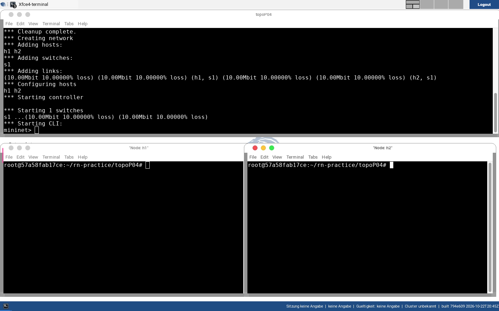
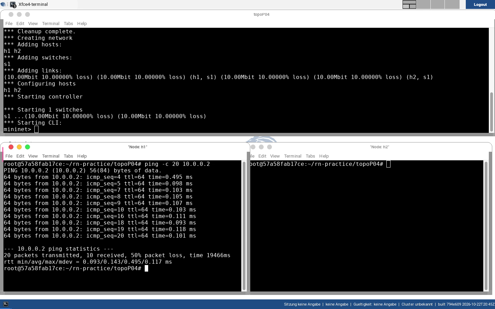
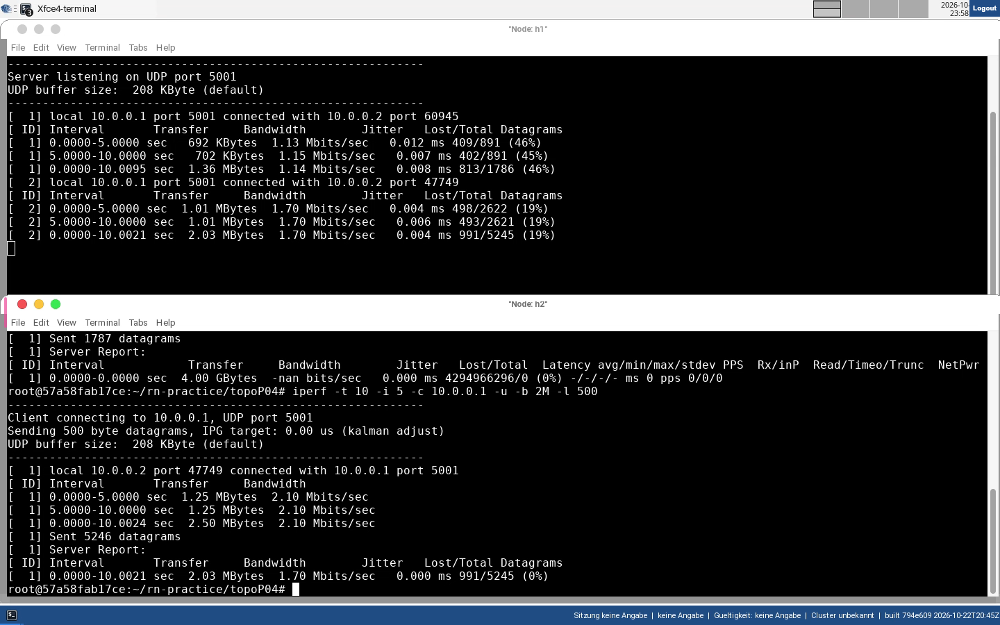
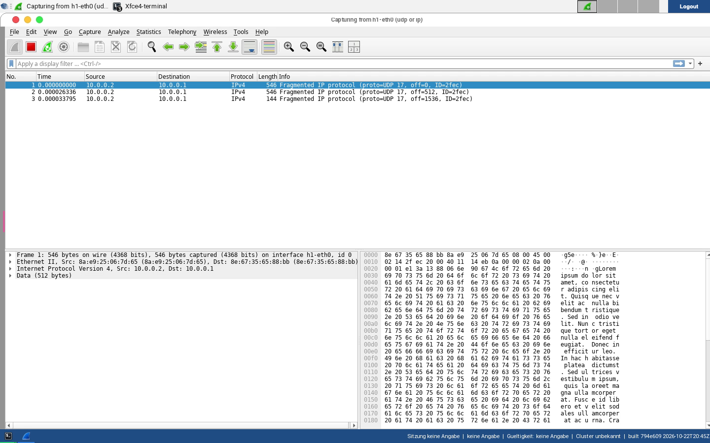

# Meilenstein 1 von 4 · Fehlerrate, MTU und Fragmentierung

*04 · TCP/UDP & Congestion Control* · [Übersicht des Blatts](index.md)

Auf dieser Seite untersucht ihr, wie Paketverlust und eine kleine MTU Ping, UDP und TCP beeinflussen.

<div class="schichtenbild" style="max-width:20rem;margin:0 0 1.2em 0;font-size:.72rem;line-height:1.5">
<div style="margin-bottom:.3em;color:#757575">In diesen Schichten des TCP/IP-Modells bewegt ihr euch hier:</div>
<div style="display:grid;gap:3px">
<div style="padding:.2em .7em;border-radius:3px;color:#9e9e9e;border:1px dashed #9e9e9e">Anwendungsschicht</div>
<div style="padding:.2em .7em;border-radius:3px;background:#c5cae9;color:#1a237e;border:1px solid #9fa8da">Transportschicht · beteiligt</div>
<div style="padding:.2em .7em;border-radius:3px;background:#3f51b5;color:#fff;font-weight:600;border:1px solid #3f51b5">Netzwerkschicht · Schwerpunkt</div>
<div style="padding:.2em .7em;border-radius:3px;background:#c5cae9;color:#1a237e;border:1px solid #9fa8da">Netzzugriffsschicht · beteiligt</div>
</div>
</div>

### Teil A — Fehlerrate, MTU und IP-Fragmentierung (`topoP04`)

!!! abstract "Auf einen Blick"
    **Lernziel:** Ihr könnt vorab ausrechnen, wie viele Pakete ein Link mit
    10 % Fehlerrate bei `ping` und bei UDP verliert, und ihr erkennt im
    Mitschnitt, wann und warum ein IP-Paket in Fragmente zerlegt wird.

    **Wozu?** Funkstrecken (WLAN, Mobilfunk, Satellit) verlieren Pakete, ohne
    dass ein Kabel defekt ist. Wer als Admin eine Videokonferenz oder einen
    VPN-Tunnel betreut, muss wissen, wie viel Verlust die Anwendung verträgt.
    Ein VPN-Tunnel verkleinert außerdem die nutzbare Paketgröße (MTU). Große
    UDP-Pakete werden dann fragmentiert, und ein einziges verlorenes
    Fragment kostet die ganze Nachricht. „Es geht nur manchmal“ ist das
    typische Symptom.

    **Vorwissen:** Terminals der Mininet-Knoten und `ping` aus
    [Blatt 01](../01-netzwerkgrundlagen-tools/index.md), MTU und Fragmentierung aus
    [Blatt 02, Teil 3](../02-subnetting-arp/m2-adressplan.md#teil-3-vertiefung-optional-mtu-und-fragmentierung-topop04).

#### Die Topologie

Startet das Setup im Aufgabenverzeichnis:

```bash
$ cd ~/rn-practice/topoP04
$ ./start-topoP04.sh
```

Es öffnet sich ein Fenster `topoP04` mit dem Mininet-Prompt `mininet>` und
zwei Terminals „Node: h1“ und „Node: h2“. Tippt immer erst in das Fenster, in
das ihr gerade tippen wollt: Eingaben und ++ctrl+c++ wirken nur im
fokussierten Fenster, und nach einem Fensterwechsel geht oft der erste
Buchstabe verloren. Wie ihr Fenster wiederfindet, steht unter
[Fenster wiederfinden und tippen](../../reference/umgebung.md#fenster-wiederfinden-und-tippen).


*Nach dem Start: das Mininet-Fenster oben, darunter die Terminals der beiden
Hosts. Die Zeilen `10.00Mbit 10.00000% loss` zeigen die Eigenschaften der
beiden Links.*

Die Topologie besteht aus `h1` (`10.0.0.1`), `h2` (`10.0.0.2`) und einem
Switch. Beide Host-Switch-Verbindungen sind auf 10 Mbit/s, eine MTU von
536 Byte und 10 % Paketverlust eingestellt. Der Verlust gilt für jede
Verbindung in jeder Richtung. Die Startausgabe nennt nur Bandbreite und
Verlust; die MTU könnt ihr mit `h1$ ip link show h1-eth0` nachlesen
(`mtu 536`).

#### Schritt 1: Verlust mit `ping` sichtbar machen

!!! info "Werkzeug: `ping`"
    `ping` schickt ICMP-Echo-Anfragen an einen Rechner und misst, ob und wie
    schnell die Antwort zurückkommt (Schicht 3, Vermittlungsschicht). Ihr
    kennt es aus Blatt 01. Hier braucht ihr zwei Optionen:

    | Aufruf | Bedeutung |
    |---|---|
    | `ping -c 20 <ziel>` | genau 20 Anfragen senden, dann Zusammenfassung ausgeben |
    | `ping -D <ziel>` | jeder Antwortzeile einen Unix-Zeitstempel voranstellen |

    Eine Ausgabe aus diesem Blatt, Zeile für Zeile gelesen:

    ```text
    64 bytes from 10.0.0.2: icmp_seq=4 ttl=64 time=0.495 ms
    20 packets transmitted, 10 received, 50% packet loss, time 19466ms
    rtt min/avg/max/mdev = 0.093/0.143/0.495/0.117 ms
    ```

    - `icmp_seq=4`: laufende Nummer der Anfrage. **Fehlen Nummern in der
      Folge, sind die zugehörigen Pakete verloren gegangen.**
    - `ttl=64`: wie viele Router das Paket noch hätte durchqueren dürfen.
    - `time=0.495 ms`: Umlaufzeit (Round-Trip-Time) dieser einen Anfrage.
    - `50% packet loss`: Anteil der Anfragen ohne Antwort.
    - `rtt min/avg/max/mdev`: kleinste, mittlere, größte Umlaufzeit und die
      Standardabweichung (ein Maß für die Streuung, auch **Jitter** genannt).

    Typische Fehlermeldung: `Destination Host Unreachable` heißt, dass für
    das Ziel keine Adresse aufgelöst oder keine Route gefunden wurde. Das ist
    etwas anderes als Paketverlust, bei dem einfach keine Zeile erscheint.

**Vorgemacht.** Wir senden 20 Anfragen von `h1` zu `h2`:

```bash
h1$ ping -c 20 10.0.0.2
```


*Ping über die verlustbehaftete Verbindung. In diesem Lauf fehlen die
Nummern 1 bis 3, 6, 11 bis 15 und 17: 50 % Verlust. In anderen Läufen liegt
der Wert meist zwischen 15 % und 55 %, im Mittel über viele Läufe bei 34 %.*

Mit `-D` seht ihr die Lücken zusätzlich an den Zeitstempeln:

```bash
h1$ ping -c 20 -D 10.0.0.2
```

**Erklärung.** Warum liegt der Verlust nicht bei 10 %? Eine Echo-Anfrage und
ihre Antwort müssen zusammen vier Teilstrecken überstehen: `h1` → Switch,
Switch → `h2` (Anfrage), `h2` → Switch, Switch → `h1` (Antwort). Jede Teilstrecke
lässt 90 % der Pakete durch. Beide Hälften der Reise müssen gelingen:

```text
Erfolgsrate = 0,9 · 0,9 · 0,9 · 0,9 = 0,656      Verlust = 1 − 0,656 ≈ 34 %
```

Bei nur 20 Anfragen schwankt der Zufall stark (typisch ±10 Prozentpunkte um
34 %), deshalb liegen einzelne Läufe zwischen etwa 15 und 55 %. Je mehr
Anfragen, desto näher liegt der Wert an 34 %: Probiert
`ping -c 100 -i 0.2 10.0.0.2`. Die erste Antwort kann dabei deutlich länger
dauern (bis etwa eine Sekunde); das ist der Verbindungsaufbau (ARP), kein
Fehler.

**Selbst.** Wiederholt den Lauf dreimal und notiert die Verlustrate. Liegen
eure Werte in der Spannweite? Bildet den Mittelwert über eure Läufe und
vergleicht ihn mit 34 %.

!!! question "Nachgedacht: Was würde sich ändern, wenn nur ein Link 10 % Verlust hätte?"
    Überlegt vorab, welcher Verlust bei `ping` dann zu erwarten wäre.

    ??? success "Lösung"
        Dann müssten Anfrage und Antwort nur je eine verlustbehaftete Strecke
        überstehen: `1 − 0,9 · 0,9 = 19 %`. Mit zwei verlustbehafteten Links
        und je zwei Richtungen sind es vier Strecken, also 34 %.

#### Schritt 2: UDP und TCP unter Verlust vergleichen

!!! info "Werkzeug: `iperf` (Version 2)"
    `iperf` misst den Datendurchsatz zwischen zwei Rechnern. Ein Rechner läuft
    als Server, der andere als Client und sendet Daten (Schicht 4,
    Transportschicht). Ihr braucht diese Optionen:

    | Aufruf | Bedeutung |
    |---|---|
    | `iperf -s` | Server starten (TCP, Port 5001) |
    | `iperf -s -u` | Server für UDP |
    | `iperf -c <server>` | Client: Daten an den Server senden |
    | `-t 10` | 10 Sekunden lang senden |
    | `-i 2` | alle 2 Sekunden eine Zwischenzeile ausgeben |
    | `-u -b 2M` | UDP mit einer festen Senderate (Option `-b`, hier 2 M) |
    | `-l 500` | Datagramme mit 500 Byte Nutzlast statt 1470 Byte |

    Eine UDP-Ausgabe des **Servers**, Zeile für Zeile gelesen:

    ```text
    [ ID] Interval       Transfer     Bandwidth        Jitter   Lost/Total Datagrams
    [  2] 0.0000-5.0000 sec  1.01 MBytes  1.70 Mbits/sec   0.004 ms 498/2622 (19%)
    ```

    - `Interval`: Zeitfenster der Zeile in Sekunden.
    - `Transfer`, `Bandwidth`: was im Fenster **beim Server ankam**.
    - `Jitter`: Schwankung der Ankunftsabstände.
    - `Lost/Total`: 498 von 2622 gesendeten Datagrammen kamen nicht an (19 %).

    **Wichtig:** Maßgeblich ist immer die Server-Seite. Die Zeile „Server
    Report“, die der Client am Ende ausgibt, kann hier unbrauchbare Werte
    zeigen: meist stimmen die Zähler, aber die Prozentangabe lautet `(0%)`
    trotz Verlust; in anderen Läufen kommen riesige Verlustzahlen wie
    `4294966296/0`, `-nan bits/sec` oder das Intervall `0.0000-0.0000 sec`
    vor. Der Grund: Auch dieser Bericht muss über den verlustbehafteten Link.
    Das ist eine Eigenheit der Client-Ausgabe von
    `iperf` (Version 2), kein Messwert; lest den Verlust nur am Server ab, oder
    messt UDP mit `iperf3 -u` ([Teil H](m4-udp-bufferbloat-algorithmen.md#teil-h-udp-vermessen-jitter-und-verlust-mit-iperf3-u-topo02), `topo02`). Beim iperf-Parameter `-b` steht `M` für
    1 048 576 Bit/s, nicht für 1 000 000.

    Typische Fehlermeldung: `connect failed: Connection refused` (oder
    `tcp connect … failed`) heißt, dass auf dem Zielrechner kein Server
    läuft. Startet zuerst den Server.

**Vorgemacht, UDP.** Wir senden bewusst nur 2 Mbit/s, weit unter der
Kapazität von 10 Mbit/s. So misst ihr den Verlust durch die Fehlerrate, nicht
durch Überlast. Zuerst mit den iperf-Standarddatagrammen (1470 Byte), dann mit
Datagrammen von 500 Byte:

```bash
h1$ iperf -i 5 -s -u
h2$ iperf -t 10 -i 5 -c 10.0.0.1 -u -b 2M
h2$ iperf -t 10 -i 5 -c 10.0.0.1 -u -b 2M -l 500
```


*Die beiden UDP-Läufe aus Sicht des Servers (oben, Spalte `Lost/Total`): 46 %
Verlust mit 1470-Byte-Datagrammen, 19 % mit 500-Byte-Datagrammen. Die
Client-Fenster darunter zeigen die unzuverlässige „Server Report“-Zeile.*

**Erklärung.** Mit `-l 500` passt jedes Datagramm in ein Paket (500 Byte
Nutzlast + 28 Byte Kopf ≤ MTU 536). Es muss zwei Teilstrecken überstehen:
`1 − 0,9² = 19 %`. Ein 1470-Byte-Datagramm passt nicht und wird in **drei
Fragmente** zerlegt. Jedes Fragment muss zwei Teilstrecken überstehen, und nur
wenn alle drei ankommen, ist das Datagramm vollständig:
`1 − 0,81³ ≈ 47 %`. Erwartet bei 2 Mbit/s: etwa 43 bis 51 % mit dem
Standard, 18 bis 21 % mit `-l 500`. UDP bemerkt den Verlust nicht und gleicht
ihn nicht aus.

!!! tip "Senderate nicht zu hoch wählen"
    Mit `-b 5M` bricht die Ausgabe des Servers nach etwa 8 Sekunden auf
    `0.000 Bytes` ab, bei `-b 20M` schon nach etwa 5 Sekunden. Der Empfänger
    hebt unvollständig angekommene Fragmente auf, um sie vielleicht noch zu
    ergänzen. Sein Speicher dafür ist auf etwa 4 MiB begrenzt. Ist er voll,
    verwirft der Kernel alle weiteren Fragmente, bis die alten nach 30 Sekunden
    verfallen. Bei 2 Mbit/s tritt das nicht auf.

**Vorgemacht, TCP.** Dieselbe Strecke mit TCP. Beendet vorher den laufenden
UDP-Server auf `h1` mit ++ctrl+c++:

```bash
h1$ iperf -s
h2$ iperf -t 10 -i 2 -c 10.0.0.1
```

Ausgabe des Clients (`h2`) in einem Lauf:

```text
[ ID] Interval       Transfer     Bandwidth
[  1] 0.0000-2.0000 sec   105 KBytes   430 Kbits/sec
[  1] 2.0000-4.0000 sec  31.7 KBytes   130 Kbits/sec
[  1] 4.0000-6.0000 sec  0.000 Bytes  0.000 bits/sec
[  1] 6.0000-8.0000 sec  0.000 Bytes  0.000 bits/sec
[  1] 8.0000-10.0000 sec  31.7 KBytes   130 Kbits/sec
[  1] 0.0000-20.4582 sec   168 KBytes  67.4 Kbits/sec
```

TCP erreicht in der Summe nur etwa 40 bis 130 Kbit/s, also rund ein
Hundertstel der 10 Mbit/s. Mehrere Zwei-Sekunden-Intervalle zeigen 0 Bit/s. Die
Zeile „0.0000-20.4582 sec“ ist länger als die 10 Sekunden, die ihr
angefordert habt: Der Client wartet, bis alle gesendeten Daten bestätigt sind.
Warum das so ist, klärt [Teil C](m2-durchsatz-und-staukontrolle.md#teil-c-das-tcp-congestion-window-unter-paketverlust-live-beobachten-topop04).

**Selbst.** Passen diese Messwerte zu euren Erwartungen? Vergleicht UDP und
TCP: Wie wirkt sich dieselbe Fehlerrate von 10 % auf beide Protokolle aus?

!!! question "Nachgedacht: Warum verliert UDP „nur“ etwa die Hälfte, TCP aber fast alles?"
    ??? success "Lösung"
        UDP sendet mit fester Rate weiter und nimmt Verlust hin. Die Hälfte
        der Datagramme kommt an. TCP behandelt jeden Verlust als Zeichen von
        Überlast, verkleinert sein Sendefenster und wartet auf
        Neuübertragungen (Timeouts). Bei 10 % Verlust auf vier Teilstrecken
        trifft das fast jedes Fenster. Der Durchsatz sinkt auf wenige
        Prozent der Linkrate. Die Zahlen dazu seht ihr in [Teil C](m2-durchsatz-und-staukontrolle.md#teil-c-das-tcp-congestion-window-unter-paketverlust-live-beobachten-topop04).

#### Schritt 3: Zu große Nachrichten bei UDP

Da die MTU auf 536 Byte begrenzt ist, wird jedes IP-Paket, das größer als
diese Grenze ist, in **Fragmente** zerlegt. Im Verzeichnis `topoP04` liegen
zwei Textdateien, `MehrAls500ByteText.txt` (632 Byte) und
`MehrAls1500ByteText.txt` (1638 Byte); die Namen nennen nur eine
Größenordnung, nicht die Bytezahl. Die Knoten-Terminals öffnen sich im
Verzeichnis `~/rn-practice/topoP04`, `ls` zeigt beide Dateien. Ihr schickt sie
als UDP-Nachricht.

!!! info "Werkzeug: `nc` (netcat)"
    `nc` schickt Text von der Tastatur oder aus einer Datei an eine
    Rechner/Port-Kombination und gibt Empfangenes aus (Schicht 4, UDP oder
    TCP). Ihr braucht diese Formen:

    | Aufruf | Bedeutung |
    |---|---|
    | `nc -lu 5000` | auf UDP-Port 5000 lauschen und Empfangenes anzeigen |
    | `nc -u 10.0.0.1 5000 < datei` | den Inhalt der Datei per UDP senden |
    | `nc -l 5000` | auf TCP-Port 5000 lauschen |
    | `nc -N 10.0.0.1 5000 < datei` | per TCP senden, danach die Verbindung beenden |

    Empfangener Text erscheint im Server-Terminal, zum Beispiel der Anfang
    der Datei: `Lorem ipsum dolor sit amet, consectetur …`. Mit Strg+C beendet
    ihr `nc`. Ein UDP-`nc` nimmt nach der ersten Nachricht nur noch Daten vom
    selben Absender an. Startet es also für jeden neuen Versuch neu.

!!! info "Werkzeug: Wireshark im Mininet-Knoten"
    Wireshark zeichnet Pakete auf einer Schnittstelle auf und zeigt sie
    aufgeschlüsselt nach Schichten (siehe Blatt 01). In einem Knoten-Terminal
    startet ihr es für genau die Schnittstelle dieses Knotens:

    | Aufruf | Bedeutung |
    |---|---|
    | `wireshark -i h1-eth0 -k &` | Aufzeichnung auf `h1-eth0` sofort starten, im Hintergrund |

    Im oberen Fenster steht je Paket eine Zeile (laufende Nummer, Zeit,
    Quelle, Ziel, Protokoll, Länge, Info). Im unteren Fenster klappt ihr die
    Schichten des gewählten Pakets auf. Im Prompt erscheinen Zeilen wie
    `Capture Start …`, das ist normal.

**Vorgemacht.** Beendet zuerst den noch laufenden Server auf `h1` (++ctrl+c++;
vorher in das Fenster `Node: h1` klicken).
Wir starten Wireshark und den Empfänger auf `h1`, dann sendet `h2` den
längeren Text:

```bash
h1$ wireshark -i h1-eth0 -k &
h1$ nc -lu 5000
h2$ nc -u 10.0.0.1 5000 < MehrAls1500ByteText.txt
```

Jeder Versuch besteht aus drei Schritten:

1. Auf `h1` den Empfänger neu starten (`h1$ nc -lu 5000`).
2. Auf `h2` senden (`h2$ nc -u 10.0.0.1 5000 < MehrAls1500ByteText.txt`).
3. Nach etwa 2 Sekunden auf beiden Seiten ++ctrl+c++ drücken.

Wireshark öffnet sich und kann die Knotenfenster verdecken. Holt
`Node: h1` und `Node: h2` über die Fensterliste oben links nach vorn und klickt
in das jeweilige Fenster, bevor ihr tippt; sonst landen Eingaben im
Wireshark-Suchfeld oder im falschen Knoten.

Erscheint der Text auf `h1`, ist der Versuch geglückt, sonst nicht. Ohne den
Neustart auf `h1` nimmt der Empfänger nach dem ersten Erfolg nichts mehr an,
obwohl Wireshark alle Fragmente zeigt. Wiederholt das Senden einige Male. Der Text
(1638 Byte) wird in vier Fragmente zerlegt. Im Mitschnitt zeigt
Wireshark sie als `Fragmented IP protocol`:


*Mehrere Sendeversuche in einem Mitschnitt. Jede vollständige Gruppe besteht
aus Fragmenten mit `off=0`, `512`, `1024` (je 512 Byte Nutzlast) und
`off=1536`. Wireshark setzt sie zur UDP-Zeile `Len=1638` zusammen
(`[Reassembled in #8]`). Die Gruppe mit `ID=cf2c` ist unvollständig: Das
Fragment `off=1024` fehlt.*

Genau das ist das Problem der Fragmentierung. Fehlt ein Fragment, kann der
Empfänger nichts zusammensetzen und verwirft die ganze Nachricht. Nach etwa
30 Sekunden meldet er dem Absender per ICMP (`Time-to-live exceeded
(Fragment reassembly time exceeded)`, in der Abbildung die dunkle Zeile),
dass das Zusammensetzen aufgegeben wurde. Ein Mitschnitt, der nur drei Fragmente
zeigt, sieht so aus:


*Ein Sendeversuch, bei dem das dritte Fragment (`off=1024`) unterwegs verloren
ging. Der Empfänger bekommt keine UDP-Nachricht.*

**Erwartung.** Der kürzere Text (632 Byte) besteht aus zwei Fragmenten
(IP-Längen 532 und 148 Byte), der längere (1638 Byte) aus vier. Jedes
Fragment übersteht die Strecke mit `0,9² = 81 %`. Der Text kommt also mit
`0,81² ≈ 66 %` (zwei Fragmente) bzw. `0,81⁴ ≈ 43 %` (vier Fragmente) an. Meist
braucht ihr einige Versuche, bis der Text im `nc`-Fenster erscheint. Bei nur
fünf Versuchen streut die Zahl der Erfolge stark: Auch 0 bis 5 Erfolge sind
möglich, und in Messläufen lagen sie bei beiden Dateien oft unter der
Erwartung.

**Selbst.** Sendet beide Dateien (`MehrAls500ByteText.txt` und
`MehrAls1500ByteText.txt`) jeweils fünfmal, jedes Mal mit Neustart des
Empfängers, und zählt, wie oft der Text ankommt. Wiederholt das Experiment dann
mit TCP (beendet vorher den UDP-`nc` auf `h1` mit ++ctrl+c++):

```bash
h1$ nc -l 5000
h2$ nc -N 10.0.0.1 5000 < MehrAls1500ByteText.txt
```

Betrachtet den Mitschnitt: Gibt es IP-Fragmente? Erklärt (Stichwort: MSS), was
TCP anders macht.

!!! question "Nachgedacht: Warum entstehen bei TCP keine IP-Fragmente?"
    ??? success "Lösung"
        Im Mitschnitt tragen die TCP-Segmente das Flag `DF` (Don't Fragment).
        Nach der vereinbarten MSS trägt jedes Segment höchstens 484 Byte
        Nutzlast (IP-Länge 536 Byte), und so viel darf auf der Leitung
        höchstens ankommen. Der Mitschnitt kann davon abweichen: Er zeigt
        mitunter einzelne größere Segmente (etwa `Len=968` oder `Len=1638`
        bei MSS 496, IP-Länge über 536). Vermutlich sind mehrere
        aufeinanderfolgende Segmente beim Empfang zusammengefasst worden
        (GRO/Offload), bevor der Mitschnitt sie sieht; belegt ist das hier
        nicht.
        Verlasst euch deshalb auf die im SYN angekündigte MSS und darauf, dass
        keine IP-Fragmente auftreten. Die Nachricht
        kommt in allen Versuchen vollständig an; die Dauer (gemessen mit
        `time nc -N …`) reicht von wenigen Millisekunden bis etwa einer
        Sekunde, denn `nc` endet schon nach dem Schreiben. Beim
        Verbindungsaufbau handeln die Partner die **MSS** (Maximum Segment
        Size) aus: die größte Nutzlast, die in ein Paket der Pfad-MTU passt
        (hier mit `mss 496` im SYN-Paket angekündigt). TCP zerlegt den
        Datenstrom selbst in Segmente dieser Größe, IP muss nichts
        fragmentieren. Geht ein Segment verloren, sendet TCP nur dieses Segment
        erneut (im Mitschnitt kann ein Segment wie `seq 1:485` zweimal
        erscheinen), nicht die ganze Nachricht.

**Hintergrund:** IP-Fragmentierung wird in modernen Netzwerken aus mehreren
Gründen oft vermieden oder deaktiviert:

- **Leistungsprobleme:** Fragmentierung und Reassemblierung erfordern
  zusätzliche Verarbeitung durch Router und Endgeräte und können die
  Netzwerkleistung beeinträchtigen.
- **Sicherheitsbedenken:** Fragmentierte Pakete können missbraucht werden, um
  Firewalls und Intrusion-Detection-Systeme zu umgehen oder zu überlasten.
- **Komplexität:** Die Handhabung fragmentierter Pakete erhöht die
  Komplexität von Netzwerkgeräten und -protokollen; Implementierungs- oder
  Konfigurationsfehler können zu verlorenen oder unvollständigen Paketen
  führen.
- **Unzuverlässigkeit:** Geht ein Fragment verloren, muss das gesamte
  ursprüngliche Paket erneut gesendet werden, selbst wenn andere Fragmente
  bereits erfolgreich übertragen wurden.
- **Path MTU Discovery:** Statt Fragmentierung zuzulassen, ermitteln viele
  Netzwerke heute per Path MTU Discovery die maximale Übertragungseinheit
  entlang des Pfades, sodass Endgeräte von vornherein passend große Pakete
  senden.
- **IPv6:** Bei IPv6 ist Fragmentierung durch Zwischenrouter nicht mehr
  erlaubt; Endgeräte sind selbst dafür verantwortlich, Pakete in
  akzeptabler Größe zu senden.
- **Quality of Service:** Fragmentierte Pakete können die QoS beeinträchtigen,
  da Reihenfolge und Vollständigkeit nicht garantiert sind.

Im Gegenzug müssen Endgeräte und Anwendungen Pakete innerhalb der Pfad-MTU
senden.

!!! success "Meilenstein 1 geschafft"
    **Das habt ihr gelernt:**

    - Den Verlust eines Links mit 10 % Fehlerrate bei ping und UDP vorab ausrechnen.
    - Im Mitschnitt erkennen, wann und warum ein IP-Paket fragmentiert wird.
    - Begründen, warum der Verlust eines Fragments die ganze Nachricht kostet.

    **Was Meilenstein 2 verspricht:** Als Nächstes misst ihr mit iperf Durchsatz und Latenz und seht, wie TCP bei Konkurrenz und Verlust reagiert. Ihr lest außerdem das Congestion Window einer laufenden Verbindung ab.

    [Weiter zu Meilenstein 2: Durchsatz und Staukontrolle](m2-durchsatz-und-staukontrolle.md){ .md-button }
