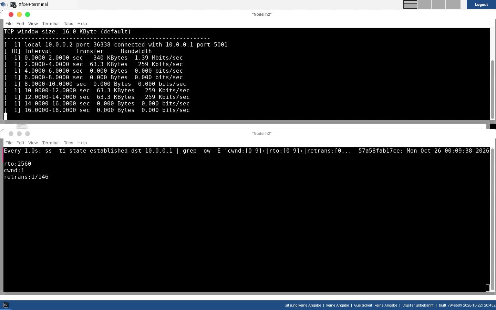

# Meilenstein 2 von 4 · Durchsatz und Staukontrolle

*04 · TCP/UDP & Congestion Control* · [Übersicht des Blatts](index.md)

Hier messt ihr Durchsatz und Latenz einer Strecke und beobachtet, wie TCP sein Sendefenster anpasst.

<div class="schichtenbild" style="max-width:20rem;margin:0 0 1.2em 0;font-size:.72rem;line-height:1.5">
<div style="margin-bottom:.3em;color:#757575">In diesen Schichten des TCP/IP-Modells bewegt ihr euch hier:</div>
<div style="display:grid;gap:3px">
<div style="padding:.2em .7em;border-radius:3px;color:#9e9e9e;border:1px dashed #9e9e9e">Anwendungsschicht</div>
<div style="padding:.2em .7em;border-radius:3px;background:#3f51b5;color:#fff;font-weight:600;border:1px solid #3f51b5">Transportschicht · Schwerpunkt</div>
<div style="padding:.2em .7em;border-radius:3px;background:#c5cae9;color:#1a237e;border:1px solid #9fa8da">Netzwerkschicht · beteiligt</div>
<div style="padding:.2em .7em;border-radius:3px;color:#9e9e9e;border:1px dashed #9e9e9e">Netzzugriffsschicht</div>
</div>
</div>

### Teil B — iperf/iperf3 in `topo02`: Durchsatz, Latenz, Fairness und Congestion Control

!!! abstract "Auf einen Blick"
    **Lernziel:** Ihr könnt Durchsatz und Latenz einer Strecke messen,
    vorab abschätzen und die Abweichung begründen. Ihr beobachtet, wie sich
    TCP bei Konkurrenz, bei einem unkooperativen UDP-Strom und bei einer
    Pfadunterbrechung verhält.

    **Wozu?** „Das Netz ist langsam“ ist die häufigste Störungsmeldung. Mit
    `iperf` und `ping` unterscheidet ihr, ob die Leitung wirklich zu klein
    ist, ob ein anderer Datenstrom sie belegt oder ob eine volle
    Warteschlange (Bufferbloat) die Latenz hochtreibt. Wer das messen kann,
    erkennt auch, ob eine Telefonkonferenz oder ein Backup auf einer
    Strecke vertretbar ist.

    **Vorwissen:** `iperf`, `ping` und die Knoten-Terminals aus [Teil A](m1-fehlerrate-mtu.md#teil-a-fehlerrate-mtu-und-ip-fragmentierung-topop04),
    Routing aus Blatt 03.

Die Messungen laufen auf einer **verlustfreien** Strecke mit mehreren Hosts und
Routern: `topo02`, dieselbe Vier-Host-Topologie wie in [Blatt 05](../05-arp-spoofing-dos/index.md).

```text
h0 (10.0.10.10) --+                        +-- h2 (10.0.20.10)
                  s1 -- r1 ==10 Mbit/s== r2 -- s2
h1 (10.0.10.11) --+                        +-- h3 (10.0.20.11)
```

Nur die Verbindung zwischen `r1` und `r2` ist auf 10 Mbit/s begrenzt.
**Zuerst die laufende Topologie beenden:** Tippt im Mininet-Terminal von
`topoP04` (in der Fensterliste „Terminal“, siehe [Teil A](m1-fehlerrate-mtu.md#teil-a-fehlerrate-mtu-und-ip-fragmentierung-topop04)) `mininet> exit` und wartet, bis alle „Node: …“-Fenster
verschwunden sind. Erst dann startet ihr diese Topologie; zwei Topologien
gleichzeitig vertragen sich nicht, das Startskript räumt alles auf, was es
findet, auch die noch laufende.

```bash
$ cd ~/rn-practice/topo02
$ ./start-topo02.sh
```

Es öffnen sich Terminals für `r1`, `h0`, `h1`, `h2` und `h3`. Ein weiteres
Terminal für einen Knoten öffnet ihr mit `mininet> xterm h0`; danach hat das
neue Fenster den Fokus. Die Fenster liegen anfangs übereinander. Prüft vor
jeder Eingabe den Fenstertitel, klickt ins Fenster und wartet kurz: Eingaben und
++ctrl+c++ wirken nur im fokussierten Fenster, und der erste Buchstabe geht nach
einem Fensterwechsel leicht verloren. Die Fensterliste („Xfce4-terminal“ oben
links oder das Symbol unten links; Name anklicken, ✕ schließt das Fenster)
ändert ihre Reihenfolge nach jedem Topologiestart: Lest die Namen. Tipp: Ordnet
die Fenster einmal nebeneinander (Titelleiste ziehen); so arbeiten auch
Netzwerkadmins mit mehreren Konsolen
([Fenster wiederfinden und tippen](../../reference/umgebung.md#fenster-wiederfinden-und-tippen)).

**Vorgemacht, Schritt 1: Erwartungswert bilden, dann Durchsatz messen.** Die
Verbindung erlaubt nominell 10 Mbit/s. In 30 Sekunden sollten sich also
`10 Mbit/s · 30 s = 300 Mbit` übertragen lassen, das sind 37,5 Megabyte
(10⁶ Byte) oder 35,8 MiB. `iperf` zählt „MBytes“ zu je 1 048 576 Byte (also
MiB). Rechnet deshalb immer erst in Bit. Messung:

```bash
h2$ iperf -i 10 -s
h0$ iperf -t 30 -i 10 -c 10.0.20.10
```

Ausgabe des Clients (`h0`):

```text
[ ID] Interval       Transfer     Bandwidth
[  1] 0.0000-10.0000 sec  14.8 MBytes  12.4 Mbits/sec
[  1] 10.0000-20.0000 sec  11.7 MBytes  9.77 Mbits/sec
[  1] 20.0000-30.0000 sec  10.5 MBytes  8.82 Mbits/sec
[  1] 30.0000-32.5046 sec  62.7 KBytes   205 Kbits/sec
[  1] 0.0000-32.5046 sec  37.0 MBytes  9.56 Mbits/sec
```

Umgerechnet: 37,0 MBytes · 8,389 Mbit/MByte ≈ 310 Mbit, geteilt durch die
tatsächliche Dauer von 32,5 Sekunden ergibt 9,56 Mbit/s (bei euch etwa 32
bis 34 Sekunden). Das passt zum
Erwartungswert, denn in der Praxis kommen nur etwa 9,5 Mbit/s als Nutzdaten an
(Köpfe: 1448 von 1514 Byte, 95,6 %). Die Zeile läuft über 30 Sekunden hinaus, weil der
Client wartet, bis alle Daten bestätigt sind (wie in [Teil A](m1-fehlerrate-mtu.md#teil-a-fehlerrate-mtu-und-ip-fragmentierung-topop04)). Das erste Intervall zeigt mit 12 bis 15 Mbit/s (hier 12,4) mehr als die
Link-Kapazität: Der Client zählt auch das, was noch in Sende- und
Router-Puffern wartet. Auf der Server-Seite (`h2`) liegt der Wert bei
9,1 bis 9,6 Mbit/s je Zehn-Sekunden-Intervall.

**Selbst.** Wiederholt die Messung mit einer auf 536 Byte reduzierten maximalen
Segmentgröße:

```bash
h0$ iperf -M 536 -l 1 -t 10 -i 5 -c 10.0.20.10
```

Bildet vorher eine These, wie sich die kleinere Segmentgröße auf den Durchsatz
auswirken sollte, und gleicht sie mit dem Ergebnis ab. Messt zum Vergleich auch
nur mit `-M 536`, ohne `-l 1`:

```bash
h0$ iperf -M 536 -t 10 -i 5 -c 10.0.20.10
```

??? success "Erwartung und Lösung"
    Gemessen mit `-M 536 -l 1`: etwa 2,4 bis 4,5 Mbit/s (je nach Rechner),
    also die Hälfte oder weniger von vorher. Zwei Ursachen wirken zusammen. Die kleinere
    Segmentgröße allein kostet nur wenig: Jedes Segment trägt nur 536 statt
    1448 Byte Nutzlast, aber den gleichen Kopf (rund 52 Byte), rechnerisch
    liefert die Leitung dann noch etwa 8,9 Mbit/s Nutzdaten (536 von 602 Byte
    auf der Leitung), also nur rund 7 % weniger. Den Einbruch auf die Hälfte
    verursacht fast vollständig `-l 1`: `iperf` übergibt jedes Byte einzeln an
    den Kernel, und der Sender schafft nicht genug Systemaufrufe je Sekunde.
    Der genaue Wert hängt von der Rechnerleistung ab.

**Schritt 2: Latenz und der Effekt einer konkurrierenden Übertragung.**
Startet auf `h1` einen fortlaufenden `ping` zu `h3` (und optional umgekehrt):

```bash
h1$ ping 10.0.20.11
h3$ ping 10.0.10.11
```

Beurteilt anhand der gemessenen Round-Trip-Time, ob eine Telefonkonferenz über
diese Verbindung praktikabel wäre (Richtwert: unter 150–200 ms). Bildet dann eine
Annahme, wie stark sich die Latenz verändert, wenn `h0` gleichzeitig einen
`iperf`-Strom zu `h2` startet (Stichwort: Pufferung auf gemeinsam genutzten
Verbindungen):

```bash
h0$ iperf -t 30 -i 10 -c 10.0.20.10
```

Prüft eure Annahme an der laufenden `ping`-Ausgabe auf `h1`. Der `ping` läuft,
bis ihr ihn mit ++ctrl+c++ beendet; lasst ihn für Schritt 3 laufen.

??? success "Erwartung und Lösung"
    Ohne Last: 0,3 bis 0,4 ms (die erste Antwort kann einige Millisekunden
    länger dauern). Mit dem `iperf`-Strom: **etwa 1,4 bis 3 Sekunden** (die Werte
    wachsen über die Laufzeit, in Messläufen bis etwa 3,4 s, auch in der
    Gegenrichtung auf `h3`), ohne dass ein Ping verloren geht. Von 0,3 ms auf
    Sekunden, ohne dass ein Paket verloren geht: Das erlebt ihr zu Hause, wenn
    beim Upload eines großen Videos der Videocall ruckelt. Der TCP-Strom füllt die Warteschlange vor dem
    10-Mbit/s-Link, und die Ping-Pakete warten hinter den Daten. Eine
    Telefonkonferenz wäre in dieser Zeit unmöglich. Den Effekt untersucht
    [Teil I](m4-udp-bufferbloat-algorithmen.md#teil-i-bufferbloat-warum-eine-schnelle-leitung-trage-werden-kann-topo02) genauer.

**Schritt 3: TCP gegen UDP im direkten Vergleich.** Der `iperf`-Server auf `h2`
darf weiterlaufen. Startet auf `h3` einen UDP-Server (in einem Terminal, in dem
nichts mehr läuft: Habt ihr in Schritt 2 optional `ping` auf `h3` gestartet,
beendet ihn dort zuerst mit ++ctrl+c++):

```bash
h3$ iperf -u -i 10 -s
```

Sendet von `h0` UDP-Verkehr mit steigender Rate zu `h3`, während `h1`
weiterhin `h3` anpingt:

```bash
h0$ iperf -u -b 8.6M -t 30 -i 10 -c 10.0.20.11
h0$ iperf -u -b 9.8M -t 30 -i 10 -c 10.0.20.11
h0$ iperf -u -b 100M -t 30 -i 10 -c 10.0.20.11
```

Beobachtet jeweils Durchsatz und Verlust auf `h3` (Server) sowie die Latenz auf
`h1`. Bei `-b 100M` überschreitet ihr die Link-Kapazität deutlich. Vergleicht
das Sendevolumen des Clients mit dem, was beim Server ankommt. Vereinzelte
„Out of Order“-Pakete bei UDP sind dabei normal. Die Zeile „Server Report“
des Clients kann auch hier `(0%)` trotz Verlust zeigen (siehe
[Teil A](m1-fehlerrate-mtu.md#teil-a-fehlerrate-mtu-und-ip-fragmentierung-topop04)); lest den Verlust am Server (`h3`) ab. Die Warnung
`WARNING: ack of last datagram failed` des Clients ist harmlos: Die Bestätigung
des Servers kam nicht mehr an (bei `100M` ist der Link voll).

??? success "Erwartung und Lösung"
    Denkt an `M = 1 048 576`: `8.6M` sind 9,02 Mbit/s (unter der Kapazität),
    `9.8M` sind 10,3 Mbit/s (darüber).

    | Rate | Ankunft am Server | Verlust | Ping-RTT auf `h1` |
    |---|---|---|---|
    | `8.6M` | 9,02 Mbit/s | 0 % | 0,3 bis 1,6 ms |
    | `9.8M` | höchstens 9,72 Mbit/s | zunächst 0 %, später einige Prozent | wächst über die Laufzeit von unter 1 ms bis auf deutlich über 500 ms |
    | `100M` | 9,72 Mbit/s | rund 90 % | bis 1,2 s, die meisten Pings gehen verloren (je nach Lauf etwa zwei Drittel bis neun Zehntel) |

    Der Link kann nie mehr als etwa 9,7 Mbit/s ausliefern. Der Überschuss geht
    verloren oder staut sich in der Warteschlange. Bei `9.8M` beträgt der
    Überschuss nur 0,56 Mbit/s und füllt die Warteschlange langsam (rechnerisch
    erst nach etwa 20 Sekunden voll); erst danach gehen Datagramme verloren.
    Eure Werte hängen davon ab, in welchem Intervall ihr schaut.

**Schritt 4: Pfadunterbrechung während einer laufenden TCP-Übertragung.**
Beendet zuerst den `ping` auf `h1` mit ++ctrl+c++. Startet erneut eine
TCP-Messung `h0` → `h2` und beobachtet parallel `h1$ ping 10.0.20.10`:

```bash
h0$ iperf -t 40 -i 5 -c 10.0.20.10
h1$ ping 10.0.20.10
```

Dieser Schritt ist zeitkritisch. Legt deshalb **vorher** die drei Fenster `h0`,
`h1` und `r1` nebeneinander (Titelleiste ziehen) und tippt in `r1` den Befehl
`ifconfig r1-eth0 down` schon ein, ohne ++enter++. Ist die Pause am Ende
zu kurz oder zu lang geraten, ist das kein Problem: TCP erholt sich in jedem
Fall (der Ablauf bleibt gleich, nur zieht sich die Erholung hin); wiederholt
den Versuch bei Bedarf. Deaktiviert dann nach etwa 10 Sekunden für
20 bis 30 Sekunden das Interface `r1-eth0` des Routers `r1` (Richtung `s1`, also
zu `h0` und `h1`) und aktiviert es danach wieder:

```bash
r1$ ifconfig r1-eth0 down
# 20-30 Sekunden warten, Client-/Server-/Ping-Ausgabe beobachten
r1$ ifconfig r1-eth0 up
```

Haltet fest, wie sich Iperf-Client (`h0`), Iperf-Server (`h2`) und der `ping`
auf `h1` jeweils während der Unterbrechung und nach der Wiederherstellung
verhalten.

??? success "Erwartung und Lösung"
    Die Übertragung **bricht nicht ab**. Der Client zeigt während der
    Unterbrechung `0.000 Bytes`, der Server ebenfalls. Der `ping` bekommt
    keine Antworten. Beachtet auch den Beginn: Der `ping` startet nicht bei
    0,3 ms, sondern schon bei etwa einer Sekunde, denn der laufende
    `iperf`-Strom hat die Warteschlange bereits gefüllt (wie in Schritt 2). Nach einigen Sekunden meldet `ping` mitunter
    `Destination Host Unreachable` von eurem eigenen Host (er findet das
    Gateway nicht mehr, ARP); in anderen Läufen bleibt es einfach still. Nach `ifconfig … up` kommen wieder Antworten, und
    die Daten fließen erst nach einigen Sekunden wieder (in Messläufen
    nach etwa 15 Sekunden und mehr), denn TCP wartet
    auf seinen Retransmission-Timer, und der verdoppelt sich bei jedem
    Fehlversuch. Die Endzeile des Clients erscheint dadurch deutlich später als
    nach den angeforderten 40 Sekunden (bis etwa 80 Sekunden); das ist normal.

**Schritt 5: Dieselbe Unterbrechung mit einer Anwendung (SSH) statt einem
rohen Iperf-Strom.**

!!! info "Werkzeug: `ssh` und `sshd`"
    `ssh` öffnet eine verschlüsselte Fernsitzung auf einem anderen Rechner
    (Schicht 7, Anwendung; sie läuft über eine TCP-Verbindung), `sshd` ist der
    zugehörige Server. Ihr braucht:

    | Aufruf | Bedeutung |
    |---|---|
    | `/usr/sbin/sshd -D -o StrictModes=no` | Server im Vordergrund starten; `-o StrictModes=no` schaltet die Dateirechte-Prüfung für das gemeinsame Home-Verzeichnis ab |
    | `ssh-keygen -t ed25519 -N "" -f <datei> -q` | Schlüsselpaar ohne Passwort erzeugen |
    | `ssh -i <schlüssel> <nutzer>@<ziel>` | mit diesem Schlüssel anmelden |

    Typische Fehlermeldung: `Permission denied (publickey)` heißt, dass der
    Server euren öffentlichen Schlüssel nicht in `authorized_keys` des
    Nutzers gefunden hat oder die Rechte der Dateien nicht stimmen.

Beendet zuerst den `iperf`-Server auf `h2` mit ++ctrl+c++ (das Terminal von
`h2` ist sonst noch belegt). Startet dann auf `h2` den SSH-Server:

```bash
h2$ /usr/sbin/sshd -D -o StrictModes=no
```

Ihr meldet euch als Nutzer `cads` an, dessen Passwort ihr nicht kennt. Erzeugt
deshalb auf `h0` ein Schlüsselpaar und tragt den öffentlichen Teil als
vertrauenswürdig ein (alle Knoten teilen sich dasselbe Dateisystem, `~/.ssh`
gilt also auch auf `h2`):

```bash
h0$ rm -f ~/.ssh/rn-practice-key ~/.ssh/rn-practice-key.pub
h0$ mkdir -p ~/.ssh && chmod 700 ~/.ssh
h0$ ssh-keygen -t ed25519 -N "" -f ~/.ssh/rn-practice-key -q
h0$ cat ~/.ssh/rn-practice-key.pub >> ~/.ssh/authorized_keys
h0$ chmod 600 ~/.ssh/authorized_keys
h0$ chown -R cads ~/.ssh
```

(Euer Knoten-Terminal ist `root`; der Nutzer `cads` muss die Datei
`authorized_keys` lesen dürfen, deshalb das `chown`.)

Verbindet euch dann von `h0` aus (die Rückfrage zum Host-Schlüssel mit `yes`
beantworten; steht dort der Zusatz „known by the following other names“, stammt
er vom gemeinsamen Home-Verzeichnis und ist harmlos) und prüft, auf welchem
Knoten ihr gelandet seid:

```bash
h0$ ssh -i ~/.ssh/rn-practice-key cads@10.0.20.10
ssh$ /sbin/ifconfig   # Interface h2-eth0 sichtbar?
```

Bildet eine Erwartung, wie sich die SSH-Sitzung bei derselben Pfadunterbrechung
verhalten sollte. Unterbrecht dann erneut `r1-eth0` wie in Schritt 4 und gebt in der
SSH-Sitzung währenddessen `date` ein. Stellt den Pfad danach wieder her. Beendet
die Sitzung anschließend mit `exit` (das beendet nur die SSH-Sitzung; `sshd -D`
belegt das Terminal von `h2` weiter, beendet ihn dort mit ++ctrl+c++).

??? success "Erwartung und Lösung"
    Die Sitzung **bleibt bestehen**. Während der Unterbrechung seht ihr weder die
    getippten Zeichen noch eine Antwort, die Sitzung wirkt eingefroren. Nach der Wiederherstellung
    kommt die Ausgabe von `date` nach einigen Sekunden. Der Zeitstempel ist
    der Moment, zu dem `h2` den Befehl tatsächlich ausgeführt hat, also nach
    der Wiederherstellung. Eine TCP-Verbindung hält eine Unterbrechung von
    Sekunden bis Minuten aus. Erst nach sehr vielen erfolglosen
    Neuübertragungen (Standard: rund 15 Minuten) bricht sie ab. Eure
    SSH-Sitzung überlebt also auch ein kurzes Funkloch im Zug.

**Schritt 6: Fairness zwischen zwei gleichzeitigen Verbindungen.** Beendet
zuerst in `h2` und `h3` alle noch laufenden Server (++ctrl+c++; auch `sshd` auf
`h2` und den UDP-Server auf `h3`). Startet dann Iperf-TCP-Server auf `h2` und
`h3` (`&`, damit ihr das Terminal weiterverwenden könnt). Einen solchen
Hintergrundjob beendet ihr später mit `kill %1` (`jobs` zeigt die Nummer). Seine
Ausgabe erscheint im selben Terminal mitten zwischen euren Eingaben; das ist
normal, ein Druck auf ++enter++ bringt den Prompt zurück:

```bash
h2$ iperf -i 10 -s
h3$ iperf -i 10 -s &
```

Startet zunächst nur `h0` → `h2`, wartet etwa 15 Sekunden und startet dann
zusätzlich `h1` → `h3`:

```bash
h0$ iperf -t 100 -i 10 -c 10.0.20.10
h1$ iperf -t 80 -i 10 -c 10.0.20.11
```

Wiederholt den Versuch mit einem TCP-Strom (`h0` → `h2`) neben einem
*unlimitierten* UDP-Strom mit etwa 105 Mbit/s (`-b 100M`, `h1` → `h3`, ohne
dass dafür ein eigener UDP-Server läuft; der UDP-Server aus Schritt 3 muss
also beendet sein):

```bash
h0$ iperf -t 30 -i 10 -c 10.0.20.10
h1$ iperf -u -b 100M -t 25 -i 10 -c 10.0.20.11
```

Vergleicht, wie fair sich TCP gegenüber einem konkurrierenden TCP-Strom verhält
und wie gegenüber einem unkooperativen UDP-Strom, der keine Rücksicht auf
Überlast nimmt.

??? success "Erwartung und Lösung"
    **TCP gegen TCP:** Beide Ströme teilen den Link, aber nicht sofort gleich.
    Der später gestartete Strom (`h1` → `h3`) liegt in den ersten 20 bis
    30 Sekunden bei nur 0,1 bis 1,5 Mbit/s, weil der erste Strom die
    Warteschlange schon gefüllt hat. Danach pendeln beide stark schwankend
    zwischen etwa 2 und 7 Mbit/s. Über 80 Sekunden gemittelt erreichen sie
    laut Client-Ausgabe etwa 7,4 Mbit/s (`h0`) und 2,7 Mbit/s (`h1`); lest die
    Werte besser am Server ab (`h2`, `h3`), denn der Client zählt auch das, was
    noch in Puffern steckt (Schritt 1), und die Summe liegt sonst über der
    Linkrate. **Faire Aufteilung stellt
    sich erst über längere Zeit ein.** Wundert euch nicht, wenn eure Zahlen anders
    aussehen als hier: Diese Schwankung ist das Ergebnis, kein Fehler.

    **TCP gegen UDP:** Der UDP-Strom nimmt keine Rücksicht. Der TCP-Strom
    erreicht nur noch 0 bis 2,4 Mbit/s je Intervall (mehrere Intervalle zeigen
    genau 0), und sein Client endet erst nach etwa 35 bis 60 Sekunden statt
    nach 30. Der UDP-Client meldet
    ohne Server auf `h3` rund 105 Mbit/s gesendet und am Ende eine
    Fehlermeldung zur abgelehnten Verbindung (`Connection refused`). Das ist
    erwartet, denn es ist kein Server da, der antwortet; die Pakete belegen den
    Link trotzdem.

**Schritt 7: Reno und Cubic mit iperf3.**

!!! info "Werkzeug: `iperf3`"
    `iperf3` ist die Neuimplementierung von `iperf` mit anderer Ausgabe und
    einer eigenen TCP-Steuerverbindung neben dem Messstrom. Es nutzt Port
    5201 statt 5001. Ihr braucht:

    | Aufruf | Bedeutung |
    |---|---|
    | `iperf3 -s` | Server starten |
    | `iperf3 -c <server> -t 8` | 8 Sekunden messen |
    | `-f m` | Ausgabe in Mbit/s |
    | `-C reno` | TCP-Staukontroll-Algorithmus für diese Verbindung wählen |
    | `-u -b 8M` | UDP mit 8 Mbit/s (hier bedeutet `M` 1 000 000) |

    Eine Ausgabe, Zeile für Zeile gelesen:

    ```text
    [ ID] Interval           Transfer     Bitrate         Retr
    [  5]   0.00-8.00   sec  3.00 MBytes  3.15 Mbits/sec    0            sender
    [  5]   0.00-9.09   sec  2.00 MBytes  1.85 Mbits/sec                  receiver
    ```

    - `Retr`: Anzahl der Neuübertragungen (Pakete, die wiederholt werden
      mussten). In der echten Ausgabe folgt danach noch eine Spalte `Cwnd`: das
      Sendefenster am Ende des Intervalls (mehr dazu in Teil C).
    - `sender`: was der **Sender in seinen Sendepuffer geschrieben** hat. Die
      Zahl kann über dem liegen, was der Link transportieren kann.
    - `receiver`: was beim **Empfänger angekommen** ist. Das ist die Zahl,
      die zählt.

    Typische Fehlermeldungen: `unable to connect to server … Connection
    refused` heißt, dass kein Server läuft. `the server is busy running a
    test` heißt, dass ein anderer Lauf den Server noch belegt. Wartet einige
    Sekunden.

Prüft zunächst, welche Congestion-Control-Algorithmen der Kernel anbietet:

```bash
h0$ sysctl -A | grep tcp | grep congestion
```

Die Ausgabe nennt unter anderem `net.ipv4.tcp_congestion_control = cubic`
(Standard), `net.ipv4.tcp_available_congestion_control = reno cubic` und
`net.ipv4.tcp_allowed_congestion_control = reno cubic` (je nach Standort steht
dort auch `bbr`; dann seht ihr es hier). Davor erscheinen Zeilen wie `sysctl: reading
key "kernel.apparmor_…"`: Das sind Meldungen von `sysctl` über nicht lesbare Schlüssel; sie spielen für
die Aufgabe keine Rolle.

!!! note "Hinweis: Welche Algorithmen wählbar sind"
    Welche Algorithmen ihr wählen könnt, bestimmt der Kernel des Servers, auf
    dem euer Desktop läuft, nicht euer Container. In diesem Blatt vergleicht
    ihr `reno` und `cubic`. `bbr` steht je nach Standort in der Liste oder
    nicht; auf manchen Desktops lief `-C bbr` auch ohne Eintrag ohne
    Fehlermeldung, auf anderen kann der Aufruf fehlschlagen. Das gehört
    nicht zur Aufgabe. Den Algorithmus einer Verbindung ändert ihr nur mit
    `-C <name>` pro Verbindung ([Teil J](m4-udp-bufferbloat-algorithmen.md#teil-j-zwei-staukontroll-algorithmen-nebeneinander-sichtbar-machen-topo02)), nicht für das ganze System; ändert
    nichts mit `sysctl -w`, in den Knoten ist `/proc/sys` schreibgeschützt.

Beendet auf `h2` und `h3` vorher laufende `iperf`-Server mit ++ctrl+c++ (den
Hintergrundjob auf `h3` mit `kill %1`). Startet auf
`h2` und `h3` je einen Iperf3-Server und vergleicht zwei gleichzeitige
Client-Verbindungen mit unterschiedlicher Congestion Control: einmal mit der
Standardeinstellung (Cubic) von `h0` zu `h2`, einmal mit Reno von `h1` zu `h3`:

```bash
h2$ iperf3 -i 10 -s
h3$ iperf3 -i 10 -s
h0$ iperf3 -t 60 -i 10 -c 10.0.20.10
h1$ iperf3 -C reno -t 60 -i 10 -c 10.0.20.11
```

Beobachtet den Durchsatzverlauf über die gesamte Laufzeit. Führt danach, wenn
beide Läufe beendet sind, dieselbe Messung mit `-C cubic` statt `-C reno` durch.

??? success "Erwartung und Lösung"
    In diesem Aufbau ist kein Unterschied zwischen Reno und Cubic erkennbar.
    Die Aufteilung entscheidet vor allem der Startvorsprung: In Messläufen auf
    beiden Clustern erreichte der zuerst gestartete Strom (`h0`) etwa 7,3 bis
    7,7 Mbit/s, der zweite (`h1`) etwa 3,3 bis 3,6 Mbit/s (am Empfänger,
    60 Sekunden). Beim Tausch von Reno und Cubic blieb das Ergebnis gleich: Der
    Vorsprung blieb bei `h0`, gleich welcher Algorithmus dort lief. `Retr` lag
    meist bei einigen hundert bis über tausend, vor allem beim später
    gestarteten Strom (in einem früheren Lauf mit gleichmäßiger Aufteilung bei
    etwa 4,6 Mbit/s je Strom dagegen bei 0 bis 1). Die Fairness zwischen zwei
    TCP-Strömen hängt also von Startzeit und Warteschlange ab, und mit 60
    Sekunden ist die Messdauer kurz. Dass Reno und Cubic sich verschieden
    verhalten, zeigt dieser Versuch nicht; belegt ist nur, dass der
    Startvorsprung hier den Unterschied überdeckt.

**Aufgabe (zu Schritt 3 und 6):** Fasst zusammen, wie TCP auf Konkurrenz durch einen weiteren
TCP-Strom reagiert (Fairness) und wie es sich gegenüber einem unlimitierten
UDP-Strom verhält, der selbst keine Überlastkontrolle betreibt. Welche
Konsequenz hat das für Anwendungen, die UDP direkt nutzen (z. B. eigene
Verlustbehandlung, Rate-Limiting auf Anwendungsebene)?

!!! question "Nachgedacht: Warum bringt ein UDP-Strom ohne Rücksicht TCP zum Stillstand?"
    ??? success "Lösung"
        TCP drosselt bei Verlust sein Tempo, UDP nicht. Der UDP-Strom füllt
        die Warteschlange, TCP sieht Verlust und Verzögerung, verkleinert sein
        Fenster und bekommt nur noch den Rest. Wer UDP einsetzt (Streaming,
        Spiele, Sprache), muss deshalb selbst Rücksicht einbauen, etwa mit
        Ratenbegrenzung oder einer eigenen Überlastkontrolle (QUIC, das ihr
        in Blatt 07 als Protokoll kennenlernt, bringt eine mit).

!!! example "Vertiefung (optional): TCP-Retransmission-Timeout und Backoff selbst vermessen"
    Schritt 4 hat gezeigt, dass eine laufende TCP-Übertragung eine
    Pfadunterbrechung übersteht. Schaut euch mit einem Mitschnitt genauer an,
    *wie* TCP das tut. Beendet zuerst alle noch laufenden
    `iperf3`-Server und startet auf `h2` einen `iperf`-Server. Startet auf `h0`
    den Mitschnitt, dazu in einem zweiten Terminal auf `h0` eine lange
    TCP-Übertragung `h0` → `h2`. Der Transfer muss die Unterbrechung
    überdauern, sonst ist vom Backoff nichts zu sehen. Deaktiviert nach etwa
    10 Sekunden für etwa eine Minute `r1-eth0` (wieder aktivieren nach etwa
    60 Sekunden):

    ```bash
    h2$ iperf -s
    h0$ rm -f /tmp/rto.pcap
    h0$ tcpdump -i h0-eth0 -w /tmp/rto.pcap
    h0$ iperf -t 120 -i 10 -c 10.0.20.10       # in einem zweiten Terminal auf h0
    r1$ ifconfig r1-eth0 down                  # nach ca. 10 s; nach ca. 60 s: up
    ```

    Beendet `tcpdump` nach dem Wiederherstellen mit Strg+C. Öffnet den
    Mitschnitt in Wireshark (`h0$ wireshark -r /tmp/rto.pcap &`) und tippt in
    die Filterzeile `tcp.analysis.retransmission`. Vergleicht die
    Zeitabstände zwischen aufeinanderfolgenden Retransmissionen desselben
    Segments.

    ??? success "Erwartung"
        Die Abstände verdoppeln sich näherungsweise (exponentieller Backoff
        des Retransmission-Timeouts); gemessen etwa 4, 8, 16 und 32 Sekunden.
        Beispiel aus einem Lauf, Zeitpunkte in
        Sekunden nach Beginn des Mitschnitts: 8,8, 13,3, 21,5, 37,9, 73,7. Die
        Abstände dazwischen sind 4,5, 8,2, 16,4 und 35,8 Sekunden.

### Teil C — Das TCP Congestion Window unter Paketverlust live beobachten (`topoP04`)

!!! abstract "Auf einen Blick"
    **Lernziel:** Ihr lest `cwnd`, `rto` und `retrans` einer laufenden
    TCP-Verbindung mit `ss -ti` ab und erklärt damit, warum der Durchsatz auf
    einer verlustbehafteten Strecke einbricht.

    **Wozu?** Wenn ein Download über eine schlechte Funkstrecke langsam
    bleibt, obwohl die Leitung nominell schnell ist, ist `ss -ti` der erste
    Befehl, den ein Admin auf dem Server tippt. Er zeigt in Sekunden, ob
    die Verbindung wegen Verlusten ausgebremst wird oder ob es an etwas
    anderem liegt.

    **Vorwissen:** TCP-Messung mit `iperf` und die Verlustrate von
    `topoP04` aus [Teil A](m1-fehlerrate-mtu.md#teil-a-fehlerrate-mtu-und-ip-fragmentierung-topop04).

!!! info "Werkzeug: `ss -ti`"
    `ss` (aus `iproute2`) listet die Netzwerkverbindungen des eigenen Rechners
    (Schicht 4). Mit `-t` nur TCP, mit `-i` zusätzlich die internen
    Kernel-Zähler jeder Verbindung. Ihr braucht:

    | Aufruf | Bedeutung |
    |---|---|
    | `ss -ti` | alle TCP-Verbindungen mit Zählern |
    | `ss -ti dst 10.0.0.1` | nur Verbindungen zum Ziel 10.0.0.1 |
    | `ss -ti state established dst 10.0.0.1` | nur aktuell bestehende Verbindungen |

    Eine echte Ausgabe (Verbindung `h2` → `h1` auf `topoP04`, mitten in der
    Übertragung):

    ```text
    State Recv-Q Send-Q Local Address:Port  Peer Address:Port
    ESTAB 28     60500       10.0.0.2:41040     10.0.0.1:5001
         cubic wscale:7,7 rto:560 backoff:1 rtt:7.285/13.085 mss:484 pmtu:536 cwnd:1 ssthresh:2 … retrans:1/20 …
    ```

    - `Send-Q 60500`: Bytes, die der Sender noch loswerden will.
    - `cubic`: der verwendete Staukontroll-Algorithmus.
    - `rto:560`: Retransmission-Timeout in Millisekunden. So lange wartet TCP
      auf eine Bestätigung, bevor es ein Segment erneut sendet.
    - `backoff:1`: wie oft der Timeout schon verdoppelt wurde.
    - `rtt:7.285/13.085`: gemessene Umlaufzeit und ihre Streuung in ms.
    - `mss:484`, `pmtu:536`: größte Nutzlast je Segment (484 Byte) und
      Pfad-MTU.
    - `cwnd:1`: **Congestion Window**, wie viele Segmente (je 1 `mss`) der
      Sender gleichzeitig unbestätigt unterwegs haben darf.
    - `ssthresh:2`: Schwelle, ab der das Fenster nur noch langsam wächst.
    - `retrans:1/20`: ein Segment ist gerade zur Neuübertragung
      ausstehend, insgesamt 20 wurden bisher wiederholt.

    **Was es nicht misst:** den Verlauf. `ss` ist eine Momentaufnahme, ruft es
    deshalb wiederholt auf. Ein niedriges `cwnd` ist bei Verlust die Folge von
    TCPs Reaktion, nicht die Ursache der Störung.

[Teil A](m1-fehlerrate-mtu.md#teil-a-fehlerrate-mtu-und-ip-fragmentierung-topop04) hat gezeigt, dass der verlustbehaftete Link aus `topoP04` (10 %
Fehlerrate, 10 Mbit/s, MTU 536 Byte) TCP zu Retransmissions zwingt. In diesem
Teil macht ihr sichtbar, *wie* TCP auf diesen Verlust reagiert. Wechselt jetzt von
`topo02` (Teil B) zurück zu `topoP04`:

!!! warning "Zuerst die laufende Topologie beenden"
    Es läuft immer nur eine Topologie. Tippt im Mininet-Fenster der bisherigen
    Topologie `mininet> exit` und wartet, bis alle „Node: …“-Fenster
    verschwunden sind. Erst dann startet ihr die neue. Zwei Topologien
    gleichzeitig vertragen sich nicht: Das Startskript räumt alles auf, was es
    findet, auch die Topologie, die noch läuft.

```bash
$ cd ~/rn-practice/topoP04
$ ./start-topoP04.sh
```

**Vorgemacht.** Ihr startet auf `h1` einen Iperf-Server und auf `h2` einen
Client-Transfer von 20 Sekunden (Befehle unten, in dieser Reihenfolge).

Öffnet parallel ein zweites Terminal auf `h2` (`mininet> xterm h2`) und
beobachtet dort jede Sekunde die drei wichtigsten Zähler der Verbindung.
**Startet `watch` zuerst** (es zeigt zunächst nur die Kopfzeile) und danach den
Client: Dann seht ihr `cwnd` ab dem ersten Verlust live fallen, den Moment, in
dem man TCPs Reaktion mit eigenen Augen sieht. Ordnet die drei Fenster vorher
nebeneinander an.

```bash
h1$ iperf -s
h2$ watch -n 1 "ss -ti state established dst 10.0.0.1 | grep -ow -E 'cwnd:[0-9]+|rto:[0-9]+|retrans:[0-9/]+'"   # zweites h2-Terminal, zuerst
h2$ iperf -t 20 -i 2 -c 10.0.0.1       # erstes h2-Terminal, danach
```

`watch -n 1` wiederholt den Befehl jede Sekunde, `grep -ow -E` zeigt nur die
drei Felder `cwnd`, `rto` und `retrans` (in der Reihenfolge, in der `ss` sie
ausgibt: `rto`, `cwnd`, `retrans`). Beenden mit Strg+C. Sind die Fenster zu
schmal, bricht eine Zeile um (aus `rto:` wird dann `to:`) und `watch` lässt
Restzeichen der vorigen Anzeige stehen (etwa `rto:20130` statt `rto:2013`);
zieht das Fenster breiter. Hat der Client seine 20 Sekunden gesendet, wartet er
noch auf Bestätigungen (Zustand `FIN-WAIT-1`, nicht mehr `ESTAB`). Dann zeigt
`watch` nur noch seine Kopfzeile; das ist kein Fehler.


*Oben der Client-Durchsatz je Zwei-Sekunden-Intervall, unten `cwnd`, `rto` und
`retrans` im selben Moment: Das Fenster steht bei einem Segment, der Timeout
bei 2,5 Sekunden, und 146 Segmente mussten bereits wiederholt werden.*

**Selbst.** Notiert den `cwnd`-Wert alle paar Sekunden mit, vom Start der
Übertragung bis zu ihrem Ende. Vergleicht den Verlauf mit den
Intervall-Durchsatzwerten, die `iperf` auf `h2` selbst ausgibt (die Spalte
`Bandwidth` je Zwei-Sekunden-Intervall). Erklärt: Was passiert mit `cwnd`,
sobald der erste Paketverlust auftritt, und warum bricht der gemessene
Durchsatz danach so stark ein?

??? success "Erwartung und Lösung"
    Nach den ersten Verlusten fällt `cwnd` auf wenige Segmente (meist 1 bis 3,
    zeitweise bis etwa 6) und bleibt in
    diesem Bereich; unmittelbar am Anfang kann es noch höher stehen. `rto:`
    wächst dabei von etwa 200 ms bis auf mehrere
    Sekunden (in Einzelläufen über 10 Sekunden), `retrans:` zählt hoch
    (in 20 Sekunden 20 bis weit über 130 Wiederholungen). `iperf` meldet im ersten
    Intervall einige hundert Kbit/s bis 1,4 Mbit/s (selten kurz deutlich mehr,
    bis etwa 15 Mbit/s, weil auch Puffer mitgezählt werden), danach
    wenig bis gar nichts; mehrere Intervalle zeigen 0 Bit/s. Die Endzeile
    des Clients erscheint erst nach etwa 30 bis 40 Sekunden statt nach 20, weil
    er auf die Bestätigung aller Daten wartet. TCP deutet den
    zufälligen Linkverlust als Überlast und hält sein Sendefenster klein,
    obwohl der Link nicht überlastet, sondern nur fehlerbehaftet ist.

**Vergleich.** Wiederholt die Messung auf einer Verbindung *ohne* die
10-%-Fehlerrate. Das geht entweder jetzt mit `topo02` oder später in
[Teil G](m3-stoerungen-messen.md#teil-g-das-sendefenster-unter-verlust-im-detail-lesen-ss-ti-topo02) (Meilenstein 3). Der Weg jetzt, in dieser Reihenfolge:
Beendet `topoP04` mit `mininet> exit` im Mininet-Terminal, startet
`./start-topo02.sh` im Verzeichnis `~/rn-practice/topo02`, dann:

```bash
h2$ iperf -s
h0$ iperf -t 20 -c 10.0.20.10 > /dev/null &
h0$ watch -n 1 "ss -ti state established dst 10.0.20.10 | grep -ow -E 'cwnd:[0-9]+|rto:[0-9]+|retrans:[0-9/]+'"
```

Beachtet: In `topo02` ist das Ziel `10.0.20.10` (`dst 10.0.0.1` liefert dort
nur eine leere Anzeige). `ss -ti` zeigt ohne Verlustregel ein `cwnd` von vielen
hundert bis zu einigen tausend Segmenten (Messwerte etwa 900 bis 3700; der Wert
wächst mit der Zeit, er hängt davon ab, wann ihr hinseht). Notiert, wie sich der
`cwnd`-Verlauf dort unterscheidet: Hundert- statt Einerwerte ist der
Unterschied zwischen Überlast und Fehler. Beendet danach die gerade laufende
Topologie (`topo02` beim Weg jetzt, sonst `topoP04`) mit `mininet> exit`.

!!! note "Nachrechnen: Warum wird `cwnd` so groß?"
    Das Bandbreite-Verzögerungs-Produkt von `topo02` ist
    `10 Mbit/s · 0,2 ms = 2 000 bit = 250 Byte`, weniger als ein Segment
    (1448 Byte). Mehr als ein Segment gleichzeitig unterwegs zu haben bringt auf
    dieser Strecke keinen Durchsatz; alles darüber steht nur in der
    Warteschlange des Routers. Ein `cwnd` von 981 Segmenten (1,4 MByte, ein Beispielwert) ist
    deshalb kein Gewinn, sondern etwa 1,2 Sekunden Wartezeit
    (`1,4 MByte · 8 / 10 Mbit/s`).

--8<-- "issue-feedback.md"

!!! success "Meilenstein 2 geschafft"
    **Das habt ihr gelernt:**

    - Durchsatz und Latenz messen, vorab abschätzen und Abweichungen begründen.
    - Das Verhalten von TCP bei Konkurrenz, bei einem unkooperativen UDP-Strom und bei einer Pfadunterbrechung beobachten; zeigen, dass eine SSH-Sitzung eine Unterbrechung übersteht, und den Backoff des Retransmission-Timeouts vermessen.
    - Mit ss -ti cwnd, rto und retrans ablesen und damit den Durchsatzeinbruch bei Verlust erklären.

    **Was Meilenstein 3 verspricht:** Als Nächstes erzeugt ihr Verzögerung, Verlust und Bandbreitengrenzen selbst mit tc/netem. So könnt ihr gezielt prüfen, wie genau Messung und Einstellung übereinstimmen.

    [Weiter zu Meilenstein 3: Störungen erzeugen und nachmessen](m3-stoerungen-messen.md){ .md-button }
