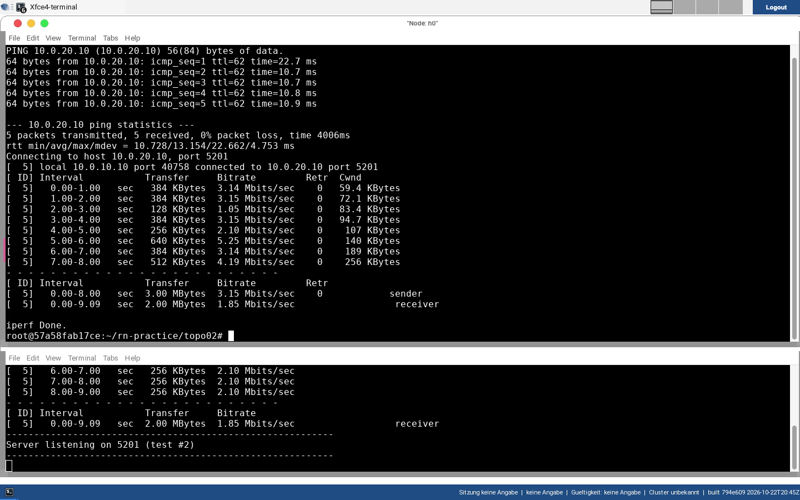

# Meilenstein 3 von 4 · Störungen erzeugen und nachmessen

*04 · TCP/UDP & Congestion Control* · [Übersicht des Blatts](index.md)

Auf dieser Seite stellt ihr Störungen selbst her und vergleicht Soll mit Ist.

<div class="schichtenbild" style="max-width:20rem;margin:0 0 1.2em 0;font-size:.72rem;line-height:1.5">
<div style="margin-bottom:.3em;color:#757575">In diesen Schichten des TCP/IP-Modells bewegt ihr euch hier:</div>
<div style="display:grid;gap:3px">
<div style="padding:.2em .7em;border-radius:3px;color:#9e9e9e;border:1px dashed #9e9e9e">Anwendungsschicht</div>
<div style="padding:.2em .7em;border-radius:3px;background:#3f51b5;color:#fff;font-weight:600;border:1px solid #3f51b5">Transportschicht · Schwerpunkt</div>
<div style="padding:.2em .7em;border-radius:3px;background:#c5cae9;color:#1a237e;border:1px solid #9fa8da">Netzwerkschicht · beteiligt</div>
<div style="padding:.2em .7em;border-radius:3px;background:#c5cae9;color:#1a237e;border:1px solid #9fa8da">Netzzugriffsschicht · beteiligt</div>
</div>
</div>

### Teil D — Störungen selbst erzeugen: Verzögerung, Verlust und Bandbreite mit `tc` (`topo02`)

!!! abstract "Auf einen Blick"
    **Lernziel:** Ihr erzeugt mit `tc`/`netem` gezielt Verzögerung,
    Schwankung, Verlust und eine Bandbreitengrenze und lest an `ping` und
    `iperf` ab, welche Wirkung jede Störung hat.

    **Wozu?** Netzwerkingenieure testen Anwendungen, bevor sie ausgeliefert
    werden: Wie verhält sich die App auf einer Satellitenstrecke mit 600 ms
    oder im Mobilfunk mit 2 % Verlust? Wer die Störung selbst herstellen kann,
    kann bei einer echten Beschwerde („manchmal hängt es“) die Ursache
    am Symptom unterscheiden.

    **Vorwissen:** `ping` ([Teil A](m1-fehlerrate-mtu.md#teil-a-fehlerrate-mtu-und-ip-fragmentierung-topop04)) und `iperf` ([Teil B](m2-durchsatz-und-staukontrolle.md#teil-b-iperfiperf3-in-topo02-durchsatz-latenz-fairness-und-congestion-control)).

!!! info "Werkzeug: `tc` (traffic control) mit `netem`"
    `tc` ist das Werkzeug des Linux-Kernels, mit dem man den **ausgehenden**
    Verkehr einer Schnittstelle steuert (Schicht 2/3). Es hängt an die
    Schnittstelle eine **qdisc** (queueing discipline, eine
    Warteschlangenregel). `netem` ist die qdisc, die Verzögerung, Verlust,
    Umsortierung und eine Ratengrenze nachbildet. `tbf` ist eine qdisc, die
    nur eine Rate begrenzt. Ihr braucht:

    | Aufruf | Bedeutung |
    |---|---|
    | `tc qdisc add dev h0-eth0 root netem delay 100ms` | 100 ms Verzögerung anlegen |
    | `tc qdisc change dev h0-eth0 root netem delay 100ms 40ms` | Regel ändern: 100 ms ± 40 ms |
    | `tc qdisc show dev h0-eth0` | anzeigen, was aktiv ist |
    | `tc qdisc del dev h0-eth0 root` | wieder entfernen |
    | `tc qdisc add netem help` | alle Optionen von `netem` |

    Eine echte Ausgabe von `tc qdisc show` nach `… netem rate 2mbit delay 10ms`:

    ```text
    qdisc netem 8018: root refcnt 37 limit 1000 delay 10ms rate 2Mbit seed 2684494603225777385
    ```

    - `netem`: die Regelart. `8018:` ist ihr Name, `root` heißt: direkt an der
      Schnittstelle.
    - `limit 1000`: die Warteschlange fasst 1000 Pakete.
    - `delay 10ms rate 2Mbit`: die angelegten Eigenschaften.
    - `seed …`: Startwert der Zufallszahlen für Verlust und Schwankung, für
      euch ohne Bedeutung.

    Ohne Regel zeigt `tc qdisc show dev h0-eth0` `qdisc noqueue 0: root refcnt 2`.
    Handle (`8018:`) und `refcnt` weichen bei euch ab; das ist normal.

    Typische Fehlermeldungen: `Error: Exclusivity flag on, cannot modify.`
    heißt, dass an der Schnittstelle schon eine Regel hängt. Entfernt sie mit
    `tc qdisc del …` oder nutzt `change` statt `add`. `Error: Cannot delete
    qdisc with handle of zero.` heißt, dass nichts zu entfernen ist.

!!! warning "Nur in eurer eigenen Topologie, und hinterher aufräumen"
    `tc` verändert das Verhalten einer Schnittstelle sofort und dauerhaft, bis
    die Regel entfernt wird. Wendet es nur auf Schnittstellen innerhalb eurer
    Mininet-Topologie an (`h0-eth0` und so weiter), niemals auf `eth0` des
    Containers, sonst schneidet ihr euch von eurem eigenen Desktop ab. Entfernt
    jede Regel am Ende wieder mit `tc qdisc del dev <schnittstelle> root`.

Wechselt jetzt von `topoP04` ([Teil C](m2-durchsatz-und-staukontrolle.md#teil-c-das-tcp-congestion-window-unter-paketverlust-live-beobachten-topop04)) zu `topo02`:

!!! warning "Zuerst die laufende Topologie beenden"
    Es läuft immer nur eine Topologie. Tippt im Mininet-Fenster der bisherigen
    Topologie `mininet> exit` und wartet, bis alle „Node: …“-Fenster
    verschwunden sind. Erst dann startet ihr die neue. Zwei Topologien
    gleichzeitig vertragen sich nicht: Das Startskript räumt alles auf, was es
    findet, auch die Topologie, die noch läuft.

```bash
$ cd ~/rn-practice/topo02
$ ./start-topo02.sh
```

Die Knotenfenster liegen nach dem Start oft übereinander. Prüft vor jeder
Eingabe den Fenstertitel (`Node: h0` usw.), klickt ins Fenster und wartet kurz;
++ctrl+c++ wirkt nur im fokussierten Fenster. Näheres unter
[Fenster wiederfinden und tippen](../../reference/umgebung.md#fenster-wiederfinden-und-tippen).

**Vorgemacht: der ungestörte Zustand.** Stellt in den Terminals von `h0` und
`h2` zuerst den ungestörten Zustand fest, als Vergleichswert für alle späteren
Messungen:

```bash
h0$ ping -c 10 10.0.20.10
h2$ ping -c 10 10.0.10.10
```

Erwartet: `rtt min/avg/max` im Bereich von 0,3 bis 0,6 ms (die erste Antwort kann
einige Millisekunden dauern), 0 % Verlust.

**Aufgabe 1: Verzögerung.** Legt auf `h0` eine Verzögerung von 100 ms an und
wiederholt den Ping:

```bash
h0$ tc qdisc add dev h0-eth0 root netem delay 100ms
h0$ ping -c 10 10.0.20.10
```

Notiert die Laufzeit vorher und nachher.

??? success "Erwartung und Lösung"
    `rtt min/avg/max/mdev = 100.333/100.380/100.423/0.034 ms`. Die Laufzeit steigt um
    **etwa 100 ms und nicht um 200**, obwohl das Paket hin und zurück muss.
    Die Regel wirkt nur auf den **ausgehenden** Verkehr von `h0-eth0`:
    Die Anfrage wird verzögert, die Antwort von `h2` kommt über eine
    Schnittstelle ohne Regel zurück.

**Aufgabe 2: Schwankung.** Ersetzt die feste Verzögerung durch eine schwankende
und beobachtet die Streuung:

```bash
h0$ tc qdisc change dev h0-eth0 root netem delay 100ms 40ms
h0$ ping -c 20 10.0.20.10
```

Vergleicht `mdev` in der Zusammenfassung von `ping` mit dem Wert aus Aufgabe 1.

??? success "Erwartung und Lösung"
    `rtt min/avg/max/mdev = 69.031/102.216/132.243/21.499 ms`: Der Mittelwert
    bleibt bei etwa 100 ms, `mdev` steigt von 0,03 auf etwa 20 ms. Diese
    Schwankung heißt **Jitter** und ist der Grund, warum Sprach- und
    Videoübertragung einen Puffer braucht. Eine konstant hohe Laufzeit stört
    weniger als eine unregelmäßige.

**Aufgabe 3: Verlust, und was er mit TCP macht.** Entfernt die Verzögerung und
legt stattdessen 5 % Paketverlust an. Messt zuerst ohne Regel (Erwartung etwa
9,5 Mbit/s) und danach mit Regel, jeweils mit `iperf` wie in [Teil B](m2-durchsatz-und-staukontrolle.md#teil-b-iperfiperf3-in-topo02-durchsatz-latenz-fairness-und-congestion-control). Beendet
vorher einen noch laufenden `iperf`- oder `iperf3`-Server im Fenster `Node: h2`
(++ctrl+c++), damit ihr ihn frisch starten könnt. Die Endzeile von `iperf` kann
länger als `-t` sein (etwa 20 bis 23 Sekunden bei `-t 20`), denn der Client
wartet auf die Bestätigung aller Daten:

```bash
h0$ tc qdisc del dev h0-eth0 root
h2$ iperf -s
h0$ iperf -c 10.0.20.10 -t 20            # ohne Regel
h0$ tc qdisc add dev h0-eth0 root netem loss 5%
h0$ iperf -c 10.0.20.10 -t 20            # mit 5 % Verlust
```

**Bildet vor der Messung eine Erwartung:** Um wie viel bricht der Durchsatz bei
5 % Verlust ein: um 5 %, um deutlich mehr oder kaum? Messt und vergleicht mit
[Teil C](m2-durchsatz-und-staukontrolle.md#teil-c-das-tcp-congestion-window-unter-paketverlust-live-beobachten-topop04) (dort habt ihr den TCP-Durchsatz
auf `topoP04` gemessen; zieht euren eigenen Wert heran). Erklärt, warum der Einbruch hier anders ausfällt als auf `topoP04`
(Hinweise: In welche Richtung wirkt der Verlust hier, in welche dort? Wie
groß ist die RTT?).

??? success "Erwartung und Lösung"
    Ohne Regel etwa 9,6 Mbit/s, mit 5 % Verlust **8,8 bis 9,3 Mbit/s**:
    Der Durchsatz sinkt um weniger als 10 %. Auf `topoP04` sind es rund 99 %
    Einbruch. Dort wirkt der Verlust auf vier Teilstrecken und in beide
    Richtungen, sodass auch Bestätigungen verloren gehen (Round-Trip-Verlust
    von etwa 34 %). Hier wirkt der Verlust nur in einer Richtung (ausgehende
    Daten von `h0`), und die Bestätigungen kommen sicher an. Die RTT beträgt
    nur etwa 0,3 ms. TCP erkennt den Verlust an doppelten Bestätigungen (Fast Retransmit) und
    wiederholt das Segment sofort, ohne auf den Timeout zu warten. Wegen der
    kurzen RTT geht das so schnell, dass kaum Durchsatz verloren geht.
    Auf `topoP04` läuft dagegen immer wieder der Timeout ab, und der
    verdoppelt sich bei jedem Fehlversuch.

**Aufgabe 4: Bandbreite.** Entfernt die Verlustregel und begrenzt stattdessen
die Rate:

```bash
h0$ tc qdisc del dev h0-eth0 root
h0$ tc qdisc add dev h0-eth0 root tbf rate 1mbit burst 32kbit latency 400ms
h0$ iperf -c 10.0.20.10 -t 10
```

Vergleicht den gemessenen Durchsatz mit den eingestellten 1 Mbit/s. (`tc qdisc
show` zeigt `burst 4Kb` statt `32kbit`: Es sind dieselben 4 KByte. Die
iperf-Endzeile kann auch hier länger als 10 Sekunden dauern.) **Warum
liegt der gemessene Wert darunter und nicht exakt darauf?** Denkt an das, was
außer den Nutzdaten noch über die Leitung geht.

??? success "Erwartung und Lösung"
    Gemessen etwa 0,96 Mbit/s, also rund 4 % unter dem Soll. Die Rate von
    `tbf` bezieht sich auf alle Bytes inklusive Ethernet-, IP- und TCP-Kopf.
    `iperf` zählt nur die Nutzdaten.

Räumt zum Schluss auf und prüft, dass keine Regel mehr aktiv ist:

```bash
h0$ tc qdisc del dev h0-eth0 root
h0$ tc qdisc show dev h0-eth0
```

Die Ausgabe beginnt mit `qdisc noqueue 0: root` (dahinter steht meist noch
`refcnt 2`).

!!! info "Hintergrund: wofür netem gedacht ist"
    `netem` ist Teil des Linux-Kernels und dient dazu, Protokollimplementierungen
    unter Bedingungen zu testen, die im Labor sonst nicht vorkommen:
    Satellitenstrecken mit 600 ms Laufzeit, Mobilfunk mit schwankender Rate,
    Funkzellen mit Paketverlust. Eine Anwendung, die „manchmal hängt“,
    verhält sich unter 200 ms Verzögerung anders als unter 2 % Verlust; wer
    beides selbst hergestellt hat, kann die Fälle am Symptom unterscheiden.

!!! question "Nachgedacht: Warum trifft Verlust TCP härter als UDP?"
    In Aufgabe 3 habt ihr TCP unter Verlust gemessen. Überlegt, wie dieselbe
    Messung mit `iperf -u` (UDP) ausgehen würde, und begründet es mit dem
    Unterschied zwischen einem Protokoll, das verlorene Pakete erneut sendet
    und sein Tempo drosselt, und einem, das beides nicht tut. Wer mag, misst
    es nach, die UDP-Variante steht in [Teil A](m1-fehlerrate-mtu.md#teil-a-fehlerrate-mtu-und-ip-fragmentierung-topop04).

    ??? success "Lösung"
        UDP sendet mit gleicher Rate weiter, Verlust verringert nur die Menge
        der angekommenen Daten um den Verlustanteil (5 % Verlust: 5 % weniger).
        TCP wiederholt jedes verlorene Segment und verkleinert bei Verlust
        sein Fenster. Je länger die Umlaufzeit und je mehr Verlust, desto
        stärker wirkt das. Bei 5 % und 0,3 ms RTT bleibt der Schaden klein
        (Aufgabe 3), bei 10 % auf vier Teilstrecken ([Teil C](m2-durchsatz-und-staukontrolle.md#teil-c-das-tcp-congestion-window-unter-paketverlust-live-beobachten-topop04)) bricht TCP ein.

### Teil E — Soll gegen Ist: was die Emulation liefert (`topo02`)

!!! abstract "Auf einen Blick"
    **Lernziel:** Ihr lest eine zugesicherte Netzeigenschaft (Bandbreite,
    Verzögerung) aus der Konfiguration, messt sie nach, rechnet die Abweichung
    in Prozent aus und begründet sie.

    **Wozu?** „Der Anschluss hat 100 Mbit/s“ steht im Vertrag, gilt aber
    erst, wenn jemand 100 Mbit/s gemessen hat. Wer als Admin einem Provider
    oder Kollegen eine Zusicherung überprüfen muss, braucht genau diese
    Rechnung und die Kenntnis, an welcher Stelle gemessen wird.

    **Vorwissen:** `iperf3` ([Teil B](m2-durchsatz-und-staukontrolle.md#teil-b-iperfiperf3-in-topo02-durchsatz-latenz-fairness-und-congestion-control), Schritt 7), `tc`/`netem` (Teil D).

In `topo02` stehen eine Bandbreite und eine Verzögerung im Topologie-Skript.
Eine Zahl in einer Konfigurationsdatei ist eine Absicht, keine Messung.

#### Schritt 1: Das Soll aus dem Skript lesen, nicht aus dem Blatt

Sucht die Stelle in `~/rn-practice/topo02/topo02.py`, an der die Verbindung
zwischen den beiden Routern angelegt wird:

```bash
$ grep -n "TCLink" ~/rn-practice/topo02/topo02.py
```

Ihr seht drei Treffer (der Befehl läuft auch in einem Knotenfenster, das
Heimatverzeichnis ist gemeinsam): der erste ist der Import, der dritte die
Netz-Definition mit `link=TCLink`; die Zeile mit `bw=10, delay='0.1ms'` legt die
Verbindung an. Nur diese Verbindung
(zwischen `r1` und `r2`) trägt eine Begrenzung. Alle anderen Verbindungen
sind unbegrenzt.

**Haltet fest, bevor ihr weiterliest:** Wenn nur *ein* Abschnitt des Weges
begrenzt ist, welcher Wert bestimmt dann den Durchsatz von `h0` nach `h2`? Und
was folgt daraus für die Frage, wo man in einem echten Netz messen muss, um eine
Zusicherung zu überprüfen?

??? success "Lösung"
    Der engste Abschnitt (Flaschenhals) bestimmt den Durchsatz: 10 Mbit/s. In
    einem echten Netz muss man **über den ganzen Weg** messen, nicht nur
    an einer Teilstrecke, und der Wert gilt für den schwächsten Abschnitt.

Kontrolliert das Soll anschließend dort, wo es wirkt, im Kernel des Routers
(im Fenster `Node: r1`; alternativ in der Mininet-Konsole mit vorangestelltem
Knotennamen, z. B. `mininet> r1 tc qdisc show dev r1-eth2`):

```bash
r1$ tc qdisc show dev r1-eth2
r1$ tc class show dev r1-eth2
```

Echte Ausgabe:

```text
qdisc htb 5: root refcnt 37 r2q 10 default 0x1 direct_packets_stat 0 direct_qlen 1000
qdisc netem 10: parent 5:1 limit 1000 delay 100us seed 12338251074618626670
class htb 5:1 root leaf 10: prio 0 rate 10Mbit ceil 10Mbit burst 15Kb cburst 1600b
```

`htb` ist die Regel, mit der Mininet die Rate durchsetzt (`rate 10Mbit ceil
10Mbit`). Darunter hängt `netem` mit `delay 100us` (0,1 ms). Damit habt ihr das
Soll am Gerät gelesen, wie es bei einer echten Störungsmeldung als Erstes zu tun
ist.

#### Schritt 2: Drei Konfigurationen messen

Für jede der drei Konfigurationen messt ihr **zwei** Größen: die Laufzeit mit
`ping` und den Durchsatz mit `iperf3`. Ein noch laufender `iperf`-Server (Version 2, Port 5001) stört nicht, denn
`iperf3` nutzt Port 5201. Beendet nur einen noch laufenden `iperf3`-Server im
Fenster `Node: h2` (++ctrl+c++) und startet dort den Server (meldet er `Address
already in use`, läuft schon einer: lasst ihn laufen):

```bash
h2$ iperf3 -s
```

Das Messpaar, das ihr dreimal wiederholt:

```bash
h0$ ping -c 10 10.0.20.10
h0$ iperf3 -c 10.0.20.10 -t 8 -f m
```

**Konfiguration 1** ist die unveränderte Topologie, Soll 10 Mbit/s und 0,1 ms
je Richtung. Messt sie zuerst, sie ist euer Bezugspunkt.

**Konfiguration 2 und 3** legt ihr selbst an. Anders als in Teil D nutzt ihr
dabei eine einzige `netem`-Regel für beide Eigenschaften gleichzeitig:

```bash
h0$ tc qdisc add dev h0-eth0 root netem rate 2mbit delay 10ms
h0$ tc qdisc show dev h0-eth0
```

…messen, dann die Regel austauschen:

```bash
h0$ tc qdisc del dev h0-eth0 root
h0$ tc qdisc add dev h0-eth0 root netem rate 5mbit delay 50ms
```

!!! note "Warum die Regel auf `h0-eth0` gehört und nicht auf `r1-eth2`"
    `h0-eth0` trägt im Ausgangszustand `qdisc noqueue`, dort ist also nichts,
    was eure Regel verdrängen könnte. Auf `r1-eth2` sitzt dagegen bereits die
    `htb`-Regel, mit der Mininet die 10 Mbit/s durchsetzt. Ein
    `tc qdisc add … root` auf dieser Schnittstelle würde sie ersetzen und
    damit genau das Soll verändern, das ihr nachprüfen wollt.

Echte Ausgabe von Konfiguration 2 (`h0`):


*Konfiguration 2 (`netem rate 2mbit delay 10ms`). `ping` zeigt etwa 10,7 ms
(die erste Antwort dauert länger). `iperf3` meldet am Ende zwei Zahlen:
`sender` 3,15 Mbit/s und `receiver` 1,85 Mbit/s.*

Räumt am Ende auf, wie in Teil D gelernt:

```bash
h0$ tc qdisc del dev h0-eth0 root
h0$ tc qdisc show dev h0-eth0
```

#### Schritt 3: Die Abweichung ausrechnen und begründen

Legt eure Messwerte in einer Tabelle ab und **rechnet die Abweichung in Prozent
selbst aus**, für jede Konfiguration (als Ist-Rate nehmt ihr die
`receiver`-Zeile):

```text
Abweichung in Prozent = (Ist - Soll) / Soll * 100
```

| Konfiguration | Soll Rate | Ist Rate | Abw. % | Soll RTT | Ist RTT | Abw. % |
|---|---|---|---|---|---|---|
| 1 – unverändert | 10 Mbit/s | ? | ? | ? | ? | ? |
| 2 – `rate 2mbit delay 10ms` | 2 Mbit/s | ? | ? | ? | ? | ? |
| 3 – `rate 5mbit delay 50ms` | 5 Mbit/s | ? | ? | ? | ? | ? |

Die Spalte „Soll RTT“ müsst ihr selbst herleiten. Der Hinweis steckt in
Teil D, Aufgabe 1 – eine `netem`-Regel wirkt nur auf den ausgehenden Verkehr
**einer** Schnittstelle. Die Grundverzögerung des Routerlinks (zweimal 0,1 ms)
liegt außerdem immer auf dem Weg.

Sichert die fertige Tabelle als Datei (in einem normalen Terminal des Desktops,
nicht im Knoten-Terminal; ++ctrl+shift+n++ im Mininet-Fenster öffnet eines):

```bash
$ mkdir -p ~/rn-practice/snapshots
$ mousepad ~/rn-practice/snapshots/04-teile-sollist.txt &
```

Das Fenster ist leer: Schreibt eure Tabelle hinein und speichert mit
++ctrl+s++. Ohne Speichern bleibt die Datei leer.

??? success "Beispielwerte aus einem Lauf"
    | Konfiguration | Soll Rate | Ist Rate (receiver) | Abw. % | Soll RTT | Ist RTT (Mittel) | Abw. % |
    |---|---|---|---|---|---|---|
    | 1 | 10 Mbit/s | 9,51 Mbit/s | −4,9 % | 0,2 ms | 0,61 ms | +205 % |
    | 2 | 2 Mbit/s | 1,85 Mbit/s | −7,5 % | 10,2 ms | 10,7 ms (Mittel ab der 2. Antwort; die erste Antwort braucht wegen ARP länger) | +5 % |
    | 3 | 5 Mbit/s | 4,62 Mbit/s | −7,6 % | 50,2 ms | 50,5 ms | +1 % |

    Das Soll der RTT bei Konfiguration 1 ist `2 · 0,1 ms` (eine Richtung je
    Router-Schnittstelle), bei 2 und 3 der `netem`-Wert auf dem Hinweg plus
    dieselben 0,2 ms Grundverzögerung des Routerlinks (10,2 bzw. 50,2 ms). Die große prozentuale Abweichung bei
    Konfiguration 1 entsteht, weil die Verarbeitung in Kernel und Switches
    einige Zehntel Millisekunden kostet, die bei 0,2 ms Soll stark ins
    Gewicht fallen. Die Werte schwanken von Lauf zu Lauf um einige Prozent.

**Fragen zur Abweichung:**

1. **Der Ist-Wert liegt immer unter dem Soll-Wert, nie darüber.** Begründet,
    warum das so sein *muss* und nicht Zufall ist. Denkt an alles, was außer
    euren Nutzdaten noch durch dieselbe Leitung passt: Ethernet-Rahmenkopf,
    IP-Kopf, TCP-Kopf, Bestätigungen in der Gegenrichtung.
2. **`iperf3` nennt zwei Zahlen: `sender` und `receiver`.** Sie sind nicht
    gleich. Welche der beiden beantwortet „wie viel kam an?“, und was misst
    die andere?
3. **Die prozentuale Abweichung der RTT ist bei Konfiguration 1 am größten,
    obwohl der absolute Fehler überall nur Bruchteile einer Millisekunde bis
    wenige Millisekunden beträgt.** Rechnet die absolute Abweichung (Ist minus
    Soll) für alle drei Zeilen aus und erklärt den Unterschied.

??? success "Lösungen"
    1. Die Nennrate gilt für alle Bytes auf der Leitung. Ihr messt nur die
       Nutzdaten, also bleibt immer etwas für die Köpfe und Bestätigungen
       übrig (hier rund 5 bis 8 %).
    2. `receiver` beantwortet „wie viel kam an?“. `sender` zählt, was der
       Sender in seinen Sendepuffer geschrieben hat. Das kann über dem Soll
       liegen (13,0 Mbit/s bei 10 Mbit/s Soll), weil Puffer die Differenz
       aufnehmen.
    3. Die absolute Abweichung beträgt in den Beispielwerten +0,4 ms, +0,5 ms
       und +0,3 ms; in weiteren Läufen lag sie zwischen +0,1 und +0,6 ms. Sie
       bleibt also in der Größenordnung einiger Zehntel Millisekunden und
       wächst nicht im Verhältnis zum Soll, ist aber auch nicht konstant:
       Verarbeitung in Kernel und Switch kostet immer einige Zehntel
       Millisekunden; bei `rate 2mbit` fiel sie am größten aus, denn dort kommt
       dazu, dass das Senden eines 98-Byte-Pakets selbst 0,4 ms dauert, und die
       erste Antwort (Adressauflösung per ARP) kann den Mittelwert nach oben
       ziehen (lasst sie notfalls weg: `ping -c 11` und ab `icmp_seq=2` lesen).
       Dieselbe kleine absolute Abweichung ist bei einem Soll von 0,2 ms ein
       großer Anteil (+205 %), bei 50 ms ein kleiner (+1 %).

!!! question "Nachgedacht: Was hätte euch eine Einzelmessung verschwiegen?"
    Ihr habt drei Konfigurationen gemessen, nicht eine. Überlegt, welche der
    drei Erkenntnisse oben ihr mit nur einer Messung **nicht** hättet gewinnen
    können.

    ??? success "Lösung"
        Das Verhältnis von Abweichung zu Sollwert (Frage 3) und dass der
        Ist-Wert *immer* unter dem Soll liegt (Frage 1) sind erst über eine
        Reihe erkennbar. Das ist der Grund, warum in der Messtechnik eine Reihe
        gebildet wird und kein Einzelwert: Ein einzelner Wert lässt sich immer
        erklären, ein Verlauf nicht.

### Teil F — Round-Trip-Verlust je Sonde zählen mit `nping` (`topoP04`)

!!! abstract "Auf einen Blick"
    **Lernziel:** Ihr messt den Verlust einer Strecke Sonde für Sonde und
    unterscheidet Round-Trip-Verlust von Verlust auf einer einzelnen
    Teilstrecke.

    **Wozu?** Wer eine Firewall-Regel oder eine Funkstrecke prüft, braucht ein
    Werkzeug, das jedes gesendete Paket einzeln protokolliert. So sieht man,
    *welche* Sonden verloren gingen, nicht nur die Prozentzahl. Dasselbe
    Werkzeug erzeugt auch gezielt gebaute Pakete (TCP-Flags, ICMP,
    ARP) für Sicherheitstests.

    **Vorwissen:** Verlustrechnung aus [Teil A](m1-fehlerrate-mtu.md#teil-a-fehlerrate-mtu-und-ip-fragmentierung-topop04).

!!! info "Werkzeug: `nping`"
    `nping` (Teil der Nmap-Sammlung) ist ein Paketgenerator und -zähler
    (Schicht 3/4). Anders als `ping` zeigt es je Sonde eine `SENT`- und, bei
    Antwort, eine `RCVD`-Zeile und rechnet am Ende die Verluste aus. Ihr
    braucht:

    | Aufruf | Bedeutung |
    |---|---|
    | `nping --icmp <ziel>` | ICMP-Echo-Sonden senden |
    | `-c 20` | genau 20 Sonden senden |
    | `--delay 100ms` | 100 ms Pause zwischen den Sonden |

    Die letzten drei Zeilen einer echten Ausgabe:

    ```text
    Max rtt: 0.091ms | Min rtt: 0.030ms | Avg rtt: 0.040ms
    Raw packets sent: 20 (560B) | Rcvd: 12 (336B) | Lost: 8 (40.00%)
    Nping done: 1 IP address pinged in 1.94 seconds
    ```

    - `Raw packets sent: 20 (560B)`: 20 Sonden mit zusammen 560 Byte.
    - `Rcvd: 12`: zu 12 Sonden kam eine Antwort zurück.
    - `Lost: 8 (40.00%)`: 8 Sonden blieben ohne Antwort. Das ist der
      **Round-Trip-Verlust**.

    **Was es misst:** wie viele der von euch erzeugten Pakete eine Antwort
    bekommen haben. **Was es nicht misst:** wo auf dem Pfad ein Paket verloren
    ging. Ein fehlendes `RCVD` sagt nur „keine Antwort gesehen“, nicht „auf
    dem Hinweg verloren“.

Für diesen Teil wechselt ihr von `topo02` (Teil E) zu `topoP04`:

!!! warning "Zuerst die laufende Topologie beenden"
    Es läuft immer nur eine Topologie. Tippt im Mininet-Fenster der bisherigen
    Topologie `mininet> exit` und wartet, bis alle „Node: …“-Fenster
    verschwunden sind. Erst dann startet ihr die neue. Zwei Topologien
    gleichzeitig vertragen sich nicht: Das Startskript räumt alles auf, was es
    findet, auch die Topologie, die noch läuft.

```bash
$ cd ~/rn-practice/topoP04
$ ./start-topoP04.sh
```

**Vorgemacht.** Zählt auf `h2` 20 Sonden zu `h1` und lest die letzten drei
Zeilen:

```bash
h2$ nping --icmp -c 20 --delay 100ms 10.0.0.1
```

**Selbst.** Wiederholt den Lauf zwei- bis dreimal. Die Prozentzahl schwankt,
weil 20 Sonden eine kleine Stichprobe sind. In der Langausgabe kann die
`SENT`-Zeile einer Sonde doppelt erscheinen (meist bei der letzten); maßgeblich
ist die Zusammenfassung mit `Raw packets sent: 20`. Haltet sie gegen den
Erwartungswert `1 − 0,9⁴ ≈ 34 %` aus [Teil A](m1-fehlerrate-mtu.md#teil-a-fehlerrate-mtu-und-ip-fragmentierung-topop04).

??? success "Erwartung und Lösung"
    Gemessen in vier Läufen: 25 %, 40 %, 25 % und 30 %; in weiteren Läufen
    20 bis 45 %. Üblich sind 15 bis 55 %, Erwartungswert 34 %, deutlich über den 10 % einer
    *einzelnen* Teilstrecke, weil Anfrage und Antwort zusammen vier
    Teilstrecken queren.

!!! quote "Hintergrund: hping und der Idle-Scan"
    `nping` ist die Nmap-eigene Antwort auf `hping`, das Salvatore Sanfilippo
    (*antirez*) schrieb, der später auch Redis entwickelte. Auf
    Bugtraq beschrieb er am 18. Dezember 1998 „mit hping“ einen Portscan, „so
    scanned hosts can't see your real address“; Nmap setzt ihn heute als
    Idle-Scan (`-sI`) um.

    - Bugtraq, 18.12.1998: <https://seclists.org/bugtraq/1998/Dec/79>
    - Nmap-Buch, Idle Scan: <https://nmap.org/book/idlescan.html>

### Teil G — Das Sendefenster unter Verlust im Detail lesen: `ss -ti` (`topo02`)

!!! abstract "Auf einen Blick"
    **Lernziel:** Ihr erzeugt selbst Paketverlust mit `tc` und lest an `ss -ti`
    ab, wie `cwnd`, `retrans` und der Retransmission-Timeout darauf
    reagieren.

    **Wozu?** Wenn ein Server „manchmal langsam“ antwortet, entscheidet `ss -ti`
    zwischen Netzproblem (viele `retrans`, kleines `cwnd`) und
    Serverproblem (keine Auffälligkeit auf der Leitung). Der Befehl ist
    Standardwerkzeug jeder Netzwerk-Fehlersuche.

    **Vorwissen:** `ss -ti` aus [Teil C](m2-durchsatz-und-staukontrolle.md#teil-c-das-tcp-congestion-window-unter-paketverlust-live-beobachten-topop04), `tc netem loss` aus Teil D,
    `iperf3` aus [Teil B](m2-durchsatz-und-staukontrolle.md#teil-b-iperfiperf3-in-topo02-durchsatz-latenz-fairness-und-congestion-control).

[Teil C](m2-durchsatz-und-staukontrolle.md#teil-c-das-tcp-congestion-window-unter-paketverlust-live-beobachten-topop04) hat `cwnd` auf der fest eingestellten 10-%-Strecke von `topoP04`
beobachtet. In diesem Teil erzeugt ihr den Verlust selbst auf dem
verlustfreien `topo02`-Link. Die Beschreibung von `ss -ti` steht in [Teil C](m2-durchsatz-und-staukontrolle.md#teil-c-das-tcp-congestion-window-unter-paketverlust-live-beobachten-topop04).

!!! note "`iperf3` und `topoP04`"
    `iperf3` hält neben dem Messstrom eine TCP-Steuerverbindung. Deshalb
    messt ihr mit `iperf3` in `topo02` und erzeugt Verlust dort gezielt mit
    `tc`. Auf `topoP04` bleibt es bei `iperf` (Version 2).

Für diesen Teil wechselt ihr von `topoP04` (Teil F) zu `topo02`:

!!! warning "Zuerst die laufende Topologie beenden"
    Es läuft immer nur eine Topologie. Tippt im Mininet-Fenster der bisherigen
    Topologie `mininet> exit` und wartet, bis alle „Node: …“-Fenster
    verschwunden sind. Erst dann startet ihr die neue. Zwei Topologien
    gleichzeitig vertragen sich nicht: Das Startskript räumt alles auf, was es
    findet, auch die Topologie, die noch läuft.

```bash
$ cd ~/rn-practice/topo02
$ ./start-topo02.sh
```

**Vorgemacht.** `topo02` läuft (`h0` = `10.0.10.10`, `h2` = `10.0.20.10`):

```bash
h0$ tc qdisc add dev h0-eth0 root netem loss 8%
h2$ iperf3 -s
h0$ iperf3 -c 10.0.20.10 -t 8 &          # Transfer im Hintergrund
h0$ sleep 2; ss -ti dst 10.0.20.10       # jetzt etwa alle 3 Sekunden wiederholen (Pfeil hoch, Enter)
```

Die Ausgabe von `iperf3` läuft zwischen eure Eingaben; das ist normal. Mit
`ss -ti dst 10.0.20.10 | grep -A1 ESTAB` bleibt die Ausgabe übersichtlicher.

Echte Ausgabe der Messverbindung (zwei Abfragen im Abstand von etwa
3 Sekunden, gekürzt):

```text
ESTAB 0  165072  10.0.10.10:48592  10.0.20.10:5201
   cubic … rto:214 rtt:13.802/1.895 mss:1448 … cwnd:14 ssthresh:10 … retrans:0/159 …
ESTAB 0  141904  10.0.10.10:48592  10.0.20.10:5201
   cubic … rto:207 rtt:6.819/10.32 mss:1448 … cwnd:2 ssthresh:2 … retrans:0/299 …
```

Beachtet: `cwnd` ist 14, dann 2; die Gesamtzahl hinter `retrans:` steigt von 159
auf 299. Dazu steht in der Liste die Steuerverbindung von `iperf3`: kaum
Daten, `cwnd:10`.

Am Ende des Laufs meldet `iperf3` im Beispiel `Retr 340` und 5,9 Mbit/s; in
anderen Läufen lag der Wert bei etwa 4 bis 7 Mbit/s. Räumt auf:

```bash
h0$ tc qdisc del dev h0-eth0 root
```

**Selbst.** Wiederholt den Transfer ohne Verlustregel und lest `cwnd` der
Messverbindung ab (nicht der Steuerverbindung: Die Messverbindung erkennt ihr an
der großen `Send-Q`).

??? success "Erwartung und Lösung"
    Mit 8 % Verlust liegt `cwnd` der Messverbindung zwischen 2 und etwa 15 und
    springt von Abfrage zu Abfrage. `retrans:` zählt mit jeder Abfrage höher. Der
    Durchsatz sinkt von 9,6 auf etwa 4 bis 7 Mbit/s. Ohne Verlustregel wächst
    `cwnd` derselben Verbindung auf viele hundert bis rund tausend Segmente (981
    im Beispiellauf, in anderen Läufen etwa 1000 bis 1150; `retrans` bleibt
    aus). Die RTT steigt dabei auf über eine Sekunde, weil das
    Fenster die Warteschlange vor dem Link füllt ([Teil I](m4-udp-bufferbloat-algorithmen.md#teil-i-bufferbloat-warum-eine-schnelle-leitung-trage-werden-kann-topo02)).

!!! question "Nachgedacht: Warum bleibt `cwnd` klein, obwohl der Link nicht überlastet ist?"
    ??? success "Lösung"
        TCP kann Verlust durch Überlast und Verlust durch einen
        fehlerbehafteten Link nicht unterscheiden. In beiden Fällen
        verkleinert es das Fenster. Ein kleines `cwnd` ist also die
        *Reaktion* auf den Verlust, nicht die Ursache der Störung.

!!! quote "Hintergrund: der erste Congestion Collapse, 1986"
    Dass ein volles Netz langsamer wird, statt nur „voll“ zu sein, zeigte sich
    im Oktober 1986: Damals brach der Durchsatz
    zwischen dem Lawrence Berkeley Laboratory und der UC Berkeley – 400 Yards
    und zwei IMP-Hops voneinander entfernt – von 32 kbit/s auf **40 bit/s** ein,
    also um den Faktor tausend. Van Jacobson und Michael J. Karels untersuchten
    das und stellten auf der SIGCOMM ’88 „Congestion Avoidance and Control“ vor,
    mit *Slow Start* als einem von sieben neuen Algorithmen im 4BSD-TCP. Genau
    dieses Slow Start seht ihr oben zusammenbrechen und wieder anlaufen.

    - Jacobson, „Congestion Avoidance and Control“, LBL: <https://ee.lbl.gov/papers/congavoid.pdf>
    - Nachdruck in ACM SIGCOMM CCR 1995: <http://ccr.sigcomm.org/archive/1995/jan95/ccr-9501-jacobson.pdf>

    Die formale Beschreibung von Slow Start und Congestion Avoidance steht
    in **RFC 5681, Abschnitt 3.1**; die Reaktion auf drei doppelte
    Bestätigungen (Fast Retransmit) in **Abschnitt 3.2**.

!!! success "Meilenstein 3 geschafft"
    **Das habt ihr gelernt:**

    - Mit tc/netem Verzögerung, Schwankung, Verlust und eine Bandbreitengrenze erzeugen und die Wirkung an ping und iperf ablesen.
    - Eine eingestellte Eigenschaft nachmessen und die Abweichung in Prozent angeben und begründen.
    - Round-Trip-Verlust je Sonde mit nping zählen.
    - Mit ss -ti beobachten, wie cwnd, retrans und Retransmission-Timeout auf Verlust reagieren.

    **Was Meilenstein 4 verspricht:** Als Nächstes geht es um UDP-Qualität (Jitter, Verlust), um Bufferbloat durch zu lange Warteschlangen und um den Vergleich zweier Staukontroll-Algorithmen.

    [Weiter zu Meilenstein 4: UDP, Bufferbloat und Algorithmenvergleich](m4-udp-bufferbloat-algorithmen.md){ .md-button }
