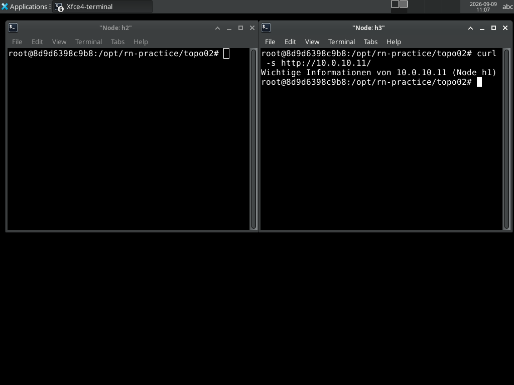
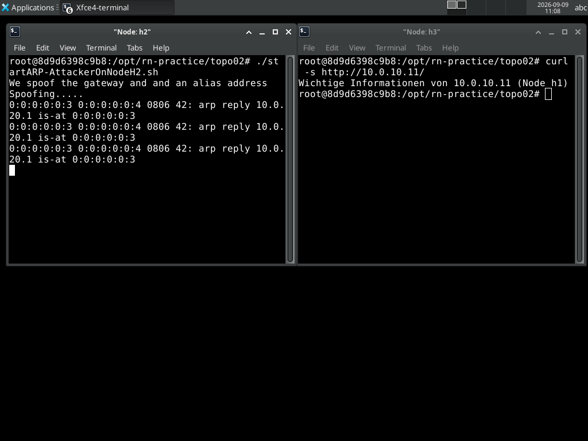

# Meilenstein 1 von 3 · ARP-Spoofing als Angreifer

*05 · ARP-Spoofing & Denial-of-Service* · [Übersicht des Blatts](index.md)

Auf dieser Seite seht ihr, wie sich ARP ohne Authentifizierung ausnutzen lässt, um den Verkehr eines Hosts im selben Segment umzuleiten.

<div class="schichtenbild" style="max-width:20rem;margin:0 0 1.2em 0;font-size:.72rem;line-height:1.5">
<div style="margin-bottom:.3em;color:#757575">In diesen Schichten des TCP/IP-Modells bewegt ihr euch hier:</div>
<div style="display:grid;gap:3px">
<div style="padding:.2em .7em;border-radius:3px;background:#c5cae9;color:#1a237e;border:1px solid #9fa8da">Anwendungsschicht · beteiligt</div>
<div style="padding:.2em .7em;border-radius:3px;color:#9e9e9e;border:1px dashed #9e9e9e">Transportschicht</div>
<div style="padding:.2em .7em;border-radius:3px;background:#c5cae9;color:#1a237e;border:1px solid #9fa8da">Netzwerkschicht · beteiligt</div>
<div style="padding:.2em .7em;border-radius:3px;background:#3f51b5;color:#fff;font-weight:600;border:1px solid #3f51b5">Verbindungsschicht · Schwerpunkt</div>
</div>
</div>

### Teil A — ARP-Spoofing als Aufwärmübung (Zwei-Netz-Routing-Topologie)

!!! abstract "Auf einen Blick"
    - **Lernziel** – Ihr könnt mit gefälschten, unaufgeforderten ARP-Replies
      den ARP-Cache eines Hosts vergiften und dadurch dessen Verkehr auf
      einen anderen Host im selben Segment umleiten.
    - **Wozu?** – Das ist der einfachste Fall von Man-in-the-Middle in
      lokalen Netzen, z. B. in einem offenen WLAN oder einem Firmennetz ohne
      Portsicherheit. Pentester nutzen genau diesen Mechanismus, um sich
      unbemerkt zwischen zwei Gegenstellen zu schalten; Administrator:innen
      müssen das Muster kennen, um es im eigenen Netz zu erkennen und
      abzustellen (siehe [Teil D](m3-verteidigen.md#teil-d-selbst-zum-verteidiger-werden-arp-spoofing-als-opfer-erkennen-topo02) und [Teil G](m3-verteidigen.md#teil-g-der-feste-arp-eintrag-als-gemessene-gegenmanahme-topo02)).
    - **Vorwissen** – ARP-Grundlagen und `ip neigh` aus
      [Lab 02](../02-subnetting-arp/index.md), die Zwei-Netz-Topologie mit Router aus
      [Lab 03](../03-routing-rip-bgp/index.md).

!!! info "Werkzeug: `arpspoof`"
    Teil des `dsniff`-Pakets. Es verschickt wiederholt gefälschte,
    unaufgeforderte ARP-Replies und arbeitet auf der Sicherungsschicht
    (Schicht 2) – es bringt den Zielrechner dazu, eine IP-Adresse der
    MAC-Adresse des Angreifers statt der echten Gegenstelle zuzuordnen.

    Aufruf-Muster: `arpspoof -i <interface> -t <ziel-ip> <vorgetäuschte-ip>`

    - `-i <interface>` – über welche eigene Netzwerkkarte die gefälschten
      Antworten gesendet werden (z. B. `h2-eth0`).
    - `-t <ziel-ip>` – wessen ARP-Cache vergiftet werden soll (ohne `-t`:
      das ganze Segment).
    - `<vorgetäuschte-ip>` – die Adresse, die scheinbar zur MAC-Adresse des
      Angreifers gehört (hier meist das Gateway).

    Echte Ausgabe aus Teil B (`topo02`, Angreifer `h2`, `arpspoof -i h2-eth0 -t 10.0.20.11 10.0.20.1`):

    ```
    0:0:0:0:0:3 0:0:0:0:0:4 0806 42: arp reply 10.0.20.1 is-at 0:0:0:0:0:3
    ```

    Gelesen: Ethernet-Quelle `0:0:0:0:0:3` (MAC von `h2`) an Ziel
    `0:0:0:0:0:4` (MAC des Opfers), Ethertype `0806` (ARP), 42 Byte lang –
    Inhalt: eine ARP-Reply, die behauptet, `10.0.20.1` (das Gateway) gehöre
    zu `0:0:0:0:0:3` (tatsächlich die MAC von `h2`). Diese eine Zeile
    wiederholt sich, solange `arpspoof` läuft.

    **Typische Fehlermeldung:** `arpspoof -i lo …` bricht mit einer
    Fehlermeldung ab – auf der Loopback-Schnittstelle gibt es kein ARP.
    Immer eine echte Schnittstelle wie `h2-eth0` angeben.

Nutzt die aus [Lab 03, Teil 1](../03-routing-rip-bgp/index.md) bekannte
Zwei-Netz-Topologie `topoP03` (`10.0.0.0/24` mit h1/h2, `20.0.0.0/24` mit
h3/h4, verbunden über den Router `r1`) mit funktionierenden Routen zwischen
beiden Netzen. Die Knoten starten dort **ohne IP-Adressen**, ihr müsst
Adressen und Routen wie in Blatt 03 selbst vergeben:

```bash
cd ~/rn-practice/topoP03
./start-topoP03.sh
```

| Knoten | Schnittstelle | Adresse | Route |
|--------|---------------|---------|-------|
| `h1` | `h1-eth0` | `10.0.0.1/24` | `20.0.0.0/24` via `10.0.0.254` |
| `h2` | `h2-eth0` | `10.0.0.2/24` | `20.0.0.0/24` via `10.0.0.254` |
| `r1` | `r1-eth0` / `r1-eth1` | `10.0.0.254/24` / `20.0.0.254/24` | – |
| `h3` | `h3-eth0` | `20.0.0.1/24` | `10.0.0.0/24` via `20.0.0.254` |
| `h4` | `h4-eth0` | `20.0.0.2/24` | `10.0.0.0/24` via `20.0.0.254` |

Prüft mit `ping -c 2 20.0.0.1` von `h1` aus, dass die Verbindung funktioniert,
bevor ihr weitermacht. Die genauen Befehle zum Vergeben der Adressen stehen
in Blatt 03, Teil 1.

**Aufgabe:** Führt von h4 einen Ping auf h1 aus. Leitet diesen Request
mittels ARP-Spoofing (`arpspoof`) auf h3 um, sodass h3 die Anfragen abfängt.
Überprüft euren Erfolg in Wireshark. Lasst h3 den abgefangenen Request —
irreführenderweise — selbst mit einer Antwort beantworten, sodass h4 einen
scheinbar erfolgreichen Ping von h1 sieht, obwohl h3 geantwortet hat.
(Hinweis zu den Adressen: `h4` liegt im Netz `20.0.0.0/24` und schickt Pakete
für `h1` an sein Gateway `r1` (`20.0.0.254`). Zum Umleiten muss `h3` deshalb
gegenüber `h4` (`20.0.0.2`) so tun, als wäre es `r1` (`20.0.0.254`).)
(Der Teil „h3 antwortet selbst“ ist eine **Vertiefung (optional)**: Das
Image bringt dafür kein fertiges Werkzeug mit. Der Kern der Aufgabe ist das
Umleiten per `arpspoof` und der Nachweis in Wireshark.)

### Teil B — ARP-Spoofing mit HTTP-Content-Swap (`topo02`)

!!! abstract "Auf einen Blick"
    - **Lernziel** – Ihr könnt zeigen, dass ARP-Spoofing nicht nur einzelne
      Pings umleitet, sondern einen kompletten Dienst (hier: HTTP) unbemerkt
      durch einen gefälschten ersetzen kann.
    - **Wozu?** – Das ist der Schritt von der Demo zum echten Schaden:
      Angreifer im selben Netzsegment – etwa im Café-WLAN oder auf einem
      kompromittierten Firmenrechner – können so Login-Seiten, Downloads
      oder Software-Updates manipulieren, ohne dass im Browser eine andere
      Adresse erscheint.
    - **Vorwissen** – Teil A (ARP-Spoofing-Mechanismus), `curl` und
      HTTP-Grundlagen aus [Lab 01](../01-netzwerkgrundlagen-tools/index.md).

Teil A hat ARP-Spoofing an einem einzelnen umgeleiteten Ping gezeigt. Jetzt
wechselt ihr zur Topologie `topo02` und einer Angriffsvariante mit echtem
Schaden: Der Angreifer tauscht nicht nur ARP-Antworten, sondern liefert dem
Opfer über einen gefälschten Webserver manipulierte Inhalte aus.

`topo02` baut eine Topologie mit zwei Routern und mehreren Hosts auf
(`h0--s1--r1---r2----s2---h3`, mit weiteren Hosts an den Switches), in der
ein regulärer Webserver und ein Angreifer im selben Segment betrieben werden.

```bash
cd ~/rn-practice/topo02
./start-topo02.sh
```

Nach dem Start öffnen sich die Terminals `r1`, `h0`, `h1`, `h2` und `h3`.
Die Rollen und Adressen:

| Knoten | Rolle | Adresse |
|--------|-------|---------|
| `h0` | Flood-Angreifer ([Teil E](m3-verteidigen.md#teil-e-syn-flood-quantitativ-den-schaden-messen-und-syn-cookies-wirken-sehen-topo02)/F) | `10.0.10.10` |
| `h1` | Webserver | `10.0.10.11` |
| `r1` | Router | `10.0.10.1` / `10.0.1.1` |
| `r2` | Gateway des Opfers | `10.0.20.1` (MAC `00:00:00:00:00:06`) |
| `h2` | ARP-Angreifer | `10.0.20.10` (MAC `00:00:00:00:00:03`) |
| `h3` | Opfer | `10.0.20.11` |

1. **Legitimen Server prüfen:** Der echte Webserver (liefert `index.html`,
    mit deaktiviertem Caching) läuft bereits automatisch auf `h1`, sobald
    `./start-topo02.sh` durchgelaufen ist. Prüft das:

    ```bash
    h1$ pgrep -f startHTTPD.py
    ```

    Ein zusätzliches manuelles `python3 startHTTPD.py` scheitert mit
    `OSError: [Errno 98] Address already in use`, weil der Port bereits
    belegt ist — der Server läuft also schon.

2. **Normalzustand prüfen:** Vom Opfer `h3` aus den Server per Browser/`curl`
    aufrufen und den unveränderten Inhalt (`index.html`) bestätigen.

    
    *Normalzustand vor dem Angriff: `h3` (Opfer) ruft den echten Webserver auf
    `h1` (`10.0.10.11`) auf und erhält den unveränderten Original-Inhalt.*

3. **Angriff starten:** Im Terminal des Angreifers `h2` das Angriffsskript
    starten (es braucht die Schnittstelle `h2-eth0` und läuft nur in `h2`):

    ```bash
    h2$ ./startARP-AttackerOnNodeH2.sh
    ```

    
    *Live-Ausgabe von `arpspoof` auf dem Angreifer-Host `h2`: fortlaufend
    gefälschte, unaufgeforderte ARP-Replies, die dem Opfer `h3` vortäuschen,
    die Gateway-Adresse `10.0.20.1` gehöre zur MAC-Adresse `0:0:0:0:0:3` von
    `h2` statt zum echten Router `r2`.*

    Das Skript tut dabei drei Dinge:

    - Es legt einen IP-Alias auf der eigenen Schnittstelle an
      (`ifconfig h2-eth0:0 10.0.10.11 up`), um eine fremde Identität im
      Netzsegment vorzutäuschen.
    - Es startet im Hintergrund `startHTTPD-Attacker.py` — einen zweiten,
      bösartigen Webserver, der anstelle von `index.html` die Datei
      `attack.html` ausliefert (ebenfalls mit deaktiviertem Caching, damit
      der Content-Swap sofort sichtbar wird und nicht durch einen
      Browser-Cache verschleiert bleibt).
    - Es startet `arpspoof -i h2-eth0 -t 10.0.20.11 10.0.20.1` — vergiftet
      damit den ARP-Cache des Ziels `10.0.20.11` mit gefälschten Antworten,
      die die Gateway-Adresse `10.0.20.1` auf die MAC-Adresse des Angreifers
      umleiten (klassisches Gateway-Impersonation-MITM).

4. **Angriff verifizieren:** Auf `h3` den Server erneut aufrufen (den
    ARP-Cache nur dann mit `clear-cache.sh` leeren, wenn ihr danach die
    Wartezeit aus Schritt 5 einhaltet) und
    beobachten, dass nun `attack.html` statt `index.html` ausgeliefert wird —
    der sichtbare Beweis für den erfolgreichen Content-Swap. Bestätigt in
    Wireshark, dass die ARP-Replies für die Gateway-Adresse von der
    MAC-Adresse des Angreifers stammen, nicht vom echten Gateway.

    
    *Erfolgreicher Content-Swap: Dieselbe Anfrage von `h3` an `10.0.10.11`
    liefert jetzt den Inhalt des Angreifer-Webservers auf `h2` statt der
    echten Antwort von `h1` (vgl. Screenshot oben vor dem Angriff) – die
    Zugriffslogs auf `h2` bestätigen, dass `10.0.20.11` (h3) tatsächlich beim
    Angreifer gelandet ist.*

5. **ARP-Cache zurücksetzen:** Für wiederholbare Demonstrationen den
    Neighbor-Cache des Knotens leeren, in dem ihr das Skript ausführt (hier
    im Terminal von `h3`; andere Knoten sind nicht betroffen):

    ```bash
    h3$ ./clear-cache.sh   # entspricht: ip -s -s neigh flush all
    ```

    !!! warning "Nach dem Leeren zuerst einen Aufruf, dann warten"
        Leert den Zwischenspeicher nicht unmittelbar vor der Probe.
        Linux legt auf eine unaufgeforderte ARP-Reply keinen neuen Eintrag
        an, es aktualisiert nur vorhandene. Direkt nach dem Leeren fragt
        euer Rechner das Gateway selbst per ARP - und der echte Router
        antwortet darauf. Ihr landet dann beim echten Server und haltet den
        Angriff faelschlich fuer gescheitert.

        Setzt deshalb erst einen Aufruf ab, wartet etwa zehn Sekunden und
        prueft mit `ip neigh show 10.0.20.1`, dass dort die MAC des
        Angreifers steht. Erst dann ist die Probe aussagekraeftig.

6. **Angriff beenden:** Mit `Strg+C` auf dem Angreifer-Terminal — das Skript
    entfernt daraufhin den IP-Alias und beendet den gefälschten Webserver
    automatisch (siehe `trap`-Behandlung im Skript).

    !!! warning "Prozesse beenden: nie `pkill` oder `killall`"
        Nie `pkill`/`killall` benutzen – die Mininet-Knoten teilen sich die
        Prozessliste mit eurem Desktop; `pkill` kann euren ganzen Desktop
        beenden und euch abmelden. Beendet Prozesse mit ++ctrl+c++ im
        eigenen Fenster oder mit `kill <PID>`. Läuft ein Programm mit `&` im
        Hintergrund, wirkt ++ctrl+c++ nicht auf es: Holt es mit `fg` in den
        Vordergrund und drückt dann ++ctrl+c++, oder beendet es mit
        `kill <PID>` (die PID zeigt `jobs -l`).

!!! example "Vertiefung (optional): Ein fester ARP-Eintrag als Gegenmaßnahme"
    ARP glaubt jeder Antwort, auch einer unaufgeforderten – daher funktioniert
    der Angriff überhaupt. Tragt auf dem angegriffenen Rechner die *richtige*
    Zuordnung fest ein, bevor ihr den Angriff erneut startet:

    ```bash
    ip neigh replace <ziel-ip> lladdr <richtige-mac> dev <interface> nud permanent
    ```

    Startet das Angriffsskript danach noch einmal und schaut mit
    `ip neigh show`, ob sich der Eintrag noch umbiegen lässt.

    Überlegt anschließend, warum diese Abhilfe trotzdem kaum jemand einsetzt:
    Wie viele Einträge wären das in einem Netz mit 500 Rechnern, und was
    passiert, wenn ein Gerät planmäßig eine neue Netzwerkkarte bekommt?
    Eine Maßnahme, die technisch wirkt, aber im Betrieb nicht durchzuhalten
    ist, ist noch keine Lösung.

!!! success "Meilenstein 1 geschafft"
    **Das habt ihr gelernt:**

    - Gefälschte, unaufgeforderte ARP-Replies vergiften den ARP-Cache eines Hosts und lenken dessen Verkehr auf einen anderen Host um.
    - Daraus ergibt sich ein Man-in-the-Middle-Szenario, in dem der Angreifer den Verkehr mitlesen oder weiterleiten kann.
    - Ein MITM-Angreifer kann einen ganzen Dienst, hier HTTP, unbemerkt durch einen gefälschten Webserver ersetzen (Content-Swap).

    **Was Meilenstein 2 verspricht:** Im nächsten Meilenstein wechselt ihr von der Sicherungsschicht zur Transportschicht: Ein SYN-Flood legt einen Server lahm, indem er den TCP-Handshake ausnutzt. Das Muster, ein Protokoll ohne Prüfung der Absender auszunutzen, kennt ihr bereits von ARP.

    [Weiter zu Meilenstein 2: SYN-Flood](m2-syn-flood.md){ .md-button }
